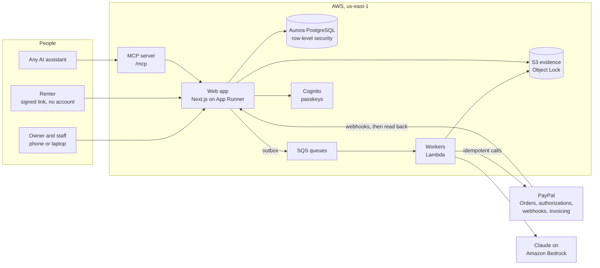

# Hold

**The deposit that never leaves your account.**

**Live demo: <https://p99faar3kp.us-east-1.awsapprunner.com>** · One tap starts a demo shop of your own. Nothing to
type, no code to wait for, and no other judge's changes in your way.

> A PayPal authorization hold *is* the deposit. The renter's money is reserved, never charged, and a clean return
> releases it on the spot. Claude compares the handover and return photographs, but plain code finds every
> difference, every amount comes from the shop's published price list, and a named person approves every charge.
> PayPal's own record, read back after every webhook, is the truth.

Built for the PayPal AI Hackathon 2026.

## For judges: five minutes

The whole money loop below runs as Jonas, at the counter, and needs **no passkey**: the shop sends claims above €150
to its owner, and Jonas approves up to €100. Keep two things to hand: the PayPal sandbox buyer login from the
submission's testing instructions, and an email address of your own.

1. Open the [live demo](https://p99faar3kp.us-east-1.awsapprunner.com/sign-in) and tap **Start a demo as Jonas, at
   the counter**. You get a Ribeira Bikes in Lisbon of your own, already busy with sample rentals marked **Sample**,
   which show the shop's day and move no money. Nobody else sees your demo, and you see nobody else's.
2. Open **Rentals**, then **New rental**. Add one **City bike**, give any name and **your own email**, and book. Tap
   **Show the link**, open it, and pay the rental fee with PayPal's own button, signed in as the sandbox buyer. Back on
   the rental, tap **Ask for the hold** and approve the €250 hold the same way. Nothing is charged by the hold.
   For a walk-in, tick **Walk-in: fee and hold in one PayPal approval** when booking: the renter then approves both at
   once, and the bike is ready to hand over.
3. Photograph the handover with **Use the sample photograph** and seal it. Start the return and photograph it with
   **Use the sample with damage**: the same frame with a chip in the paint. The real camera works on any object to hand.
4. Open the comparison. Code finds the candidate areas, Claude says what changed, then takes an independent second
   look at a wider crop. When both agree, the chip is offered as a claim line priced from the shop's list. When the
   second look is not sure, the return waits for a person: choose **Scratch on the frame, through the paint · €35.00**
   and say what you see. Tap **Prepare claim for review**, then **Approve and show renter link**.
5. Open the renter's link, as the renter would on their phone. Tap **I have reviewed this claim** and **Email me a
   verification code**: it goes to your email, because the sandbox buyer has no inbox. Accept the claim. PayPal
   captures €35 of the hold and releases the other €215, in the sandbox, and the rental shows **Settlement
   confirmed**. For a clean return, use **Use the sample photograph** at the return instead and release the hold.
6. Open the **[hosted assistant](https://p99faar3kp.us-east-1.awsapprunner.com/assistant)** in the same browser and ask
   it to rent you a bike. It rents from your own demo shop through Hold's own MCP server, the same one your own
   assistant can use, and hands you the PayPal approval link.

**As the owner.** Sign out and tap **Continue as Tomás, the owner** for the same shop. **Today** lists the claims that
need a decision, **Calendar** shows every bike as a row and every rental as a bar marked by where its PayPal hold
stands, and one sample claim is one the renter contested. Tomás's own money decisions ask for a passkey,
which **Add a passkey** sets up on your device. **Start a fresh demo** opens a new shop.

Anything simulated is labelled on screen and marked `simulated` in the record.

## What it is

Small rental shops take a cash or card deposit and refund it later. Renters hate it, foreign cards lose on the
exchange twice, and every scratch turns into an argument. Hold replaces the deposit with a PayPal hold placed at
pickup:

- **Handover.** Staff photograph the item from a guided set of angles, and the renter confirms the condition report
  on their phone.
- **Return.** The same photographs again. Code aligns each pair and finds what changed, and Claude says whether each
  change is wear or damage, with a second, independent look at every damage finding.
- **Clean return.** The hold is released at the counter. Nothing was ever charged.
- **Damage.** An itemized claim, priced only from the list the renter agreed to, goes to a person to approve. The
  renter sees every photograph and can accept or contest it. Only the approved amount is captured, and the rest is
  released at once.

Six extensions build on that: an accuracy scorecard measured on a held-out photo set, an operations agent that
prepares a morning queue a person decides, a portable Clean Record for renters who return things well, renting
through your own AI assistant over MCP, an advocate for each side of a contested claim, and an incident desk for
theft and accidents. The full description is in [`docs/project-description.md`](docs/project-description.md).

## How reliable is the comparison

Measured on the gate half of the evaluation set, which is never used for tuning. Every figure is a count. The same
figures are on the reliability page of the deployed app.

<!-- scorecard:start -->
Not measured yet: no run over the evaluation set has been accepted. Until one is, Hold claims no accuracy for the
comparison.
<!-- scorecard:end -->

## Connect your own assistant

Hold's MCP server is at **`https://p99faar3kp.us-east-1.awsapprunner.com/mcp`** (streamable HTTP, no sign-in for the
public tools). Any MCP client can find a shop, read its damage prices, get a quote and book. The person approves every
payment in PayPal. No tool takes an amount and none can capture a hold. The tools are listed in
[`docs/extensions.md`](docs/extensions.md) section 8.

## How it fits together



Every call that moves money leaves through an outbox with a `PayPal-Request-Id`, and a hold counts as placed,
captured or released only after a verified PayPal event or a direct read from PayPal. The design is in
[`docs/architecture.md`](docs/architecture.md).

## Security model

Deny by default, and every check runs on the server. In short:

- **People decide money.** No agent tier charges, no assistant's tool takes an amount, and a capture starts only from a claim a
  named person approved. Owners and managers confirm money steps with a passkey. The one amount a model proposes is an
  advocate's offer on a contested claim: code bounds it by the published prices, the approved claim and both sides'
  limits, so it can only lower a charge, and the renter confirms it with a one-time code.
- **Every shop is walled off** by PostgreSQL row-level security. A test checks that every table has a policy, and
  others that a second shop reads nothing.
- **Renters** reach their rental through a signed, expiring link bound to it, and accepting or contesting a claim
  needs a one-time code.
- **Assistants and agents** pass one gateway that checks actor, shop, tier, mandate, rate and argument shape, and
  writes an audit line. Text from renters, PayPal memos and other agents is treated as quoted data.
- **Evidence** photographs are write-once under S3 Object Lock, and the money log, approvals and audit trail are
  append-only.
- **Each demo is its own shop** with two new accounts, walled off like any other shop. Their passwords live only in
  the sealed cookie of the browser that started it. The app may create those accounts but never set a password, demo
  shops use only the PayPal sandbox, and money steps still need the judge's own passkey.

The rules every change follows are in [`AGENTS.md`](AGENTS.md), and the threats and their controls are in
[`docs/architecture.md`](docs/architecture.md) section 15.

## Tech stack

| Part | Choice |
|---|---|
| Payments | PayPal Orders v2 (authorize, capture, void, reauthorize), the PayPal JavaScript SDK v6 button on the renter's pages, webhooks with read-back (one shared webhook for every demo shop, routed by the order's `custom_id`), Invoicing v2, refunds, Disputes v1 (the shop's answer as evidence, with the rental's evidence pack attached), PayPal's MCP server read-only for the operations agent |
| AI | Claude Opus 4.6 on Amazon Bedrock for judging (designed for Opus 5.5, which the account has no quota for yet), OpenCV.js on the phone for photo quality |
| Web | Next.js, React, Tailwind CSS and shadcn/ui, in English, German, Spanish and French |
| Scheduling | Bryntum Scheduler (trial package) for the shop's calendar: items as rows, rentals as bars marked by their PayPal hold |
| Data | Aurora PostgreSQL Serverless v2 through the RDS Data API, Drizzle ORM |
| Work | SQS queues and Lambda workers, EventBridge Scheduler for hold upkeep |
| Identity | Amazon Cognito with emailed codes and passkeys |
| Infrastructure | AWS CDK, GitHub Actions deploying over OpenID Connect |
| Tests | Vitest and fast-check, Playwright end to end, a photo evaluation set |

Why each was chosen is in [`docs/tech-stack.md`](docs/tech-stack.md).

## Run it yourself

You need Node 24 and pnpm 12. The tests need no AWS account: they run against a real PostgreSQL in WebAssembly and
in-process fakes for PayPal, Cognito and email.

```sh
pnpm install
pnpm check        # lint, type-check and every unit test
pnpm test:e2e     # builds the app and runs Playwright against the fakes
```

To run the app against your own AWS services, copy `apps/web/.env.example` to `apps/web/.env.local`, fill it in, and
run `pnpm dev`. The infrastructure is in `infra/` as CDK stacks, all named `hold-*`.

**Connecting the demo to PayPal's sandbox** (administrators, once, with AWS credentials for the account):

```sh
PAYPAL_SANDBOX_CLIENT_ID=… PAYPAL_SANDBOX_CLIENT_SECRET=… AWS_PROFILE=… pnpm demo:paypal
```

It checks the credentials with PayPal and stores them in Secrets Manager. Every demo started after that shares the
sandbox business account. There is nothing to reset: each demo starts fresh.

## License

[MIT](LICENSE).
