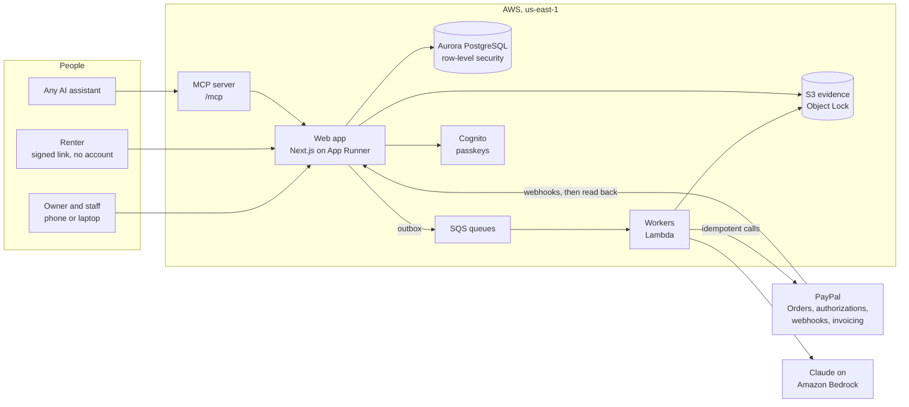

# Hold

**The deposit that never leaves your account.**

**Live demo: <https://p99faar3kp.us-east-1.awsapprunner.com>** · One tap starts a demo shop of your own. Nothing to
type, no code to wait for, and no other judge's changes in your way.

> A PayPal authorization hold *is* the deposit. The renter's money is reserved, never charged, and a clean return
> releases it on the spot. Claude compares the handover and return photographs, but plain code finds every
> difference, every amount comes from the shop's published price list, and a named person approves every charge.
> PayPal's own record, read back after every webhook, is the truth.

Built for the PayPal AI Hackathon 2026.

## For judges: five minutes

1. Open the [live demo](https://p99faar3kp.us-east-1.awsapprunner.com/sign-in) and tap **Start a demo as Tomás, the
   owner**. You get a Ribeira Bikes in Lisbon of your own, already busy: bikes out, returns due today, a claim
   waiting for approval and one the renter contested. These are sample rentals, marked **Sample**. They show the
   shop's day and move no money. Nobody else sees your demo, and you see nobody else's.
2. To switch roles, sign out and tap **Continue as Jonas, at the counter**: the same shop, as the counter staff. Your
   browser keeps your demo; **Start a fresh demo** opens a new one. For a real rental, book a bike and open the
   renter's link. Pay the fee and approve the hold in PayPal's sandbox with the sandbox buyer account given in the
   submission's testing instructions. Photograph the handover with **Use the sample photograph**, and the return with
   **Use the sample with damage** for one view: the same frame with a chip in the paint. The real camera works on any
   object to hand.
3. Back as Tomás (**Continue as Tomás, the owner**), open the comparison. Code finds the chip and Claude says what it
   is, then takes an independent second look. When both agree, the finding is offered as a claim line priced from the
   shop's list. When the second look is not sure, the return waits for a person, who claims the same entry with a
   written reason. Approve the claim, or release the hold for a clean return. A step that moves money asks for a
   passkey. The first time, follow **Add a passkey** to the Security page and add one on your own device (Touch ID,
   Windows Hello or your phone), then confirm with it. The capture and the release happen in the PayPal sandbox, and
   no real money moves.
4. For a contested claim, book another bike with your own email as the renter's contact. At the handover, record
   the faint scuff on the down tube as a known mark. At the return, use **Use the sample for a contested claim**: the
   scuff has grown into a scratch through the paint. Claim the scratch as Tomás. Then open the renter's link and
   contest the claim. The one-time code goes to your email, because PayPal's sandbox buyer has no inbox. Each side may
   send an advocate with written limits. A referee in plain code checks every move against the photographs and the
   wear policy, and the owner decides if the two do not agree.
5. Open the **[hosted assistant](https://p99faar3kp.us-east-1.awsapprunner.com/assistant)** and ask it to rent you a
   bike. It books through Hold's own MCP server, the same one your assistant can use, and hands you the PayPal
   approval link.

Anything simulated is labelled on screen and marked `simulated` in the record.

## What it is

Small rental shops take a cash or card deposit and refund it later. Renters hate it, foreign cards lose on the
exchange twice, and every scratch turns into an argument. Hold replaces the deposit with a PayPal hold placed at
pickup:

- **Handover.** Staff photograph the item from a guided set of angles, and the renter confirms the condition report
  on their phone.
- **Return.** The same photographs again. Code aligns each pair and finds what changed, and Claude says whether each
  change is wear or damage, with a second, independent look at every damage finding.
- **Clean return.** The hold is released at the counter. Nothing was ever charged.
- **Damage.** An itemized claim, priced only from the list the renter agreed to, goes to a person to approve. The
  renter sees every photograph and can accept or contest it. Only the approved amount is captured, and the rest is
  released at once.

Six extensions build on that: an accuracy scorecard measured on a held-out photo set, an operations agent that
prepares a morning queue a person decides, a portable Clean Record for renters who return things well, renting
through your own AI assistant over MCP, an advocate for each side of a contested claim, and an incident desk for
theft and accidents. The full description is in [`docs/project-description.md`](docs/project-description.md).

## How reliable is the comparison

Measured on the gate half of the evaluation set, which is never used for tuning. Every figure is a count. The same
figures are on the reliability page of the deployed app.

<!-- scorecard:start -->
Not measured yet: no run over the evaluation set has been accepted. Until one is, Hold claims no accuracy for the
comparison.
<!-- scorecard:end -->

## Connect your own assistant

Hold's MCP server is at **`https://p99faar3kp.us-east-1.awsapprunner.com/mcp`** (streamable HTTP, no sign-in for the
public tools). Any MCP client can find a shop, read its damage prices, get a quote and book. The person approves every
payment in PayPal. No tool takes an amount and none can capture a hold. The tools are listed in
[`docs/extensions.md`](docs/extensions.md) section 8.

## How it fits together



Every call that moves money leaves through an outbox with a `PayPal-Request-Id`, and a hold counts as placed,
captured or released only after a verified PayPal event or a direct read from PayPal. The design is in
[`docs/architecture.md`](docs/architecture.md).

## Security model

Deny by default, and every check runs on the server. In short:

- **People decide money.** No agent tier charges, no tool takes an amount, and a capture starts only from a claim a
  named person approved. Owners and managers confirm money steps with a passkey.
- **Every shop is walled off** by PostgreSQL row-level security, with a test per table that a second shop reads
  nothing.
- **Renters** reach their rental through a signed, expiring link bound to it, and accepting or contesting a claim
  needs a one-time code.
- **Assistants and agents** pass one gateway that checks actor, shop, tier, mandate, rate and argument shape, and
  writes an audit line. Text from renters, PayPal memos and other agents is treated as quoted data.
- **Evidence** photographs are write-once under S3 Object Lock, and the money log, approvals and audit trail are
  append-only.
- **Each demo is its own shop** with two new accounts, walled off like any other shop. Their passwords live only in
  the sealed cookie of the browser that started it. The app may create those accounts but never set a password, demo
  shops use only the PayPal sandbox, and money steps still need the judge's own passkey.

The rules every change follows are in [`AGENTS.md`](AGENTS.md), and the threats and their controls are in
[`docs/architecture.md`](docs/architecture.md) section 15.

## Tech stack

| Part | Choice |
|---|---|
| Payments | PayPal Orders v2 (authorize, capture, void, reauthorize), webhooks with read-back, Invoicing v2, the PayPal MCP server |
| AI | Claude Opus 4.6 on Amazon Bedrock for judging (designed for Opus 5.5, which the account has no quota for yet), OpenCV.js on the phone for photo quality |
| Web | Next.js, React, Tailwind CSS and shadcn/ui, in English, German, Spanish and French |
| Data | Aurora PostgreSQL Serverless v2 through the RDS Data API, Drizzle ORM |
| Work | SQS queues and Lambda workers, EventBridge Scheduler for hold upkeep |
| Identity | Amazon Cognito with emailed codes and passkeys |
| Infrastructure | AWS CDK, GitHub Actions deploying over OpenID Connect |
| Tests | Vitest and fast-check, Playwright end to end, a photo evaluation set |

Why each was chosen is in [`docs/tech-stack.md`](docs/tech-stack.md).

## Run it yourself

You need Node 24 and pnpm 12. The tests need no AWS account: they run against a real PostgreSQL in WebAssembly and
in-process fakes for PayPal, Cognito and email.

```sh
pnpm install
pnpm check        # lint, type-check and every unit test
pnpm test:e2e     # builds the app and runs Playwright against the fakes
```

To run the app against your own AWS services, copy `apps/web/.env.example` to `apps/web/.env.local`, fill it in, and
run `pnpm dev`. The infrastructure is in `infra/` as CDK stacks, all named `hold-*`.

**Connecting the demo to PayPal's sandbox** (administrators, once, with AWS credentials for the account):

```sh
PAYPAL_SANDBOX_CLIENT_ID=… PAYPAL_SANDBOX_CLIENT_SECRET=… AWS_PROFILE=… pnpm demo:paypal
```

It checks the credentials with PayPal and stores them in Secrets Manager. Every demo started after that shares the
sandbox business account. There is nothing to reset: each demo starts fresh.
