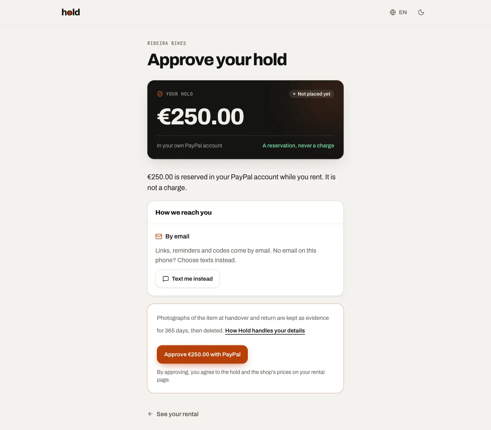
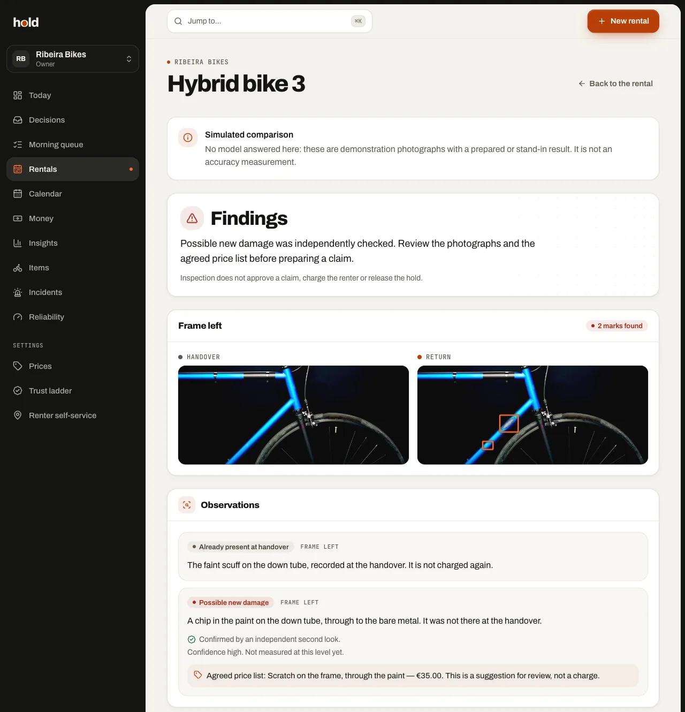
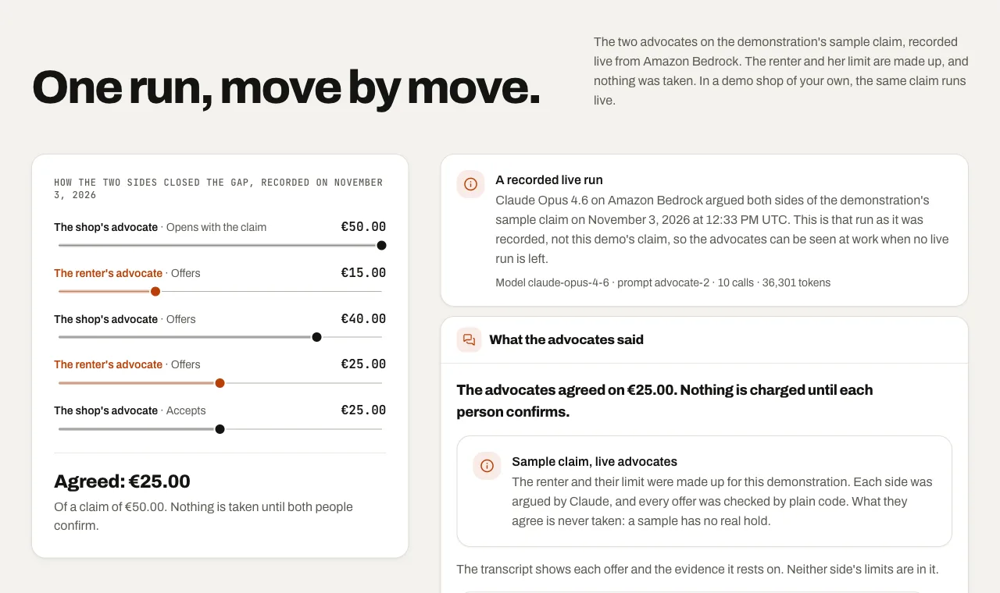
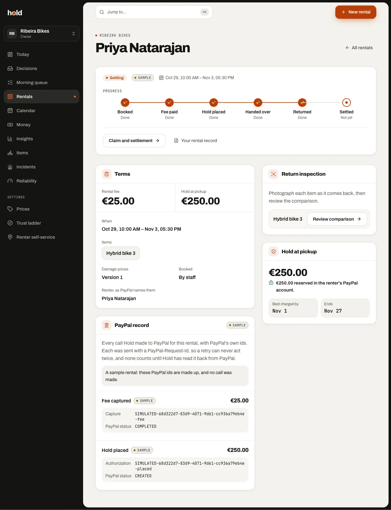
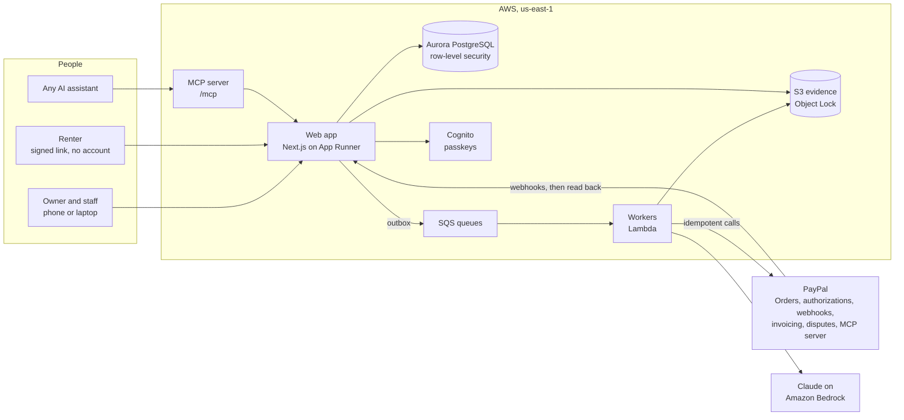

<h1 align="center">
  <picture>
    <source media="(prefers-color-scheme: dark)" srcset="docs/images/hold-logo-dark.png">
    
  </picture>
</h1>

<p align="center">
  <strong>A PayPal hold instead of a cash deposit, for small rental shops.</strong><br>
  <em>The deposit that never leaves your account.</em>
</p>

<p align="center">
  <a href="https://github.com/rogerjeasy/hold/actions/workflows/ci.yml"></a>
  <a href="LICENSE"></a>
  
  
</p>

<p align="center">
  <strong>Live demo: <a href="https://p99faar3kp.us-east-1.awsapprunner.com">p99faar3kp.us-east-1.awsapprunner.com</a></strong>
  · <strong>Video:</strong> <em>(YouTube link)</em> · Built for the PayPal AI Hackathon 2026<br>
  One tap builds a demo shop of your own in about 25 seconds, with nothing to type.
</p>

A small rental shop takes a cash deposit and hands it back later. A tourist paying with a foreign card can lose on the
exchange twice, and every scratch becomes an argument at the counter.

Hold replaces the deposit with a PayPal hold the renter approves in their own account. A clean return releases it
untouched. For damage, code and Claude compare the handover and return photographs, a named person approves a charge
from the shop's published prices, and PayPal takes that amount and releases the rest. If the renter disagrees, two
Claude advocates negotiate for the two sides inside limits their own people set.

**Live in PayPal's sandbox:** a judge's own rental held €250, captured €35 for a chip in the paint and released the
other €215, with PayPal's ids on the rental's page.

| | |
|---|---|
|  |  |
| The renter approves the hold in PayPal. Nothing is charged. | Code boxes the change, a look names it, a second look confirms it, the list prices it. This one is a simulated run, and says so. |
|  |  |
| The advocates' offers, recorded on Bedrock. The renter is made up. | Every PayPal call behind a rental, with PayPal's ids (made up on this sample). |

Screenshots from the app on its in-process fakes. Simulated parts say so on screen.

## Why it matters

Deposits are where rental trust breaks. In 2025 a member of the US Congress wrote that Hertz was "apparently the only
car rental company in the U.S. that issues damage assessments to customers without human review"
([letter, 20 August 2025](https://oversight.house.gov/wp-content/uploads/2025/08/AI-letter-to-Hertz._8.20.2025.pdf)),
after renters were billed for dents a scanner found. Hold is built the other way round: a person approves every
charge, the renter sees the same photographs, and every price comes from a list the renter agreed to.

The shops it is for are small and many. In 2024 the US had 3,342 recreational-goods rental businesses with employees
([BLS](https://data.bls.gov/cew/data/api/2024/a/industry/532284.csv)), and the EU had 21,614 recreational and
sports-goods rental firms, averaging two people each
([Eurostat](https://ec.europa.eu/eurostat/api/dissemination/statistics/1.0/data/sbs_ovw_act?format=JSON&lang=EN&nace_r2=N7721&geo=EU27_2020&indic_sbs=ENT_NR)).
Rental software already reserves deposits with card holds, captured once, and leaves the damage amount to the shop.

## One rental, start to finish

1. **Book and hold.** The renter pays the fee with PayPal's button and approves a €250 PayPal authorization. Hold
   counts it as placed only after the webhook is verified and the authorization is read back for the exact amount.
2. **Handover.** Staff photograph the item from guided angles, sealed into a signed statement.
3. **Return.** Code aligns each pair of photographs and marks what changed. Claude Opus 4.6 says whether each change
   is wear or damage, and an independent second look checks every damage finding.
4. **Decide.** A clean return voids the hold. For damage, a named person approves a claim priced from the shop's list,
   the renter accepts it with a one-time code, and PayPal captures that amount and releases the rest.
5. **Disagree.** Two Claude advocates argue each side in separate calls, plain code checks every offer, and an
   agreement can only lower the approved claim.

The rule behind every step: **code decides what can happen to money, the model only explains, and a person approves.**

## What is new here

Card holds, photo comparison and human approval each exist. Hold joins them into one record (the hold, its evidence,
the price list, who approved, what the renter saw and how PayPal settled it) and adds four things you can try without
signing in:

| What | Where to see it |
|---|---|
| **Two agents settling a payment.** PayPal's brief asks for "two agents negotiating and settling a payment between themselves" ([resources](https://paypalaihackathon.devpost.com/resources)). Hold's advocates do it for a contested damage claim. A referee in plain code ([`referee.ts`](packages/domain/src/referee.ts), with fast-check properties) refuses any added line, any price above the list and any reduction that names no ground. A renter's own assistant can take the renter's side over MCP. | [`/advocates`](https://p99faar3kp.us-east-1.awsapprunner.com/advocates): a recorded run, move by move |
| **An operations agent that reads PayPal and cannot charge.** For each exception code finds overnight, it confirms the facts through PayPal's own MCP server (nine read-only tools of 46) and drafts a proposal a person decides. | [`/ai`](https://p99faar3kp.us-east-1.awsapprunner.com/ai): one night's queue, recorded |
| **Evidence anyone can check.** Handover photographs are sealed into a signed statement that anyone can verify in the browser against Hold's published key, without trusting Hold. | [`/verify`](https://p99faar3kp.us-east-1.awsapprunner.com/verify) and [`/.well-known/jwks.json`](https://p99faar3kp.us-east-1.awsapprunner.com/.well-known/jwks.json) |
| **Accuracy counted, not claimed.** The comparison is scored on a held-out half it is never tuned on, with every pair published. No run is accepted yet, and the page says so. | [`/reliability`](https://p99faar3kp.us-east-1.awsapprunner.com/reliability) |

## Try it

**One minute, no sign-in:** [`/advocates`](https://p99faar3kp.us-east-1.awsapprunner.com/advocates),
[`/ai`](https://p99faar3kp.us-east-1.awsapprunner.com/ai),
[`/verify`](https://p99faar3kp.us-east-1.awsapprunner.com/verify) and
[`/mcp`](https://p99faar3kp.us-east-1.awsapprunner.com/mcp).

**About ten minutes: your own sandbox rental, as Jonas at the counter, with no passkey.** Jonas approves claims up to
€100, and the shop sends claims above €150 to its owner. Keep the sandbox buyer login from [Testing
instructions](#testing-instructions) and an email address of your own to hand.

1. Open [sign in](https://p99faar3kp.us-east-1.awsapprunner.com/sign-in) and tap **Start a demo as Jonas, at the
   counter**. You get a Ribeira Bikes in Lisbon of your own, with sample rentals marked **Sample** that move no money.
   Nobody else sees your demo.
2. Open **Rentals**, then **New rental**. Add one **City bike**, any name and **your own email**, and book. Tap **Show
   the link**, open it, and pay the fee with PayPal's button as the sandbox buyer. Back on the rental, tap **Ask for the
   hold** and approve the €250 hold the same way. (Or tick **Walk-in: fee and hold in one PayPal approval** when
   booking.)
3. Photograph the handover with **Use the sample photograph** and **Seal the photographs**. Tap **Start return**, use
   **Use the sample with damage** (the same frame with a chip in the paint) and **Seal return photographs**.
4. Tap **Review comparison**. Code and Claude compare the photographs for real; the photographs are samples, so the
   result is kept out of every accuracy figure. Go **Back to the rental**, tap **Claim and settlement**, tick the
   finding (if no price is suggested, choose **Scratch on the frame, through the paint · €35.00**), then tap **Prepare
   claim for review** and **Approve and show renter link**.
5. Open the renter's link, as the renter would on their phone. Tap **I have reviewed this claim** and **Send me a
   verification code**; it goes to your email, because the sandbox buyer has no inbox. Accept. PayPal captures €35 and
   releases €215, and the rental shows **Settlement confirmed**.
6. Open the [hosted assistant](https://p99faar3kp.us-east-1.awsapprunner.com/assistant) in the same browser, ask it to
   rent you a bike and accept its quote. It books from your demo shop through Hold's MCP server and hands you PayPal's
   approval link.

**As the owner.** Sign out and tap **Continue as Tomás, the owner**. **Calendar** shows every bike as a row and every
rental as a bar marked by its PayPal hold. Open **Rentals**, **Elena Duarte**, her contested claim, and tap **Let the
advocates argue it**; a run takes about two minutes, so reload to see its moves. The sample moves no money. Live model
runs share a daily allowance; when it is spent, the page says so.

## What is live and what is simulated

| Part | In your demo shop |
|---|---|
| Fee, hold, capture, void and webhooks | **Live** in PayPal's sandbox, with PayPal's ids on the rental page |
| The comparison on the sample return | **Live** on Claude Opus 4.6; the photographs are samples, and the screen says so |
| The hosted assistant | **Live** on Claude Opus 4.5, booking through Hold's public MCP server |
| The advocates on Elena's sample claim | **Live** on Claude Opus 4.5; the claim is sample data, so its agreement moves no money |
| "Investigate the samples" on the morning queue | **Live** model, with simulated PayPal reads |
| The nightly operations run | **Live** reads through PayPal's MCP server, for shops with real exceptions |
| `/advocates` and `/ai` | **Recorded** runs, labelled as such |
| Sample rentals | **Sample** data with made-up PayPal ids, marked on screen and `simulated` in the record |
| Dispute and invoice events | Received on a real shop's own webhook; not yet routed to demo shops |

## How reliable is the comparison

Measured on the gate half of the evaluation set, which is never used for tuning. Every figure is a count, and the
reliability page shows every pair behind it.

<!-- scorecard:start -->
Not measured yet: no run over the evaluation set has been accepted. Until one is, Hold claims no accuracy for the
comparison.
<!-- scorecard:end -->

The set has 300 pairs: 288 generated from freely licensed photographs of one bike, with damage drawn on them and
marked synthetic, and 12 real. A run accepted on 29 October 2026 by mistake, in which the model answered too few pairs
to measure anything, was withdrawn on 3 November and stays on record; the gate half was then rebuilt. A figure worth
publishing needs real photographs of real damage.

When code cannot align a pair or the model does not answer, the return waits for a person, and a finding the second
look does not confirm is marked so. Nothing is charged without a person.

## How Hold uses PayPal

PayPal's record is the truth: a hold counts as placed, captured or released only after a verified PayPal event or a
direct read from PayPal. Hold makes 22 PayPal REST calls across Orders v2, Payments v2, Invoicing v2, Disputes v1 and
Webhooks.

| Moment | PayPal | Code |
|---|---|---|
| Rental fee | Orders v2 (`CAPTURE`) and the JavaScript SDK v6 button | [`holds.ts`](packages/paypal/src/rest/holds.ts), [`paypal-button.tsx`](apps/web/src/features/renter/paypal-button.tsx) |
| The hold | Orders v2 (`AUTHORIZE`), authorize, then the authorization read back for the exact amount | [`hold-placement.ts`](packages/settle/src/hold-placement.ts) |
| Proof | `verify-webhook-signature` on every event, then the resource read back | [`paypal-webhook.ts`](apps/web/src/server/paypal-webhook.ts), [`paypal-events.ts`](packages/settle/src/paypal-events.ts) |
| A late claim | One reauthorization just before charging, past PayPal's 3-day honor period | [`settlement-renewal.ts`](packages/settle/src/settlement-renewal.ts) |
| Damage | Capture of the approved amount with `final_capture: true`; the rest is released | [`return-settlement.ts`](packages/settle/src/return-settlement.ts) |
| Clean return | Void | [`return-settlement.ts`](packages/settle/src/return-settlement.ts) |
| Claim above the hold | Invoicing v2 | [`claim-invoice.ts`](packages/settle/src/claim-invoice.ts) |
| Disputes | Disputes v1, answered with the rental's evidence pack after the owner approves | [`disputes.ts`](packages/paypal/src/rest/disputes.ts) |
| Overnight checks | PayPal's MCP server, read-only | [`paypal-reader.ts`](packages/ops/src/paypal-reader.ts) |
| Every money call | An outbox, and a `PayPal-Request-Id` built from the record it moves | [`client.ts`](packages/paypal/src/rest/client.ts) |

A PayPal authorization stays open for up to 29 days, but PayPal assures capture only within a 3-day honor period.
PayPal's reference allows one reauthorization from day 4 and its guides describe several; the sandbox allowed one and
refused a second, so Hold reauthorizes once, just before charging a late claim. The rental page shows the honor
period's date ("Best charged by").

## How Hold uses Claude

Claude runs on Amazon Bedrock. Every call has a ceiling on tokens and time, handles a refusal as a normal outcome, and
names its prompt version; whatever a call proposes is checked by code before it is used.

| Job | Model | What it may do |
|---|---|---|
| Compare return photographs, then a second look at each damage finding | Opus 4.6 | Describe each change code found and suggest a code from the shop's price list; never set a price |
| Advocate for the shop and for the renter | Opus 4.5 | Offer, accept or pass, each move checked by the referee |
| Operations agent | Opus 4.5 | Read PayPal through nine read-only MCP tools and draft a proposal for a person |
| Hosted assistant | Opus 4.5 | Find a shop, quote and book through Hold's MCP server |
| Contest summary, incident triage, owner insights | Opus 4.5 | Summarise and sort; no tool moves money |

OpenCV aligns photographs and finds what changed before the model is asked, and OpenCV.js checks photo quality on the
phone. Amazon Rekognition finds faces so they can be blurred.

## Who can move money

| Who | Can | Cannot |
|---|---|---|
| Counter staff | Approve a claim up to the shop's limit | Approve above it |
| Owner or manager | Approve claims within their role's limit, confirming money steps with a passkey | Approve above their limit |
| Renter | Accept or contest a claim, and confirm an agreement, each with a one-time code | |
| Claude, comparing photographs | Describe and suggest a price code | Set a price or charge |
| The advocates | Offer, accept or pass within their mandates | Add a line, exceed a listed price, or settle without both people |
| The operations agent | Read PayPal and draft proposals | Call any tool that moves money; none of its proposal kinds is a capture |
| Any assistant over MCP | Find, quote and book; the person approves in PayPal | Set a price, capture or refund |

Only a claim a named person approved can reach PayPal as a capture. 21 of the 22 MCP tools take no amount; the one
that does, `submit_offer`, can only lower a claim a person approved. Every agent call passes one gateway that checks
actor, shop, tier, mandate, rate and argument shape. Every shop is walled off by PostgreSQL row-level security,
evidence is locked for 180 days under S3 Object Lock, and the money log is append-only. The rules are in
[`AGENTS.md`](AGENTS.md); threats and controls in [`docs/architecture.md`](docs/architecture.md) section 15.

## How it fits together



## Hackathon requirements

| The rules ask for | Where Hold meets it |
|---|---|
| A working build, hosted or with run instructions | The [live demo](https://p99faar3kp.us-east-1.awsapprunner.com), and [Run it yourself](#run-it-yourself) with no account |
| A public repository with an open-source licence | [MIT](LICENSE) |
| A public video under three minutes | The link at the top |
| PayPal central to the project | [How Hold uses PayPal](#how-hold-uses-paypal) |
| An AI tool, model or platform | [How Hold uses Claude](#how-hold-uses-claude) |
| Test credentials for judges | [Testing instructions](#testing-instructions) |
| Built during the submission period | First commit on 14 October 2026; the period opened on 1 October |

## Connect your own assistant

Hold's MCP server is at **`https://p99faar3kp.us-east-1.awsapprunner.com/mcp`** (streamable HTTP, no sign-in for the
public tools). Any MCP client can find a shop, read its damage prices, get a quote and book; the person approves every
payment in PayPal. The tools are listed in [`docs/extensions.md`](docs/extensions.md) section 8.

```bash
claude mcp add --transport http hold https://p99faar3kp.us-east-1.awsapprunner.com/mcp   # Claude Code
npx @modelcontextprotocol/inspector                                                     # choose "Streamable HTTP"
```

In Cursor, `.cursor/mcp.json`: `{ "mcpServers": { "hold": { "url": "https://p99faar3kp.us-east-1.awsapprunner.com/mcp" } } }`.
Then ask, for example, "Find a bike shop on Hold and quote me a city bike for tomorrow".

## Testing instructions

The hosted demo needs no account and no code. The one login a judge needs is the PayPal sandbox buyer, to approve the
fee and the hold in PayPal's own pages:

- PayPal sandbox buyer email: amara-doe@personal.example.com
- PayPal sandbox buyer password: h#-sd8U^

It is a sandbox account with test money only. The sandbox buyer has no inbox, so give your own email address when a
rental asks for the renter's, and the renter's one-time code reaches you there. Owner money decisions ask for a
passkey on your own device, which **Add a passkey** on the Security page sets up in a few seconds.

## Run it yourself

You need Node 24 and pnpm 12. The clone is about 190 MB, most of it the evaluation set's photographs under `eval/`.
The tests need no AWS account: they run against a real PostgreSQL in WebAssembly and in-process fakes for PayPal,
Cognito and email.

```sh
pnpm install
pnpm check        # lint, type-check and every unit test: about 3,900 tests
pnpm test:e2e     # builds the app and runs Playwright against the fakes
```

**The whole app with no account.** The same fakes run the built app on your machine: a database in memory, a simulated
PayPal approval page, stand-ins for Claude that say they are stand-ins, and a fixed sign-in code, `24681357`. **Start a
demo as Jonas, at the counter** runs the whole money loop as on the hosted demo.

```sh
pnpm install
pnpm --filter @hold/web build
cd apps/web
HOLD_ENVIRONMENT=test HOLD_COOKIE_KEY="$(openssl rand -base64 32)" HOLD_PUBLIC_URL=http://localhost:3000 \
  node node_modules/next/dist/bin/next start --port 3000
```

To run against your own AWS services, fill in `apps/web/.env.local` from `apps/web/.env.example` and run `pnpm dev`;
[`docs/deploy.md`](docs/deploy.md) recreates the six CDK stacks in `infra/` and connects PayPal's sandbox.

## Built with

PayPal (Orders v2, Payments v2, JavaScript SDK v6, webhooks, Invoicing v2, Disputes v1, MCP server) · Claude Opus 4.6
and 4.5 on Amazon Bedrock · OpenCV · Next.js, React, Tailwind CSS and shadcn/ui, in English, German, Spanish and
French · AG Grid Enterprise (five grids) and AG Studio · Bryntum Scheduler · Aurora PostgreSQL, SQS, Lambda, S3 and
Cognito with passkeys, on AWS CDK · Vitest, fast-check and Playwright. Why each was chosen is in
[`docs/tech-stack.md`](docs/tech-stack.md); the full description is in
[`docs/project-description.md`](docs/project-description.md).

## What real shops still need

Hold runs end to end in PayPal's sandbox. Before a shop takes real money:

- **Live PayPal and partner onboarding.** The configuration accepts only the sandbox. Going live needs PayPal's app
  review and partial capture switched on per shop ([`docs/deploy.md`](docs/deploy.md) section 11). Today a shop pastes
  its own PayPal app's secret; PayPal's partner onboarding, refused to this account in the sandbox on 28 October 2026,
  needs PayPal to approve Hold as a partner.
- **Card rules for damage.** Visa excludes any amount for potential damage from an estimated authorization for bicycle
  and equipment rental ([Visa Core Rules](https://usa.visa.com/content/dam/VCOM/download/about-visa/visa-rules-public.pdf)
  5.7.2.4). Capturing only after the renter accepts with a code fits the consent those rules ask for, but how PayPal
  treats a card-funded deposit hold must be confirmed, and Seller Protection does not cover in-person damage.
- **Rentals longer than 29 days**, through the renter's saved PayPal wallet, with consent.
- **A measured comparison** on real photographs of real damage, **staff removal and role changes**, terms with a data
  processing agreement, billing (the proposal is a fee per protected rental), and a production environment apart from
  the public demos.

A phone app for iOS and Android is in `apps/mobile`. It is not part of this submission's demonstration.

## License

[MIT](LICENSE).
