# Hold: architecture

Architecture of the complete Hold application for the PayPal AI Hackathon 2026. Draft 2, 13 October 2026.

Read `project-description.md` for what Hold is and `tech-stack.md` for the tools. This document explains how the system is built: its parts, its data, how a PayPal hold is managed from start to finish, how evidence is kept, how the AI is contained, and how it runs on AWS.

Six additions built on top of the spine are specified in `extensions.md`. This document has been updated to match them. Where a section below mentions an extension, the detail is there.

**Contents**

1. Summary
2. What drives the architecture
3. System context
4. Services and stores
5. Code structure
6. Domain model
7. The hold core
8. PayPal integration
9. Evidence architecture
10. AI architecture
11. Key flows
12. Identity and access
13. Interfaces
14. Infrastructure on AWS
15. Security
16. Reliability and failure handling
17. Observability and audit
18. Performance and scale
19. Testing
20. Environments, deployment and demo mode
21. Decision record
22. Risks, assumptions and open questions
23. How certain each part is

---

## 1. Summary

Hold is a TypeScript system of two services, a web app on AWS App Runner and a worker, one PostgreSQL database on Aurora Serverless v2, an evidence store on S3, and a small set of managed AWS services. It talks to two outside systems: PayPal and Claude.

The architecture rests on eleven decisions. The last three come from the extensions.

1. **The deposit is its own PayPal authorization.** The hold is tracked as a separate object with its own life, apart from the rental fee. Everything PayPal documents about holds applies to it cleanly.
2. **PayPal's record is the truth.** A hold is placed, captured or released only when a verified PayPal event, or a direct read from PayPal, says so.
3. **Hold never trusts a hold to stay valid on its own.** Every hold has a schedule that watches its assurance period and its expiry, and acts before either lapses.
4. **Evidence cannot be altered.** Photographs are locked on write, fingerprinted, and chained to the item's earlier photographs.
5. **The AI gathers and compares. A person decides.** The comparison produces findings. Only a named person's approval turns findings into a charge.
6. **Prices come from the published list, never from the model.** The model may suggest which list entry applies. The amount is read from the database.
7. **Two independent looks before a damage finding stands.** A second, separate check must confirm each finding from close crops, or it is marked uncertain and sent to a person.
8. **Renters need no account.** A renter acts through a signed link bound to one rental. Their identity is their PayPal payment.
9. **A mandate is an approval given in advance.** A person may let an agent act for them inside written limits. Plain code checks every such action against those limits.
10. **Detect with code, explain with the model.** Anything that must not be missed is found by deterministic code. Agents investigate, draft and argue.
11. **One gateway for every agent.** The owner's assistant, the operations agent, a renter's outside assistant and the two advocates all reach Hold through the same checked and logged tools.

---

## 2. What drives the architecture

| Quality | What it means for Hold | How the architecture answers |
|---|---|---|
| **Correctness of money** | Never charge twice, never charge more than approved, never lose a hold | State machines, idempotency keys, webhook truth, hold upkeep, nightly reconciliation |
| **Fairness to the renter** | No charge without evidence, a published price and a person's approval | Findings tied to photographs, prices from the agreed list, approval records, a right to reply |
| **Credible evidence** | A photograph must stand up in a dispute | Locked storage, fingerprints, server timestamps, a chain per item |
| **Speed at the counter** | Handover and return in under a minute | Checks on the phone, direct uploads, comparison off the request path |
| **Honest uncertainty** | The system knows when it cannot tell | Confidence on every finding, an independent second look, deferral to a person |
| **Isolation** | One shop never sees another's data | Shop scoping in the service and row-level security in the database |
| **Demo reliability** | Judges can run it without a bike | A fresh seeded shop for each judge, sample photo sets |

---

## 3. System context

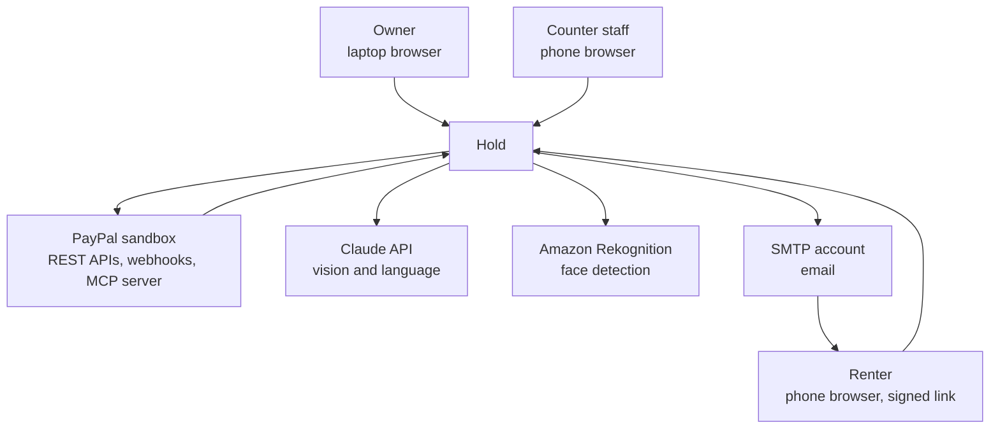

**People**

- **The owner** sets up items, prices and policies, approves larger claims and reviews the business.
- **Counter staff** hand items over, take them back and approve ordinary claims.
- **The renter** pays, accepts the hold, confirms condition, and accepts or contests a claim.

**Outside systems**

- **PayPal** reserves, captures and releases every dollar and reports every event.
- **Claude** compares photographs and writes language.
- **Rekognition** finds faces so they can be blurred.
- **An SMTP account** delivers codes, links and messages.

---

## 4. Services and stores

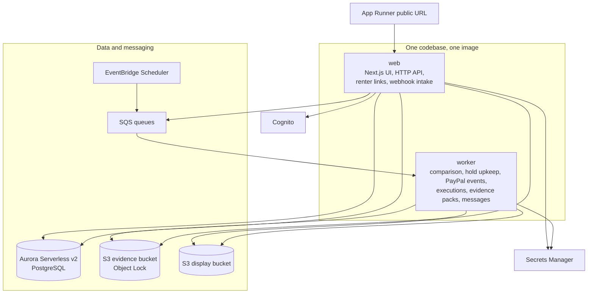

| Part | Responsibility | Never does |
|---|---|---|
| **web** | Serves the app and renter links. Exposes the HTTP API and the MCP server for assistants. Issues upload links. Receives PayPal webhooks. Runs the owner's assistant. | Compare photographs or call PayPal to capture inside a request |
| **worker** | Compares photo sessions. Keeps holds valid. Verifies and applies PayPal events. Executes approved actions. Builds evidence packs. Sends messages. Runs the operations agent and negotiations. | Serve user requests |
| **Aurora** | Shops, items, rentals, holds, claims, approvals, PayPal events, audit log | |
| **S3 evidence bucket** | Original photographs and evidence packs, locked against change | |
| **S3 display bucket** | Smaller, face-blurred copies for screens | |
| **SQS** | Hands work from web to worker, with retries | |
| **EventBridge Scheduler** | Starts timed work, most importantly hold upkeep | |
| **Cognito** | Signs in owners and staff | |
| **Secrets Manager** | Holds every credential | |

**Why a separate worker.** Comparing a photo session takes seconds and uses memory. The counter screens must stay instant while that happens, and a failed comparison must be retried without the user doing anything. Capturing money must also continue if the web tier is busy.

---

## 5. Code structure

One repository with shared packages, built into one Docker image.

```
hold/
  apps/
    web/              Next.js app, HTTP API, renter links, webhook intake
    worker/           queue consumers and scheduled jobs
  packages/
    domain/           rental, hold and claim state machines, claim arithmetic,
                      approval rules, upkeep planning, mandates, proposals,
                      detectors, trust ladder, negotiation referee. Pure code.
    db/               schema, migrations, repositories, row-level security
    paypal/           PayPal adapter, webhook verification, event mapping
    settle/           running executions, applying verified PayPal events, the outbox relay
    evidence/         capture sessions, fingerprints, chain, evidence packs
    vision/           quality checks, alignment, candidate regions
    compare/          the comparison pipeline and its second look
    agent/            owner's assistant, tool gateway with tiers, number guard
    mcp/              Hold's MCP server for assistants, agent tokens, quotes
    ops/              operations agent, PayPal MCP client
    negotiate/        the two advocates' runners
    trust/            Clean Record, credential signing and checking
    auth/             token verification, shop authorization, renter links
    notify/           email and in-app messages
    config/           typed configuration and secrets loading
  infra/              AWS CDK stacks
  eval/               photo evaluation set and its runner
  docs/
```

**The dependency rule.** `domain` depends on nothing. It has no database, no network and no AI. Every other package may depend on `domain`. Apps depend on packages and never on each other.

**Ports and adapters.** PayPal, Claude, Rekognition and email are each reached through an interface defined beside the code that needs it. Tests use fakes.

**`vision` runs in two places.** The quality checks are the same code on the phone and on the worker, so a photograph the phone accepts is one the worker can use.

---

## 6. Domain model

### 6.1 Concepts

| Concept | Meaning |
|---|---|
| **Shop** | A rental business, with one or more locations |
| **Item type** | A kind of thing rented, with its hold amount and photo plan |
| **Item** | One physical thing, with its own history |
| **Photo plan** | The views that must be photographed for an item type |
| **Price list** | The shop's published prices for damage, loss and lateness. Versioned. |
| **Wear policy** | What the shop counts as ordinary wear. Versioned. |
| **Rental** | One renter taking one or more items for a period |
| **Renter** | A person identified by their PayPal payment |
| **Hold** | Money reserved on the renter's PayPal account for one rental |
| **Authorization** | One PayPal authorization backing a hold. A hold may have several over time. |
| **Capture session** | One guided set of photographs: at handover, at return, at unboxing |
| **Photo** | One locked photograph of one view |
| **Mark** | A known imperfection on an item, with the date it was first seen |
| **Comparison** | The result of comparing a return session with its handover session |
| **Finding** | One difference: where, what kind, how confident |
| **Claim** | The shop's itemized request to charge the hold |
| **Approval** | One person's recorded decision, with what they changed |
| **Execution** | One attempt to carry out an approved action through PayPal |
| **Evidence pack** | The complete record of a rental's condition and money, as one document |
| **Mandate** | A person's written permission for an agent to act within limits |
| **Proposal** | An action an agent suggests, waiting for a person to decide |
| **Exception** | Something a detector found that needs attention |
| **Clean Record** | A renter's count of rentals returned in good condition |
| **Trust ladder** | A shop's published rule for lowering a hold. Versioned. |
| **Quote** | A priced offer of a rental, referred to by its ID |
| **Agent session** | An outside assistant's access to one rental |
| **Negotiation** | Two advocates' exchange of offers on a contested claim |
| **Incident** | Something a renter reported during a rental |

### 6.2 Entity relationships

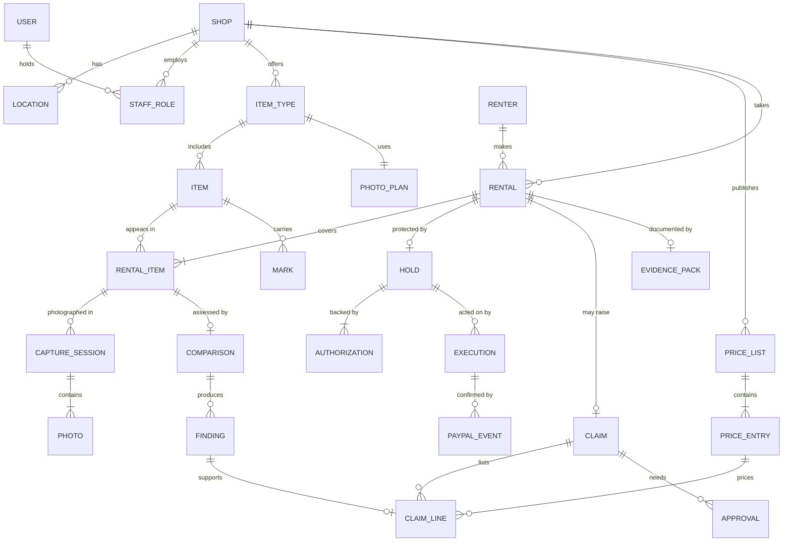

### 6.3 Tables

Every table except `users`, `renters` and `eval_runs` carries a `shop_id`.

| Table | Key contents |
|---|---|
| `users` | Cognito subject, contact details, language |
| `shops` | Name, address for renters (`slug`), timezone, currency, approval thresholds, reply period, whether it is a judge's demo (`demo_session`) |
| `locations` | Address, opening hours |
| `staff_roles` | User, shop, role, approval limit |
| `paypal_accounts` | Shop, merchant ID, credential reference, webhook ID, mode |
| `item_types` | Name, kind, value to replace, hold amount, day rate, kit, photo plan, whether it is a sample |
| `items` | Type, label, size, serial, status with its note and date, chain head fingerprint, whether it is a sample |
| `photo_plans` | Ordered views with keys, labels, outlines and whether each is required. Never changed once saved. |
| `price_lists` | Version, effective date, published text |
| `price_entries` | Code, description, amount, category |
| `wear_policies` | Version, rules |
| `renters` | PayPal payer ID, email, name, language, and the renter key once a hold is asked for (section 6.8) |
| `rentals` | Renter, period, fee, agreed hold, agreed price list and wear policy versions, state, the contact staff booked for and the renter's language, whether it was booked by staff or on the shop's page, whether it is a simulated sample, the trust ladder version and rung its hold was placed under |
| `rental_items` | Rental, item, the day rate and hold agreed for it at booking, accessories out, accessories back |
| `holds` | Rental, reserved amount, the ordinary amount agreed at booking, the trust ladder version, rung and clean returns that lowered it, placement strategy, state, current authorization |
| `authorizations` | Hold, PayPal authorization ID, amount, created, assured until, valid until, state |
| `capture_sessions` | Rental item, kind (handover, return, packing, unboxing, send-back, condition, incident), the photo plan used, actor, started, completed, manifest fingerprint |
| `photos` | Session, view, evidence key, display key, fingerprint, received time, quality scores |
| `marks` | Item, view, region, description, first seen session, status (`open`, `repaired`, or `reported` during its rental), the incident it was reported in |
| `comparisons` | Handover session, return session, alignment scores, state, model and version used |
| `findings` | Comparison, view, region, class (including `reported`, a mark the renter reported during this rental), confidence, description, matched mark, suggested price entry |
| `finding_outcomes` | Finding, rental, claim, verdict (upheld, reduced, removed by staff, removed after contest), who decided, when. Append-only. |
| `eval_runs` | Half, data set version, pipeline version, model, prompt version, thresholds, pair counts, measures for all pairs and for real ones, every pair as the pipeline left it (`cases`, migration `0030`), gate limits and result, accepted, results file. No `shop_id`. |
| `claims` | Rental, total, state, presented at, reply due |
| `claim_lines` | Claim, finding, price entry, amount, source (`finding`, `person`, or `agreed_in_rental` with its incident) |
| `claim_replies` | Claim, renter decision, comment, added photos |
| `approvals` | Subject, staff member, decision, changes made, method |
| `executions` | Rental, hold (absent for the fee), action, idempotency key, amount, PayPal resource IDs, state, attempts |
| `paypal_events` | PayPal event ID, type, raw body, headers, verification state, processing state |
| `money_events` | Rental, kind, amount, PayPal reference, time. Append-only. |
| `invoices` | Rental, PayPal invoice ID, amount, state |
| `shipments` | Rental, direction, carrier, tracking number, status |
| `disputes` | Rental, PayPal dispute ID, reason, state, evidence sent |
| `evidence_packs` | Rental, immutable version and validated frozen snapshot, source fingerprint, renderer version, build state, PDF/manifest hashes and exact S3 object-version references |
| `receipt_deliveries` | Rental, verified event, receipt kind, exact pack version, recipient identity and language, amounts, delivery state, lease, attempts and sent time |
| `renter_links` | Rental, token fingerprint, scope, expiry, last used, and two one-time codes kept apart: one for a claim reply, one for changing the Clean Record |
| `outbox` | Pending messages written in the same transaction as state changes |
| `audit_log` | Who did what, when, from where |

**What the migrations hold so far.** Every table above, with `rentals.simulated` added in `0009`, the item columns in `0010` and the booking columns in `0011`, except `locations`, `shipments` and `disputes`, which arrive with the features that use them. The schema is in `packages/db/src/schema`, the migrations in `packages/db/migrations`.

Migrations `0018`–`0020` add evidence publication metadata and `receipt_deliveries`, shop RLS and publication/delivery guards. A pack must be inserted as `building` without publication metadata; a receipt starts `queued` without a lease or sent time. The web role reserves work; only the worker role may publish artifacts or update delivery metadata. Frozen snapshot/version identity and published metadata cannot be rewritten, and neither service role may delete these records.

Migration `0023` (Extension 5) adds `incidents`, the capture session kind `incident`, the mark status `reported` with `marks.incident_id`, the finding class `reported`, and the claim line source `agreed_in_rental` with `claim_lines.incident_id`. Its hand-written block grants the services `SELECT, INSERT` and column-limited `UPDATE` on `incidents` (never the renter's words, the rental, the item, the session or the report time), requires a confirmed price to name its staff member and time, requires an agreed line to equal the confirmed entry with a positive amount, ties every `agreed_in_rental` line to an incident and no other line to one, and adds the trigger `hold_incident_guard`, which refuses any state move the incident machine does not list and any change to a sent time, a confirmed price, an agreed line or a theft account already given (only a missing police report number may be added, once).
Migration `0024` adds Extension 2's tables (`rental_outcomes`, `trust_ladders`, `trust_rungs`, `renter_consents`), the trust columns above, and the functions through which a renter's record is read across shops (section 6.8).
Migration `0026` (Extension 3) adds `quotes` and `agent_sessions` and the booking channel `assistant` (section 6.11). Its hand-written block grants the web app `SELECT, INSERT` on both, `UPDATE` only of a quote's `rental_id` and of a session's token, use, draft and revocation columns, and the worker `SELECT`; checks that a quote's amounts are not negative and its period runs forward, and that a session's token fingerprint, issue time and end date are set together; the triggers `hold_quote_guard` (a quote is booked from once) and `hold_agent_session_guard` (a token is issued once and never extended; a disconnected session stays disconnected and takes no new token or draft); and four security-definer functions read before any shop is chosen, granted to `hold_app` only: `hold_public_shops` (shops taking bookings online, by place and kind), `hold_quote_shop`, `hold_agent_booking` (a session by booking-secret fingerprint) and `hold_agent_session` (a session by token fingerprint).

Migration `0031` adds `insights_dashboards` (`extensions.md` section 12.5), one row per shop with row-level security. Its hand-written block grants the web app `SELECT, INSERT` and `UPDATE` only of the state, the report version, who saved it and when.
Migration `0037` adds `repairs` and `repair_lines` (section 9.6) with row-level security, the capture session kind `repair`, and `marks.repair_id`. Its hand-written block grants both services `SELECT, INSERT`, and the web app `UPDATE` only of a repair's state, session, cost, note and who closed it when, and of a line's outcome; triggers keep a repair done and an outcome written once.

Migration `0038` adds how a renter is reached (section 12.3): the rental columns `contact_channel` (`email` or `text`), `contact_phone`, `phone_confirmed_at`, `phone_code_hash`, `phone_code_expires_at` and `phone_code_attempts`, with checks that texts need a phone and a confirmed phone exists, and the table `text_messages` with row-level security. A text keeps its words only while `simulated`. Its hand-written block grants both services `SELECT, INSERT` on `text_messages` and the worker `UPDATE` only of a text's status, when and why, and lets the worker count texts with `hold_take_rate_token`.
Migration `0036` adds the shop's promise to decide a contested claim (section 6.16): `shops.decision_promise_days` (1 to 14), the claim columns `promise_days`, `decide_by`, `decided_at` and `promise_missed_at` with the trigger `claim_promise_guard` that writes each once, and the append-only `claim_messages` with row-level security, granted `SELECT, INSERT` only. It adds the detector kinds `decision_promise_due` and `decision_promise_missed` and the escalation reason `promise_missed`.

**Tables added by the extensions.** `mandates`, `proposals`, `exceptions`, `ops_runs`, `eval_runs`, `finding_outcomes`, `rental_outcomes`, `trust_ladders`, `trust_rungs`, `renter_consents`, `quotes`, `agent_sessions`, `negotiations`, `negotiation_moves`, `incidents` and `insights_dashboards`. Their contents are listed in `extensions.md` section 4.6.


### 6.4 Items, their kit and their photo plan

The rules are plain code in `packages/domain` (`item-type.ts`, `item.ts`, `photo-plan.ts`). The tables are written by `packages/db/src/item-repository.ts`, and the pages are in section 13.6.

- **An item type** has a name, a kind, the value to replace one item, the hold while one is out, the fee for one day and a kit. The kind is one of `bike`, `e_bike`, `scooter`, `water`, `snow`, `camera`, `camping`, `event`, `tool` and `other`. The kit is up to ten things, such as a charger or a lock, each with a count. They are handed over with each item and counted back at the return. All three amounts are in the shop's currency, so a type can be made only after the first price list is published. The hold is never more than the value. A shop's own type names are unique, whatever their case.
- **The day rate** is what a rental's fee is worked out from at booking. The fee is then kept on the rental, so a later change to the rate changes no booking.
- **A photo plan** is one to twelve views, at least one of them required. Each view has a label, a framing outline (`whole_side`, `front`, `rear`, `top` or `detail`) and a key made from its label. Photographs are filed under that key. Each kind has a suggested plan that the shop adjusts; the e-bike's is the six views the guided handover shows. **A plan is never changed once saved.** An edit to a type's views saves a new plan and points the type at it. Each capture session records the plan it was taken with, so a return is always compared view by view with its handover. The service roles may not update `photo_plans` at all.
- **An item** is named after its type and numbered on from the highest number in use, as in "City e-bike 5". It has an optional size and serial number, and a label unique within the shop.
- **An item's status** is what the shop says about it: `in_service`, `in_repair` or `retired`, with a note and the date it changed. A retired item never comes back. An item a renter has cannot go to repair, and an item a booking, hold or comparison still needs cannot be retired.
- **Where an item stands** is not stored. It is read from its status and the rental that binds it (`bindingRental`): `available`, `booked`, `out`, `overdue`, `checking` (returned, being compared), `in_repair` or `retired`.
- **Who may change what.** The owner or a manager creates and edits types, with a passkey where their role needs one, because the amounts are what renters are held and charged. They also add and rename items, which needs no passkey. Counter staff may send an item to repair and back, since they see a flat tyre first. Only the owner or a manager may retire an item. Read-only members see everything and change nothing.
- **Sample types and items** made for a demonstration (section 20.3) are marked `simulated`, stand apart from the unique names, and cannot be changed.

### 6.5 Bookings and the fee

The rules are plain code in `packages/domain/src/booking.ts`. The tables are written by `booking-repository.ts`, `renter-repository.ts` and `fee-repository.ts` in `packages/db`.

- **Three ways to book, one booking.** Staff book at the counter or on the phone (`/shop/rentals/new`), with an optional contact name and email. A renter books themselves on the shop's own page (`/s/{slug}`), with nobody signed in. Both choose a period on the shop's clock and a count of each item type, and both end at the renter's link, where the fee is paid. A renter's own assistant books from a quote through Hold's MCP server (section 6.11), and PayPal returns the person to their link after they approve the fee. `rentals.booked_through` records which (`staff`, `shop_page` or `assistant`).
- **The amounts come from the item types.** `priceBooking` in `booking-repository.ts` is the one place a booking is priced, whether it is made at once or quoted first. The fee is each item's day rate times the days, where each started 24 hours is a day and a rental is at least one. The hold is the sum of each item's hold. Both are stored on the rental, and each item's agreed day rate and hold on its `rental_items` row, so a later change to a type changes no booking. No form sends an amount.
- **Limits.** A rental lasts at most 28 days, so the hold placed at pickup outlives it, its return and a claim's reply. It may start up to 15 minutes in the past, for a renter at the counter, and up to a year ahead. Up to ten kinds of item, ten of each.
- **Which items.** The booking takes specific items, the first free ones of each type by label. An item is free for a period unless it is in repair or retired, or a rental that still needs it overlaps the period. An unpaid booking keeps its items for 15 minutes (`PENDING_PAYMENT_MINUTES`). An item out, or back and being checked, is kept until now at least; an overdue one until it comes back. The candidate items are locked while the booking is written, so two bookings made at once cannot take the same item.
- **The renter's link.** Each booking issues a link with the scopes `view` and `pay` (section 12.3). Staff can show a new link as a QR code at any time, or email it to the contact. Each showing makes a new link, since only fingerprints are kept.
- **Paying the fee.** The renter's link page shows what they rent, the fee and the hold apart, the price list and wear policy they agree to, and the reply period. Paying creates an order with intent to capture in the shop's own PayPal account, for the stored fee, and sends the renter to PayPal. An order already awaiting approval is reused. PayPal sends the renter back to `/r/{token}/paid`, which changes nothing on arrival and confirms by a POST: the order is read back and must be approved and must be the one this rental started; then the execution is recorded and handed to the worker, which captures the order with its key and reads it back. Only that read-back books the rental (section 7.6). A renter who approves and never comes back is booked from PayPal's `CHECKOUT.ORDER.APPROVED` event (section 8.5).
- **After the time to pay.** A booking past its 15 minutes no longer keeps its items, but its renter may still pay while nobody else has taken them. Staff can let an unpaid booking go (`abandoned`). A booking an assistant made is let go by Hold itself once its 15 minutes are over and no capture of an approved fee has begun: when the assistant next asks about it, and whenever an assistant books at the same shop (section 6.11). A paid booking is not cancelled here, since that would need its fee refunded.
- **Who the renter is.** The payer PayPal names on the capture, through `hold_renter_for_payer`. Until then a rental shows the contact staff typed, or "not paid yet".

### 6.6 The hold at pickup

The rules are plain code in `packages/domain/src/hold-placement.ts`. The tables are written by `hold-repository.ts` and `hold-upkeep-repository.ts` in `packages/db`; the PayPal calls are made by `packages/settle`.

- **Staff ask for it.** On the rental's page, the "Hold at pickup" panel asks for the hold once the fee is paid (`askForHold`, any staff member). This writes the hold, `requested` and `at_counter`, for the hold agreed at booking, moves the rental to `awaiting_hold`, and shows a new renter link to `/r/{token}/pay` as a QR code. Asking again shows a new code for the same hold. Requesting moves no money.
- **The renter approves it on their own phone.** `/r/{token}/pay` says what the hold is, that it is not a charge, and sends the renter to PayPal for an order with intent to authorize, for the stored amount, worded by `holdOrderDescription` in their language. An order still waiting for approval is reused. PayPal sends them back to the same page, which changes nothing on arrival and confirms by a POST: the order is read back, must be approved and must be the one the hold waits on; then the authorization is recorded as an execution and handed to the worker (section 7.6).
- **Placed only on PayPal's word.** The worker authorizes the order with the execution's key and reads the authorization back. The hold is placed only for a `created` authorization for exactly the agreed amount and currency; a pending one waits for the event, and any other amount fails the execution. Placing records both clocks from PayPal (section 7.4), logs `hold_placed` once, moves the rental to `ready`, and schedules the hold's upkeep. A renter who approves and never comes back is placed from PayPal's `CHECKOUT.ORDER.APPROVED` event, and a reply lost on the way from `PAYMENT.AUTHORIZATION.CREATED` (section 8.5).
- **A declined funding source** fails the execution with `declined`. The hold stays `requested`, the rental `awaiting_hold`, and both the renter's page and the staff panel say plainly that nothing was reserved. The renter approves again, which makes a new order with a new key.
- **The staff panel looks again by itself** every three seconds while it waits, and shows the placed hold with the day to charge by and the day it ends.
- **Lowered by the shop's trust ladder.** Asking for the hold first keeps the renter key of the payer who paid the fee, then `trustedHold` (`packages/trust`) works out the hold from the shop's published ladder and the renter's record with `rentalHoldFor` in the domain. `askForHold` keeps the lower amount only if it is below the hold agreed at booking, and stores the ordinary amount, the ladder version, the rung and the clean returns on the hold, and the version and rung on the rental. The PayPal order and authorization are for the reserved amount, as before. The renter's page and the staff panel say why the hold is lower (section 6.8).

### 6.7 The guided handover

The rules are plain code in `packages/domain/src/capture-session.ts`. The tables are written by `capture-repository.ts` in `packages/db`; photographs are stored by `packages/evidence`, and display copies made by `packages/vision`.

- **Staff photograph each item.** Once the hold is placed, the rental's "Handover" panel starts a session per item (`/shop/rentals/{id}/handover/{session}`), on the plan its type has now. The screen walks the plan's views; each shows the rear camera with the view's framing outline, a file to choose when there is no camera, and, for a demonstration, a sample photograph said to be one.
- **The phone checks each photograph before it uploads.** OpenCV.js, in a Web Worker, measures sharpness (the variance of the Laplacian), shadows and highlights (the grey levels the darkest and brightest 5% lie beyond, so an item lit against a black or white backdrop passes) and how much of the frame the item's edges fill. `checkPhotoQuality` decides: a blurred, too dark, washed-out or nearly empty photograph is retaken, with the reason, before anything uploads.
- **Straight to the locked bucket, fingerprinted twice.** The phone computes the SHA-256 and asks for a five-minute signed PUT under `{shop}/{session}/{view}/{random}.jpg`; the checksum is signed, so S3 refuses any other file. The server then reads back the SHA-256 S3 computed and records that, at the server's time. A retake takes the view's place and marks the earlier photograph superseded; the earlier one stays locked and on record. The service roles may change only a photograph's display copy, perceptual fingerprint and retake mark, never its fingerprint or original.
- **Marks.** Each view shows the item's known open marks from sealed sessions; staff confirm those still there, and box new ones on the photograph (dragged, or moved and sized with the arrow keys) with a description. A new mark is on the item from then on (section 9.4).
- **Sealing** needs every required view. The manifest (`manifestText`) lists each photograph's view, fingerprint and time and names the item's previous manifest; its SHA-256 becomes the item's chain head. When every item of the rental is sealed, the rental is `out`.
- **The condition report.** Sealing the last item issues a link with the scopes `view` and `confirm_condition` to `/r/{token}/condition`, emailed to the contact and shown to staff as a code. For 24 hours (`CONDITION_REPLY_HOURS`) the renter confirms it, or adds photographs of anything missed into a `condition` session of their own, sealed and chained like any other, and the rental records the answer. Any link to the rental may look; only that one may answer.
- **Display copies.** Each recorded photograph is sent to the `media` queue as soon as it is committed (the outbox is the fallback). The worker reads the original, shrinks it to 1,600 pixels, finds faces with Rekognition on the small copy, blurs them, strips all metadata, writes the copy to the display bucket and records it with a 64-bit perceptual fingerprint. Screens show display copies through five-minute signed links.
### 6.8 The incident desk

Extension 5 (`extensions.md` section 10). The rules are plain code in `packages/domain` (`incident.ts`, `incident-safety.ts`, `number-guard.ts`, and step 7 in `inspection.ts`). The table is written by `incident-repository.ts` and `incident-closing.ts` in `packages/db`; the sorting call is `triageIncident` in `packages/compare`; the pages are in section 13.

- **Reporting.** "Something happened" shows on `/r/{token}` while the rental is `out` or `overdue`, to a link with the scope `report_incident` (booking, hold and condition links carry it). The renter chooses the item, what happened (damage, a fault, gone, someone hurt or unsafe, not sure) and describes it. The words are stored at once as an incident in `reported`, with a capture session of kind `incident` on the plan of the item's sealed handover, every view optional.
- **Photographs.** The renter photographs a view with the handover photograph of that view shown faintly behind the camera, through the same signed-checksum upload as staff. They may box the damage on one photograph; the box is at most a tenth of the view (`INSPECTION_LIMITS.maxReportedArea`). Sending records `sent_at`, seals the photographs into the item's chain (renter-supplied, never a comparison baseline), adds the box as a mark with status `reported` linked to the incident, and closes the session: no photograph or mark can be added after.
- **Sorting.** Code decides first: words that could bear on safety in English, French, Spanish or German (`mentionsSafety`), or the renter's choice of unsafe or not sure, make it `unsafe_or_unclear`. Then one Claude call with no tools, a strict schema, effort `medium`, 1,024 output tokens and a 20-second ceiling, with the renter's words, choice and the agreed price list (codes and descriptions, no amounts) as quoted data. The model can only agree with code's kind or make it unclear; any disagreement, low confidence, refusal, invalid answer or outage goes to `awaiting_staff`. Small damage with a photograph and a listed code is `triaged` with a *suggested* entry; every other report waits for a person. The model's confirmation is kept only for small damage and only if it names no number at all (`guardNumbers` with no amount, since no price is confirmed yet). Model, prompt version (`incident-1`), outcome and the simulated marker are stored on the incident.
- **Price.** A staff member confirms which entry of the agreed list applies (`confirmIncidentPrice`, owner, manager or counter staff). Only then may the renter agree it, with the one-time code of section 12.3, bound in its digest to that incident. The agreed amount is the entry's, read from the database. Nothing is charged and PayPal is not called. The renter may instead leave it for the return.
- **Faults and thefts.** A fault becomes the shop's matter only when staff say so (`makeShopMatter`); no claim line can come from it. A theft or loss shows fixed steps: where, when, lock and keys, written once, and a police report number added once, later if need be.
- **Alerts.** After sorting, or if sorting fails, the shop's owners and managers are emailed in their language (`incidentAlertEmail` in `packages/notify`), and the time is recorded. `/shop/incidents` lists every sent report; its waiting view (`incidentsWaitingForStaff`) is complete whether or not the model or the email worked, and is the seam for Extension 1's detector.
- **At the return.** A price the renter did not agree lapses to `awaiting_staff`. Step 7 of the comparison reads the item's `reported` marks of this rental (section 10.2). The claim draft carries each agreed line; staff keep it, lower it or leave it out, never raise it (`checkKeptLine`), and drafting moves waiting reports to `claim_opened`. The line is charged with any others in the one final capture, and the rest of the hold is released, through the ordinary settlement.
- **At the close.** Agreed, shop-matter and claim-opened reports are `resolved`, and every `reported` mark of the rental becomes an ordinary `open` mark, so no later renter is charged for it.

### 6.9 The Clean Record and the trust ladder

Extension 2 (`extensions.md` section 7). The rules are plain code in `packages/domain` (`clean-record.ts`, `trust-ladder.ts`, `ladder-simulation.ts`, `never-taken.ts`); the tables are written by `trust-repository.ts` and `trust-code-repository.ts` in `packages/db`; the renter key, the record as Hold reads it, and the credential are in `packages/trust`.

- **The renter key** is the HMAC-SHA256 of the PayPal payer ID with a secret only Hold has (`hold/web/trust-key`). It is kept on the renter, through `hold_set_renter_trust_key`, when staff ask for a hold or the renter answers the consent question, so the worker can write an outcome without the secret. Trust records and credentials carry the key, never the payer ID, a name, an email, a shop or an amount.
- **One outcome per rental.** `closeSettledRental` writes it in the transaction that closes the rental: `clean` when nothing was taken in the end (no claim, a waived claim, or a charge refunded in full), `settled` when a claim was paid from the hold or by invoice. An invoice for a decided claim that is sent and not paid writes `open`, with the day it falls due 30 days on (`INVOICE_DUE_DAYS`); after that it counts as `unpaid`, and paying it turns it `settled`. No state machine gains a state. A PayPal dispute is not an input, so opening one changes nothing.
- **What counts.** A rental counts only if PayPal captured its fee and it met the minimum fee and length of the shop's ladder at closing. Simulated samples never count. Clean and settled returns count inside the window (24 months by default); an unpaid or open claim counts whenever it was closed.
- **The ladder** is versioned like the price list and never changed once published. Each rung needs more clean returns than the one before and keeps less of the hold, in whole percent, up to five rungs, each with an optional largest item value. For each item, of the rungs the record reaches whose value cover the item fits, the one keeping the least applies; a share is rounded up to the cent. An unpaid claim reaches no rung. A rung that needs a saved PayPal method is stored but never reached, since Hold keeps no saved methods yet, so the lowest share without one is above zero. Property tests prove the hold is never above the ordinary hold, never below zero, and never rises as clean returns rise.
- **Whose history.** The shop chooses its own returns only, or its own and other Hold shops'. Other shops' outcomes are read through `hold_trust_outcomes`, a security-definer function that answers only for a renter the asking shop has rented to, returns another shop's rows only with the renter's live consent or to the renter's own link, and names each shop by a number, never its id. `trustedHold` checks the consent again in code.
- **Consent and control.** `renter_consents` has no `shop_id` and no service role may read or write it: `hold_trust_consent`, `hold_answer_trust_consent` and `hold_delete_trust_record` do, and the last two only for a transaction that names no person, which is the renter's link. Because staff can open a view link at the counter, answering the question and deleting the record also need a one-time code emailed to the address PayPal gave for the payer (the claim reply's recipient rule, sandbox contact labelled), link-bound, ten minutes, three tries, single use. Deleting removes the renter's clean and settled returns at every shop and withdraws consent; an open or unpaid claim stays until settled.
- **The credential** is an ES256 compact JWS: the renter key, the count of each outcome, the window, the number of shops, its issue time and a ten-minute expiry, signed through a port with two adapters: the KMS key `alias/hold-credential-key` deployed, a key in the process in tests and on a developer's machine. `/r/{token}/trust` issues a fresh one on every visit, with a QR code of `/verify#{credential}`; the fragment never reaches a server. `/verify` checks the signature in the browser with Web Crypto and the key published at `/.well-known/jwks.json`.
- **The owner's page** (`/shop/trust`) shows the ladder in force and the shop's own trust ledger, and lets the owner, confirmed with a passkey, replay a candidate ladder over the shop's closed rentals (`simulateLadder`, totals equal a direct recomputation) and publish it. Drafting a ladder with the owner's assistant and `get_merchant_insights` (`extensions.md` section 7.8) waits for Extension 1.
- **Deposits never taken** is read from the money log through `hold_trust_money_log`, for the renter's own link only: each rental whose hold was released and never captured adds its largest release once, by currency.

### 6.10 The operations agent and the morning queue

Extension 1 (`extensions.md` section 6). The detectors, proposal states, mandates and the gateway are plain code in `packages/domain` (`detectors.ts`, `proposal.ts`, `agent-gateway.ts`); the records are written by `ops-repository.ts` and `ops-settings-repository.ts` in `packages/db`.

- **An approved proposal runs by the path a click takes**, in the approval's own transaction (`decideProposal`). `release_hold` is the clean-return release staff confirm on the claim page (`releaseCleanReturn`, with the approver a person or the owner's standing rule); `request_replacement_hold` sends the hold's upkeep the same `replace` message its schedule sends; `note` is done when approved. If that path refuses, for example because the rental is not back, the proposal stays pending and the person is told why. An approved `send_message` or `respond_to_dispute` goes, with its draft, to the `ops-execute` queue, where `hold-worker-operations-execute` emails the renter the shop's words, or gives them to PayPal on the dispute as evidence with the rental's latest published evidence pack attached as a PDF (`provideDisputeEvidence`, the proposal as `PayPal-Request-Id`; the role may read `packs/*` and nothing else in the bucket), then marks the proposal `executed` or `failed`; one with no draft is refused. `send_invoice` is refused (`not_offered`): the spine invoices a balance itself once the charge is settled.
- **The run** (`runOperations` in `packages/ops`) reads open disputes and each reserved hold's authorization from PayPal by code, runs the detectors over a snapshot of the shop, records the exceptions, sends the automatic reminders (recorded first, one of a kind per renter a day), then asks Claude about each exception that needs a decision, nearest deadline first. The model's answer is a strict schema with a proposal kind, a reason, references, a draft and observations, and never an amount. A kind its detector does not allow, a refusal or an outage falls back to the detector's first allowed kind with a fixed reason, marked on the proposal (`payload.fixedReason`); observations become notes only. An entry says PayPal was checked only if a PayPal read for it answered. A drafted message or dispute note is kept only if every number in it is the amount the exception names, in its rental's currency (`guardNumbers`); otherwise it is dropped and marked (`payload.draftDropped`). A confirmed owner rule removes a kind before anything is asked. A run stops investigating at 60 tool calls, 400,000 tokens or three minutes, and what is left goes to the queue marked not investigated. A clean return nobody confirmed is released at once when the owner's standing rule is live, through the same check as a person's approval.
- **PayPal's MCP server** is reached with the shop's own token over server-sent events (`https://mcp.sandbox.paypal.com/sse`; the `/http` path answers 404, `tech-stack.md` trial 10). `openPayPalReader` keeps only Hold's read allowlist, under either spelling PayPal uses, refuses to open if a required read tool is missing, and refuses a write tool before it reaches the server. Every call the model asks for passes `gatewayDecision` and gets an audit line `agent.tool.paypal.<tool>` with the run as its source, refused ones included.
- **Where it runs.** EventBridge Scheduler calls `hold-worker-operations-nightly` at 02:00 UTC, which sends one `ops-agent` message per shop with a PayPal account (`hold_shops_for_operations`, a definer function only `hold_worker` may call). `hold-worker-operations` runs one shop per message, ordered per shop. Its role, `hold-operations`, reads the database, each shop's PayPal credentials and the SMTP login, may call the two Claude models, and sends only to `ops-agent`; it writes no photograph, schedules nothing and sends no money work.
- **A proposal follows its execution.** It is `executing` while the spine's execution runs, and the trigger `proposal_follows_execution` (migration `0025`) makes it `executed` when PayPal confirms the execution, or `failed` when it fails.
- **The screens.** `/shop/queue` (`features/operations`, in the menu after Today) opens with one sentence, how many decisions and how many expire before the shop's day ends (`queueBrief`), then the entries grouped by kind: what will happen, the detector's translated fixed reason when `payload.fixedReason` is set (the agent's own reason otherwise, shown as text), the amount read from the records by `morningQueue` (X1.10), the PayPal references, any draft, and labels for an observation, `investigated: 'no'`, `paypalChecked: 'no'` and `draftDropped: 'yes'`. Every staff member reads it; owners and managers decide. The server functions, all through `shopAction`: `approveProposals` (one entry, or several only when every one is a `release_hold`; a money-moving kind is refused `passkey_needed` until the session is proven by a passkey; a superseded outcome is committed and shown, any other refusal changes nothing), `rejectProposal` (a reason is required, and a rule `never <kind>` is drafted in the same transaction), `postponeProposal` (24 hours), `checkNow` (owners and managers, twelve a shop in ten minutes through the wrapper's `rateLimit`, which counts with `takeRateToken` before the transaction opens; it writes an `ops-agent` outbox row for the shop, `{ trigger: 'manual' }`, which the relay delivers), `confirmRule` (owner; as drafted, or "below an amount" starting from the proposal's amount read now from the records, which discards the draft and confirms its replacement), `discardRule` (owner; drafted or confirmed), and `grantStandingRule` (owner, passkey; 1 to 20 a day for 1 to 90 days, replacing a live one) and `revokeStandingRule` (owner). What an approval or a check wrote to the outbox is sent at once after the commit (`outboxWrittenAt`, `outboxMessage`, `sendWrittenAt`) and marked sent; anything that fails waits for the relay. Below the queue, what was decided in the last day and what is postponed (`recentDecisions`), so a superseded or failed entry shows its outcome after it leaves the queue. In the test environment the `ops-agent` message runs in-process (`simulated-operations.ts`), with the simulated PayPal read by code and no model; since that PayPal serves every shop, a shop is shown only the disputes on its own payments. Its approval page can approve a payment the renter then disputes, which gives the queue a case to try. A hold near its end cannot be seen there: the spine starts its replacement at the same three days, so the detector only catches a replacement that did not start.

### 6.11 Renting through an assistant

Extension 3 (`extensions.md` section 8). The rules are plain code in `packages/domain` (`assistant.ts`, and the rental binding in `agent-gateway.ts`). The tables are written by `assistant-repository.ts` in `packages/db`. The server is `packages/mcp`, served by `web` at `/mcp` (section 13.4).

- **Quotes.** `quote_rental` prices a period and a count of each item type through `priceBooking`, checks enough items are free, and stores the price with the price list and wear policy it was priced on, for 15 minutes (`ASSISTANT_LIMITS.quoteMinutes`). Nothing is held by a quote.
- **Bookings from a quote.** `create_booking` takes only a quote ID. The quote must be usable (`quoteState`: not used, not expired) and the shop's prices today must give the same fee, hold and price list, or the booking is refused (`prices_changed`). Each booking is made in one transaction that takes the shop's advisory lock (`pg_advisory_xact_lock` on the shop), lets go of the shop's lapsed assistant bookings, counts the unpaid ones (at most five, `mayBookUnpaid`), books through `createBooking` with a renter link, marks the quote used and stores the session with the booking secret's fingerprint and the client's declared name. The fee's PayPal order is then made outside the transaction through the same `startFeePayment` a renter's link uses, returning the person to their own link (`/r/{token}/paid`), whose token the assistant never sees. One caller may book three times in 15 minutes (`assistant-booking` in `rate_limits`, by network).
- **Paying.** The person approves the fee in PayPal. The fee is captured from the return page, or from `CHECKOUT.ORDER.APPROVED` alone when the person never comes back (section 8.5), exactly as for any booking.
- **Expiry.** `assistantBookingStatus` decides: a booking with PayPal's capture of the fee on record (a `fee_captured` line in the money log) is `paid`; one past its 15 minutes with no fee capture begun is `expired`, and the rental moves to `abandoned`; a booking whose approved fee is being captured is not cut short.
- **The agent token.** `get_booking` with the booking secret returns the token once, on the first call after the fee is paid, and stores only its fingerprint, its scopes (`AGENT_SCOPES`: `rental`, `hold`, `condition`, `claim`, `record` and `extend`, none of which moves money) and its end, two weeks after the rental ends (`agentTokenExpiry`). A later call reports it was issued earlier.
- **Secrets.** The booking secret (`hbs_…`) and the agent token (`hat_…`) are random and signed like a renter link, each with a key of its own derived from the renter-link secret (`packages/mcp/src/secrets.ts`), so neither can pass for the other or for a renter link, and a changed one is refused before the database is asked.
- **The renter is told.** The renter's link shows "An assistant made this booking", then "An assistant is connected to this rental" once its token is issued, with a link to `/r/{token}/assistant`: the name the client declared, marked as not verified, every call it made on the rental in plain words from the audit log, the reply it drafted, and a button that revokes the session (`revokeAssistant`). Its next call is refused.

### 6.12 An advocate for each side

Extension 4 (`extensions.md` section 9). The referee is plain code in `packages/domain` (`negotiation.ts`, `negotiation-grounds.ts`, `referee.ts`, and the two settlement mandates in `agent-gateway.ts`); the tables are written by `negotiation-repository.ts`, `negotiation-settlement.ts`, `negotiation-ending.ts` and `settlement-mandate-repository.ts` in `packages/db` (migration `0027`); the two advocates' runner is `packages/negotiate`.

- **The mandates.** The owner sets the shop's in `/shop/settlement`, with a passkey: lowest share of a claim in whole percent, largest claim, rounds (1 to 10, default 6), whether every reduction must cite evidence, and an end date. Saving revokes the mandate before and grants a new one, which sends any negotiation still running under the old one to the owner. The renter grants theirs on the claim screen, after the same one-time code as accepting or contesting: their highest total, ending with the reply period. Both kinds keep the final tap on; waiving it is in the data model and not offered. `checkSettlementLimits` refuses anything but the typed set, and `withinMandate` checks every offer and acceptance against its own side's mandate.
- **Opening.** Contesting with an advocate records the contest (no written reason needed), grants the renter's mandate and, when the shop has a live mandate in the claim's currency, the claim is no larger than its largest claim, and the deadline is still ahead, opens one negotiation: the claim moves `contested → negotiating` and the shop opens, by code, with the claim as presented. Otherwise only the renter has an advocate, and it writes their contest (a negotiation of kind `reply`); the claim stays `contested` and the owner decides as in the spine. Either way an outbox row hands it to the `negotiations` queue, grouped by rental. The deadline is the earlier of the reply period's end and the hold's validity, less a day (`negotiationDeadline`). `negotiations.claim_id` is unique: a claim is negotiated once, ever.
- **The referee** (`judgeMove`) accepts or refuses each move: in turn; a full list of the claim's lines, each a whole number of cents between zero and its published price; a lowered line naming a ground whose check holds (`checkGround`: a known mark near the finding's region on its view, a clause of the agreed wear policy, a finding below the highest confidence or poorly aligned or doubted by the second look, a photograph the renter added to this claim, both looks confirmed with no mark near, goodwill only for the shop and only if its mandate allows); evidence only for grounds that cite records, and only this rental's record ids; the shop's totals never rising and the renter's never falling; no offer reaching past the other side's last one; inside its own mandate; and at most the round limit of offers a side. It ends the negotiation on a pass, two refusals in a row, a side taking more than ten minutes, the deadline, or a mandate that ended or was revoked. An acceptance agrees on the other side's last offer.
- **One gateway.** Every move, from Hold's advocates in the worker and from a renter's own assistant through the MCP server, goes through `applyNegotiationMove`: the agent's side comes from its kind (`shop_agent` or `renter_agent`), it must be the agent that side's mandate names (`mandates.agent`: `shop_advocate`, `renter_advocate`, or `assistant:{session id}`) and act for the person who granted it, then `gatewayDecision` (shop, the one rental an agent token is bound to, actor, tier `act_under_mandate`, a live mandate, twelve calls a minute, the strict argument schema), then the referee, then the record and an audit line. An agent that is not the one named acts for nobody and is refused. A refused move's reason goes back to its own advocate only: the audit trail the shop reads records that the renter's advocate was refused, never why.
- **No words cross.** Moves carry amounts, grounds and record ids, never text an advocate wrote: a free-text field is refused by the gateway as the wrong shape. Screens and the evidence pack word each move from fixed templates (`negotiation.grounds.*`), so no limit can travel to the other side in any writing (security review; `extensions.md` section 9.13).
- **The transcript.** `negotiation_moves` is append-only (no update grant, and a trigger refuses any update or delete, whoever asks), and each move's SHA-256 fingerprint covers the move and the fingerprint before it (`moveFingerprint`). A trigger refuses a move that does not follow the last one of an open negotiation. Each move stores its model and prompt version.
- **The advocates** (`runNegotiation`) take turns from the queue, for each side whose mandate names Hold's advocate; when the side to move is a renter's own assistant the run stops and waits. Each move is a short, bounded tool loop of its own (`advocateConversation`, `packages/negotiate/src/advocate-turn.ts`) on Claude Opus 4.6 through Bedrock (`us.anthropic.claude-opus-4-6-v1`), with its own context: its side's prompt (`packages/negotiate/src/prompts.ts`, `advocate-2`, the renter's published there) and an opening that carries no records. The model reads through six read-only tools (`evidence-tools.ts`): `get_negotiation` (`briefFor(records, side)`: the claim, the facts code found, the wear policy, the transcript, the renter's own words, and that side's limits as amounts only: the shop's lowest total, never the share or largest claim; the renter's highest total), `get_claim_lines` (each line's finding: view, class, confidence, description, alignment, second look), `get_line_photos` (the handover and return display copies of a line's view, as images), `get_price_list` (the price list and wear policy the renter agreed to, with versions), `get_known_marks` (marks seen before the rental) and `get_condition_report` (the handover report and the renter's answer); every result is quoted data. Then exactly one move: offer, accept or pass. Tools are closed-schema and not in strict mode while on Opus 4.6 (`tech-stack.md` section 6), with automatic tool choice and adaptive thinking at effort `medium`; the model's own turn, thinking included, is sent back as it came. A refused move goes back to the same conversation once, told the referee's reason. Each move has ceilings (five model calls, ten reads, 150,000 tokens, three minutes; reads past their ceiling are not run), inside the run's (60 calls, 600,000 tokens, eight minutes, one minute a call). A refusal, an outage, an answer without a tool, two moves at once, or a ceiling is a pass for that side, so the claim goes to the owner and nothing is captured. The negotiation role may read display copies of photographs (read only, display bucket only) for `get_line_photos`. The test environment uses `createScriptedAdvocate`, which never calls Bedrock, reads `get_negotiation` and `get_claim_lines` before moving, and marks every move `simulated`.
- **The renter's own assistant** (`extensions.md` section 9.11). A renter whose own assistant holds a live agent token for this rental may choose it on the claim screen instead of Hold's advocate, with the same one-time code and highest total. `openAdvocate` then names that one session in the renter's mandate (`assistant:{session id}`), ending no later than the token, and audits the grant (`negotiation.assistant_granted`). That mandate is the assistant's negotiation scope: no agent token carries it, since a token's scopes never change once issued. Over MCP the assistant gets `get_negotiation`, `get_claim_lines`, `get_line_photos` (short-lived links rather than images), `get_price_list`, `get_known_marks` and `submit_offer`, from the same records and the same brief (`packages/mcp/src/advocate-tools.ts`); `assistantGrant` finds the live mandate for the token's session and rental, and the gateway checks it. Its move goes through `submitAssistantMove` and `applyNegotiationMove`; when the shop's advocate is next, an outbox row hands the turn to the `negotiations` queue. Stopping the advocate revokes the grant; disconnecting the assistant revokes it and sends the claim to the owner. It has the same ten minutes a move as any advocate: `endStaleNegotiations`, run every five minutes by `negotiation-sweep-lambda.ts`, sends a negotiation nobody moved in time to the owner.
- **Settling.** An agreement moves the negotiation and the claim to `agreed`. The renter confirms on `/r/{token}/negotiation` with a fresh one-time code (`issueSettlementCode`); the owner or a manager confirms on the claim page, as for any contested claim. With both taps, `settleIfConfirmed` writes an approval with method `mandate` naming both mandates and the last move's fingerprint, lowers `claims.total_cents` to the agreed total (a trigger refuses any rise once a claim is approved), and calls `queueClaimCapture`: renew if the assured period passed, capture the agreed total as the final capture, release the rest. A decline, a deadline, a stopped advocate or a revoked mandate sends the claim to `escalated`; an agreement on nothing to pay goes there too, for the owner to waive. `decideClaim` decides an escalated claim like a contested one.
- **Screens.** The renter's claim screen offers the third choice after the code, and, while an assistant is connected to the rental, who argues it: Hold's advocate or that assistant, named as it named itself and marked not verified. `/r/{token}/negotiation` shows the transcript (an assistant's moves are labelled as the renter's own assistant), the renter's own highest total, the final tap and a way to stop the advocate, which charges nothing. The owner's claim page shows the transcript, the final tap, and the decision for an escalated claim. Each side's view is shaped on the server (`shopNegotiation`, `renterNegotiation`) and neither carries the other's limits.
- **Evidence.** The snapshot gains the transcript (moves, grounds, record ids, actors, models and fingerprints, no limits), and the PDF a section that says whether its chain of fingerprints verifies.

### 6.13 Returns with nobody at the counter

Added 29 October 2026, from the competitive gap analysis (feature 2, "self-service return, approved later by a person"). A shop with one to five locations cannot staff every hour, and returns after closing are routine. The rules are plain code in `packages/domain/src/self-return.ts`; the records are written by `self-return-repository.ts` in `packages/db` (migration `0032`); the screens are in `apps/web/src/features/self-return`. The difference from contactless returns elsewhere: a photograph the renter took never leads to a charge on its own.

- **The shop opts in.** The owner turns it on at `/shop/self-service` and writes where renters leave items, in the shop's own words (`shops.self_return`, `shops.drop_point`, at most 300 characters; a check refuses self-return without a drop point). The owner may give the counter's hours, the same every day on the shop's clock (`shops.opens_at`, `shops.closes_at`, both or neither, opening before closing, `checkSelfReturnSettings`). `shopOpening` turns them into "open now" or the next opening. The demo shop has it on, with hours 09:00 to 19:00.
- **Who may.** A link with the scope `return_item` (booking and condition links carry it), while the rental is `out` or `overdue` and every item has a sealed handover (`maySelfReturn`). The card on `/r/{token}` comes first while the shop is closed. Staff who already started a return at the counter keep it: the renter is refused `staff_returning`. Staff who start a return the renter has not sent take it over, and photograph the item in front of them with no drop point.
- **What the renter photographs.** One return session per item, marked `capture_sessions.by_renter`, on the handover's plan: every view photographed at the handover, each required, then `drop-point`, the item where it was left (`selfReturnViews`). A view the handover lacks is not asked for, so the comparison always has a pair. The handover photograph shows faintly behind the camera, as for staff. The phone checks sharpness, light and framing before upload; the server refuses a photograph whose fingerprint repeats any earlier photograph of the item, or another view of this return, with `photo_reused`, while the renter is still at the drop point (`photoRepeatsEvidence`). A sample photograph is exempt, as in the comparison, and marked simulated.
- **Sending.** `sendSelfReturn` seals every item's session at once. The rental moves `out` or `overdue` to `dropped_off`, `rentals.dropped_off_at` records the moment, and the comparisons and their outbox messages are written in the same transaction (`queueReturnComparisons`). The return counts from that moment (`returnedOnTime`), not from when the shop opens. Nothing moves money, and the hold stays: upkeep still replaces it near its end (`needsReplacement`), the item stays booked (`blocksItem`) and the operations agent still watches it (`detectExceptions`).
- **Overnight.** The worker compares a `dropped_off` rental like any return (`beginComparison`) and leaves it `dropped_off`; the drop-point photograph has no handover twin and is never compared. Findings stay with the shop: a claim is drafted only by a person, after the item is seen.
- **The receipt.** `/r/{token}/return` then shows when it came back and whether on time, what PayPal holds now (the authorization read from PayPal as the page opens, with the time of the read; Hold's record, said to be so, when PayPal cannot be asked; nothing asked for a sample), the three steps (sent, a person checks it, then the hold released or a claim to answer) and the sealed photographs.
- **The morning.** `dropOffsWaiting` lists every `dropped_off` rental oldest first: when it came back and whether on time, how many views, what the comparison found so far, the view to look at first beside its handover twin with any finding outlined, and the drop-point photograph. It heads `/shop/queue` and the rental's page, is a row of its own on the decision board (`dropped_off`, under holds and returns, with the same photographs and the two choices), and Today puts it before every other decision. Counter staff, managers and the owner may act; read-only members see it.
- **It's here.** `confirmDropOff` moves `dropped_off` to `returned` and opens the claim page, where a clean release or a claim is decided exactly as after a counter return, with its approval limits and passkey.
- **It's not here.** `reportDropOffMissing` records once who looked and when (`rentals.drop_off_missing_at`, `drop_off_missing_by_user_id`). The rental stays `dropped_off`, so the hold stays and a person can still confirm the item when it turns up. In the same transaction the renter is emailed, in the rental's language, at the address PayPal gave (or the contact staff booked for), with when they sent it, when the shop looked and a new link carrying only `view` to their return (`dropOffNotice`, `tellRenterNotFound`); a sample rental is not emailed. Their receipt says the shop could not find it and that nothing is charged meanwhile. The evidence PDF shows the drop-point photograph on its own, never as a pair with a missing handover.
- **Sample.** The sample rentals include one dropped off at 21:40 the evening before, with the chip found overnight and the drop-point photograph (`sample-drop-point.jpg`, credited in `public/images/CREDITS.md`).

### 6.14 Keeping an item longer from the renter's phone

Added 29 October 2026, from the competitive gap analysis (feature 3). The renter extends from their own link, or their own assistant does it for them, and it goes through as soon as they pay in PayPal, with nobody at the shop to ask: every reason a shop would say no is one plain code checks. The rules are in `packages/domain/src/extension.ts`; the records are written by `extension-repository.ts` in `packages/db` (migration `0033`); the worker step is `packages/settle/src/extension-capture.ts`; the screens are in `apps/web/src/features/extension`.

- **What is checked** (`checkExtension`): the rental is `out`; the new end is later than both the current end and now; the extra days, each started 24 hours past the current end, are at most what the shop allows (`shops.extension_max_days`, 7 unless the owner changes it on `/shop/self-service`, 0 to 28, and 0 turns extensions off); the hold is still `placed` (or `renewing`) on an authorization PayPal still holds (`created` or `renewed`), and that authorization is valid at least `EXTENSION_LIMITS.returnToCaptureDays` (2) days after the new end; a hold at risk, being settled, released or expired covers no extension (`no_hold`), to check the return, approve a claim and charge it the day before the hold would lapse (section 7.5); and no other booking needs any of the items in the extra days. Each refusal names what the renter can act on: the latest end the hold covers, when the item is needed, or the most days allowed.
- **The price** is the day rates agreed at booking, read from `rental_items`, times the extra days. No amount comes from the renter or an assistant.
- **A quote** is a `rental_extensions` row (`quoted`). A newer quote replaces any not yet paid (`replaced`). Paying makes the extension's own PayPal order, an ordinary order like the rental fee, for the stored amount (`ordered`). The hold is never touched.
- **Approved in PayPal.** When the renter is back on `/r/{token}/extended`, or PayPal's own button returns, `beginExtensionCapture` checks everything again under a lock, since the days could have been booked meanwhile, refuses a quote whose rental end has moved since (`quote_stale`), applies the new end at once, so nobody can book those days while PayPal captures, and records one `extension_capture` execution keyed `extension-capture-{extension}` with its outbox message (`capturing`).
- **The worker** captures the order with that key (`captureExtension`). On PayPal's read-back of exactly the quoted amount, the extension is `paid` and the money log gets an `extension_captured` line, which flows to the shop like the fee and is never part of the hold. If PayPal refuses, nothing was taken: the extension is `failed`, the rental's old end comes back unless something else moved it, and the renter's page says so. While PayPal cannot be reached, the queue tries again.
- **A capture PayPal reports as pending** keeps the new end and the capture open (`pendExtensionCapture`): the execution is `submitted` with the capture's id, and nothing counts as paid. Hold never captures it again; it reads the order back from PayPal (`readFeePayment`) when PayPal's `PAYMENT.CAPTURE.COMPLETED` or `DENIED` event names that capture (`settlementExecutionForResource` routes it to the extension), believing nothing in the event, and once more at a deadline set by a one-time schedule, `extension-due-{execution}` on the executions queue. The deadline is the old end, and never less than `EXTENSION_LIMITS.pendingPaymentHours` (24) after the capture began (`extensionPaymentDeadline`): until the old end the renter keeps only days they already paid for. Completed is paid; declined, failed or refunded puts the old end back; still pending at the deadline fails closed with `payment_expired`, and the old end comes back. Meanwhile the renter's page says PayPal is reviewing the payment, that the new end holds for now, and when it would not; a payment PayPal refused, at once or after its review, is said plainly as declined, with the way to choose the time again. In the test environment the simulated PayPal can hold a capture for review, then complete or deny it with the signed event PayPal would send, or take another amount (`e2e/extension-review.spec.ts`).
- **Money a person must check.** A capture of another amount than the quote is never undone quietly, since money moved: the new end stays, the execution fails with `amount_mismatch` (`flagExtensionCapture`). A capture PayPal completes after Hold stopped waiting, read back from PayPal, is recorded once (`flagLateExtensionPayment`): the renter paid for days they were not given. Either way the money log gets the line PayPal shows, the audit trail `extension.capture_mismatch` or `extension.paid_after_expiry`, and the extension a row on the decision board (`rental_extensions.attention`, migration `0035`), with Hold's price, what PayPal took and the capture to find in PayPal. Nothing refunds or charges on its own: an owner or manager acts in PayPal and marks it checked (`checkExtensionPayment`).
- **Screens.** The renter's page offers "Keep it longer" while the item is out, the link carries `extend` and the shop allows extensions. `/r/{token}/extend` shows when it is due back, how far the hold reaches, one to three more days in a tap or a time to the minute, Hold's price and the new end with "your hold stays exactly as it is", and PayPal's button; then each extension, paid, being paid or refused. Staff see a rental's extensions on its page, the calendar shows the new end, and the money ledger shows the line as "Extra days paid by the renter".
- **The renter's own assistant** calls `request_extension` (scope `extend`, tier `draft`) with a new end on the shop's clock. It gets Hold's price and a PayPal link that returns the person to a link of their own (scopes `view` and `extend`), or the reason it cannot, with the latest end, the day needed or the most days allowed. The tool never captures; the person approves in PayPal.

### 6.15 A neutral summary when the renter contests

Added 29 October 2026, from the competitive gap analysis (feature 4). A contested claim is decided by an owner or manager who was not at the counter, from a renter's reply typed on a phone. Hold lays the two sides out line by line, with what its own records show, so the person deciding reads the dispute in a minute and the renter reads the same thing. Plain code finds every fact and draws the layout; one model call only puts each side into plain words. The rules are `checkContestSummary` in `packages/domain/src/contest-summary.ts`; the record is read by `contestRecord` in `packages/db/src/contest-repository.ts` and kept in `contest_summaries` (migration `0034`); the model call is `summarizeContest` in `packages/compare`; the screen is `apps/web/src/features/contest`.

- **What the model reads** (`contestRecord`): each claim line with what it is and its basis (a finding, a person's written reason, or agreed by the renter during the rental), whether the comparison's second look confirmed the finding, whether a mark recorded before the rental is near it, the staff member's reason, the renter's words from every contest reply, whether they added photographs, how they answered the condition report at handover, whether they reported anything during the rental, and the two readers' languages (the owner's, and the rental's). No amount, price, total or hold is sent: the model cannot repeat a figure it never reads. Everything is quoted data, and the call has no tools.
- **One bounded call.** Claude Opus 4.6 on Bedrock (`CONTEST_MODEL`, prompt `contest-2`), structured output against a strict schema, at most `CONTEST_SUMMARY_LIMITS.maxTokens` (2,048) tokens and `maxMilliseconds` (30 seconds). It writes two versions of the same content: for the shop, in the owner's language, and for the renter, in theirs, speaking to them as "you". It writes only the overview and the renter's side of each line. The shop's side is the record's own words, what the comparison found or the reason a person wrote, so a reply crafted to make the model speak for the shop has nowhere to do it (the schema has no field for it, and an answer with one is `invalid`). The test environment uses a stand-in that never calls Bedrock and marks every record `simulated`.
- **What plain code accepts.** Every claim line appears exactly once in each version and nothing else does; both versions dispute the same lines; no sentence holds a number of any kind, in digits or in words (`guardNumbers`), so an answer naming one is dropped whole; and a quote of the renter is kept only when it is their own words, compared without spacing or quotation marks. Anything else is stored as `refused`, `unavailable`, `invalid` or `dropped`, with no summary.
- **When.** After the renter's contest commits (`replyToClaim`), and when the advocates start on a contest, outside any transaction. Every attempt is a new append-only row with its outcome, model, prompt version and `simulated`; the latest one is shown. A failure never touches the contest. An owner or manager may ask for it again, or for the first time for a contest that has none, such as a sample's (`rewriteContestSummary`, at most six an hour per shop).
- **Where it shows.** Above the decision on the staff claim page, in the opened row of a contested or escalated claim on the decision board, and on the renter's claim page, each reader in their own version. For each line: disputed or not, the shop's side in the record's own words beside what the renter says with their quote, and a box of what the records show, worded by templates from the record, never by the model, with the line's two photographs and the finding outlined. The count of disputed lines is code's. The summary says it was written by Claude, or is simulated, takes no side and names no amount. With no summary, the panel quotes the renter's words in full and still shows every line's facts.
- **What it cannot do.** It decides nothing, changes no amount and no state, and is not shown to any advocate as an instruction. The person deciding still reads the evidence and decides on the claim page, with their limits and passkey (section 7.3).

### 6.16 A response promise to the renter, kept by code

Added 29 October 2026, from the competitive gap analysis (feature 5). A renter has a deadline to reply to a claim; until now the shop had none to decide a contest. Hold makes the shop state one, shows it to the renter as a date, and keeps it by code.

- **The setting.** `shops.decision_promise_days`, 1 to 14 days (`DECISION_PROMISE`, default 3), set by the owner on `/shop/settlement` ("Contested claims", which every staff member may read). It is always on: the owner chooses the days, never none.
- **Fixed when made.** Presenting a claim copies the shop's days onto it (`claims.promise_days`), so the renter reads "If you contest, the shop promises to decide within 3 days of your reply" before contesting. Contesting (`replyToClaim`, the one path a contest takes) fixes the date, `claims.decide_by` (`decideByFor`): the shop's closing time, on its own clock, that many days after the contest, or the last minute of that day when the shop has not said its hours; never after the hold's last charge time (`latestChargeTime`), so a shop that keeps its promise can still collect. The trigger `claim_promise_guard` (migration `0036`) lets `promise_days`, `decide_by`, `decided_at` and `promise_missed_at` each be written once, so a later setting never moves a promise already made.
- **Decided.** Deciding a contested or escalated claim (`decideClaim`), settling an agreement (`settleIfConfirmed`) or the waiver below writes `claims.decided_at` once. `promiseStanding` reads `none`, `open`, `kept` or `missed` from the three dates and the clock.
- **Kept by code.** The contest writes an outbox row `{ kind: 'claim_promise' }` to the `upkeep` queue; `runClaimPromise` schedules `claim-promise-{claim}` at the date with EventBridge Scheduler, and at the date runs `keepClaimPromise`. A claim still undecided is recorded missed once (`promise_missed_at`, audit `claim.promise_missed`). Any running negotiation ends as `escalated` with reason `promise_missed`, and the claim moves `contested → escalated` (the one transition this adds). From then on only the owner may decide it (`mayConfirm`, refusal `owner_decides_after_promise`), even a claim they raised, and the renter reads the reason they write. The owners and the renter are emailed (`promiseMissedEmail`, `promiseMissedRenterEmail`).
- **The waiver rule.** The owner may grant a standing rule with condition `decision_promise_missed` (an `ops_standing_rule` mandate, with a passkey, a daily count of 1 to 20 and an end of 1 to 90 days). When it is live and within its daily count, a missed claim nothing was taken for yet is waived instead: `escalated → decided → waived`, an approval with method `mandate` naming the mandate, and the hold released through `releaseCleanReturn`, as a person's waiver would. It can only release; a claim already charged to protect an expiring hold goes to the owner instead (`missedPromiseOutcome`).
- **The morning queue.** Two detectors (`decision_promise_due`, raised in the promise's last day, and `decision_promise_missed`) put it in front of the owner; they allow only a drafted message or a note, never money. On the decision board a contested claim falls due at its promised date, and once missed reads "The owner decides".
- **Messages.** The renter writes to the shop from their claim page through the claim link (scope `contest`, ten an hour a link), and staff who may act on claims answer from the staff claim page (sixty an hour a shop). Each message is kept as written in the append-only `claim_messages` (1 to 1,000 characters, author `renter` or `shop`, the staff member named). The owners and managers are emailed that the renter wrote, with a link and never the words (`renterWroteEmail`); the renter is emailed the shop's words (`shopMessageEmail`). A renter's message is quoted data: no agent reads it and nothing it says moves money.
- **The screens.** On the renter's claim page: the promise inside the reply panel before contesting; the date and the time left once contested; "The shop missed its date" once missed; the owner's reason for a late decision; "Waived: not decided in time" under the rule; and the conversation. On the staff claim page: the date promised, "Promise missed" once missed, the conversation, and, after a miss, the decision for the owner only, with a note that the renter reads the reason.

---

## 7. The hold core

This is the part of Hold that must never be wrong. It lives in `packages/domain` and is plain, deterministic code.

### 7.1 Three linked state machines

A rental, its hold and its claim each move through explicit states. A change that is not listed cannot happen.

**Rental**

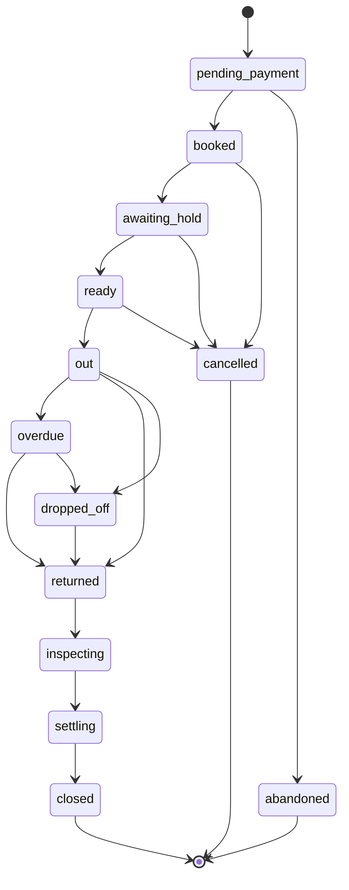

- **pending_payment:** a booking exists and its fee is not yet paid. It keeps its item for fifteen minutes.
- **abandoned:** the fee was never paid and the item was freed: staff let it go, or Hold did once an assistant's booking passed its fifteen minutes (section 6.11).
- **dropped_off:** the renter photographed the item through their link and left it at the shop's drop point with nobody at the counter (section 6.13). Only a person who has seen it makes the rental `returned`.

**Hold**

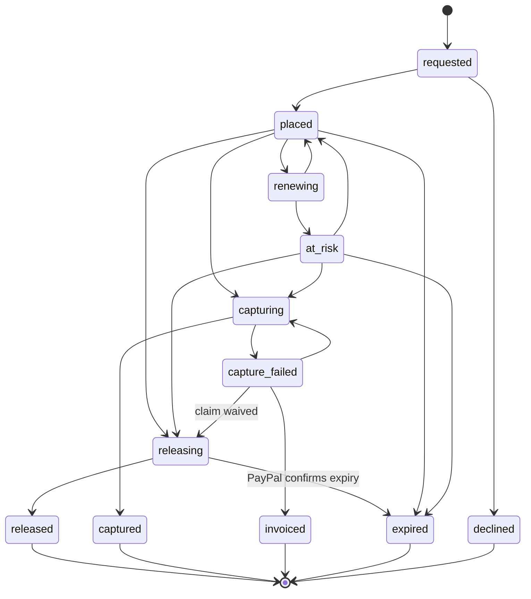

- **placed:** PayPal confirms the money is reserved.
- **at_risk:** the hold exists but its assured period has passed and a renewal did not succeed. The owner is told.
- **captured:** the approved amount was taken. Any remainder is released in the same step.
- **invoiced:** capture was not possible, so the claim was sent as an invoice.
- **expired:** the hold reached the end of its life without being used or replaced.

**Claim**

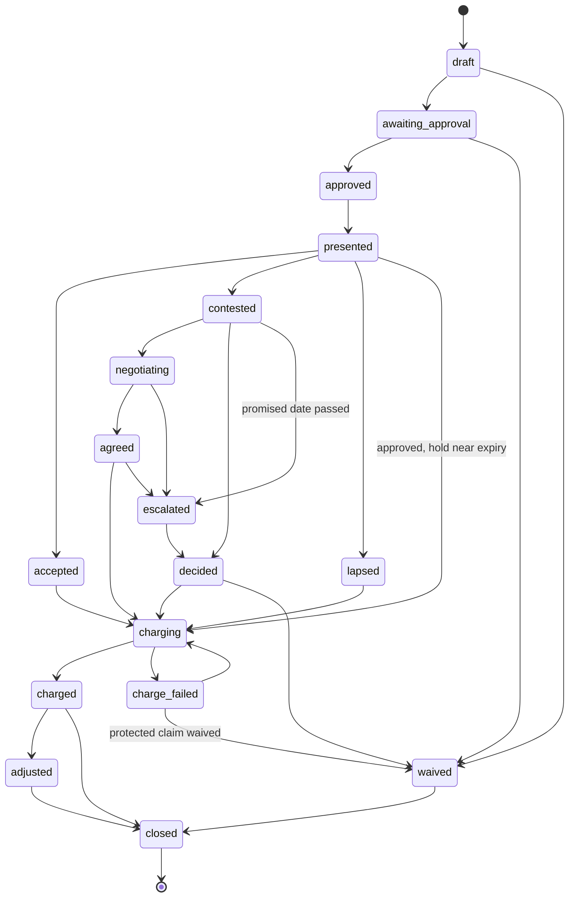

- **lapsed:** the renter's reply period ended without a reply.
- **adjusted:** part of a charge was refunded after review.
- **negotiating:** both sides gave an advocate limits, and the advocates are exchanging offers.
- **agreed:** the advocates agreed. Each person confirms, unless their mandate waives it.
- **escalated:** the advocates did not agree, a person declined the result, or the shop did not decide by the date it promised the renter (section 6.16). The owner decides. A claim never returns to `contested`.

**How they connect.** A rental cannot be handed over unless its hold is placed. A hold cannot be captured unless a claim reached charging. A rental cannot close while its hold is in any state but released, captured, invoiced or expired.

### 7.2 Claim arithmetic

- **Each line is priced from the price list version the renter agreed to at booking.** A later price change never affects an earlier rental.
- **The line amount is read from the database.** The model may suggest which entry applies. It cannot supply an amount.
- **The claim total is the sum of its lines.**
- **The charge is the smaller of the claim total and the reserved amount.**
- **Anything above the reserved amount** becomes a separate invoice with the same evidence.
- **Amounts are integer cents** with a currency code.

Hold deliberately does not use PayPal's allowance to capture slightly more than was authorized. The renter agreed to a stated hold, and Hold never takes more than that from it.

### 7.3 Approval rules

Before any action on a hold, the approval rules decide who must confirm it.

| Action | Who may confirm |
|---|---|
| Release a hold after a clean return | Any staff member |
| Approve a claim up to the shop's staff limit | Any staff member with that limit |
| Approve a claim above the staff limit | The owner or a manager |
| Reduce or waive a claim | The owner, a manager, or the staff member who raised it |
| Decide a contested claim | The owner or a manager, and not the person who raised it where the shop has more than one |
| Decide a contested claim after the shop missed the date it promised the renter | The owner alone, even for a claim they raised. The renter reads the written reason (section 6.16) |
| Refund part of a charge | The owner or a manager |
| Move a booking that has not started to another item of the same type | Any staff member |

**Rules that always hold**

- A claim cannot be approved unless every line has a finding with photographs, or was added by a named person with a written reason.
- A claim cannot be charged before the renter has been shown it, unless the hold is about to lapse. Section 7.5 covers that case.
- Every approval records what the person changed, such as a removed line or a reduced amount.

**Approval in advance**

A person may also approve earlier, by granting a mandate. A mandate has a fixed kind, typed limits and an end date, and can be revoked. Plain code checks each action against it, and the approval record names it.

| Mandate | Granted by | Allows |
|---|---|---|
| Standing rule | The owner | The operations agent to release a hold after a clean comparison that nobody confirmed |
| Standing rule, missed promise | The owner | Hold to waive a contested claim not decided by the date promised to the renter, and release its hold (section 6.16) |
| Settlement, shop side | The owner | The shop's advocate to agree a contested claim, down to a stated share |
| Settlement, renter side | The renter | The renter's advocate to agree a contested claim, up to a stated total |
| Hold by assistant | A renter with a saved method | The renter's own assistant to accept a hold, up to a stated amount. Optional. |

No mandate allows a charge that a claim does not already justify. The rules above still apply to every claim.

### 7.4 Hold upkeep

A PayPal hold has two clocks.

- **Assured period:** three days from placement. Capture is best assured inside it.
- **Validity:** 29 days from placement. After that the hold is gone.

A hold can be renewed once, after the assured period and before validity ends. The renewal gives a new authorization identifier and a new three-day assured period. It does not extend the 29 days.

**Hold renews only at the moment it charges.** The sandbox said on 14 October 2026 that a hold may be renewed only once. A renewal made earlier is a guess about when a charge will come. If the return is late, or the renter takes the reply period, the charge falls outside the renewal's three days and the one renewal is already spent. So when a charge is due after the assured period, Hold renews and captures on the new identifier straight away, inside its fresh assured period. Every charge within the 29 days is then assured, whatever the return date and however long the reply period. A clean return, the common case, is never renewed at all. Decision 4 in section 21 records the alternatives.

The plan is computed by plain code in `packages/domain/src/upkeep.ts` from the authorization's clocks. Each timed step is a schedule in EventBridge. None of them renews.

| When | What Hold does |
|---|---|
| **The hold is placed** | Records both clocks from PayPal's reply and creates the schedules below |
| **A charge is due,** inside the assured period | Captures on the current identifier |
| **A charge is due,** after the assured period, on a hold not yet renewed | Renews, reads the new authorization back, then captures on it at once |
| **A charge is due,** and the renewal is already spent | Captures on the current identifier, without assurance |
| **A renewal fails** | Marks the hold at risk, tells the owner, and still tries the capture on the original identifier |
| **A capture is refused** | Sends the claim as an invoice with the evidence pack and releases the hold (section 8.4) |
| **Three days before validity ends,** and the rental is still open | Starts a replacement: a new hold through a saved payment method if one exists, otherwise a link asking the renter to approve a new hold. The replacement has its own clocks and its own renewal. |
| **A replacement is confirmed** | Releases the old hold |
| **A day before validity ends,** with an approved claim still waiting for the renter's reply | Charges it then, as section 7.5 says |
| **Validity ends with no replacement** | Marks the hold expired and tells the owner at once |
| **The rental ends** | Removes any schedules still pending |

**What Hold gives up.** A renewal also re-checks the renter's funds, so renewing early would warn sooner that the money is gone. Hold accepts the later warning: the failure is handled at the charge in the same way, with a capture attempt and then an invoice, and the one renewal is never wasted on a rental that comes back clean. While a claim is being prepared, the claim screen reads the authorization from PayPal to show that the hold still stands, which spends nothing.

**Hold tracks expiry itself.** PayPal's event list has no event for a hold expiring, so Hold does not wait to be told. It acts on its own clock and confirms by reading the authorization from PayPal.

**As built** (`packages/settle/src/upkeep.ts`, `upkeep-schedules.ts`):

- **Two one-off schedules per authorization,** `hold-replace-{authorization}` three days before the end and `hold-expire-{authorization}` at the end, in the `hold-schedules` group of EventBridge Scheduler. Each sends a message to the `upkeep` queue, grouped by the hold, and is deleted after it fires. A step whose time has already passed is sent to the queue at once, since a schedule in the past never fires. If making them fails after PayPal placed the hold, the execution is tried again and `ensureUpkeep` makes them then.
- **A step acts only on the authorization the hold rests on.** One made for an authorization a replacement took over from does nothing.
- **Expiry** reads the authorization back. If PayPal still holds the money until a later time, the step moves to that time. Otherwise the hold and its authorization are marked `expired`, the audit trail says so, and every owner is emailed in their language with a link to the rental. A failed email is tried again without expiring twice.
- **Replacement,** while the rental still needs its hold (`needsReplacement`: from `ready` until `settling`): the worker makes a new hold order for the same amount, keyed by the authorization it replaces, keeps it on the hold, signs a new renter link to `/r/{token}/pay` and emails it to the renter, in the rental's language, with the day the old hold ends. Once the renter approves, the hold moves onto the new authorization (`replaces_id` names the old one), its own clocks and schedules replace the old ones, and the old authorization is voided through a `release` execution, confirmed by reading it back, with `hold_released` in the money log. A renter who never approves is left to expiry. Placing a replacement through a saved payment method waits for PayPal to allow it (tech-stack.md section 16).
- **The rental ends:** a step for a hold no longer `placed` or `at_risk` does nothing, so no schedule outlives its use. Removing them when the rental closes comes with closing.

### 7.5 The reply period and the hold's life

A shop may give the renter time to reply to a claim. That period cannot outlast the hold.

- If the reply period ends inside the hold's validity, Hold waits.
- If the hold would lapse first, Hold captures the approved amount before it lapses and tells the renter that the claim is still open. If the claim is then reduced or waived, the difference is refunded.

This rule is shown to the renter at booking. The explicit `presented` → `charging` exception is allowed only by the deterministic deadline guard for an approved claim whose hold would otherwise outlast the reply period by less than one day. It preserves the original reply period: a protective capture is not a final decision on a later contest, and a human-approved waiver refunds the verified capture through its own execution.

**As built on 20 October 2026 — claim approval and settlement**

- `/shop/rentals/{rentalId}/claim` composes a claim from the rental's agreed price-list version. A selected finding must be second-look-confirmed new damage or a missing part with photographs from both sealed sessions, and not from sample photographs unless the shop's PayPal account is the sandbox, where the finding is offered marked as a sample. A manual line requires a named staff member and a written inspection reason. Neither input accepts an amount. The screen shows stored prices, paired signed display photographs and the capture/release/invoice split.
- Approval checks the person's role and approval limit, records the immutable line IDs and total, and creates a private, scoped renter link and QR. Approval alone neither starts the reply period nor permits capture. The renter sees `/r/{token}/claim` and explicitly posts “I have reviewed this claim”; that transaction records presentation and the original reply deadline. Reopening or reissuing a link does not reset it. A claim never reviewed stays approved for staff follow-up rather than silently charging.
- Accept/contest requires a fresh eight-digit code sent to the email returned by PayPal for the payer. One exception, for the sandbox only: PayPal's sandbox test accounts have addresses on `personal.example.com` and `business.example.com`, which receive no mail, so when the shop's PayPal account is in sandbox mode and the payer's address is on one of those domains, the code goes to the booking's contact email instead (`claimCodeRecipient` in `packages/domain`). The renter's screen says so, and the audit line `renter.claim_code_sandbox_contact` records it without the address. Live, the code only ever goes to the payer. Migration `0017` adds only challenge metadata to `renter_links`: a keyed digest, expiry and attempt count. The code is bound to the link, expires after ten minutes, has three attempts, is single-use, and cannot be resent inside sixty seconds. A booking/pay link cannot reply. The signed shared renter wrapper and shop RLS apply to every write; staff money decisions use the existing passkey step-up.
- A normal acceptance, elapsed reply period or eligible independent owner/manager decision queues one capture; a contest queues none. A staff-confirmed clean return or waiver queues one release. Approval, state changes, execution and outbox row commit together. Prices, approval bounds and final-capture amounts are rechecked before PayPal is called. No agent or model can approve or charge.
- The capture reserves the hold as `renewing` or `capturing` before any outside call. A renewal has its own execution; its new authorization ID replaces the capture's binding before capture starts. A late replacement authorization cannot replace one being settled: it gets a durable release job, and the rental cannot close while an extra created authorization remains or its claim is not closed (including an unpaid excess invoice). Confirmation checks the exact execution, authorization, final-capture flag, amount and currency. Pending capture/refund resource IDs are retained for verified webhook recovery and direct read-back.
- `claim_plan` and `claim_due` use the existing upkeep queue. The due time is the earlier of the reply deadline and one day before authorization expiry. A protective capture leaves the original reply period open. Excess/fallback invoices wait for acceptance, an eligible uphold decision, or the original deadline with no contest. A contested protected claim remains open. The human decision is fenced under the claim lock; a later conflicting decision cannot race a refund. Waiver refunds the verified captured amount, or releases the unused authorization after a failed capture. These recovery edges are `charge_failed → waived`, `capture_failed → releasing`, and `releasing → expired` only when a fresh PayPal read proves expiry; an already expired hold stays terminal.
- A refused capture, including a pending capture later read as declined/failed, uses the approved claim's full amount for an invoice; an expired authorization is never captured. An excess above the hold becomes a separate invoice. Capture confirmation and any next invoice/refund outbox obligation share one transaction. Invoices are searched by a stable invoice number before creation, then read/validated before and after sending. A verified `INVOICING.INVOICE.PAID` event triggers another direct read before recording payment and closing. A sent invoice keeps the claim/rental open; it is never counted as paid. Money events and approvals remain append-only.
- Staff and renter screens show settlement status in English, French, German and Spanish. The private link is handed to the renter at the counter; claim presentation is explicitly acknowledged there. A downloadable evidence pack and automatic settlement receipt emails are still subsequent spine work; the current claim pages contain the shared record and evidence. Deployment and live AI accuracy evaluation are deferred as recorded in section 20.2.

### 7.6 Execution, the outbox and idempotency

Acting on a hold involves a database and an outside API, which cannot share a transaction. Hold uses the outbox pattern.

1. In one database transaction, Hold records the approval, creates an execution with a fresh idempotency key, and writes an outbox row.
2. The worker reads the outbox and sends the message to the executions queue.
3. The worker calls PayPal with the idempotency key.
4. The worker records PayPal's reply and marks the execution submitted.
5. The execution is confirmed only when the matching PayPal event is verified, or the resource is read back from PayPal.

**More days** a renter paid for from their phone follow them too, with the action `extension_capture` (section 6.14).

**The rental fee** follows the same steps with the action `fee_capture`, which names the rental and no hold. The renter's request records the execution with its outbox message and sends it to the `executions` queue at once (`requestFeeCapture` in `packages/settle`); the worker calls PayPal with the execution's key and records the read-back (`runExecution`). If the send fails, the outbox relay sends it within a minute. The renter's page looks again every two seconds until the rental shows as booked.

**The outbox relay** runs every minute (`relayOutbox`, scheduled by EventBridge Scheduler). It reads the oldest waiting messages in every shop through `hold_pending_outbox`, which only `hold_worker` may call, sends each to its queue with its rental as the group and what it names as the deduplication ID, and marks it sent only once the queue took it. Most messages are sent by the request that wrote them, so the relay mostly finds nothing. The capture's key is fixed by the rental and its order, so repeating it captures nothing twice, and the money log takes the capture's identifier once. PayPal's amount must equal the stored fee to the cent, or the execution fails and nothing is booked.

**Idempotency at each layer**

- **To PayPal:** the `PayPal-Request-Id` header carries the execution's key. A retry cannot capture twice.
- **From PayPal:** each event's ID is unique in `paypal_events`. A redelivered event is ignored.
- **In the money log:** each row has a unique PayPal reference. Applying the same event twice writes nothing new.
- **In the queues:** work is ordered per rental, so two workers never act on the same hold at once.

**Invariants the code enforces**

- The amount captured from a hold never exceeds its reserved amount.
- The amount captured never exceeds the approved claim.
- Captured plus released never exceeds reserved.
- A hold reaches exactly one final state.

---

## 8. PayPal integration

### 8.1 The shop's PayPal account

Each shop is paid into its own PayPal business account. Hold does not hold funds at any point.

**In the hackathon,** each demo shop maps to a sandbox business account. Its API credentials are stored in Secrets Manager and referenced from `paypal_accounts`.

**In production,** Hold would act for shops through PayPal's partner model, with each shop's consent and without holding its credentials. The code reaches the account through a credential provider interface, so that change is confined to one adapter. The sandbox refused Partner Referrals to an app without partner permissions on 28 October 2026, and an order naming the shop by email alone could be captured but not voided, so the change waits on PayPal granting those permissions (tech-stack.md section 16, item 15).

### 8.2 Placing the hold: three strategies

PayPal sets two constraints that shape this.

- An order that authorizes first cannot contain more than one purchase unit. The fee and the deposit cannot be two parts of one such order.
- A hold lasts 29 days. A hold placed when a tourist books three weeks ahead would be nearly spent by the time they arrive.

So the hold is always its own authorization, and when it is placed depends on the rental. All three strategies sit behind one interface and produce the same hold object.

| Strategy | When it is used | How it works | Approvals by the renter |
|---|---|---|---|
| **At the counter** | Advance bookings, and the safe default | The fee is paid at booking with an ordinary order. At pickup, staff show a QR code and the renter approves the hold on their own phone. | One at booking, one at pickup |
| **Combined** | Walk-in and same-day rentals | One authorize-first order for the fee plus the deposit. The fee is captured at once, marked as not the final capture. The rest stays reserved as the hold. | One |
| **Saved method** | Returning renters, where the shop is approved for it | The renter saves their PayPal wallet with the shop once. Hold places the hold shortly before pickup with no action from the renter, and can replace it for long rentals. | None after the first |

**Which is built first.** "At the counter" uses only behavior PayPal documents plainly, so it is the baseline. "Combined" gives the best walk-in experience. The sandbox confirmed on 14 October 2026 that the remainder stays held after a partial capture and can then be captured or released, and on 28 October 2026 that a hold part of which was captured renews when the renewal names what is still held. "Saved method" is optional.

**How "Combined" is built (28 October 2026).** Staff choose it, with "Walk-in: fee and hold in one PayPal approval" on the New rental form, which is offered only for a rental that starts on the shop's own today and is off by default. It is a choice because a returning renter's Clean Record lowers the hold only once their fee tells Hold who they are; a walk-in's one approval comes before that, so they get the ordinary hold (`placementStrategy` in `packages/domain/src/hold-placement.ts`). The booking asks for the hold at once, with strategy `combined`. The renter's link offers one button, "Pay the fee and approve the hold with PayPal", for one authorize-first order of the fee plus the hold (`holdOrderCents`), described in PayPal as a fee and a refundable hold of which only the fee is charged. The worker authorizes it, checks PayPal's amount against fee plus hold, and only then queues the fee's capture from the authorization, as a capture that is not the final one, through its own execution keyed by the rental and the order. The order is read back for who approved it, which is how Hold learns the renter. Once the fee capture reads back, the rental goes from pending payment through booked and waiting for its hold to ready, each step through the state machine. The rental's fee order stays empty, so a later capture's event is never taken for the fee. A release voids what is left; a claim is captured from what is left, never more; and a renewal names what is still held (`renewHold` with an amount) and is checked against it. Bookings on the shop's page or through an assistant always pay the fee first.

### 8.3 Which PayPal capability does what

| Hold need | PayPal capability | Call | Confirmed by |
|---|---|---|---|
| Rental fee | Orders v2, capture | Create order, capture order | `PAYMENT.CAPTURE.COMPLETED` |
| Place the hold | Orders v2, authorize | Create order with intent to authorize, authorize order | `PAYMENT.AUTHORIZATION.CREATED` |
| Renew the hold | Payments v2 | Reauthorize the authorization | Read-back of the new authorization |
| Release the hold | Payments v2 | Void the authorization | `PAYMENT.AUTHORIZATION.VOIDED` |
| Charge damage | Payments v2 | Capture the authorization for the claim amount, as the final capture | `PAYMENT.CAPTURE.COMPLETED` |
| Check a hold | Payments v2 | Show authorization details | |
| Reduce a charge | Payments v2 | Refund the capture | `PAYMENT.CAPTURE.REFUNDED` |
| Damage beyond the hold | Invoicing v2 | Create and send invoice | `INVOICING.INVOICE.PAID` |
| Returning renter | Payment Method Tokens v3 | Setup token, payment token, order with the saved method | `VAULT.PAYMENT-TOKEN.CREATED` |
| Shipped rental | Shipment tracking | Add and read tracking | Tracking status |
| Dispute | Disputes v1 | Read dispute, provide evidence | `CUSTOMER.DISPUTE.*` |
| The record of truth | Webhooks, Transaction Search | | |
| Owner identity | Log in with PayPal | OAuth exchange | |
| Owner's assistant | Agent Toolkit, sandbox MCP server | Read tools | |

### 8.4 The life of one hold in PayPal calls

**Placing, at the counter**

1. The worker creates an order in the shop's account with intent to authorize, for the hold amount, described as a refundable hold.
2. The renter approves it in PayPal from the QR code or link.
3. On approval, the server authorizes the order.
4. PayPal returns an authorization with its identifier and expiry time.
5. Hold records both clocks and marks the hold placed when the event is verified.

**Releasing after a clean return**

1. A staff member confirms the clean return.
2. The worker voids the authorization.
3. `PAYMENT.AUTHORIZATION.VOIDED` confirms it.
4. The renter is told that nothing was charged.

**Charging damage**

1. The claim reaches charging.
2. If the assured period has passed and the hold has not been renewed, the worker renews it and reads the new authorization back. This is the only place Hold renews (section 7.4).
3. The worker captures the claim amount as the final capture, at once, on the current identifier.
4. `PAYMENT.CAPTURE.COMPLETED` confirms it.
5. The worker reads the authorization back to confirm the remainder was released.
6. Renter and shop receive the same record.

**If the renewal or the capture fails**

1. A refused renewal marks the hold at risk. The worker still captures on the original identifier, without assurance.
2. A refused capture is not retried with a second renewal, which PayPal does not allow. The claim is sent as an invoice with the evidence pack, and the hold is released.
3. The owner is told in plain words what happened.

### 8.5 The webhook pipeline

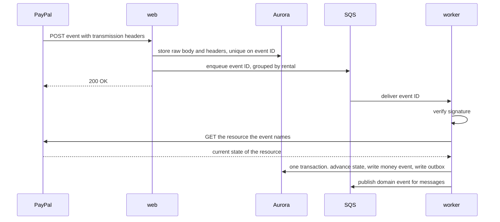

**Rules**

- **Store first.** The raw body is saved before anything else, so no event is lost and the signature is checked against the exact bytes received.
- **Answer quickly.** PayPal retries a delivery that does not return success, up to 25 times over three days.
- **Verify before applying.** An event that fails verification is kept for inspection and never applied.
- **Read the resource back.** Hold does not trust the event body for amounts or status.
- **Tolerate disorder.** State machines only move forward, so a late or repeated event changes nothing.

**Simulator events.** PayPal's webhook simulator sends events that PayPal's own verification call rejects, so Hold never applies them. In the test environment, the simulated PayPal signs its own events and verifies only those.

**As built** (`apps/web/src/server/paypal-webhook.ts`, `packages/settle/src/paypal-events.ts`):

- **The subscription.** Connecting PayPal subscribes the shop's own address, `/api/webhooks/paypal/{accountId}`, to the events in `PAYPAL_EVENT_TYPES`, and keeps the subscription's id beside the account. A shop connected earlier turns it on from its PayPal page. PayPal takes only an HTTPS address, so on a developer's machine there are no events and Hold works without them.
- **The intake** reads the shop from the account in the address through `hold_paypal_account`, before any shop is chosen. It stores the exact body and PayPal's signing headers, once per PayPal event ID, with an outbox message in the same transaction, sends that message to the `paypal-events` queue at once, and answers 200. Events about one order share a group: a capture is grouped by the order it was made on. Deliveries are limited per network and to 64 KB.
- **Verification** asks PayPal's `verify-webhook-signature` about the exact stored body, against the account's subscription. A rejected event is kept, marked `rejected`, and never applied.
- **What is applied.** `CHECKOUT.ORDER.APPROVED` on a fee order: the order is read back, and only if PayPal shows it approved is the fee captured. This books a renter who approved in PayPal and never came back to Hold. `PAYMENT.CAPTURE.COMPLETED` on a fee order: the order is read back for who paid and how much, and confirmed as in section 6.5. `CHECKOUT.ORDER.APPROVED` on a hold order: read back, and only if approved is the authorization recorded and carried out. `PAYMENT.AUTHORIZATION.CREATED` on a hold order: the authorization is read back and confirmed as in section 6.6. Every other event is kept and marked `ignored` until the feature that acts on it is built.

### 8.6 Reconciliation

Every night Hold compares its records with PayPal.

- **Every open hold** is read from PayPal. Its status and expiry must match Hold's record.
- **Every capture and refund** in the shop's transaction history must have a money event in Hold.
- **A difference** raises an alert. Missing events are applied through the normal path. Anything else is shown to the owner and is never corrected silently.

### 8.7 Disputes

A renter may open a dispute with PayPal despite the reply period.

1. `CUSTOMER.DISPUTE.CREATED` arrives and Hold links the dispute to the rental by the capture it names.
2. The owner is told, with the evidence pack already built.
3. The owner reviews and confirms.
4. Hold uploads the evidence pack to PayPal as the shop's response.
5. Later events update the dispute's state. If the shop loses, the refund appears as a money event like any other.

Hold never responds to a dispute without the owner's confirmation.

### 8.8 The PayPal adapter

`packages/paypal` is the only code that talks to PayPal.

- **One method per business action,** such as `placeHold`, `renewHold`, `releaseHold` and `captureFromHold`, each requiring an idempotency key.
- **The port** is `PayPalHolds` in `packages/paypal/src/port.ts`: `createHoldOrder`, `readHoldOrder`, `placeHold`, `readAuthorization`, `renewHold`, `releaseHold` and `captureFromHold`. Every write takes an idempotency key. After placing, renewing or releasing, the adapter reads the authorization back from PayPal instead of trusting the reply.
- **A fake PayPal** (`createFakePayPal`) implements the same port in memory with a clock the caller controls. It is what renewal and expiry are tested against, and what the integration tests use.
- **Typed results and typed errors,** so callers can tell a decline from an expired hold from an outage.
- **Token handling.** Access tokens are fetched per shop account, cached until shortly before expiry and never logged.
- **Debug IDs.** PayPal returns a debug ID with each response. Hold logs it with every call.
- **Retry policy.** Network and server errors are retried with backoff and the same idempotency key. Client errors are not retried.

**How the Agent Toolkit is used.** The toolkit has no tool to authorize, renew, release or partly capture a hold, so the adapter calls the REST API for those. The toolkit is used for invoices, refunds, shipment tracking and reading disputes and transactions, and it gives the owner's assistant its PayPal read tools.

---

## 9. Evidence architecture

Hold's claim to fairness rests on its evidence. This section describes how a photograph becomes something both sides can rely on.

### 9.1 Capture sessions

A capture session is one guided set of photographs of one item.

| Kind | Taken by | When |
|---|---|---|
| Handover | Staff | When the item leaves |
| Return | Staff, or the renter through their link (`by_renter`, section 6.13) | When the item comes back |
| Packing | Staff | Before a shipped item is sealed |
| Unboxing | Renter | When a shipped item arrives |
| Send-back | Renter | Before a shipped item is returned |
| Condition | Renter | Within a day of a handover, photographs of anything staff missed (section 6.7) |
| Incident | Renter | During the rental, photographs of something that happened (section 6.8). Never a comparison baseline. |

**How a session runs**

1. The app loads the photo plan for the item type.
2. For each view, the camera shows a framing outline. In a return session it also shows the handover photograph faintly, to match the angle: the handover ghost. Staff can hide it to see the item clearly and set how strongly it shows (10 to 90 percent, 40 to start). With no live camera, when the photograph is chosen from a file, the handover photograph is shown whole in the camera's place as the framing guide, with a line saying to take the return from the same angle. The handover itself has no ghost: nothing earlier exists to match.
3. The phone checks sharpness, brightness and framing at once, and asks for a retake if needed.
4. The photograph uploads straight to the evidence bucket through a short-lived signed link, with its fingerprint attached so S3 rejects a corrupted upload.
5. When every required view is present, the session is sealed.

**Return capture implemented, 20 October 2026.** Staff start a return only for an `out` or `overdue` rental with a sealed handover. The return keeps that handover's photo plan, even if the item type is edited later. Starting again resumes the same session. Retakes preserve earlier originals. Only when all items have sealed returns does the rental move to `returned`, and the same transaction writes one comparison and outbox message per item. Handovers and returns share upload validation but their actions refuse each other's session IDs. A return cannot add permanent known marks through a handover action. Sample photographs carry `quality.simulated = 1`; the return capture screen labels saved samples and sample handover guides, and any comparison using them is marked simulated in its record and on screen. The return screen also offers the sample with damage and the sample for a contested claim (section 20.3).

### 9.2 What makes a photograph evidence

| Property | How Hold provides it |
|---|---|
| **It cannot be changed** | The evidence bucket uses S3 Object Lock. An object cannot be overwritten or deleted until its retention period ends. |
| **It can be proved identical** | A SHA-256 fingerprint is recorded in the database when the upload completes. |
| **Its time is trustworthy** | The recorded time is when the server received it, not the phone's clock. |
| **Its place in history is fixed** | Each sealed session writes a manifest listing its photographs and fingerprints, plus the fingerprint of the item's previous manifest. This forms a chain per item. Removing or replacing an earlier session would break it. |
| **It shows the right item** | The comparison checks identifying features and flags a mismatch. |
| **It is not a reused image** | A perceptual fingerprint is compared with earlier sessions for the same item. Fingerprints within four bits of each other count as the same picture, since resizing and saving again moves one by a few bits (`REUSED_WITHIN_BITS`). |

### 9.3 Two copies of every photograph

- **The original** stays locked in the evidence bucket and is never shown directly.
- **The display copy** is smaller, has faces blurred, and lives in the display bucket. It is what people see on screen.

Faces are found by Amazon Rekognition and blurred before the display copy is saved. If a dispute requires it, the owner can release the original.

### 9.4 The item passport

Each item carries a list of marks.

- A mark has a view, a region, a description and the session where it was first seen.
- At handover, staff confirm the known marks and can add new ones. The renter sees the list and can add a photograph of anything missed.
- During comparison, a difference that matches a known mark is labelled as already present and cannot be claimed.
- When damage is charged, it becomes a mark, so the next renter is not charged for it. PayPal's confirmed capture does this (`openRepairsForClaim`, section 9.6).
- When the item is repaired, the mark is closed, with the repair's photographs as its evidence (section 9.6).

This is what guarantees that nobody pays for an earlier renter's damage.

The passport is the page `/shop/items/{id}` (section 13.6). It shows the item's marks, its rentals and its sealed photo sessions in chain order, read by `itemPassport` in `packages/db`.

### 9.5 The evidence pack

Versioned documents per rental, built by the worker from a frozen, validated database snapshot.

1. The rental's details and the versions of the price list and wear policy the renter agreed to.
2. The handover session and the condition report the renter confirmed.
3. The return session.
4. The comparison: each finding with both photographs and the region outlined.
5. The claim, each line with its price list entry.
6. The approvals, including anything a person changed.
7. The renter's reply, if any.
8. The PayPal record: authorizations and verified fee capture, deposit capture, release, refund and invoice events. Invoice sent and invoice paid are distinct; expiry is not represented as release. Sandbox and simulated records are visibly labelled.
9. A manifest of original and embedded display-copy SHA-256 fingerprints, server receipt times, supersession and sealed-session chain links. Storage keys and renter tokens never enter the downloadable manifest or PDF.

Sealing evidence, condition replies, comparison completion or deferral, claim changes, approvals, renter replies, resolution and verified settlement reserve the relevant snapshot in the same shop transaction as the lifecycle change and its outbox work. A rental-row lock serializes version allocation. Identical canonical source fingerprints reuse a version; changed source values reserve a new one. The worker renders only that frozen snapshot, including incomplete stages, agreed historical prices/policy text, named manual reasons, uncertainty, model/prompt identity and quoted renter comments. Ordinary packs embed face-blurred display photographs, paired by item/view with finding outlines. A missing display copy blocks publication and retries; there is no original-photo fallback.

The snapshot, photograph manifest and PDF are written under version-specific keys in the locked evidence bucket using conditional S3 creation and SHA-256 checksums. Exact object-version references are retained and used for verification and downloads. Identical bytes after a lost response can be reused; conflicting bytes fail closed. `building → ready` requires complete hashes/version references, while `failed → building` retries the same reserved snapshot. `ready` has no outgoing transition. Earlier published versions remain. The record supplies the evidence for a later dispute submission; generation itself does not submit a dispute.

PDFKit `0.20.2` renders four Western-language document label sets with standard Helvetica, measured wrapping, section headings and page numbers. Arbitrary non-Latin names or comments need a future embedded Unicode font. Python PDF tooling is used only for local visual inspection.

Photo and comparison Lambda entry points use `@hold/evidence/photos`, which exposes photo storage and display processing without loading the PDF renderer. The evidence worker alone loads PDFKit as an installed external module; its file-based assets must not be bundled into the photo workers' CommonJS code. A startup regression builds and executes both photo handlers in that deployment format.

Staff and renters can list versions and download the shared PDF/manifest after access checks (sections 12.3 and 13). Snapshots whose claim is `draft` or `awaiting_approval` remain staff-only. Authenticated POST server actions request a build or a download link; rendering and signed-link issuance never happen merely because a page is visited. Read-only staff can download but cannot request builds. Signed links last at most 300 seconds and name the published S3 version. Page/action responses are private/no-store; no original-photo URL is included.

**Settlement receipts.** Verified capture with its confirmed remainder produces one receipt; clean release, refund, invoice sent and invoice paid have separate receipt kinds. Fee payment and renewal do not send settlement receipts. Each intent is committed with its verified money event and bound to the snapshot's exact pack. Publication queues its delivery; later evidence cannot retarget it. A protective capture receipt leaves the contest visibly open, and a sent invoice never claims payment. The shared `@hold/settle` receipt state machine leases work, waits for that pack to be ready and marks `sent` only after the transport accepts it. The worker uses SMTP; simulated execution uses the same state machine with the memory mailer. Missing verified payer contact is a recorded failure. No receipt attaches a PDF or grants payment authority.

### 9.6 Repair closes the loop

Added 29 October 2026, from the competitive gap analysis (feature 6). Charged damage used to stop at the money. Now it reaches the item: the passport carries it, a repair puts it right, and the photographs show it. The rules are plain code in `packages/domain/src/repair.ts`; the records are written by `packages/db/src/repair-repository.ts` (migration `0037`); the screens are `apps/web/src/features/repairs`.

- **A charge opens a repair.** In the transaction that records PayPal's confirmed capture (`confirmClaimCaptured`), `openRepairsForClaim` puts each line with its item: a finding's through its return session, an agreed incident's through its report, and a person's written line only when the rental had one item. Each finding becomes an open known mark, first seen in that return session, so the next renter's comparison sets it aside. One repair opens per item, its lines pre-filled with what each was claimed for, marked lines first; it runs once per claim. The item keeps renting; staff take it out of service through its status only if they choose.
- **Opened by hand.** Staff who may act (`openRepairFromMarks`) open one from an item's open marks that no open repair covers, for wear or damage nobody was charged for. It goes on the item's latest rental that has ended (`settling` or `closed`), never a booking still to come.
- **Photographed.** `startRepairCapture` starts a capture session of kind `repair` on the repair's rental item (the claim's, or the item's latest), asking only for the views its marks are on, each one required. None when no line has a mark. Starting and closing are refused while the item is in use (`out`, `overdue`, `dropped_off`, `returned` or `inspecting`), so a mark is never closed under a rental it was handed over with. The upload contract, evidence store, quality checks and display copies are those of the handover and return (`staffPhotoActions('repair')`). Staff frame each view against the photograph the mark was found on (`repairGuides`).
- **Closed.** `closeRepair` seals the session into the item's chain, writes each line's outcome (`repaired` or `left`), closes the repaired marks (`status repaired`, `closed_at`, `repair_id`), records the cost in whole cents in the shop's currency and an optional note, and returns the item to service when it was in repair and no other repair is open. A mark left as is stays on the passport. A repair done is never changed (trigger `repair_guard`), a line's outcome is written once (`repair_line_guard`), and a repaired mark always names its repair (check `repaired_by_a_repair`). Sealing rebuilds the rental's evidence pack: a rental's record includes a repair session only when that rental's own claim opened the repair, so a repair opened by hand never enters another renter's record.
- **No money moves.** The cost is the shop's own record. It never enters the money log and is never shown to the renter.
- **What it shows.** On the passport: each repair to do with its origin and claimed amounts, a form to open one from marks, and repairs done with cost against claim; a repaired mark reads "Repaired" with its date. On the decision board: each open repair, with the counter's work, for any staff member. On the fleet grid (AG Grid): repair cost, what damage recovered less repair cost (`repairMargin`), and repairs to do. On the prices page: for each price a repair was costed against alone (every line of the repair priced from that one entry), the number of repairs, the average cost and the gap (`priceRepairStanding`), as AG Grid from a tablet up and a list on a phone. On the renter's claim page: each line repaired, with its date and photograph.

---

## 10. AI architecture

### 10.1 The principle

The AI is good at looking and at language. It has no authority over money. It produces findings and words. People produce decisions.

```mermaid
flowchart LR
    pair["Handover and return photos"]
    q["Quality check<br/>plain code"]
    align["Align and find regions<br/>plain code"]
    look1["First look<br/>Claude, full views and crops"]
    look2["Second look<br/>Claude, crops only, fresh context"]
    marks["Match known marks<br/>plain code"]
    price["Price from the list<br/>plain code"]
    person["Person approves"]
    claim["Claim"]

    pair --> q
    q --> align
    align --> look1
    look1 --> look2
    look2 --> marks
    marks --> price
    price --> person
    person --> claim
```

### 10.2 The comparison pipeline

Run by the worker for each item when a return session is sealed.

**Step 1. Quality.** Plain code scores each photograph for sharpness, brightness and framing. This already happened on the phone. It runs again so the record does not depend on the phone.

**Step 2. Normalize.** Orientation, size and exposure are corrected so the two photographs of a view are comparable.

**Step 3. Align.** The return photograph is lined up with the handover photograph. An alignment score is recorded. A poor score means the angles differ too much to compare reliably.

Since 28 October 2026 the alignment follows features, so a handheld photograph turned, zoomed, shifted or seen a little from one side still aligns (`packages/vision/src/align-pair.ts`). Both photographs are scaled to 1,024 pixels on their longer side (`PAIR_LIMITS.workingSide`), so a chip one percent of the photograph's width is about ten pixels. ORB finds up to 3,000 keypoints in each. Each keypoint is matched to its two nearest in the other photograph and kept only when the nearest is clearly better (ratio 0.75). A homography is fitted to the kept matches with OpenCV's MAGSAC++, its robust RANSAC variant: on the sample photograph zoomed five percent, classic RANSAC put the frame's corners 3 to 11 pixels off, which drew false changes along strong edges there; MAGSAC++ put them under one pixel off. The pair is aligned only if every named limit holds: at least 40 agreeing matches and 30 percent of the kept ones (`ALIGNMENT_LIMITS`); a plausible camera move, with no mirror image, a zoom between 0.67 and 1.5, a stretch in one direction under 1.25 and the perspective changing the frame's corners by under 20 percent (`HOMOGRAPHY_LIMITS`); the handover covering at least 60 percent of the return photograph; and, once lined up and corrected for exposure, a similarity of at least 0.92 over the best-matching nine tenths of the overlap (`PAIR_LIMITS`). Otherwise the pair is deferred as poorly aligned. All are starting values, measured only on synthetic moves of the sample photograph; the evaluation set's tuning half measures them before the accuracy gate is released.

**Step 4. Candidate regions.** Plain code marks areas that changed between the aligned pair. These are hints. Most will be shadows, reflections or dirt.

The handover photograph is moved onto the return photograph's frame and both are compared in colour at the working size, since a grey chip on blue paint can be as bright as the paint. Exposure is corrected per channel as a pair, by the median difference over the part both show. A pixel counts as changed when a channel differs by more than 35 levels from every pixel within two of it in the other photograph, both ways, so an alignment off by a pixel or resampling does not draw every edge. Changed pixels within six of each other form one region; a region needs twelve changed pixels and keeps six around them. Only where the handover photograph lands counts. More than eight regions defers the pair.

**One frame for every region.** A region is always in fractions of the return photograph. Candidates are found there, the model is told to report there, and the comparison screen, the claim screen and the evidence pack draw findings on the return photograph, never on the handover's. Known marks and marks reported during the rental, drawn on other photographs, are carried into that frame through the pair's homography: their four corners are mapped and the box around them taken (`mapRegion`). The handover crop the model sees is cut from the handover photograph moved onto the return's frame, so both crops of one region show the same place on the item. The handover photograph is never redrawn for people. The homography is not stored, so the negotiation's known-mark ground (`checkGround`) still compares a handover mark with a finding's region directly, within `NEGOTIATION_LIMITS.knownMarkDistance`.

**Step 5. First look.** Claude receives both full photographs of the view, close crops of each candidate region from both, the item type, the known marks and the wear policy. It returns structured findings:

| Field | Content |
|---|---|
| View | Which view of the item |
| Region | Where in the photograph |
| Class | No change, ordinary wear, damage, missing part, or cannot tell |
| Confidence | A stated level |
| Description | A short plain sentence |
| Suggested price entry | A code from the shop's list, or none |

The model is also asked to report anything the candidate regions missed.

**Every candidate is accounted for (prompt version `inspection-3`).** Code found the candidate regions, so the model may not pass over one in silence. It reports a finding whose region touches the candidate, of any class, or lists the candidate's number under `dismissed` with a reason from a fixed list: light, shadow, reflection, dirt, camera angle or background. Plain code (`unaccountedCandidates` in `packages/domain/src/inspection.ts`) finds any candidate left over and adds it as an uncertain finding with confidence 0, so the return goes to a person. A dismissal naming no candidate counts for nothing. Each comparison records how many candidates code found, how many the model dismissed and how many went to a person.

**Step 6. Second look.** Each finding classed as damage or missing is checked again by a separate call with a fresh context. That call sees only the two crops, each keeping a tenth of the photograph around the finding (`SECOND_LOOK_MARGIN`, since prompt version `inspection-2`), and a neutral question. With the first look's tighter crops it agreed on the class but was often unsure of a featureless tube. It does not see the first call's reasoning. It confirms the finding when it names the same class at a confidence of at least `INSPECTION_LIMITS.secondLookMinConfidence` (0.6); the first look must still reach `minConfidence` (0.9). On the evaluation set's tuning half (29 October 2026), the second look named the same damage at 0.6 to 0.65 and never reached 0.9, so under one bar for both looks nothing was ever confirmed. A confirmed finding only drafts a claim line; a person still approves every charge. If the two disagree, or the second look is less sure than 0.6, the finding becomes "cannot tell".

**Step 7. Known marks.** Plain code compares each finding's region with the item's marks. A match is relabelled as already present and removed from consideration. Marks reported during this rental through the incident desk are checked too. A finding and a reported mark match only both ways (intersection over union at least `INSPECTION_LIMITS.reportedOverlap`) and only for a box within the size cap. A match with a report that was agreed or made the shop's matter is labelled as reported during the rental and linked to the report and its agreed line; it is never billable as a finding. Damage that grew, moved or sits inside a larger box is "cannot tell" and goes to a person. A report nobody agreed only links the finding, which stays ordinary. These marks are never known marks: reporting does not make a mark old.

**Step 8. Price.** Plain code looks up the suggested entry in the price list version the renter agreed to. If the code does not exist in that list, the finding is left for a person to price.

**Step 9. Outcome.** The comparison ends in one of three results.

| Result | Condition | What happens |
|---|---|---|
| **Clean** | No damage or missing findings, nothing uncertain | Staff confirm and the hold is released |
| **Findings** | One or more confirmed findings | A draft claim is prepared for a person |
| **Needs a person** | Anything uncertain, a poor alignment, a possible item mismatch | Staff are asked to look at the item itself |

### 10.3 When the system defers

**Current implementation, 20 October 2026.** `packages/compare` runs the pipeline after all items' return sessions are sealed. The worker remeasures originals with OpenCV, corrects orientation and size with sharp, aligns the pair with a feature homography (step 3), corrects exposure as a pair, and groups changed pixels into candidate regions (step 4). A pair it cannot align within its limits goes to a person. Preparing a pair took about 0.4 seconds for the 1,600 by 685 sample pair and 0.7 to 0.8 seconds for a pair of 4,032 by 3,024 photographs, on a laptop (Apple silicon, 28 October 2026); the comparison Lambda has not been timed. Its starting thresholds are in `ALIGNMENT_LIMITS`, `HOMOGRAPHY_LIMITS` and `PAIR_LIMITS`; confidence and known-mark overlap rules are in `INSPECTION_LIMITS`. They have synthetic-image and recorded-response tests, not a measured accuracy claim. The tuning evaluation and the public scorecard remain required before release.

The first look sees full photographs and candidate crops with the agreed wear policy and price codes as quoted data. The second look gets only neutral paired crops in a fresh request, without the first look's description or proposed price. Code carries handover marks into the return photograph's frame through the pair's homography before excluding overlaps, clears unknown price codes, and gives uncertainty precedence over confirmed findings. Every observation in a second look must agree on the damage class at the required confidence; a mixed or uncertain response defers. Prices are resolved only against the rental's saved price-list version. Exact original or perceptual-fingerprint matches with earlier evidence defer without calling the model; renter condition photographs never become the baseline.

One comparison permits at most ten logical model calls, each with at most 4,096 output tokens, explicit high effort and a shared 120-second model-phase deadline. Each call has a 60-second timeout (`INSPECTION_LIMITS.maxMillisecondsPerCall`; Opus 4.6 took 13 to over 30 seconds a look with two photographs, measured 27 October 2026) and no transport retries. The documented refusal fallback can make one additional physical request per logical call, so the physical ceiling is twenty requests and 81,920 output tokens. No tools are offered. Model identity, prompt version, call/token totals and per-view alignment scores are persisted; refusals, invalid output and ordinary service failures defer. An unexpected processing error records a deferred result before being surfaced to the queue handler.

Comparison records have a `started_at` lease, `deferred_reason` and `simulated` marker (migration 0016). A running lease can be reclaimed after three minutes; completion must match the current lease. Duplicate deliveries cannot duplicate findings or replace a completed result. The comparison Lambda has its own IAM role with evidence read access and model-scoped Mantle inference, but no PayPal credentials, execution queue access or photograph write access. The existing outbox relay is the fallback if immediate delivery fails; its configured queue addresses and send grants include both comparisons and media.

The staff review shows **Clean**, **Findings**, or **Needs a person**, paired display photographs and observations. A person can append their own outcome and written reason to the audit trail even while AI is unavailable. This preserves the model's original result and records the named reviewer. Neither inspection nor a manual note creates an approval, changes the hold, prepares a charge, or closes the rental. The claim and settlement parts of the spine follow this inspection feature.

Hold is designed to say "I cannot tell" readily. It defers to a person when:

- a photograph's quality score is below the threshold
- the alignment score is poor
- lighting differs strongly between the two sessions
- the two looks disagree
- confidence is below the shop's threshold
- the item's identifying features do not match

A wrong damage finding on a clean return is treated as the worst error the system can make. The thresholds are tuned to avoid it, at the cost of asking people to look more often.

### 10.4 Language

| Task | Input | Safeguard |
|---|---|---|
| **Turn the shop's rules into a price list and wear policy** | The owner's plain description | The owner reviews and publishes the result. Nothing takes effect unreviewed. |
| **Write the claim message** | The approved claim | The number guard checks every amount and item against the claim. |
| **Translate for the renter** | The message and the renter's language | The number guard runs on the translation too. |
| **Summarize a contested claim** | Each claim line's basis and the facts code found, and the renter's reply; never an amount | Two versions of the same content, for the shop and the renter. No side, no recommendation, no number; plain code checks every line and quote (section 6.15). |
| **Draft rental terms** | The shop's settings | The owner reviews and publishes. |

**The number guard.** Before any message about money is sent, plain code extracts every amount and item name from it and compares them with the claim record. If anything differs or is missing, the message is discarded and a fixed template is used. A renter can never read an amount that the claim does not contain.

### 10.5 The owner's assistant

The owner can ask questions and give instructions in plain language.

- **Model:** Claude Opus 5.5 on Amazon Bedrock (`anthropic.claude-opus-5-5`), through the Bedrock SDK's Mantle client and the Anthropic SDK's tool runner.
- **Tool choice is automatic,** with strict tool schemas.
- **Every tool call passes through a gateway** that checks the owner's identity, shop and role.

| Tool | Kind |
|---|---|
| `list_holds`, `get_hold` | Read |
| `list_rentals`, `get_rental` | Read |
| `list_claims`, `get_claim` | Read |
| `damage_report`, `item_history` | Read |
| `search_paypal_transactions`, `get_paypal_insights` | Read, through the PayPal toolkit |
| `get_shipment_status` | Read, through the PayPal toolkit |
| `propose_release` | Proposal, confirmed by the owner on screen |
| `propose_extension` | Proposal, confirmed by the owner on screen |
| `draft_message_to_renter` | Draft, sent only after the owner confirms |

**An asymmetry by design.** The assistant can propose releasing a hold, which returns money to a renter. It has no tool to propose a charge. A charge can only begin from a claim built from photographs and approved on the claim screen.

**Proposals are records.** A proposal names the records it concerns and never an amount. It is checked again against the current state when the owner approves it. The operations agent writes the same proposals each night and prepares the owner's morning queue.

**Tools have tiers.** Read, draft, propose, notify, or act under a mandate. No tier permits a charge. See `extensions.md` sections 4 and 6.

### 10.6 Defense against manipulation

| Threat | Defense |
|---|---|
| A renter's comment contains instructions aimed at the model | Renter text is passed as data. The summary step has no tools. |
| A renter uploads an edited photograph | Renter photographs are labelled as renter-supplied and are never used as the comparison baseline. |
| Staff substitute an old photograph | Uploads come from the live camera session. Reused images are flagged by perceptual fingerprint. |
| The model invents a price | Prices are read from the database. The number guard checks every message. |
| The model overstates damage | The second look, the confidence threshold and a person's approval. |
| The owner's assistant is asked to charge someone | No such tool exists. |
| Text in a PayPal memo or dispute note steers the operations agent | It can only write proposals of allowed kinds, for exceptions that plain code found, and a person approves each one. |
| A renter's outside assistant sends instructions or bad data | Everything it sends is stored as data. No tool it can call takes an amount or moves money. |
| An advocate is talked into a bad agreement | The referee is plain code. No move outside a side's mandate is accepted. |
| An advocate reveals its side's limit | Limits are never placed in the other side's context. No text an advocate writes reaches the other side: moves carry amounts, grounds and record ids, worded by Hold's templates. |
| An assistant blocks a shop's items with unpaid bookings | Unpaid bookings expire in fifteen minutes and are capped per caller. |

### 10.7 Model configuration

- Model Claude Opus 5.5 on Amazon Bedrock, `anthropic.claude-opus-5-5`, with a client-side refusal fallback to `anthropic.claude-opus-4-8`. The account's quota for Opus 5.5 is zero, so Opus 4.6 runs in its place through `us.anthropic.claude-opus-4-6-v1`, without a fallback, through judging (`tech-stack.md` section 6).
- Effort is set explicitly on every call: high for both looks, medium for summaries and for sorting an incident report, low for short messages.
- Structured output for all findings.
- The stop reason is checked on every response. A refusal is handled as a normal outcome, and server-side fallbacks are enabled.
- The model and prompt version used are stored with each comparison, so a result can be explained later.

### 10.8 Measuring the comparison

`eval/` holds pairs of photographs with known outcomes: no change, ordinary wear, and damage of several kinds, in good and poor light, on each supported item type.

| Measure | Why |
|---|---|
| Share of real damage found | Shows the shop is protected |
| Share of clean returns wrongly flagged | The error that harms renters. Kept as low as possible. |
| Share sent to a person | Shows the cost of caution |
| Agreement between the two looks | Shows whether the second look adds value |
| Whether stated confidence matches reality | Shows the thresholds can be trusted |

The set runs before every release and whenever a prompt or threshold changes.

**The results are published.** The set has a tuning half and a gate half. Only the gate half is published, each number with its count, in the owner's view, on a public page and in the README. The build fails if the gate half gets worse. Every closed claim also records what a person decided about each finding. See `extensions.md` section 5.

**As built (Extension 0, 26 October 2026).**

- **The set.** `eval/set/manifest.json` names each pair: its half, group (`clean_easy`, `clean_hard`, `wear`, `damage`, `known_mark`, `identity`), origin (`real` or `synthetic`), view, photographs, labelled regions and known marks. `manifestSchema` refuses a damage pair without a region, a clean pair with one, and a photograph outside its half's folder. `loadHalf` reads one half only and fingerprints its cases and bytes as the data set version.
- **Synthetic pairs.** The set was agreed on 26 October as a hybrid: real photographs of one bike in several sessions, and `eval/src/augment.ts` to draw scratches, dents, cracks, chips and missing parts with exact regions, change light and angle, and add mud. Every synthetic pair starts from two different real shots of one view, so the reuse check cannot catch it by accident, and every report shows the measures twice: all pairs, and the photographs taken as they are. The handover photographs are freely licensed Commons photographs of one e-bike and of a second e-bike (`eval/raw/SOURCES.md`, 29 October), cut into views placed relative to the wheel hubs; the returns are re-shots generated from the handover photograph (`A-s2-frame.generated.jpg`), which `rawCatalog` reads as generated so every pair built on them is synthetic. A raw photograph may have a mask beside it (`A-s1-frame.mask.png`, white where the item is); `buildSet` then draws damage and known marks only inside it (`readMask`), because detail alone picks out a brick wall as readily as a bike.
- **The runner.** It stops with an error, writing no report and recording nothing, as soon as Bedrock throttles a look (a 429, which the adapter reports as `throttled`), since a throttled run measures the account's quota, not the comparison. That nearly happened on 29 October, when the daily tokens ran out mid-run. `pnpm eval --half gate|tuning` sends each pair through the shop's own steps (`photoReused`, `inspectPair`, `compareInspection` with the Bedrock model), measures it with `measureEvaluation` in `packages/domain`, checks `checkGate` against the last accepted run and the limits in `eval/gate-limits.json`, writes a report and a results file to `eval/results`, and records an `eval_runs` row. A count of zero that is the good outcome is printed with its 95 percent bound (`zeroUpperBound`): sixty clean pairs with none wrongly flagged supports "below about 6 percent".
- **Who writes runs.** `eval_runs` belongs to no shop. The services read it. The `hold_eval` login (secret `hold/database/eval`) may insert a run that is not accepted and read runs, nothing else; accepting a run is the owner's act, run locally with `--accept`. The gate workflow `.github/workflows/comparison-gate.yml` runs on changes to the comparison, as `hold-github-eval`, which may call the model, query the database and read only that login.
- **Where the figures appear.** `/shop/scorecard` for staff, with the field record; `/reliability` for anyone, linked from the footer and the AI page; beside each finding's confidence on the comparison screen; in the evidence record as "Last measured" (snapshot field `measurement`); and in the README between the scorecard markers, written by `pnpm --filter @hold/eval readme` from the accepted run's results file. All of them print the same `sharePercent` beside each count.
- **The open scorecard.** Below the figures, `/reliability` shows the accepted run case by case (`features/open-scorecard`, extensions.md section 5.5): every pair of the gate half on AG Grid Enterprise, grouped and filtered by group with each group's record, filtered by any column's values and downloaded for a spreadsheet, each pair opening in place into its handover and return photographs with the labelled region outlined in green and the findings in orange, how confidence held up (counted from the pairs with `measureEvaluation`, so it equals the count beside each finding), what each pair should have ended in against what it did (`outcomeMatrix`), and every gate run oldest first against the lines its gate drew (`gateRunHistory`, `runTrend`). A pair's verdict comes from `caseVerdict`, the rule each measure counts by. The runner stores each pair's view, photograph paths and alignment with the run; `apps/web/scripts/copy-eval-photos.ts` copies the gate half's photographs into `public/eval` as display copies before each build. In the test environment, `HOLD_EVAL_FIXTURE=on` records a made-up accepted run over the demonstration's sample photographs for the end-to-end tests (`@hold/db/testing/eval-fixture`); nothing else ever records one.
- **The field record.** When a rental closes, `recordFindingOutcomes` writes one `finding_outcomes` row per damage or uncertain finding from photographs that were not simulated: `upheld`, `reduced`, `removed_by_staff` or `removed_after_contest` (`verdictForFinding`). `fieldRecordAlarm` warns the owner when this month's share of removed findings rises well above the months before.

---

## 11. Key flows

### 11.1 Booking and placing the hold at the counter

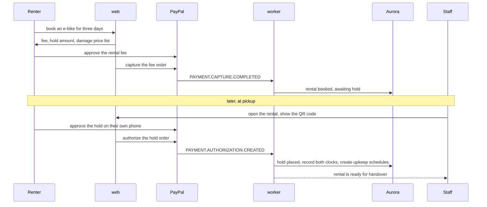

### 11.2 Guided handover

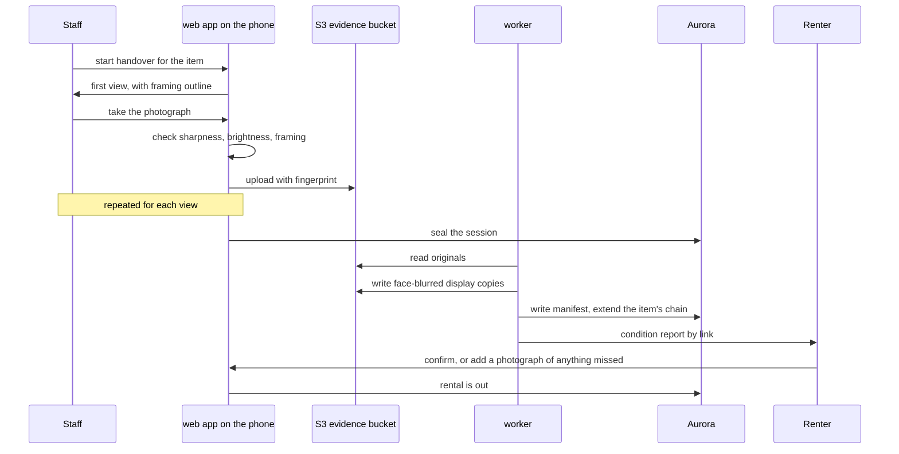

### 11.3 A clean return

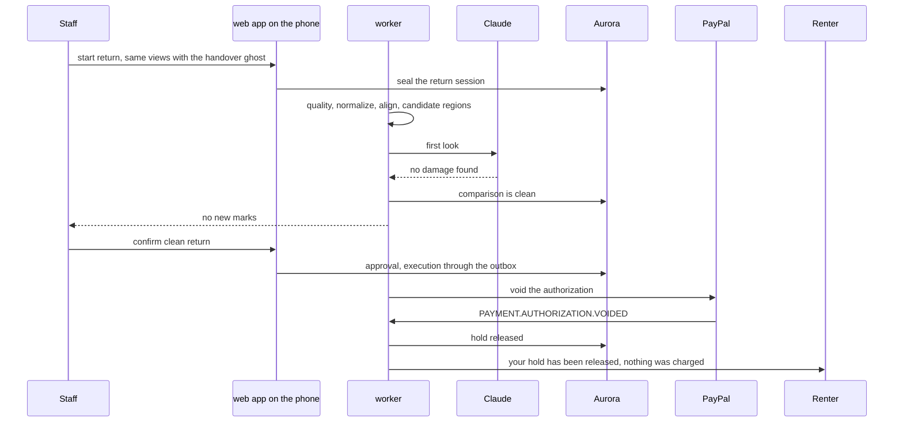

### 11.4 A return with damage

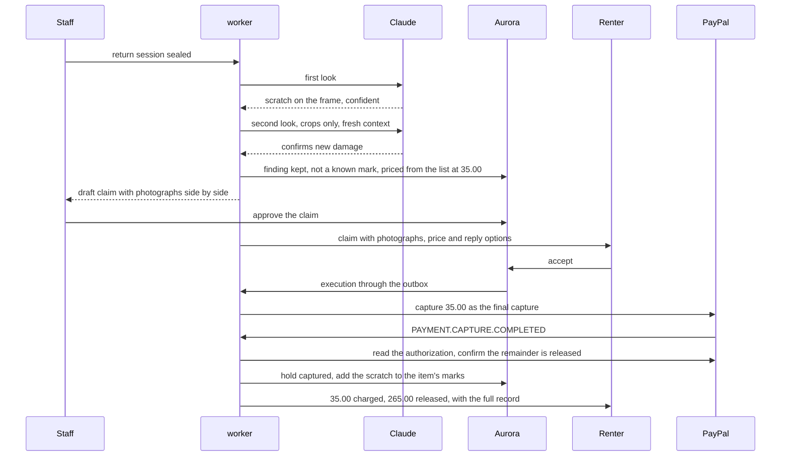

### 11.5 A contested claim

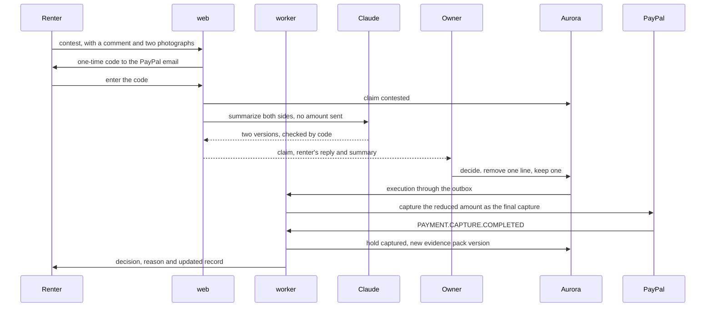

### 11.6 Charging a hold after day three

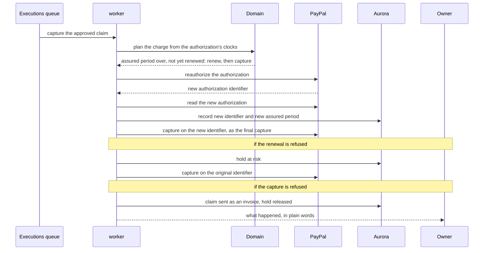

A long rental is kept protected by the replacement in section 7.4, not by renewal.

### 11.7 A dispute

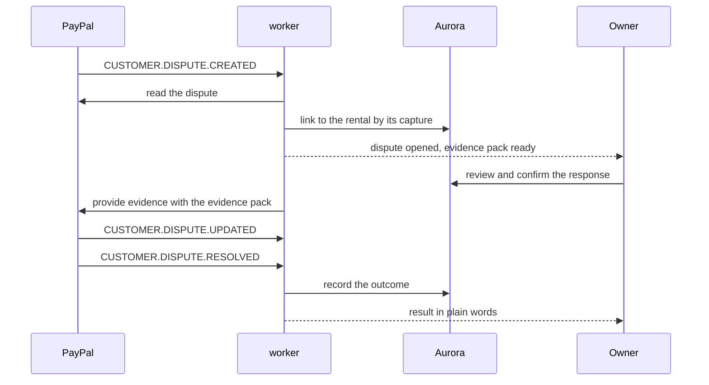

### 11.8 Flows added by the extensions

| Flow | Where |
|---|---|
| The operations agent's nightly run | `extensions.md` section 6.3 |
| A booking made by a renter's assistant | `extensions.md` section 8.4 |
| A negotiation between two advocates | `extensions.md` section 9.8 |
| Damage agreed during a rental | `extensions.md` section 10.4 |
| A return with nobody at the counter | Section 6.13 |
| More days from the renter's phone | Section 6.14 |

---

## 12. Identity and access

### 12.1 Owners and staff

- **Amazon Cognito** holds one user pool for owners and staff.
- **Passwordless sign-in** by emailed code or passkey, on Hold's own `/sign-in` and `/sign-up` pages, which call Cognito. Decision 25 says why. The one exception is the demo shop's two accounts, which judges sign in to with one tap through a password only the server knows (section 20.3).
- **Who signs up.** Only a shop's owner. Staff are invited by the owner and sign in with that address. Renters have no account.
- **How sign-up and sign-in run.** Both pages check their input in the browser and on the server with one function (`apps/web/src/features/auth/auth-input.ts`), then call Cognito through the `Identity` port in `packages/auth`. The steps are in `apps/web/src/features/auth/sign-in-flow.ts`.
  - **Sign-up** creates a Cognito account with no password and emails a six-digit code to confirm the address. The confirmation signs the person in with no second code. Then one transaction creates the person, the shop and their `owner` role, and writes the audit line (`registerOwner` in `packages/db`). The person also joins the `owner` group in Cognito.
  - **Sign-in** emails an eight-digit code (Cognito's `USER_AUTH` flow with `EMAIL_OTP`).
  - **An address that already has an account** is sent a sign-in code by the sign-up page, and the new shop is added to that account. One person may own several shops.
  - **The same answer for every address.** An address with no account gets the same "check your email" step, and a code typed for it is simply wrong. The forms cannot be used to find out who has an account.
  - **Between the two steps,** the address, Cognito's session for the attempt and the shop to create travel in a cookie sealed with AES-256-GCM. The browser cannot read or change it. Cognito keeps an attempt open for ten minutes and ends it after three wrong codes.
  - **The session** is the Cognito access token and refresh token, each in an HTTP-only cookie. Every request checks the access token on the server with `aws-jwt-verify`. When it lapses, the proxy uses the refresh token for a new one. Signing out revokes the refresh token at Cognito.
  - **Rate limits of Hold's own,** on top of Cognito's: five code emails per address and forty sign-in requests per network address in fifteen minutes, counted in `rate_limits` by fingerprint, so no address is stored. The network address is the last entry of `x-forwarded-for`, the one App Runner's load balancer adds. A request with none, or from loopback, comes from a developer's machine and is limited by address only.
- **The test environment.** With `HOLD_ENVIRONMENT=test`, the web app uses an in-memory identity service that sends a fixed code, and a PGlite database. Only the end-to-end tests set it. Every other environment refuses to start without Cognito and Aurora settings.
- **A passkey as the second factor** for owners and managers, and for staff whose approval limit is above the shop's threshold (`needsStrongSignIn` in `packages/domain`). Cognito cannot follow an emailed code with an authenticator app: a person who turns one on can only sign in with a password from then on. A passkey with user verification is the device and the person's fingerprint, face or PIN together, so it is multi-factor on its own. The user pool requires user verification and its relying party is the host of the web app's address (`webPublicUrl` in `infra/cdk.json`), so passkeys work on the deployed site and not on `localhost`. A developer signs in with an emailed code, which works everywhere. Before the app had an address, the relying party was `localhost`.
  - A person's first passkey is registered from a session an emailed code proved, on the shop's security page: there is nothing stronger yet. Every later one needs a session a passkey proved, so someone who reached the person's inbox cannot add a passkey of their own. A passkey can then be used to sign in.
  - **Sign-in answers every address the same way.** For an emailed code, any refusal by the identity service still leads to the code step, for an attempt that fails as a wrong code would. For a passkey, the options sent to the browser leave out the account's list of credentials, and any refusal gets options of the same shape for an attempt that fails as an unrecognized passkey would. Only "too many attempts" is said plainly. Confirming with a passkey, which may say "you have none", is open only to the person signed in, and always uses their own address.
  - **How a session was proven** is kept beside it in a sealed cookie, bound to the person the access token names and to the session's refresh token, so a record from one account's session counts for nothing on another's. Every change to prices, staff or PayPal checks it on the server: a person who needs a passkey and signed in with an emailed code is asked to confirm with their passkey first, and returns to the page they were on.
- **Staff are invited, never sign up.** An owner or a manager invites by email, with a role and, for counter staff, an approval limit. Owners invite managers, counter staff and read-only members; managers invite counter staff and read-only members (`mayInvite`). The email carries a link with a random token, of which only the SHA-256 fingerprint is stored. The link works once, for seven days. Following it sends a code to the invited address, never to one the visitor types; once the code is typed, the role is created and the invitation is marked accepted, in one transaction.
- **Every change to a shop** goes through `shopAction` in `apps/web/src/server/shop-access.ts`, which authenticates, resolves the shop and the caller's role, checks the passkey where needed, validates the form against a strict schema, opens the transaction with the caller's identity and writes the audit line. A refusal rolls the transaction back. A test fails on any export of `features/shop/actions.ts` not built by it.
- **Tokens** are verified by every service on every request.

### 12.2 Authorization

Three layers, each independent of the others.

| Layer | Question | Where enforced |
|---|---|---|
| **Account type** | May this person use the shop side of Hold at all? | Cognito group, checked at the edge |
| **Role in a shop** | What may this person do in this shop, and up to what amount? | Service, on every request, from `staff_roles` |
| **Row-level security** | Can this query see this row? | Aurora, on every query |

**How row-level security works.** At the start of each request the service opens a transaction with `inShop` from `packages/db`. It sets the role, the shop and, for a signed-in person, the user's ID, each for that transaction only. Every table has a policy that allows a row only inside that shop, and only if the named person has a role there. A renter link or a worker job names no person and is bound to its shop by the code that resolved it. A query that forgets its filter, or runs outside `inShop`, returns nothing.

- `users` and `renters` carry no shop. A person sees themselves and their colleagues in the current shop. A shop sees only the renters who rented from it. Renters are created only through `hold_renter_for_payer`, from the identity PayPal returned.
- No service role may delete a row. The money log, approvals and the audit trail also refuse updates. Both rules are grants, so they hold even for a query that passes every policy.

**Service access.** The worker uses a separate database role, `hold_worker`, with its own login in the secret `hold/database/worker`, and each job names the single shop it is working on. The migration gives `hold_worker` its password once that secret exists, so the first deploy of the worker needs a second migration run. Only `hold_worker` may read the outbox across shops, through `hold_pending_outbox`.

### 12.3 Renters

Renters have no account. They act through links.

| Property | How |
|---|---|
| **Bound to one rental** | The link's token names one rental and nothing else |
| **Signed** | The token is 32 random bytes and a 16-byte HMAC-SHA-256 of them, with a key derived from the secret `hold/web/renter-link-key`, which is not the cookie key (`packages/auth/src/renter/renter-link.ts`). The web app and the worker read it, so the worker can sign the links it emails without being able to seal a sign-in. On a developer's machine it falls back to the cookie key. A changed token is rejected before the database is asked. |
| **Expiring** | Each link has an end date tied to the rental's life |
| **Scoped** | View, pay, confirm condition, extend, accept, contest, report incident, return item. Each link carries only the scopes it needs. A booking's link carries view, pay, extend, report incident and return item; the condition report's link view, confirm condition, extend, report incident and return item. Extending is paid in PayPal by the person (section 6.14). Returning the item moves no money (section 6.13). |
| **Revocable** | Only the token's fingerprint is stored. Removing it ends the link. |
| **Stepped up for money decisions** | Accepting or contesting a claim, or agreeing an incident's confirmed price, requires a one-time code sent to the phone the renter confirmed for texts, or to the email PayPal provided (see "Reached by text or by email" below). The code's digest names its purpose and, for an incident, the incident, so one code never serves another decision. |

**Who the renter is.** The renter's identity is the PayPal payer who approved the order. Their payer ID, name and email come from PayPal and are not typed in.

**How a link is checked.** Every renter request and page goes through `renterAction` or `renterAccess` in `apps/web/src/server/renter-access.ts`: the token's signature is checked, a token that fails it costs its network one of sixty tries a minute and a signed token is limited to six hundred requests a minute of its own (so renters sharing a network, and pages that refresh themselves, never lock each other out), its link is read by fingerprint through `hold_renter_link` before any shop is chosen, the link must be live and carry the scope, and the work runs in transactions bound to the link's shop with no person named. A changed, unknown, expired and revoked link get the same answer. Renter pages are not indexed and send no referrer, so the token in their address never reaches another site.

Receipt links carry only `view`, are bound to one rental and select the immutable pack UUID through `/record?version={pack UUID}`. They expire 60 days after the later of the rental end or receipt issuance. This extends the read-only window for a late refund: a newly issued refund receipt must not arrive with an already expired record link. Retries may issue multiple valid, expiring read-only links; only fingerprints are stored, and no plaintext token enters the outbox, PDF, manifest or logs. Expired, revoked, malformed, wrong-scope and cross-rental/version requests fail closed. A record link cannot accept, contest or pay a claim.

**Reached by text or by email (1 November 2026).** A tourist at the counter may have only their phone, with no email on it, so the renter chooses how Hold reaches them, on their own phone, from any of their links: by email, or by text message through AWS End User Messaging. The choice, the number in international form and when it was confirmed are on the rental (`contact_channel`, `contact_phone`, `phone_confirmed_at`).

- **Choosing texts.** The renter types their number, with its country code filled in from the phone's region, and Hold texts a code to it: eight digits, ten minutes, three tries, another only after a minute, the money codes' own rules. The code's digest is kept on the rental (`phone_code_hash`), bound to the rental. Staff may also type a number when they book at the counter, and the booking link then goes by text.
- **What goes where.** Every message to a renter follows their choice: the booking link, the condition report, the return reminder, the drop-off notice, a request for a new hold, a missed promise, the shop's messages, receipts and every one-time code. Links and notices go to the number as given. A one-time code goes to it only once the renter has confirmed it; until then codes go to the email PayPal gave. The email side of a link still goes to the address given at booking, as before. Messages to staff stay on email.
- **Changing the number.** Until the hold is placed (`pending_payment`, `booked`, `awaiting_hold`) the renter sets their number freely: at the counter, in the same visit as the PayPal approval. Once it is placed, a new number first needs a code sent where the renter's codes go now, the confirmed phone or the PayPal email (`contactChangeNeedsCode`, `issueContactChangeCode`), so whoever has only the link cannot point the codes at their own phone. Whenever a number is confirmed and PayPal has named the payer, the email PayPal gave is told which number texts now go to (`tellPayerOfPhone`), so a number someone else set before pickup does not go unnoticed. Going back to email needs no code.
- **Never stuck.** Every code screen offers "send it to my PayPal email instead" (`via: 'email'`). A text that cannot go is refused, so the page offers email; a notice whose text cannot go is emailed instead where there is an address. A number that replied STOP is switched back to email.
- **Both channels hear of money.** A money decision made with a code a phone received (accepting or contesting a claim, confirming or declining an agreement, agreeing an incident's price) is copied to the email PayPal gave for the payer (`decisionCopyRecipient`, `copyDecisionToEmail`). A receipt goes to that email as before, and by text as well.
- **What a code's text says.** It names the shop and what the code is for, says not to share it, and ends with the WebOTP line `@{Hold's host} #{code}`, so a supporting phone offers the code on Hold's own site and on no other page. Code inputs carry `autocomplete="one-time-code"`.
- **Limits.** At most twelve texts a day to one rental and to one number, and four hundred to one shop (`TEXT_LIMITS`), counted by `takeTextAllowance` in the sending transaction; the limiter keeps only digests. Texts go only to the countries in `TEXT_COUNTRIES` (Europe, the United States and Canada, Australia, New Zealand, Japan); a `+1` number must have ten digits and an area code outside the Caribbean and the US territories, which share `+1` and are common targets of texting fraud. A number elsewhere is reached by email. The account's monthly spending limit is the backstop.
- **One way to send.** `reachRenter` in `packages/notify` decides text or email for the web app and the worker alike, through the `Texter` port (`createAwsTexter`, `SendTextMessage`, transactional, with the shop and rental as context). Each text is a row of `text_messages` with its purpose, number and status; a real text's words are never stored, since a code may be in them. Staff see a rental's texts, numbers masked, on the rental page.
- **Delivery reports.** With the configuration set `hold-texts` (infra/lib/texts.ts), AWS reports each text's outcome to the SNS topic `hold-text-reports`, which feeds the `text-reports` queue and the `hold-worker-texts` function. It reads the context Hold sent, so it records the report inside that shop alone (`recordTextReport`, `markTextStatus`). A report naming another shop finds nothing.
- **Demo shops and samples.** A demo shop, or a sample rental, never sends a text. It records it as `simulated`, with its words, and the renter's page shows it in a bubble labelled as a sandbox text that was not sent, with the code ready to tap in.

### 12.4 Connecting the shop's PayPal account

**In the hackathon build,** the owner pastes the client ID and secret of their shop's PayPal sandbox app on the shop's PayPal page. Hold checks them by asking PayPal for a token, then keeps them in Secrets Manager under `hold/paypal/shops/{shop}/sandbox`, and stores only that name in `paypal_accounts`. They are never shown again. Only the owner can connect, and only after confirming with a passkey.

**In production,** the owner would connect through Log in with PayPal and PayPal's partner model, and Hold would keep no credentials. The `CredentialStore` interface in `packages/paypal` is the one place that change touches.

### 12.5 Assistants

A renter's own AI assistant acts through an agent token: signed, bound to one rental, scoped, expiring, and revocable by the renter. It is issued only after PayPal's capture of the fee is on record, and only to the caller that presents the booking secret the booking returned. Before that, an assistant is a `public_agent`: it has no identity and can only read public information, quote and book. No scope moves money. The token is an argument of each rental tool, so any MCP client can use it without special setup. The gateway refuses a token on any rental but its own (`subjectRentalId` in `gatewayDecision`), and a changed, unknown, expired or revoked token gets the one answer `not_authorized`. The name a client declares when it connects travels in the session ID the server returns and is stored as the session's label, shown to the renter as not verified. Section 6.11 and `extensions.md` section 8.5.

---

## 13. Interfaces

### 13.1 HTTP API for owners and staff

Served by `web`. All routes require a Cognito token.

| Group | Purpose |
|---|---|
| `/api/shops` | Shop settings, locations, staff and limits |
| `/api/items` | Item types, items, photo plans, item passports |
| `/api/prices` | Price lists and wear policies, draft and publish |
| `/api/rentals` | Create, read, extend, move to another item of the same type, cancel |
| `/api/holds` | Read state, request a hold, show the approval QR code |
| `/api/sessions` | Start, add photographs, seal |
| `/api/uploads` | Short-lived upload links |
| `/api/comparisons` | Read results and findings |
| `/api/claims` | Read, edit, approve, waive, decide |
| `/api/disputes` | Read, confirm the response |
| `/api/reports` | The insights dashboard's rows: money held, captured and released, damage and recovery, staff consistency |
| `/api/assistant` | Conversation with the owner's assistant, streamed |
| `/api/paypal/connect` | Connect the shop's PayPal account |
| `/api/proposals` | The morning queue: read, approve, reject, postpone. Built as the page `/shop/queue` and its POST server functions (`approveProposals`, `rejectProposal`, `postponeProposal`, `checkNow`, `confirmRule`, `discardRule`), not a separate API route |
| `/api/mandates` | Standing rules and settlement limits. The operations standing rule is `grantStandingRule` and `revokeStandingRule` on `/shop/queue` |
| `/api/ladder` | The trust ladder: draft, simulate, publish |
| `/api/incidents` | Incidents reported by renters |
| `/api/accuracy` | The scorecard |

The rental record uses POST server actions through the same access wrapper: `buildRecord` for owner/manager/counter staff, and `downloadRecord` for all four staff roles. The strict input selects a stored rental/pack and `pdf` or `manifest`; it accepts no amounts or storage keys. The record page itself only reads.

### 13.2 Renter routes

Served by `web`. Each requires a valid signed link.

| Route | Purpose |
|---|---|
| `/r/{token}` | The rental: status, hold, price list |
| `/r/{token}/pay` | Approve the hold at pickup, or its replacement before it ends. PayPal returns the renter here, and the hold is confirmed by a POST, never on arrival. The fee is paid from `/r/{token}` itself. |
| `/r/{token}/paid` | Where PayPal returns the renter. Confirms the fee by a POST, never on arrival. |
| `/r/{token}/condition` | How each item left: its photographs and marks. Within 24 hours of the handover, the link sent then may confirm it or add photographs of anything missed. |
| `/r/{token}/session` | Guided photographs for shipped rentals |
| `/r/{token}/claim` | See a claim, accept or contest it |
| `/r/{token}/record` | Shared evidence versions and PDF/manifest downloads; `?version={pack UUID}` selects the exact receipt version. Draft and awaiting-approval claims remain staff-only. |
| `/r/{token}/return` | Returning the item with nobody at the counter (section 6.13): where to leave it and what happens next, the photographs, then a receipt with PayPal's own reading of the hold. Starting, photographing and sending need the scope `return_item`. |
| `/r/{token}/extend` | Keeping the item longer (section 6.14): when it is due back, one to three more days in a tap or a time to the minute, Hold's price, PayPal's button, and each extension. Asking and paying need the scope `extend`. |
| `/r/{token}/extended` | Where PayPal returns the renter after approving more days. Confirms by a POST, never on arrival. |
| `/r/{token}/incident` | Report something that happened during the rental, and list earlier reports. Needs the scope `report_incident`. |
| `/r/{token}/incident/{incident}` | One report: photographs while it is written, then the fixed message for its kind, the confirmed price and the one-time code to agree it, or the theft steps. Another rental's report answers as an unusable link. |
| `/r/{token}/negotiation` | The renter's advocate: the transcript, their own highest total, the final tap with a one-time code, and stopping the advocate. The limit is set on `/r/{token}/claim`, after the code, as the third choice. A link without the `accept` and `contest` scopes sees no forms. |
| `/r/{token}/trust` | The Clean Record: its counts, the deposits never taken, a fresh credential as a QR code, the consent question and deleting the record. Answering and deleting need a one-time code emailed to the payer (section 6.8). |
| `/r/{token}/assistant` | What the renter's own assistant did on the rental, in plain words from the audit log, the reply it drafted, its declared name marked as not verified, and a button to disconnect it. Any link to the rental may disconnect it, since that only takes access away. A rental no assistant booked answers as an unusable link. |

Record build/download POST actions require the signed link's `view` scope and exact rental binding. Visits only read; download actions issue a private, exact-version S3 URL lasting at most 300 seconds. Unknown or malformed selected versions are refused without revealing another rental's metadata.

### 13.3 Inbound webhooks

| Route | From | Protection |
|---|---|---|
| `/api/webhooks/paypal/{accountId}` | PayPal | Stored first, then verified with PayPal before anything in it is used. Limited per network and to 64 KB. Under `/api` because the language proxy leaves it alone. |
| `/api/webhooks/paypal/demo` | PayPal, for the demo's shared sandbox app | Routed to the demo shop whose rental the order's `custom_id` names, and to no other shop, then as above (section 20.3). |

### 13.4 The MCP server for assistants

Served by `web` at `/mcp` over streamable HTTP. It lets a traveller's own AI assistant find a shop, read its damage prices, get a quote, book, and follow the rental. The person approves every payment in PayPal.

| Caller | Identified by | May |
|---|---|---|
| Any assistant | Nothing. Rate limited. | Read public information, quote, book |
| The assistant of the renter who paid | An agent token bound to one rental | Follow the hold, read the condition report and any claim, ask for an extension, prepare a reply |

No tool takes an amount but the line amounts of the renter's advocate's offer, which the referee bounds, and none can capture a hold. Accepting or contesting a claim needs the person's confirmation or a mandate. The tools, the identity rules and the defenses are in `extensions.md` section 8.

**As built.** `apps/web/src/app/mcp/route.ts` reads the body up to 64 KB and hands it to `handleMcpRequest` in `packages/mcp`, outside the language proxy. Each POST gets a fresh server over the SDK's web-standard streamable HTTP transport in stateless mode with JSON responses, so any instance answers any call; GET and DELETE are answered 405. The tools and their input and output schemas are in `packages/mcp/src/catalogue.ts`, listed with JSON Schemas generated from the same zod schemas that check every call; unknown fields are refused. Shop-written text comes back inside `{ "merchant_words": … }`.

| Tool | Tier | Needs |
|---|---|---|
| `find_shops`, `get_shop`, `check_availability`, `get_damage_prices` | read | Nothing |
| `quote_rental`, `create_booking` | draft | Nothing; a quote ID for a booking |
| `get_booking` | read | The booking secret |
| `get_rental`, `get_hold`, `get_hold_approval_link`, `get_condition_report`, `get_claim`, `get_record` | read | The agent token and its rental's ID |
| `draft_claim_reply` | draft | The agent token |
| `submit_claim_reply` | act under mandate | The agent token, and the person: with no mandate it returns `human_confirmation_required` and changes nothing |
| `get_negotiation`, `get_claim_lines`, `get_line_photos`, `get_price_list`, `get_known_marks` | read | The agent token, and the negotiation scope: the renter chose this assistant as their advocate on this rental's claim, with their one-time code (section 6.12) |
| `submit_offer` | act under mandate | The same scope; the renter's settlement mandate is the mandate the gateway checks, and the referee holds each move to it. An agreement still needs the renter's code on their link |

Every call takes one path (`callTool` in `dispatch.ts`): the actor is resolved (a `public_agent`, or the `renter_agent` a token names, acting for the payer), the rate is counted (60 calls a minute per network for public tools, per session for rental tools), `gatewayDecision` decides on shop, rental, actor, tier, mandate, rate and argument shape, the tool runs, and one audit line goes to the shop with the actor, tool (`assistant.{tool}`), subject (the token's own rental, or the shop), outcome, gateway reason, the client's name and the duration. A call that names no shop, such as `find_shops` or an unknown token, is written to the application log instead. No mandate kind lets an assistant answer a claim in this build; the one mandate an assistant acts under is the renter's settlement mandate naming it, on the advocate's tools. Not offered yet, with the reason in `NOT_OFFERED`: `report_incident` (it needs photographs taken through the renter's link). `request_extension` is offered since 29 October 2026 (section 6.14).

**The hosted assistant** (`/assistant`, `packages/mcp/src/hosted`) is a client of the same address: the page's server function connects the MCP SDK's client to this deployment's own `/mcp` and runs one turn of `runHostedTurn` with ceilings of eight tool calls, 30,000 tokens and 60 seconds a message. The model is Claude Opus 4.6 on Bedrock through judging, designed for Opus 5.5 (`createBedrockAssistantModel`: closed tool schemas, not sent in strict mode while on Opus 4.6, automatic tool choice, effort `medium`, no retries; a refusal or an outage is an ordinary outcome and nothing is booked), or in the test environment a scripted stand-in labelled as simulated. The approval link shown is taken from Hold's own tool result, never from the model's words. The page keeps the conversation and sends it back with each message, validated against a strict schema and capped; a network may send 20 messages in 15 minutes (`publicAction`).

### 13.5 Public pages

| Route | Purpose |
|---|---|
| `/` | The home page: the handover and return comparison, the shop's screen beside the renter's, and a summary of each page below |
| `/how-it-works` | One rental in four moments, each beside the record it leaves: the hold, the condition report, the comparison to try and the two ways a rental settles. Then what happens when the renter disagrees, and the questions asked at the counter |
| `/for-shops` | What changes for the owner, the counter staff and the business, the owner's day at a glance, what the shop sets up once, the item passport, the safeguards, and the kinds of shop Hold is built for |
| `/for-renters` | A deposit and a hold as two account statements, the claim as the renter sees it, the published price list, what the renter can count on, and the questions asked before approving |
| `/ai` | The seven steps from photograph to decision and who carries out each, what the AI does and never does, the four answers a comparison can give, how accuracy is measured, and the tiers an agent's tools may use |
| `/paypal` | The life of one hold as the four PayPal calls behind it, which capability meets each rental need, how long a hold lasts beside a card hold, and how a payment's status is confirmed |
| `/sign-in` | Sign-in for owners and staff: a work email, then a code by email. It tells staff they are invited and renters that they need no account |
| `/sign-up` | Sign-up for a shop's owner: name, shop name and work email, and the three steps that follow |
| `/demo` | The demo shop's entry page. Until the demo is deployed it says so and describes the three sample rentals, the three people to sign in as, and what is real and what is simulated |
| `/s/{slug}` | A shop's own page: a renter chooses dates and items, sees the prices and wear policy, and books with nobody signed in. Open only once the shop has PayPal connected, a price list and items. Bookings from it are limited per network (`apps/web/src/server/shop-page-access.ts`). |
| `/simulated-paypal/{order}` | In the test environment only: stands in for PayPal's approval page, says so, and sends the renter back to the order's own return path. Everywhere else it is 404. |
| `/accuracy` | The comparison's measured accuracy, with counts |
| `/verify` | Checks a Clean Record credential in the browser, with the published key. The credential comes after the `#`, so it never reaches a server. |
| `/.well-known/jwks.json` | The public key that credentials are signed with, as a JSON Web Key Set. Reads nothing from the request. |
| `/assistant` | A demonstration: chat with the hosted assistant, which rents through Hold's MCP server as any outside assistant would, and the `/mcp` address for connecting one's own. Labelled as a demonstration, and its stand-in as simulated. |
| `/mcp` | Hold's MCP server for renters' assistants, over streamable HTTP with no sign-in (section 13.4). |

The first nine routes are the public site. They take no sign-in, read no shop data and call no service. `/sign-in` and `/sign-up` post to a server function that checks the input and, until Cognito is connected, does nothing else (section 12.1).

- **Languages.** English is served at the bare path. Spanish, French and German are served under `/es`, `/fr` and `/de`, for example `/de/for-shops`. The `[locale]` route segment is the root of the app, and `src/proxy.ts` sends each request to its language. A switch to English goes through `/en/...`, which redirects to the bare path.
- **One list of routes.** `apps/web/src/lib/routes.ts` names every public route. The header, the footer, the phone menu and the tests read that list. A test fails if a route has no page.
- **No in-page links.** Header and footer links open pages. The only `#` link is the skip link for keyboard users.
- **A page opens at its top.** The root layout sets `data-scroll-behavior="smooth"` on `<html>`. Without it, Next.js 16 leaves smooth scrolling on while it changes page, and a page reached from far down another one opens at the old position and glides upward.
- **Example figures.** The amounts shown (300 reserved, 35 taken, 265 released, the 120 fee and the three damage prices) are fixed data from `project-description.md` section 5, held as integer cents in `features/marketing/example-rental.ts`. The owner's day on `/for-shops` is fixed data in the same file. No screen computes an amount.
- **Illustrations say so.** The phone screens, the owner's day, the item passport, the price list and the example findings are pictures of the product, not the product. Each carries a caption that says it is an example.
- **Illustrative photographs.** The frame photograph is a stock photograph with the marks drawn on. The page says so beside it and in the footer. `apps/web/public/images/CREDITS.md` lists each source and edit.


### 13.6 Pages for owners and staff

Served by `web` under `/shop`. Each page asks `shopAccess` itself; the frame around them is not the access check.

| Route | Purpose |
|---|---|
| `/shop` | Today: the day's figures (items out, due back, held on PayPal, claims to decide), what needs a decision, the handovers and returns at the counter with a line for now, the holds by where they stand, the month so far from the money log, and the latest audit lines. Until the shop is set up, its setup steps. |
| `/shop/decisions` | The decision board, on AG Grid Enterprise (`extensions.md` section 12.5): every record that waits on a person in one grid, grouped by kind, in the order it falls due, each saying who decides it from where the viewer stands. Each decision opens in place into its evidence and actions from `md`, and the board is a list of cards below `md`. Every staff member reads it. |
| `/shop/rentals` | Every rental, newest first: who, items, period, fee, hold and where it stands, filtered by part of its life (`?show=`). The address of the shop's own page. |
| `/shop/calendar` | Bryntum Scheduler: each item a row, each rental a bar marked by where its PayPal hold stands, from a week back to three ahead, opening where the earliest rental still out began. Read only; a bar opens its rental. Below `md`, the same rentals as a list by item. |
| `/shop/rentals/new` | Booking at the counter or on the phone: dates on the shop's clock in the address, then a counter per item type up to what is free, the fee and hold as they add up, and an optional contact who is emailed the link. Needs PayPal connected and items. |
| `/shop/rentals/{id}` | One rental: its progress from booking to settlement, its terms, the hold at pickup, the handover of each item, the renter's link as a QR code or by email, and letting go of an unpaid booking. On a phone, what staff act on comes before the terms. |
| `/shop/rentals/{id}/handover/{session}` | One item's guided handover: each view photographed and checked on the phone, its marks confirmed or boxed, then sealed; the condition report's code once the rental is out. |
| `/shop/rentals/{id}/return/{session}` | One item's guided return, using the handover's saved plan and faint display-photo overlay. Required views must be present before sealing. Read-only members see evidence without capture controls. |
| `/shop/rentals/{id}/comparison/{comparison}` | Comparison progress, paired display photographs, findings and model/prompt identity. Staff can append a named manual inspection; read-only members cannot. A different shop's record or a different rental binding answers 404. |
| `/shop/rentals/{id}/record` | Evidence versions, creation times, fingerprints, pending/failure/retry states and receipt delivery status. `?version={pack UUID}` selects a stored version. All roles can download; read-only staff have no build controls. |
| `/shop/items` | The item types, each with its terms, kit, photo plan and items, and where each item stands. Four figures on top: items, available, out now, in repair. Filters by standing, each its own address (`?show=`). From `md`, the fleet passport on AG Grid Enterprise lists the items (`extensions.md` section 12.5): each type above its items, with rentals, days out this year, damage found rental by rental, what was recovered of the damage priced, open marks, and the item in each type wearing fastest (`itemWear`, `wearingFastest`); each type's panel below keeps its terms and the form to add items. A phone lists each type's items in its panel. |
| `/shop/items/new`, `/shop/items/types/{id}` | Creating and editing an item type, with its kit and its photo plan. The plan starts from the suggestion for the kind. |
| `/shop/items/{id}/repairs/{repairId}` | One repair (section 9.6): the marked views photographed against where each mark was, then each line's outcome and the cost. Another shop's repair, or one of another item, answers 404. |
| `/shop/items/{id}` | The item passport (section 9.4): where it is, its rentals, its known marks, its chain of photo sessions, its photo plan, its details and its status. Another shop's item answers 404. |
| `/shop/incidents` | What renters reported during their rentals: waiting for a person by default, all with `?show=all`. Each quotes the renter, says how it was sorted and whether an alert email went out, and offers staff the price to confirm or the shop's matter to take on. Read-only members see it without controls. |
| `/shop/trust` | The trust ladder in force, the owner's editor with its replay over past rentals, and the shop's trust ledger. Publishing needs the owner and a passkey. Other members read it. |
| `/shop/money` | The money ledger, on AG Grid Enterprise (`extensions.md` section 12.5): every line of the money log grouped by rental or by month with the grid's totals, each rental checked against its hold, its approved claim and PayPal (`rentalMoney`), each line opening into its read-back, any verified PayPal event about the same resource, its execution and the rental's audit trail, and a download for a spreadsheet. A card per rental below `md`. Every staff member reads it; nothing on it moves money. |
| `/shop/insights` | The insights dashboard on AG Studio (`extensions.md` section 12.5), for the owner and managers: the money ledger's lines and rentals and the fleet's items as Studio's tables, shaped on the server and naming no renter, a first dashboard of where the money is, money by month and damage by item type, Hold's own widgets for each live hold's 29 days and the settlement waterfall, holds by trust rung, and the insights agent in edit mode. The dashboard as the owner or a manager leaves it is saved for the shop (`saveInsightsDashboard`, `insights_dashboards`) and opens so next time. Every model turn of the agent goes through `askInsights`, which gates each tool call it asks for (`gateInsightsCalls`). On a phone, the figures it opens with. Others read that only the owner or a manager opens it. |
| `/shop/self-service` | What renters may do from their phone with nobody to ask: returns after hours (section 6.13), on or off, where renters leave items and the counter's hours, beside the card renters read; and extensions (section 6.14), the most extra days a renter may add. Only the owner changes them; everyone else reads what renters are told. |
| `/shop/settlement` | The shop advocate's limits (section 6.12). Only the owner reads, sets or ends them, with a passkey; anyone else sees that only the owner does. |
| `/shop/prices` | The price list editor (`features/prices`, `extensions.md` section 12.5): the next version as a draft on AG Grid Enterprise, a card per price below `md`, pasted from a spreadsheet into a panel or onto the cells, copied out and downloaded for a spreadsheet, each cell checked by publishing's own rules (`checkPriceRows`), every change one step of an undo history, kept in the browser until published; the draft as a renter reads it, in the renter's language, beside the grid from 1400 pixels; every published version with the open rentals agreed to it (`priceListVersions`) and what changed between any two or against the draft (`diffPriceLists`). Publishing is `publishPrices`, owners and managers with a passkey; everyone else reads the versions. |
| `/shop/paypal`, `/shop/staff`, `/shop/security` | The shop's settings |

- **One frame.** `app/[locale]/shop/layout.tsx` puts every shop page in the shop's frame (`features/shell`): a dark sidebar with the shop switcher, the menu, PayPal's state and mode, the language and theme, and the account menu. It is a rail of icons from `md` to `lg` and a top bar with a menu sheet below `md`. The public pages keep the site's header and footer through the `(site)` route group, which is not part of their address.
- **What the page reads.** `shopToday` in `packages/db` returns plain counts and rows. Where a hold stands (assured, valid, ending) and the order of the decisions come from `holdStanding` and `holdDay` in the domain. Times show on the shop's clock (`shopDay`), whoever reads them.
- **Rentals**, **Items** and **Incidents** follow Today in the menu. **Holds and claims** join the menu after Rentals as their own pages are built with the spine.
- **After the extensions,** `/shop/calendar`, the rental calendar on Bryntum Scheduler, and `/shop/decisions`, the decision board on AG Grid, join the menu; Decisions sits right after Today and before the morning queue. `/shop/money`, the money ledger on AG Grid, follows the calendar, and `/shop/insights`, the owner's dashboard on AG Studio, follows the money ledger. `extensions.md` section 12.5.
- **What the board reads.** `decisionRecords` in `packages/db` returns, inside the shop alone, the claims awaiting approval, contested or escalated, each with its lines and the display keys of the photographs behind them (read for all claims in three queries), the morning queue (`morningQueue`), the incidents waiting for staff, the held holds, the late rentals, the items renters dropped off (`dropOffsWaiting`), extension payments a person must check (`extensionPaymentsToCheck`, section 6.14) and how many staff the shop has. The page adds the neutral summary of each contested or escalated claim (`contestViewFor`, section 6.15), which opens in the claim's row. `boardRows` in `features/decisions` turns them into one row each: who decides comes from `mayConfirm`, a hold near its end from `holdStanding` and shows once when the agent already proposes to release or replace it, the split of a claim from `settle`, and what is overdue is worked out on the server. Approving and postponing a proposal reuse the morning queue's server functions; a claim is approved or decided on its own page, with its passkey and limits.

---

## 14. Infrastructure on AWS

### 14.1 Layout

Hold runs in the AWS account 707938860881, us-east-1, which it shares with Wick and CareCircle. It uses none of their resources. Every name starts with `hold`, every resource carries `project=hold`, and Hold has its own database cluster, buckets, user pool, queues, roles and image repository. Two things are shared because the account has only one of each: the CDK bootstrap stack, and the default VPC that Hold's database cluster sits in. The cluster has no public address and lets nothing connect to it over the network.

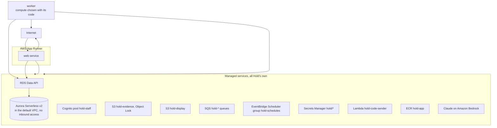

The CDK code is in `infra/`, as five stacks:

| Stack | Holds | Protection |
|---|---|---|
| `HoldData` | The Aurora cluster, its two logins, the evidence and display buckets | Termination protection. Every resource is retained if the stack is deleted |
| `HoldIdentity` | The Cognito pool `hold-staff` for owners and staff, its groups and its web client. Its codes go to the custom email sender `hold-code-sender`, a Lambda function, encrypted with the KMS key `alias/hold-code-key`, and out through the SMTP account in `hold/email/smtp`. The key and the secret are an administrator's. Cognito still names the SES identity `rogerjeasybavibidila@gmail.com`, verified outside the stack, which it requires but sends nothing through | Termination protection, deletion protection on the pool |
| `HoldWork` | The spine's queues and their dead-letter queues and alarms, the schedule group, the role the scheduler uses | |
| `HoldRegistry` | The image repository | Retained |
| `HoldWeb` | The App Runner service `hold-web`, its instance role and the role it pulls the image with, and a scaling limit of two instances. Its address is App Runner's own, https://p99faar3kp.us-east-1.awsapprunner.com, the stack's `ServiceUrl` output | Termination protection, because a new service would get a new address. Set once by an administrator, since the pipeline may not change it |

The worker's compute is added with its code. The web app's address is known only once the service exists, so it goes into `infra/cdk.json` as `webPublicUrl` after the first deploy, and the links in Hold's emails use it from the next one.

### 14.2 Containers

- **One Docker image** built from a multi-stage Dockerfile. The web app runs from it on App Runner.
- **The image is built for the processor architecture it runs on.** The image library ships different binaries for each architecture, so a mismatch fails at start.
- **Amazon ECR** stores the images in `hold-app`. A tag names one build and cannot be moved.
- **Docker Compose** runs web, worker and PostgreSQL together for local development.
- **No secrets in the image.** They are read from Secrets Manager at start.

### 14.3 Network

- **No network path to the database.** The cluster sits in the default VPC with no public address, and its security group has no inbound rules. Hold reaches it only through the RDS Data API, over HTTPS and authorized by IAM.
- **No VPC for the services.** App Runner calls PayPal, Bedrock and the AWS APIs directly over HTTPS, so there is no NAT gateway and no VPC connector.

### 14.4 Compute

| Service | Runs on | Notes |
|---|---|---|
| web | App Runner, 1 vCPU and 2 GB, one to two instances | Checked by TCP on port 3000. Runs the image named by the deploy, never the newest pushed |
| worker | Lambda, Node 24, 512 MB, four minutes per message | App Runner throttles CPU between requests, so it cannot poll queues. Five functions: `hold-worker-paypal-events`, `hold-worker-executions` and `hold-worker-upkeep` fed by their FIFO queues, `hold-worker-media` (1.5 GB, with sharp) fed by the standard `media` queue, each message read with its queue's schema and naming only the messages that failed so only those are tried again, and `hold-worker-outbox-relay` started every minute by EventBridge Scheduler. The worker makes schedules only in `hold-schedules`, hands them only the scheduler's role, and emails through Hold's SMTP login. The four minutes allow a paused Aurora cluster to wake. Each queue hides a message for six minutes, longer than a function may run on it. Code in `apps/worker`, deployed by `infra/lib/worker.ts` |

### 14.5 Data

- **Aurora Serverless v2,** PostgreSQL 17, one writer, with the RDS Data API switched on. The minimum capacity is zero while building, so the cluster pauses when idle, and is raised above zero for judging.
- **The database** is `hold_db`. Aurora reserves `hold`. While the cluster is paused, the first call fails with `DatabaseResumingException` until it resumes, so the adapter retries that error.
- **Two logins.** `hold_admin` runs migrations. `hold_app` is what the services use. It does not own the tables, so row-level security applies to it.
- **Backups** kept for seven days, with point-in-time recovery.
- **Encryption** at rest with the AWS-managed KMS key.
- **Migrations** run as a one-off step before each deployment.

### 14.6 Storage

| Bucket | Contents | Protection |
|---|---|---|
| **Evidence**, `hold-evidence-707938860881` | Original photographs, manifests, evidence packs | Object Lock in governance mode with 180 days' retention by default, versioning, KMS encryption, no public access, TLS only. Object Lock is switched on when the bucket is created. |
| **Display**, `hold-display-707938860881` | Smaller, face-blurred copies | KMS encryption, no public access, TLS only, served through short-lived signed links |

### 14.7 Queues and schedules

| Queue | Carries | Ordering |
|---|---|---|
| `paypal-events` | Stored event IDs to verify and apply | Per rental |
| `executions` | Approved actions on holds | Per rental |
| `upkeep` | A hold's timed steps, sent by its schedules. Deduplicated by content, since EventBridge Scheduler cannot name a deduplication ID | Per hold |
| `comparisons` | Sealed return sessions to compare | None needed |
| `media` | Display copies and face blurring. A standard queue, so messages carry no group or deduplication ID; a copy is made once whatever | None needed |
| `evidence` | Reserved pack IDs to render and publish from frozen snapshots | Per rental |
| `messages` | Settlement receipt delivery IDs; six-minute visibility exceeds the five-minute delivery lease | None needed |
| `ops-agent` | Operations agent runs | Per shop |
| `negotiations` | A negotiation to run to its end, or a reply to write: one message per negotiation, taken by `hold-worker-negotiations` (ten minutes, its own role: the database and Claude on Bedrock only). A retried message picks up where the transcript stands. | Per rental |

Every queue has a dead-letter queue and an alarm on it.

The outbox relay carries evidence and receipt identities without tokens or contact details. Separate evidence and receipt Lambda roles have only their required database, logs, queue and artifact/secret access: the renderer reads face-blurred display copies and writes/reads `packs/*`, without PayPal credentials; the receipt worker reads its link-signing and SMTP secrets. PDFKit and sharp are external pinned worker modules so PDFKit font data and sharp's native loader ship with the bundle. Deploy the updated `HoldDelivery` permissions boundary before the compute stack. AWS deployment and Linux Lambda runtime execution remain unverified in this change.

**Schedules:** hold replacement before validity ends, the charge of an unanswered claim before the hold lapses, the date the shop promised to decide a contest (section 6.16), hold expiry, return-due reminders, overdue alerts, reply-period end, the nightly reconciliation, the operations agent's run after it, and the expiry of unpaid bookings. Schedules for a hold are created when it is placed and removed when it ends.

### 14.8 Configuration

- Non-secret configuration is typed and validated at startup, in `packages/config`. A service with invalid configuration does not start, and the error names the settings that are wrong, never their values. The web app's settings are listed in `apps/web/.env.example`.
- Secrets come from Secrets Manager at startup and are never written to logs or images. The key that seals the sign-in cookie is `hold/web/cookie-key`, made by the HoldIdentity stack: the web app reads it by its ARN (`HOLD_COOKIE_KEY_SECRET_ARN`) and uses its SHA-256 as the key. Deployed, the app refuses a key given any other way. Renter links are signed with their own key, `hold/web/renter-link-key` (`HOLD_RENTER_LINK_KEY_SECRET_ARN`), which the worker reads too. The worker is told the web app's address (`HOLD_PUBLIC_URL`) for links in its emails. Both are told the photograph buckets (`HOLD_EVIDENCE_BUCKET`, `HOLD_DISPLAY_BUCKET`), and the web app the `media` queue. The evidence bucket takes a PUT only from the web app's own address (CORS).
- The renter key is made with its own secret, `hold/web/trust-key` (`HOLD_TRUST_KEY_SECRET_ARN`). Clean Record credentials are signed with the KMS key named by `HOLD_CREDENTIAL_KEY_ID`, `alias/hold-credential-key`, an asymmetric `ECC_NIST_P256` `SIGN_VERIFY` key an administrator makes tagged `project=hold`, as with the code key, because the pipeline may not make or tag a key (`infra/lib/settings.ts`). The web role may only `kms:Sign` with ECDSA_SHA_256 and `kms:GetPublicKey`, on that alias and tag. On a developer's machine both may be left out: the renter key falls back to the cookie key and a key made at start signs credentials.

---

## 15. Security

### 15.1 Threats and controls

| Threat | Control |
|---|---|
| **A shop overcharges a renter** | Charges only from findings with photographs. Prices only from the list the renter agreed to. Never more than the hold. A person's approval on record. The renter sees everything and can reply. |
| **Staff invent damage** | Every line needs a finding or a written reason. Claims above the limit need a second person. Approvals record what was changed. |
| **Evidence is altered afterwards** | Object Lock, original/display fingerprints and the chain per item; frozen version identities and worker-only publication guards; conditional artifact writes with checksums and exact-version reads. Published metadata cannot be updated or deleted. |
| **An evidence export exposes an original or an unpresented claim** | PDF/manifest downloads contain only face-blurred display photographs and shared fields, with no storage keys or renter tokens. Missing display copies block publication. Renter queries and downloads exclude draft/awaiting-approval snapshots and enforce the link's rental/version binding. |
| **A receipt repeats a charge or announces an unverified success** | Delivery is separate from money execution, created only from verified event records and bound to a published frozen pack. Capture and remainder share one receipt; protective captures and unpaid invoices retain their distinct labels. Leases and terminal sent-state guards reject ordinary duplicates. |
| **A forwarded receipt link grants money authority** | Receipt links have only the view scope, exact rental binding, signature, expiry and revocation checks. Accept/contest/payment scopes and one-time codes remain separate. Only fingerprints are stored; short-lived artifact URLs name an exact published version. |
| **A return is uploaded or sealed as a handover baseline** | Staff capture actions bind the session kind as well as shop scope. Returns keep the sealed handover plan; handover mark actions refuse return sessions. Negative cases are in `return-flow.test.ts`. |
| **A model response invents money or turns uncertainty into a charge** | Strict schemas contain price codes but no amounts, code resolves only agreed entries, a fresh second look checks damage, and uncertainty defers. The comparison has no PayPal dependency or action tool. Tested in `pipeline.test.ts`, `inspection.test.ts` and `job.test.ts`. |
| **A queue retry duplicates or replaces findings** | Atomic comparison creation with the return outbox, a bounded worker lease, terminal-state checks and stale-completion rejection. Tested in `return-repository.test.ts` and `job.test.ts`. |
| **Demonstration photographs pass as measured results** | Only the server marks a photograph as a sample, when its fingerprint is one of the demonstration's own sample files (`SAMPLE_PHOTO_SHA256`, `isSamplePhoto`); a phone cannot claim it, so no real photograph escapes the reuse checks by being called a sample. The marker is kept; it propagates to the comparison and its audit line, and the staff screen discloses it. Reused real photographs defer before model inference; a sample is compared, marked simulated. Simulated comparisons never enter the scorecard or the field record. A finding from samples bills only in the PayPal sandbox and is marked as a sample where staff choose it. Tested in `photo-taker.test.tsx`, `return-flow.test.ts`, `job.test.ts`, `sample-finding-claim.test.ts`, `claim-screen.test.tsx` and `returns.spec.ts`. |
| **A renter extends past what the hold can cover, or into another booking** | Plain code refuses an end within two days of the hold's validity and any day another booking needs, at the quote and again under a lock when PayPal shows the order approved. The price is the agreed day rate from the rental, never an amount sent in. The new end is applied only once the order is approved, and put back if PayPal refuses the capture. Tested in `extension.test.ts`, `extension-repository.test.ts` and `extension-capture.test.ts`. |
| **An assistant extends a rental the person did not want extended** | `request_extension` only returns a price and a PayPal link; the person approves the payment in PayPal, and nothing changes until they have. No tool captures. Tested in `server.test.ts`. |
| **A renter returns an item with nobody there and photographs something else** | Every view photographed at the handover is required, with the handover photograph behind the camera; a photograph repeating the item's earlier evidence is refused at once and checked again overnight to the eye; the comparison asks whether it is the same item and defers otherwise. Nothing is charged until a person has seen the item at the drop point, and a person drafts any claim. Tested in `self-return-repository.test.ts` and `self-return-flow.test.ts`. |
| **A renter says they returned an item that is not there** | The return counts from the photographs sent, the drop-point photograph is on record, and the hold stays: "It's not here" records who looked and when, and the rental stays `dropped_off` until a person confirms the item. Tested in `self-return-repository.test.ts`. |
| **A renter denies damage they caused** | The handover report they confirmed, and the dated photographs. |
| **A renter is blamed for old damage** | The item passport and the known-marks check. |
| **Someone guesses a renter's link** | Long signed tokens, expiry, scopes, and a one-time code for money decisions. |
| **A staff account is taken over** | Passwordless sign-in, a passkey before any change to prices, staff or PayPal, approval limits. Tested in `shop-access.test.ts`. |
| **An invitation is guessed, reused or forwarded** | A 32-byte random token, stored only as a fingerprint, valid once for seven days. The code goes to the invited address, and the role is given only if the proven address matches. Tested in `shop-setup.test.ts` and `sign-in-flow.test.ts`. |
| **Sample rentals pass for real ones** | Only the owner, only in a shop with no rentals, and once. Every sample rental is marked `simulated` in the record, its PayPal references start with `SIMULATED-`, its audit lines say so, and every screen marks it. No PayPal call is made. Tested in `shop-access.test.ts` and `shop-today.test.ts`. |
| **Codes are requested to pester someone or run up cost** | Five code emails per address and forty requests per network in fifteen minutes, on top of Cognito's own limits. Tested in `sign-in-flow.test.ts`. |
| **A sign-in code is read on its way to the person** | Cognito encrypts each code with Hold's own KMS key before handing it over. Only `hold-code-sender` may decrypt with it and only Hold's user pool may call it. The code and the address are never logged. Tested in `code-sender.test.ts` and `hold-app.test.ts`. |
| **The SMTP password leaks** | Kept only in the secret `hold/email/smtp`, readable by the code sender, web app and narrowly scoped receipt worker. No template, image, setting or log holds it. |
| **A shop's PayPal credentials leak** | Kept only in Secrets Manager, checked with PayPal before being kept, never shown again, never logged. |
| **Someone finds out who has an account** | Every address gets the same "check your email" step, and a code for an address with no account is simply wrong. Passkey sign-in gives every address options of the same shape, with no list of credentials. Tested in `sign-in-flow.test.ts` and `fake-identity.test.ts`. |
| **A passkey-proven record is carried to another account's session** | The record names the person and the session it belongs to, and is checked against the verified access token. Tested in `shop-access.test.ts`. |
| **Someone who reached an owner's inbox adds their own passkey** | Only the first passkey can be added from an emailed-code session. Every later one needs a session a passkey proved, checked on both halves of the registration. Tested in `passkey-registration.test.ts`. |
| **The public demo sign-in is used against a real shop** | A demo start only makes new users on `demo.hold.example` and a new shop; it signs in to nothing that existed before. The app may create a user and add it to a group, never set a password, so it cannot take over an existing account. A demo's passwords are only in the sealed cookie of the browser that started it. A demo session counts as weaker than a passkey, so a money step still needs one, and demo shops use the PayPal sandbox only. Offered only where `HOLD_DEMO_SESSIONS=on`. Tested in `demo-session-accounts.test.ts`, `demo-session.test.ts`, `passkey-registration.test.ts` and `hold-app.test.ts`. |
| **One judge reaches another judge's demo** | Each demo is its own shop with its own two users, so row-level security and the role checks keep it apart like any other shop: another demo's rental answers 404. Its address carries eight random characters, and it is never listed for assistants. Tested in `demo-session.test.ts` and `e2e/demo.spec.ts`. |
| **Demo starts are used to make accounts and shops in bulk** | Ten starts per network per hour. Each makes two users on a domain that receives no mail, and a shop that is never listed. A demo shop cannot subscribe a webhook address on the shared sandbox app, so it cannot use up PayPal's ten. Tested in `demo-session.test.ts` and `paypal-subscription.test.ts`. |
| **A sign-in attempt is altered or guessed** | The attempt travels in a cookie sealed with AES-256-GCM, so a changed one is refused. It lasts ten minutes and ends after three wrong codes. Tested in `sealed.test.ts`. |
| **A claim link is forwarded or a reply is replayed** | Signed, expiring rental-scoped links plus a link-bound, three-attempt, single-use payer-email code. Unknown fields and client amounts are rejected. Negative cases are covered in `claim-code-repository.test.ts` and `claim-flow.test.ts`. |
| **A deadline charges before the renter sees a claim** | Staff approval only creates the private link. A renter POST acknowledges review and starts the reply period; opening/reissuing a link never resets it. Tested in `claim-flow.test.ts`. |
| **A late replacement or conflicting waiver races settlement** | Reserve the hold before network calls, bind confirmation to the exact authorization, void unused late replacements, fence the human decision and retain pending resource IDs. Regression cases are in `return-settlement.test.ts`. |
| **An invoice is collected while a protected claim is still contested** | Defer invoice creation until acceptance, eligible uphold or an unanswered original deadline; preserve the contest/refund path after a protective capture. Tested in `return-settlement.test.ts`. |
| **A forged webhook** | Stored, then verified with PayPal against the shop's own subscription before anything in it is used; a rejected one is never applied. What it names is then read back from PayPal, and the event's body is never believed. Tested in `settle.test.ts` and `paypal-webhook.test.ts`. |
| **Made-up events fill the database** | Deliveries are limited per network and to 64 KB, and one PayPal event ID is stored once. |
| **The web app reads another shop's queued work** | Reading the outbox across shops is a function only `hold_worker` may call; the web app's role is refused. Tested in `paypal-event-repository.test.ts`. |
| **A replayed request** | Idempotency keys at every layer. |
| **One shop reads another's data** | Shop checks in the service and row-level security in the database. |
| **A photograph is swapped, corrupted or forged at upload** | The upload link signs the photograph's SHA-256, so S3 refuses any other file; the server records the SHA-256 S3 computed, not one the phone states; the key must be under the session and view; Object Lock keeps the original; column grants stop any service changing a fingerprint or key. Tested in `capture-repository.test.ts` and `handover-flow.test.ts`. |
| **The worker is compromised and forges a sign-in** | The worker reads the renter-link key, never the cookie key, so it can sign links but not seal a sign-in. Tested in `hold-app.test.ts`. |
| **A renter link leaks through the address bar** | Renter pages send no referrer and are not indexed. Each link is bound to one rental and its scopes, expires 60 days after the rental, and cannot move money without the renter approving in PayPal. |
| **Bookings are made to tie up a shop's items** | Bookings on a shop's page are limited to ten per network in fifteen minutes, and an unpaid booking keeps its items for fifteen minutes only. Tested in `booking-flow.test.ts`. |
| **A renter pays one rental with another's order, or a changed amount** | The fee is read from the rental, never from the renter. A capture is made only for the order this rental started, after PayPal shows it approved, and PayPal's captured amount must equal the stored fee or nothing is booked. Tested in `booking-flow.test.ts` and `booking-repository.test.ts`. |
| **Every server function skips a check** | Staff functions go through `shopAction`, renter functions through `renterAction`, shop-page functions through `shopPageAction`. A test fails on any export that does not. |
| **A row is tied to another shop's row by its id** | PostgreSQL checks a foreign key without row-level security, so a guessed id would pass it. Every repository function reads the row it refers to inside the caller's shop first, and answers "not found" when it is not there. Tested in `item-repository.test.ts` and `items.spec.ts`. |
| **Staff consent for a renter, or delete their Clean Record, through a link they showed** | Answering the consent question and deleting the record need a one-time code emailed to the address PayPal gave for the payer, bound to the link, ten minutes, three tries, single use, kept apart from the claim code; the database functions also refuse any transaction that names a person. Tested in `trust-code-repository.test.ts`, `trust-repository.test.ts` and `trust-flow.test.ts`. |
| **A shop learns where else a renter rented, or reads a stranger's record** | Other shops' outcomes come only through security-definer functions that answer for a renter the asking shop served, return them only with the renter's consent or to their own link, and number shops instead of naming them. Consents are out of every service role's direct reach. Tested in `trust-repository.test.ts` and `record.test.ts`. |
| **A Clean Record credential is forged, changed or replayed later** | ES256 over the whole token with a key that never leaves KMS; checked with the published key alone; a changed, expired or other-key credential fails; ten-minute expiry. It holds no name, email, payer ID, shop or amount. Tested in `credential.test.ts`, `kms-signer.test.ts` and `credential-check.test.tsx`. |
| **A record is built cheaply, or trust raises a hold** | Only fees PayPal captured, at the shop's minimum fee and length, count; plain code only lowers a hold, never below zero, and `askForHold` ignores anything above the agreed hold. Tested in `trust-ladder.test.ts` and `trust-repository.test.ts`. |
| **A credential leaks** | Secrets only in Secrets Manager. Each service has its own minimal IAM role. |
| **A hold lapses unnoticed** | Hold upkeep, the at-risk state, alarms and reconciliation. |
| **A renter's report talks the model into calling an item safe or cheap** | The words are quoted data in a call with no tools; code routes safety words in four languages to a person first, and the model can only agree with code's kind or make it unclear. Tested in `incident.test.ts`, `incident-safety.test.ts` and `incident-triage.test.ts`. |
| **A model's confirmation slips an amount past the guard** (security review 1) | Each number is parsed by the currency's rules: a decimal part has exactly the currency's digits, thousands groups exactly three, and a bare number counts whole units, so "3500" is never 35.00. An incident's confirmation may hold no number at all. Tested in `number-guard.test.ts`. |
| **A large reported box absorbs unrelated damage at the return** (security review 2 and 5) | A renter's box is at most a tenth of the view, refused when sent and ignored at the comparison; a finding matches a reported mark only both ways (intersection over union), otherwise it goes to a person. Tested in `inspection.test.ts`, `pipeline.test.ts` and `incident-repository.test.ts`. |
| **The model turns a renter's damage into the shop's matter, or the reverse** (security review 3) | Code's kind and the model's must agree, or the report is unclear and goes to a person; a fault becomes the shop's matter only when staff confirm it. Tested in `incident.test.ts` and `incident-repository.test.ts`. |
| **A model-chosen price becomes binding** (security review 4) | The model only suggests an entry. A named staff member confirms the entry before the renter can agree; the database requires the confirmation's author and time, and the agreed entry to equal it. Tested in `incident.test.ts` and `incident-repository.test.ts`. |
| **A theft account is rewritten after the fact** (security review 6) | Written once while the report waits for a person; afterwards only a missing police report number may be added, once. The `hold_incident_guard` trigger refuses any other change. Tested in `incident-repository.test.ts`. |
| **Photographs are added to a report after it was sent** (security review 7) | Sending records `sent_at` and closes the incident session whether or not it holds photographs; `recordPhoto`, `addMark` and `confirmMarks` refuse it, and the trigger keeps `sent_at` fixed. Tested in `incident-repository.test.ts`. |
| **An assistant books every item and pays for none** | An unpaid booking keeps its items 15 minutes, then is let go; a caller may book three times in 15 minutes; a shop holds at most five unpaid assistant bookings, counted under the shop's advisory lock so bookings made at once cannot both pass. Tested in `assistant-repository.test.ts` and `server.test.ts`. |
| **An assistant reads or acts on someone else's rental** | The agent token names one rental and the gateway refuses it on any other; changed, unknown, expired, revoked and wrong-rental tokens get one answer. Tested in `agent-gateway.test.ts`, `server.test.ts` and `route.test.ts`. |
| **An assistant names its own price** | No tool input has an amount, a price or a number but a count, and unknown fields are refused; a booking is made from a quote Hold priced, and refused if the shop's prices changed since. The one exception is the line amounts of `submit_offer`, the renter's advocate's offer (AGENTS.md section 6): whole cents that the referee holds to each line's published price, the approved claim and the renter's own limit, and that can only lower a charge. Tested in `catalogue.test.ts`, `server.test.ts`, `advocate.test.ts` and `assistant-repository.test.ts`. |
| **An assistant accepts a claim the person never saw, or starts its reply period** | `submit_claim_reply` without a mandate returns `human_confirmation_required` and changes nothing; the link it gives opens no rental, so no assistant ever holds a link that could acknowledge or answer a claim. Tested in `server.test.ts` and `route.test.ts`. |
| **A booking secret or agent token is stolen or guessed** | Each is signed with its own derived key and stored only as a fingerprint; the token is issued once, only after PayPal's capture is on record, ends two weeks after the rental, carries no scope that moves money, and the renter can revoke it at once. No secret is written to the audit log. Tested in `secrets.test.ts`, `assistant-repository.test.ts`, `server.test.ts` and `route.test.ts`. |
| **Every tool is called to see if any captures a hold** | No tool or port reaches a capture; a test calls every tool on a rental with a placed hold and finds no capture and no new line in the money log. Tested in `catalogue.test.ts` and `server.test.ts`. |
| **Shop text steers a renter's assistant** | Shop-written text is returned only inside `merchant_words` fields; Hold's own fields state facts. The hosted assistant's instructions treat those fields as data. Tested in `catalogue.test.ts` and `server.test.ts`. |
| **The hosted assistant runs up cost or shows a forged payment link** | Ceilings on tool calls, tokens and time per message, 20 messages per network in 15 minutes, a capped and validated conversation, and the approval link taken from Hold's tool result only. Tested in `runner.test.ts` and `hosted-flow.test.ts` (both packages). |
| **An agreed line is raised, or charged from an unagreed report** | Staff may keep or lower an agreed line and never raise it; only an `agreed` incident yields an `agreed_in_rental` line; a check constraint ties those lines to incidents. Agreeing calls no PayPal and writes no execution. Tested in `incident-claim.test.ts`, `incident-repository.test.ts` and `claim-screen.test.tsx`. |
| **An advocate agrees outside a person's limits, or a claim is charged above what was agreed** (extension 4) | The referee is plain code: every offer and acceptance is checked against its own side's mandate, every line against its published price, the shop's totals never rise and the renter's never fall. Agreement needs both mandates live. The agreed total can only lower the claim (trigger `claim_total_guard`), and the capture is the spine's, from `charging` only. Property tests over any two mandates and any moves. Tested in `referee.property.test.ts`, `referee.test.ts`, `agent-gateway.test.ts` and `negotiation-repository.test.ts`. |
| **One side learns the other's limit** (extension 4, security review) | Each advocate's conversation has its own context; the only tool that carries limits, `get_negotiation`, is built by `briefFor` from its own side's limits only, as amounts, and the evidence tools carry none. The renter's own assistant reads the same brief for the renter's side. No words cross: moves carry amounts, grounds and this rental's record ids, any free-text field is refused by the gateway, and the referee refuses evidence ids that are not this rental's records. A renter-side refusal's reason never reaches the shop's audit trail. Each side's screen is shaped on the server. Tested in `negotiation-brief.test.ts`, `negotiation-evidence.test.ts`, `runner.test.ts` (every request each side's model was sent, tool results included), `advocate.test.ts`, `negotiation-repository.test.ts`, `referee.property.test.ts` and `transcript-view.test.tsx`. |
| **The insights agent is asked, or tricked, into a tool beyond the dashboard, or run up a bill** (section 12.5) | AG Studio runs its agent loop in the browser, but every model turn goes through `askInsights` on Hold's server: owners and managers only, a schema on the turn and a ceiling of 400,000 characters on it, a shop's rate limit, a token ceiling per turn, a budget of 3,000,000 tokens a day for each shop counted from the turns' audit lines (anyone can start a demo shop, so each one's bill has a ceiling), and `gateInsightsCalls`, which passes on only calls to Studio's own dashboard tools that the turn offered, each read or draft. No tool reaches a Hold record or moves money. The tables it reads carry no renter's name or words. Each turn's audit line names the model, the prompt version, the tokens, every call dropped and why a turn Bedrock turned away failed. Tested in `insights-gateway.test.ts`, `run-insights-turn.test.ts` and `features/insights/actions.test.ts`. |
| **A saved dashboard carries something harmful to the next owner or manager who opens it** (section 12.5) | The dashboard's state comes from the browser, so `saveInsightsDashboard` takes it only from an owner or a manager of the shop, checks its shape and caps it at 500,000 characters and 20 pages, rate limits saves and writes an audit line. It is stored for that shop alone under row-level security and is read only by AG Studio, as a dashboard, and by Hold's own widgets, which write every value as text. A state from an earlier report version is not opened. Tested in `insights-dashboard-repository.test.ts` and `features/insights/actions.test.ts`. |
| **A text an advocate reads talks it into a bad agreement** (extension 4) | The renter's words, the shop's descriptions and the finding descriptions reach an advocate only inside quoted data blocks in tool results; the opening carries no records. Its tools are read-only evidence and offer, accept and pass, none of which can exceed its mandate or move money. Tested in `runner.test.ts` and `advocate-turn.test.ts`. |
| **Hold moves for a renter who chose their own assistant, or another assistant moves for them** (extension 4, X4.9) | The renter's mandate names one agent: Hold's advocate, or `assistant:{session id}`. `applyNegotiationMove` refuses any other agent as acting for nobody, and Hold's runner never asks a model for a side whose mandate is not Hold's. The assistant's negotiation scope is that live mandate on the rental its token is bound to; a forged, expired, revoked or other-rental token, or a token whose renter never chose it, is refused on every advocate tool with one answer. Tested in `negotiation-repository.test.ts`, `advocate.test.ts` and `runner.test.ts`. |
| **A renter's assistant stalls a contested claim** (extension 4, X4.9) | It has the same ten minutes a move as any advocate. The referee ends a late move, and `endStaleNegotiations`, every five minutes, sends a negotiation nobody moved in time to the owner; disconnecting the assistant or stopping the advocate does at once. Nothing is captured. Tested in `runner.test.ts`, `negotiation-repository.test.ts` and `hold-app.test.ts`. |
| **An advocate's reading runs up cost, or reaches photographs it should not** (extension 4) | Each move has ceilings on model calls, reads, tokens and time inside the run's; reaching one is a pass. The read tools take no amount and change nothing. The negotiation role may read display copies only (`s3:GetObject` on the display bucket), never originals, and writes nothing to storage. Tested in `advocate-turn.test.ts`, `runner.test.ts`, `display-photos.test.ts` and `hold-app.test.ts`. |
| **A claim is negotiated again to probe the other side's limit** (extension 4, X4.7) | `negotiations.claim_id` is unique, the claim machine never returns from `negotiating`, `agreed` or `escalated` to `contested`, and opening needs a `presented` claim. Tested in `state-machines.test.ts` and `negotiation-repository.test.ts`. |
| **The transcript is reordered, trimmed or changed after the fact** (extension 4, X4.8) | Moves are append-only (no update grant; trigger `negotiation_move_fixed`), each joins only the end of an open negotiation's chain (trigger `negotiation_move_chain`), and each fingerprint covers the one before; the evidence pack checks the chain. Tested in `negotiation-fingerprint.test.ts`, `negotiation-repository.test.ts` and `evidence-renderer.test.ts`. |
| **Someone at the counter hands a renter's contest to an advocate, or confirms an agreement for them** (extension 4) | Both need a one-time code emailed to the payer, bound to the link; the code to confirm is a fresh one with its own purpose in its digest. Stopping the advocate needs none, since it charges nothing. Tested in `negotiation-flow.test.ts` and `negotiation-repository.test.ts`. |
| **Extra days are kept on money PayPal never settles** (section 6.14) | A pending capture counts as nothing paid. Hold reads it back from PayPal on its event and at a deadline no later than the old end, or a day after the capture began; still pending then, the old end comes back. Money PayPal moves that Hold did not apply goes to the money log and to an owner or manager on the decision board. Tests: `extension-capture.test.ts` in `packages/settle`. |
| **The contest summary takes a side, speaks for the shop, slips in an amount, or misquotes the renter** (section 6.15) | No amount reaches the model. The shop's side of each line is the record's own words; the model has no field to write it in, and its overview and the renter's side are labelled as Claude's. `checkContestSummary` drops an answer with any number, refuses one that leaves out, adds or splits a line, and keeps a quote only when it is the renter's own words. The facts under each line are templates over the record, never the model's words, and the panel says who wrote the summary. It decides nothing: the person deciding still opens the evidence on the claim page. Tests: `contest-summary.test.ts` in `packages/domain` and `packages/compare`. |
| **A shop misses the date it promised a renter, quietly or by moving it** (section 6.16) | The days are copied onto the claim when it is presented and the date fixed when the renter contests; the trigger `claim_promise_guard` writes each promise date once. The upkeep queue keeps the date by code, records a miss once, escalates the claim, and leaves the decision to the owner alone, whose reason the renter reads. The renter and the owners are emailed. Tested in `decision-promise.test.ts`, `claim-promise-repository.test.ts`, `claim-promise.test.ts` and `promise-flow.test.ts`. |
| **The rule for missed promises takes money, or waives a claim already charged** (section 6.16) | It is a standing rule that only releases: it waives an uncharged claim and releases its hold through `releaseCleanReturn`, inside its daily count and end date, with an approval naming it. A claim charged early to protect an expiring hold goes to the owner (`missedPromiseOutcome`). Tested in `decision-promise.test.ts`, `agent-gateway.test.ts` and `claim-promise-repository.test.ts`. |
| **A renter's message floods staff, phishes them, or steers an agent** (section 6.16) | Only a claim link may write, ten messages an hour a link, 1 to 1,000 characters, kept append-only. Staff are emailed that the renter wrote, with a link and never the words. No agent reads messages and no step that reads them can move money. Tested in `claim-promise-emails.test.ts` and `promise-flow.test.ts`. |
| **A repair erases damage, or excuses the next renter for new damage** (section 9.6) | A mark is closed only by a repair done, which names it and seals its photographs into the item's chain; a repaired mark always names its repair, a repair done is never changed and an outcome is written once. A mark left as is stays open. A closed mark is no longer set aside by the comparison, so new damage in the same place is the next renter's. A repair cannot be photographed or closed while the item is in use, and a renter's record includes only repairs their own claim opened. Only staff who may act open, photograph or close one; read-only members and other shops are refused. Tested in `repair-repository.test.ts` and `repair-flow.test.ts`. |
| **Someone with only a renter's link points the one-time codes at their own phone** (section 12.3) | A code goes to a phone only once a code texted to it was typed back. Until the hold is placed the renter sets the number at the counter, where the pickup page shows it before PayPal approval; the email PayPal gave is told whenever a number is confirmed. After the hold, a new number first needs a code sent to the channel trusted now. The new number is not trusted until it is confirmed. Accepted trade-off: requiring the PayPal email before the hold would shut out a tourist with only their phone. Tested in `renter-contact.test.ts`, `renter-contact-repository.test.ts` and `contact-flow.test.ts`. |
| **Someone runs up the shop's texting bill** (section 12.3) | Twelve texts a day a rental and a number, four hundred a shop, counted before each text; only listed countries are texted, and `+1` only in the United States and Canada, so premium-rate destinations are out of reach; the account's monthly spending limit caps the rest. Tested in `text-allowance.test.ts` and `reach-renter.test.ts`. |
| **A renter's phone is lost or its number taken over** (section 12.3) | A code only answers decisions a person already approved, bounded by the hold; none sends money anywhere. Every money decision made with a texted code is copied to the email PayPal gave, and the renter may always ask for codes there. Tested in `renter-contact-repository.test.ts` and `contact-flow.test.ts`. |
| **A fake page collects a texted code** (section 12.3) | The text names the shop and the purpose and says not to share it. Its WebOTP line names Hold's own host, so a phone offers the code nowhere else. The digest names the purpose, so a code for one decision serves no other. Tested in `contact-flow.test.ts`. |
| **A text leaks a code or a number** (section 12.3) | A real text's words are never stored; logs carry only an error's kind; staff and logs see a number masked; the limiter keeps digests. Tested in `texter.test.ts`, `renter-contact-repository.test.ts` and `rental-screen.test.tsx`. |
| **A forged delivery report changes a text's status** (section 12.3) | Reports reach the worker only through the SNS topic that AWS End User Messaging in this account alone may publish to; the worker validates each report and records it inside the shop it names, where only that shop's text can match. Tested in `text-report.test.ts` and `texts.test.ts`. |
| **A model writes a number past the guard in another form** (security review of extensions 4 and 5) | `guardNumbers` refuses digits of any other script, Roman numerals, a share sign, and number words in English, French, Spanish and German, also when spaced or hyphenated; property tests write any amount in many forms. Tested in `number-guard.test.ts`. |

### 15.2 Data protection

- **In transit:** TLS everywhere.
- **At rest:** KMS encryption in Aurora and both buckets.
- **Minimal data:** photographs of items, the renter's PayPal identity and contact email. No payment details are stored. PayPal holds those.
- **Faces:** blurred in every copy people see.
- **Logs:** no tokens, no credentials, no photograph contents. Personal details are masked.
- **Model calls:** photographs of items and the minimum text needed. No renter contact details.
- **Retention:** photographs are kept for the shop's stated period and the period a dispute could arise, then removed. Object Lock retention is set to match.

---

## 16. Reliability and failure handling

| Failure | What Hold does |
|---|---|
| **The hold is declined** | The rental stays awaiting hold. The renter is told plainly and can try another funding source. The item is not handed over. |
| **A PayPal call times out** | Marks the execution unknown, reads the resource from PayPal by its identifier, waits for the event. Never assumes. |
| **A capture fails** | Falls back to an invoice with the evidence pack, releases the hold and tells the owner. There is no second renewal to retry with. |
| **A renewal fails** | Marks the hold at risk and tells the owner. The capture is still attempted on the original identifier. |
| **A hold expires** | Marks it expired, tells the owner at once, and offers an invoice path for any later claim. |
| **A webhook is missed** | Nightly reconciliation finds and applies it. |
| **A webhook arrives twice or out of order** | Duplicate IDs are ignored. State machines only move forward. |
| **An upload fails on weak wifi** | The phone retries. A session cannot be sealed until every required photograph is confirmed stored. |
| **Claude is unavailable** | The return session is still sealed and stored. Staff are told the comparison is delayed and can inspect by eye. The hold stays in place. |
| **The comparison cannot decide** | The result is "needs a person". Nothing is charged on an uncertain finding. |
| **Rekognition is unavailable** | Display copies are held back until faces can be blurred. Originals are unaffected. |
| **A pack lacks a display copy or artifact write fails** | Publication fails closed and retries the same frozen version. Existing identical conditional writes can be reused; conflicting bytes are refused. Payment operations are neither rolled back nor repeated. |
| **A receipt has no verified contact or SMTP fails** | Delivery is recorded as failed and retries independently of payment and pack generation. A five-minute lease fences concurrent attempts; messages remain invisible for six minutes. |
| **SMTP accepts a receipt and the worker crashes before recording success** | A retry may send a duplicate email. Ordinary redelivery after recorded success is a no-op; SMTP cannot provide exactly-once delivery across that crash boundary. Retries may create additional valid read-only expiring links. |
| **A worker crashes mid-job** | The message returns to the queue. Idempotency makes the retry safe. |
| **A message keeps failing** | It moves to the dead-letter queue and raises an alarm. |
| **A deployment goes wrong** | Rolling deployment with health checks rolls back automatically. |

**The governing rule:** when Hold is unsure whether money moved, or unsure whether damage occurred, it stops, finds out and tells a person. It never charges on a guess.

---

## 17. Observability and audit

### 17.1 Logs, metrics and alarms

- **Structured logs** from both services, each line tagged with the shop, the rental, the hold, the execution and PayPal's debug ID.
- **A correlation ID** follows one piece of work from the first request through every queue.

| Metric | Why |
|---|---|
| Holds by state | The health of the whole system at a glance |
| Holds at risk or expired | Should be near zero |
| Time from return to release | The renter's experience |
| Time to complete a comparison | The counter's experience |
| Comparison outcomes: clean, findings, needs a person | Shows how often the system defers |
| Disagreements between the two looks | Shows comparison stability |
| Claims accepted, contested, reduced | Shows whether evidence convinces |
| Captures by outcome | Shows charges are succeeding |
| Number guard rejections | Shows how often the model strays |
| Reconciliation differences | Should be zero |
| Dead-letter queue depth | Should be zero |
| Model cost per comparison | Keeps running costs known |

**Alarms** on any hold that expires, any hold at risk for more than an hour, any execution unknown for more than a few minutes, any reconciliation difference and any dead-lettered message.

### 17.2 The audit trail

For any charge, Hold can show:

1. The rental and the price list version the renter agreed to.
2. The handover photographs and the report the renter confirmed.
3. The return photographs.
4. Each finding, with both looks and their confidence.
5. Who approved the claim and what they changed.
6. What the renter was shown and how they replied.
7. The request sent to PayPal and its identifier.
8. The PayPal event that confirmed it.
9. The fingerprints proving the photographs are unchanged.

---

## 18. Performance and scale

**For the hackathon,** load is a few demo shops and occasional judge visits.

**Targets to measure against**

| Step | Target |
|---|---|
| Photo quality check on the phone | Feels instant |
| A full handover session | Under one minute |
| Comparison of one item | Within the time staff take to greet the renter |
| Release after a clean return | Seconds after staff confirm |

These are targets, not measured results.

**Where it would be stressed first, and the answer**

| Pressure | Answer |
|---|---|
| A busy morning of returns | Comparisons are queued and workers scale on queue depth |
| Large photographs on slow wifi | Direct upload to S3 with retry. Display copies generated later. |
| Model cost per comparison | Candidate regions limit what is sent as close crops. The second look runs only on damage findings. |
| Many shops | Every table is scoped by shop. Queues are ordered per rental, not per shop. |
| Photograph storage growth | Lifecycle rules move older evidence to cheaper storage and remove it at the end of retention |

---

## 19. Testing

| Level | What is tested | How |
|---|---|---|
| **Domain** | State machines, claim arithmetic, approval rules, upkeep planning | Unit tests and property-based tests. No database, no network. |
| **Adapters** | PayPal mapping, webhook verification, event handling | Tests against recorded PayPal responses |
| **Integration** | A full flow through the database and queues | A real PostgreSQL (PGlite, in the test process) and a fake PayPal |
| **Sandbox** | Real calls: authorize, capture, void, refund | Run on demand and before release |
| **Negative** | Declines, failed captures, voided holds | PayPal's mock-response header, which covers orders, captures and voids |
| **Renewal** | Reauthorization and expiry | A fake PayPal with a controllable clock, because the sandbox cannot simulate these |
| **End to end** | Handover, return, claim, reply | Playwright, with a recorded image as the camera |
| **Comparison** | Accuracy of findings | The evaluation set in section 10.8 |
| **Evidence** | Frozen historical snapshots, immutable publication, SHA-256 manifests, chain, conditional writes and exact versions | PostgreSQL grant/guard and cross-shop tests, storage/worker recovery tests, deterministic PDF tests, and page rasterization/text inspection with generated fixtures |
| **Receipts** | Verified-event creation, capture/remainder grouping, exact pack binding, leases, retry and contact failures | Shared worker/fake state-machine tests and memory mailer; no real email or payment needed |
| **Security** | Isolation between shops, renter link scope | Tests that try to cross those boundaries and must fail |
| **Agents** | That no tool, proposal kind or mandate leads to a charge a claim does not justify | Tests that list every one and must find none |
| **Detectors** | Each exception is found once, and only when its condition is true | Seeded states and property tests |
| **Referee** | No settlement outside either side's limits, and every negotiation ends | Property tests over any sequence of moves |
| **Ladder** | A hold is never raised, and never rises with more clean returns | Property tests |
| **Manipulation** | Text from renters, assistants and PayPal memos cannot steer an agent into an action | Seeded hostile text |

Evidence/receipt coverage includes staff and renter PDF/manifest actions, staff-only draft snapshots, malformed/expired/revoked/cross-rental links and exact version selection. Representative English, French, German and Spanish PDFs, a clean return and long multi-item content are rendered and visually inspected locally; generated fixture photographs are separate from the evaluation set. Record pages join the shared responsive Playwright checks. These local checks do not verify deployed AWS Object Lock/IAM, the Linux native/font bundle, new live PayPal sandbox paths or live AI accuracy; those remain deferred.

**Properties the domain tests assert for any input**

- A hold reaches exactly one final state.
- The amount captured never exceeds the reserved amount or the approved claim.
- Applying the same event twice changes nothing.
- No sequence of events can move a record backwards.
- A charge at any moment within the 29 days, on a hold not yet renewed, is assured: it captures inside the assured period or renews first.
- An unanswered claim is always charged before the hold lapses.

---

## 20. Environments, deployment and demo mode

### 20.1 Environments

| Environment | Purpose | PayPal |
|---|---|---|
| **Local** | Development with Docker Compose. A tunnel for webhooks. | Sandbox |
| **Test** | Automated tests in continuous integration | Fake, plus the simulator |
| **Demo** | The hosted environment judges use | Sandbox |

### 20.2 Deployment

**Participant deferral, 20 October 2026:** Deployment and live AI accuracy evaluation remain outstanding and will be done later. Continue local implementation and verification of the essential spine. This records a deliberate deferral, not a successful deployment or an accuracy result.

**Verification resumed, 22 October 2026:** The participant requested the clean-return, accepted-damage and contested-claim paths against real services. Deployment repair and observed results are tracked in [the real-service verification record](verification/2026-10-22-core-real-services.md). The earlier deferral no longer blocks this scope. This is not the accuracy evaluation; the extension gate remains unmet until the recorded end-to-end checks pass.

1. Every pull request and every push to main runs **CI** (`.github/workflows/ci.yml`): lint, type-check and the unit tests (`pnpm check`), the key end-to-end flows against the in-process fakes (`pnpm test:e2e:key`: sign-in, the demo, shop set-up, booking, handover, return, claims, the morning queue, the assistant and the evidence page, without the width checks), and a build of the container image. The full end-to-end suite, with every page at every width, runs locally (`pnpm test:e2e`). Decided 27 October 2026, when the full suite took 19 minutes on CI. CI needs no AWS access and no secret.
2. Once CI passes on main, **Deploy** (`.github/workflows/deploy.yml`) runs. It can also be started by hand.
3. Database migrations run through the Data API as `hold_admin` (`pnpm --filter @hold/db migrate:aurora`).
4. The image is built and pushed to ECR, tagged with the commit. Tags are immutable.
5. The CDK shows its diff, then deploys every stack, passing the commit as `webImageTag`.
6. App Runner rolls `hold-web` forward to that commit's image, with health checks, and CloudFormation rolls back if it does not start.

GitHub signs in to AWS through OpenID Connect as `hold-github-deploy`, made by the HoldDelivery stack. Only a workflow on the main branch of `rogerjeasy/hold` can take it, named by GitHub's immutable subject (owner and repository ids as well as names), so a renamed or recreated repository does not match. The account is shared, so nothing the pipeline holds reaches beyond Hold:
- It never takes the account's CDK bootstrap roles, which could deploy any stack. Hold's stacks are synthesized with the caller's own credentials and keep their templates under `hold/` in the bootstrap bucket, the only prefix it may list.
- It may change only the five resource stacks (`HoldData`, `HoldIdentity`, `HoldWork`, `HoldRegistry`, `HoldWeb`), through change sets that CloudFormation carries out as `hold-cloudformation-exec`.
- That CloudFormation role manages Hold's resources and reads none of their contents: no objects, messages, user accounts or credentials, except the database logins' secrets, which attaching the cluster needs. The only objects it reads are its own templates and function code under `hold/` in the bootstrap bucket. It manages Lambda functions named `hold-*` and KMS keys that already carry `project=hold`, and never decrypts with one. It cannot make or tag a key, because tagging a key as it is made would let it tag another project's key too. Hold's one key, `alias/hold-code-key`, was made by an administrator, and setting it on the user pool, which makes Cognito's grant, is all the role may do with it. That grant may go only to Cognito and only to encrypt, so no grant the role makes can let anyone, itself included, decrypt a code. Security groups and user pools are reached by the `project=hold` tag, which may be set only while one is created and never changed after.
- Every role it makes must carry the `project=hold` tag and `hold-permissions-boundary`, and it changes only roles that carry the tag. It can neither remove the boundary nor the tag, and can hand on only the web app's two roles, `hold-web` and `hold-web-access`, which trust App Runner alone, and the code sender's, `hold-code-sender`, which trusts Lambda alone. It creates an App Runner service only with the `project=hold` tag, and changes only services named `hold-*`. The boundary caps any Hold role at exactly what the app uses: sending and reading Hold's queues, reading and writing objects, reading Hold's secrets and keeping the shops' PayPal credentials, the database through the Data API, its schedules, its image, sending email, Claude on Bedrock, its own logs, putting a person in a group of its user pool, and decrypting with Hold's own keys. The only role a Hold role may hand on is the scheduler's, to the scheduler.
- **What remains.** A template on main can still give a Hold role a trust policy naming another principal; the boundary keeps such a role to Hold's own resources. Main is where Hold's code comes from, so whoever can change it can already change what the app does with Hold's data.
- HoldDelivery itself, with both roles and the boundary, is deployed only by an administrator, so a commit on main cannot widen what the pipeline may do.
- Beyond deploying, the pipeline may push to `hold-app` and run statements on `hold-database` with the two database secrets. No AWS key is stored in GitHub. The ARNs it needs are repository variables, which hold no secret.

**The image** (`Dockerfile`) is the web app's standalone build, run by `apps/web/serve.ts` instead of the server.js Next.js generates. That server names a host, and then treats each language rewrite as a request to another site, which loops. `serve.ts` starts it the way `next start` does.

### 20.3 Demo mode

Judges have no bike to photograph and cannot wait four days for a hold to age.

- **A seeded shop** with items, a price list, a wear policy, an owner, a staff member and a sandbox renter.
- **Sample photographs** built in: the frame as handed over (`sample-handover.jpg`), which has a faint scuff on the down tube, and, on the return screen only, two more of the same frame: one with a chip in the paint (`sample-return-damage.jpg`), and one where the scuff has grown into a scratch through the paint (`sample-return-contested.jpg`). With the handover sample used again for a clean return, they are the three sets the demo promises: clean, damaged and contested. One tap loads any of them in place of the camera, the upload is marked as a sample, and the comparison is marked simulated. The rest of the flow, including the model and every PayPal call, is real. A sample return is compared even though it repeats the handover sample byte for byte: a sample says it shows nothing about the return, so the reuse check does not apply to it (`runComparison`). In the PayPal sandbox a confirmed finding from samples may be billed, so a judge can follow a damaged return to a real sandbox capture; in a live shop, or one with no PayPal account on record, it never bills (`draftClaim`, `claimWorkspace`, `shopPayPalMode`). Measured 27 October 2026 against Opus 4.6 on Bedrock: code finds the chip every time, and the first look calls it new damage at 0.95 with the right price entry every time, but the independent second look, which sees only small crops, reached the 0.9 needed in 2 of 10 runs. The rest wait for a person, who can claim the same entry with a written reason. The contested sample is built so that each side has a case. The demo shop's wear policy says a mark recorded at the handover is never charged again; the scratch runs on from the scuff, but it is longer and through the paint. Measured the same day in 6 runs: each time the first look called it a new scratch through the paint and suggested the frame-scratch price. With the scuff recorded as a known mark, the model said the scratch lies above it and is a separate mark, and the second look confirmed it in none of 3 runs. Without the scuff recorded, it confirmed it in 1 of 3. A judge claims it, from the finding or with a written reason, then contests it from the renter's link, where each side may send an advocate (`extensions.md` section 9).
- **The real camera path** also works, on any object a judge has to hand.
- **Renewal and expiry.** PayPal allows renewal only from the fourth day, so it cannot be shown on a hold placed during the demo. The demo shows the upkeep plan for each hold and marks any simulated renewal as simulated.
- **Honest labelling.** Anything simulated is marked as simulated on screen and in the record.
- **A demo of the judge's own.** Judges have no inbox Hold can send a code to, and each must see the same story without meeting another judge's. So the sign-in page, where `HOLD_DEMO_SESSIONS=on`, offers one tap that starts a fresh demo: **Start a demo as Tomás, the owner** or **as Jonas, at the counter** (`DemoAccountsForm`, `signInWithDemoAccount`, `startDemo` in `features/auth/demo-session.ts`). Built 27 October 2026, at the participant's request; it replaced two accounts every judge shared.
  - **The accounts.** Each start makes two new Cognito users, `tomas.<code>@demo.hold.example` and `jonas.<code>@demo.hold.example`, where the code is eight random letters and digits. `demo.hold.example` is a reserved domain, so no mail is ever sent. The web app may only create a user and add it to a group (`createDemoSessionAccounts` in `packages/auth`): it makes the user with a random temporary password, and the user's own first sign-in sets a second random password through `NEW_PASSWORD_REQUIRED`. The app is never allowed `AdminSetUserPassword`, so it cannot change an existing person's password. Addresses outside the demo's domain are refused before Cognito is called.
  - **The shop.** `openDemoSession` in `packages/db/src/demo-session.ts` opens a new Ribeira Bikes as `hold_app`, bound to the new shop alone, as a sign-up is: Tomás as owner, Jonas as counter staff with a €100 limit under the owner's €150 threshold, the published price list and wear policy, four real City bikes a judge can book (`DEMO_SHOP.bookable`, one required photograph, of the frame the sample photographs show), the twelve sample rentals, and returns after hours on with its drop point and hours (`DEMO_SHOP`, `furnishDemoShop`, section 6.13). Its address is `/s/ribeira-bikes-<code>`, so one judge cannot find another's by counting. It is marked `shops.demo_session`, which keeps it out of `hold_public_shops`, so no renter's assistant finds it (migration `0028`). Its first audit line is `demo.session_started`.
  - **PayPal.** Every demo shop shares one sandbox connection by reference to the same secret, `hold/paypal/shops/demo/sandbox`, which an administrator stores once with `pnpm demo:paypal` (`apps/web/scripts/demo-paypal.ts`). The script checks the credentials with PayPal first. PayPal allows an app ten webhook addresses, so no demo shop has its own: each demo start subscribes, or finds, the shared app's one webhook at `/api/webhooks/paypal/demo` and keeps its id on the demo shop's account (`demoPayPalFrom` in `apps/web/src/server/services.ts`). An event there names its rental in the `custom_id` Hold set on the order; `hold_demo_paypal_account` (migration 0029) finds that rental's demo shop, and only a demo shop's, and the event then goes the way of any shop's own (`receiveDemoPayPalEvent` in `apps/web/src/server/demo-webhook.ts`): stored, verified with PayPal against the shared webhook, and applied only after what it names is read back. An event that names no demo shop's rental is answered and dropped. Hold also reads every step back when the renter returns, as before.
  - **Coming back.** The browser keeps the demo in a sealed cookie, `hold_demo`: the shop and both passwords, AES-256-GCM with the cookie key, for thirty days. Signing out keeps it. The sign-in page then offers **Continue as Tomás** or **as Jonas** (`continueDemo`), so a judge can switch roles in the same shop, and **Start a fresh demo**, which opens a new one and leaves the old one as it was. The passwords exist nowhere else, so no other browser can reach that demo, and once the cookie is gone nobody can.
  - **Sessions.** The session is a real Cognito session, and its record says `demo`. Every check after it is the same as for anyone else, so another demo's shop answers 404, as any other shop's does. A demo session counts as weaker than a passkey, so a step that moves money, or changes prices, staff or PayPal, still asks for one. The judge adds a passkey on their own device from the Security page; after the first, the ordinary rule applies (`mayAddPasskey`).
  - **Limits.** Ten starts per network per hour (`DEMO_LIMITS`), since each makes two users and a shop, and the ordinary sign-in limit for coming back. Nothing is deleted: a demo's records stay, as every shop's do.
  - **Tests.** `demo-session-accounts.test.ts`, `demo-session.test.ts` (both the database's and the web app's), `passkey-registration.test.ts`, `auth-screens.test.tsx`, `hold-app.test.ts` and `e2e/demo.spec.ts`, which starts demos in two browsers and checks that neither reaches the other's rental.
- **Sample rentals in any shop.** The sample claim awaiting approval rests on a finding: a sealed handover and return session of one view, with the sample photographs, the faint scuff on record as a known mark, and a comparison marked `simulated` that found the chip, confirmed by its second look, and set the scuff aside (`photographSample` in `packages/db/src/sample-rentals.ts`). Its photographs have reserved display keys, `sample/…`, which the web app serves from its own sample images (`withSamplePhotos`), so no shop's bucket holds them. The contested sample claims the lost lock its renter answers about. While a shop has no rentals, its owner can add twelve sample rentals from the Today page (`addSampleRentals` in `features/shop/actions.ts`, built in `packages/db/src/sample-rentals.ts`). They use the shop's published price list, so a price list must come first. Every rental is marked `simulated`, every PayPal reference starts with `SIMULATED-`, every audit line carries `simulated: true`, and the page says so. Two sample proposals come with them, since the operations agent reads no sample rental: a replacement hold for the hold near its end and an answer to a sample PayPal dispute, marked `simulated: 'yes'` in their payload and shown as samples; approving one records the decision and carries nothing out. In a demo shop the sample claims are raised by Jonas, the counter staff member, so Tomás may decide the contested one (section 7.3); a shop adding samples for itself raises them as the person adding them. Today's handovers and returns are set from the moment they are added, so the day reads the same at any hour. Only the sandbox exists today; a live mode must refuse sample rentals.
- **For the extensions.** The seeded renter has a history of clean returns, so the trust ladder can be seen. A seeded contested claim can be settled by two advocates. The morning queue is seeded with one case for each detector. A hosted assistant uses the same MCP server as any outside assistant, so a judge needs no MCP client. In the browser that started a demo, the assistant's prompt names that demo's shop by its address, which `find_shops` never lists, so it rents from the judge's own shop (`askAssistant`).

---

## 21. Decision record

| # | Decision | Alternatives considered | Reason |
|---|---|---|---|
| 1 | The hold is its own authorization, separate from the fee | One order with two purchase units | PayPal does not allow an authorize-first order with more than one purchase unit. A separate hold also has a clean, fully documented life. |
| 2 | Three placement strategies behind one interface | One fixed way to place a hold | Advance bookings, walk-ins and returning renters have different needs, and a hold lasts only 29 days. |
| 3 | Place the hold close to pickup | Place it at booking | A hold placed weeks ahead would be nearly spent on arrival. |
| 4 | Renew only at the moment of charging, and capture on the new identifier at once | Renewing every three days; renewing shortly before the expected return; renewing as soon as damage is found | PayPal allows one renewal. Each alternative spends it on a guess, and a late return or the reply period then pushes the charge outside its three days. Renewing at the charge makes every charge within the 29 days assured, and clean returns never renew. Decided 14 October 2026. |
| 5 | Never capture above the held amount | Use PayPal's allowance to capture slightly more | The renter agreed to a stated amount. Anything more goes by invoice. |
| 6 | Webhooks plus read-back as the source of truth | Trusting API responses | A response can be lost. The event and the resource cannot both lie. |
| 7 | Hold tracks expiry itself | Waiting for PayPal to report it | PayPal's event list has no expiry event. |
| 8 | An append-only money log, not a double-entry ledger | A full ledger | Hold never holds a balance. It records what PayPal did. A ledger would add complexity without adding truth. |
| 9 | Classical image steps before the model | The model alone | Alignment and difference-finding are precise. The model judges what the differences mean. |
| 10 | A second, independent look on every damage finding | One model call | A wrong damage finding is the worst error. An independent check is the cheapest strong defense. |
| 11 | Prices read from the database | Prices proposed by the model | A renter must never be charged an invented amount. |
| 12 | Locked storage, fingerprints and a chain per item | Ordinary storage | Evidence that could have been altered convinces nobody. |
| 13 | Two copies of each photograph | One copy | The original must stay untouched. The copy people see must protect bystanders. |
| 14 | No renter accounts | Sign-up for renters | A visitor renting for an afternoon will not create an account. |
| 15 | The assistant can propose a release but not a charge | Full control by conversation | Returning money is low risk. Taking it must begin from evidence. |
| 16 | Per-shop roles in the database, not in Cognito | Cognito groups for everything | One person can work in several shops with different limits. |
| 17 | A mandate is an approval given in advance, with typed limits checked by plain code | Approval at the moment only. Or agents trusted to stay in bounds. | People cannot be present for every step. An agent's own word that it is allowed is worth nothing. |
| 18 | Detectors in plain code find what needs attention. The agent explains and proposes. | Let the agent look for problems | A lapsing hold must never be missed because a model overlooked it. The queue is complete even with no model. |
| 19 | PayPal's MCP server is reached from Hold's own client, behind the gateway | The model provider's connector. The toolkit's framework adapters. | Every call is checked and logged in one place, and the shop's PayPal token stays inside Hold. |
| 20 | The comparison's accuracy is published from a half of the set that tuning never sees | Internal testing only. One set for both. | A number tuned on its own test proves little. A published number can be held to account. |
| 21 | Trust only ever lowers a hold | A score that raises or lowers it | Nobody is penalised for who they are. A new account gains nothing. No model judges a person. |
| 22 | A renter's assistant is identified by the PayPal payment, with a token passed as a tool argument | A sign-in for the MCP server | Renters have no account. Any MCP client can use it with no setup. |
| 23 | Two advocates exchange itemized offers under a referee in plain code | Private bids split down the middle. One model acting as mediator. | A split gives a number with no reasons. Hold's product is a claim where each line traces to a photograph. |
| 24 | Damage agreed during a rental is charged at the return, in the one final capture | Take part of the hold at once | It uses only PayPal behavior the spine already depends on, and a named person still sees the item first. |
| 25 | Hold's own sign-in and sign-up pages, calling Cognito | Cognito's managed pages | The pages keep the site's design, its four languages and its header. They can also tell staff and renters, who do not sign up, where they belong. Cognito still holds the users and issues the tokens. |
| 26 | Hold's own resources in an AWS account shared with Wick and CareCircle | Reusing their database, user pool or table, with Hold's data kept apart inside them | Nothing Hold stores can be read through, or lost with, another project. Names, tags and stacks make Hold's part of the account plain. |
| 27 | The web app on App Runner | ECS Fargate behind a load balancer | No load balancer, NAT gateway or VPC to run and pay for through judging. The trade is that App Runner cannot run the worker. |
| 28 | The RDS Data API between the services and Aurora | A VPC connector with a NAT gateway or instance | The database accepts no network connections, and App Runner keeps direct internet access for PayPal. Each statement takes some tens of milliseconds longer. A jsonb value read through raw SQL or a function arrives as text, so repositories read it with `readJson` and the schema it must match; `*-data-api.test.ts` drive a repository through Aurora's own answers. |
| 29 | Hold's own Aurora cluster | A `hold` database inside CareCircle's cluster | CareCircle's own Terraform could change or remove that cluster before judging ends. |
| 30 | Columns with a fixed list of values are text with a check constraint | PostgreSQL enums | The RDS Data API sends every string parameter as text, and PostgreSQL will not compare an enum with text. Every insert and every filter on an enum column would need a cast. The values still come from the domain's lists. Found against Aurora on 14 October 2026. |
| 31 | A passkey with user verification as the second factor | An authenticator app, as first planned | Cognito allows an authenticator app only after a password. A person who turned one on could no longer sign in with an emailed code. Found in Cognito's documentation on 14 October 2026. |
| 32 | Rate limits counted in Aurora, by fingerprint | Counting in memory; a separate store | App Runner may run more than one instance, so a count in memory would not hold. Aurora is already there. |
| 33 | Judges sign in to a demo with one tap, through a password only the server and their own browser know | A shared inbox for judges; a code shown on screen; a password published in the README | Judges have no inbox Hold can send a code to. A tap keeps the session a real Cognito one, so every check after it is unchanged. No judge sees a secret that works anywhere else. A money step still needs a passkey on the judge's own device. Decided with the participant on 27 October 2026. |
| 34 | ~~The demo reset archives the shop judges used and builds a fresh one~~ Replaced by decision 36 | Deleting the demo shop's rentals in place | Archiving kept every record. With a fresh shop per judge there is nothing to reset. |
| 35 | In the PayPal sandbox, a confirmed finding from sample photographs may be billed | Sample findings never bill, so a damaged sample return ends in a written-reason claim | Judges have no bike to damage, and the claim from a finding is the path the product is about. The sandbox moves no real money, the finding and its comparison stay marked simulated, and a live shop refuses it. Decided with the participant on 27 October 2026. |
| 36 | Each demo start opens a new shop with two new users, and only the browser that started it can return to it | Two accounts and one shop every judge shares, reset between sessions | Judges score the live demo at the same time, so a shared shop shows each of them the others' changes, and anyone could act in it. A shop per judge keeps each story whole and uses the isolation every shop already has. The users are made with a temporary password so the app never holds the right to set one. Decided with the participant on 27 October 2026. |

---

## 22. Risks, assumptions and open questions

### 22.1 Assumptions the design depends on

- A sandbox business account can authorize, capture part, release and renew.
- After a final capture for part of a hold, the remainder is released.
- The comparison can tell real damage from wear, dirt and lighting often enough to be useful, with people handling the rest.

The first two are confirmed by short trials on day one. The third is confirmed only by the evaluation set. The second was confirmed in the sandbox on 14 October 2026 (`tech-stack.md` section 16, item 1).

### 22.2 Open questions

| Question | Why it matters | Affects the hackathon |
|---|---|---|
| **Does the "combined" strategy work?** | Partly answered: the sandbox confirmed on 14 October 2026 that the remainder survives a partial capture and can be captured or released. Renewal after a partial capture is tried after day 4. | Yes. If renewal fails, combined holds are limited to short rentals. |
| **What runs the worker?** | Settled on 15 October 2026: Lambda functions fed by SQS (section 14.4). App Runner throttles CPU between requests, so it cannot poll queues or run scheduled work. Comparisons that run for minutes fit Lambda's 15-minute limit. | No |
| **Is SES out of its sandbox?** | Settled another way: email goes through Hold's SMTP account, so SES's sandbox no longer limits who receives a code (`tech-stack.md` section 9.1). | No |
| **How accurate is the comparison in a real shop?** | Outdoor light, wet or dirty items and hurried photographs will all test it. | Yes. It decides how much is automatic and how much goes to a person. |
| **How does Hold act on a real shop's PayPal account?** | Holding a shop's API credentials is not acceptable in production. PayPal's partner model is the likely answer. | No |
| **Will shops be approved for saved payment methods?** | The "saved method" strategy needs it in production. | No, it is optional |
| **How are rentals longer than 29 days protected?** | They need a replacement hold, which needs the renter or a saved method. | No, but the design covers it |
| **What do consumer protection rules require** for holds, damage charges and the right to reply, in each country? | Decides reply periods and wording. | No |
| **How long may photographs be kept?** | Sets Object Lock retention. | No |
| **Is Pay Later offered on these orders?** | It may not be available when an order authorizes first. | No, it is optional |

### 22.3 Risks

| Risk | Likelihood | Effect | Mitigation |
|---|---|---|---|
| The comparison misses small damage | Medium | Shops lose trust | Guided angles, the handover ghost, candidate regions, and staff can always add a line with a reason |
| The comparison flags clean returns | Medium | Renters lose trust. The worst outcome. | The second look, cautious thresholds, deferral to a person, and human approval on every charge |
| A hold lapses during a rental | Low | The shop is unprotected | Upkeep schedules, the at-risk state, alarms, reconciliation and the invoice fallback |
| Phone cameras behave differently across devices | Medium | Poor photographs | Quality checks on the phone, early testing on iPhone and Android |
| A sandbox behavior differs from the design | Medium | A flow must change | Day-one trials and the baseline strategy that uses only plainly documented behavior |
| The demo environment fails during judging | Low | Judges cannot test | Alarms, automatic rollback, a fresh shop for each demo and a recorded walkthrough |
| The extensions crowd out the spine | High | No working product | The gates and the stop line in `extensions.md` section 12 |

The extensions' own risks and open questions are in `extensions.md` section 14.

### 22.4 The essential spine

If time is short, these parts alone make a complete product: placing a hold at the counter, guided handover, guided return, the comparison with its second look, the claim screen with approval, capture and release, and the evidence pack. Everything else can follow.

**After the spine,** the extensions are built in the order set out in `extensions.md` section 12: the accuracy scorecard, the operations agent, the Clean Record, renting through an assistant, the advocates, and the incident desk. Then the two sponsor surfaces in its section 12.5. None starts before the spine runs end to end.

---

## 23. How certain each part is

**Checked against PayPal's documentation during this work**

- A hold is valid for 29 days, with a three-day period in which capture is best assured.
- A hold can be renewed after the three-day period and within the 29 days. The renewal gives a new identifier and a new three-day period. The sandbox says only once, which corrects the earlier reading that it could be repeated.
- A capture can be for less than the held amount, and can be marked as final or not final.
- A fully captured hold cannot be voided.
- An authorize-first order cannot have more than one purchase unit.
- The endpoints for showing, capturing, renewing and voiding a hold, and for refunding a capture.
- The dispute endpoints, including providing evidence, and the two sandbox-only test endpoints.
- The webhook event names used here, and that the list contains no hold-expiry event.
- Webhook verification and PayPal's retry behavior.
- PayPal's mock-response header for sandbox error testing covers orders, captures and voids, and does not list renewal.
- Saving a PayPal wallet for later charges, and its approval requirement.
- The Agent Toolkit's tool list.

**Confirmed in the sandbox**

- That a final capture for part of a hold releases the remainder, and that the hold then refuses further captures and voids. 14 October 2026.
- That a hold can be captured as final or voided after a non-final partial capture. 14 October 2026.

**Written from general knowledge and to be confirmed**

- That a hold can be renewed after part of it has been captured. If it cannot, a walk-in hold charged after day 3 captures without assurance, as section 7.4 already allows.
- That a capture after the assured period succeeds on a hold that was never renewed. The fallback in section 7.4 depends on it. Trial 3, hold G.
- That a sandbox account allows more than one capture on a hold without special setup.
- The accepted formats and size limits for dispute evidence.
- AWS specifics: S3 Object Lock and upload checksums, Rekognition face detection, Aurora's pause behavior and Cognito's sign-in options.
- That OpenCV.js runs fast enough on a phone and gives usable alignment on the worker.

**Not yet tested**

- Apart from the PayPal adapter in `packages/paypal` and the sandbox trials, nothing in this document has been built or run. The comparison's accuracy is unknown until the evaluation set exists. The timing figures are targets.
