# Hold: architecture

Architecture of the complete Hold application for the PayPal AI Hackathon 2026. Draft 2, 13 October 2026.

Read `project-description.md` for what Hold is and `tech-stack.md` for the tools. This document explains how the system is built: its parts, its data, how a PayPal hold is managed from start to finish, how evidence is kept, how the AI is contained, and how it runs on AWS.

Six additions built on top of the spine are specified in `extensions.md`. This document has been updated to match them. Where a section below mentions an extension, the detail is there.

**Contents**

1. Summary
2. What drives the architecture
3. System context
4. Services and stores
5. Code structure
6. Domain model
7. The hold core
8. PayPal integration
9. Evidence architecture
10. AI architecture
11. Key flows
12. Identity and access
13. Interfaces
14. Infrastructure on AWS
15. Security
16. Reliability and failure handling
17. Observability and audit
18. Performance and scale
19. Testing
20. Environments, deployment and demo mode
21. Decision record
22. Risks, assumptions and open questions
23. How certain each part is

---

## 1. Summary

Hold is a TypeScript system of two services, a web app on AWS App Runner and a worker, one PostgreSQL database on Aurora Serverless v2, an evidence store on S3, and a small set of managed AWS services. It talks to two outside systems: PayPal and Claude.

The architecture rests on eleven decisions. The last three come from the extensions.

1. **The deposit is its own PayPal authorization.** The hold is tracked as a separate object with its own life, apart from the rental fee. Everything PayPal documents about holds applies to it cleanly.
2. **PayPal's record is the truth.** A hold is placed, captured or released only when a verified PayPal event, or a direct read from PayPal, says so.
3. **Hold never trusts a hold to stay valid on its own.** Every hold has a schedule that watches its assurance period and its expiry, and acts before either lapses.
4. **Evidence cannot be altered.** Photographs are locked on write, fingerprinted, and chained to the item's earlier photographs.
5. **The AI gathers and compares. A person decides.** The comparison produces findings. Only a named person's approval turns findings into a charge.
6. **Prices come from the published list, never from the model.** The model may suggest which list entry applies. The amount is read from the database.
7. **Two independent looks before a damage finding stands.** A second, separate check must confirm each finding from close crops, or it is marked uncertain and sent to a person.
8. **Renters need no account.** A renter acts through a signed link bound to one rental. Their identity is their PayPal payment.
9. **A mandate is an approval given in advance.** A person may let an agent act for them inside written limits. Plain code checks every such action against those limits.
10. **Detect with code, explain with the model.** Anything that must not be missed is found by deterministic code. Agents investigate, draft and argue.
11. **One gateway for every agent.** The owner's assistant, the operations agent, a renter's outside assistant and the two advocates all reach Hold through the same checked and logged tools.

---

## 2. What drives the architecture

| Quality | What it means for Hold | How the architecture answers |
|---|---|---|
| **Correctness of money** | Never charge twice, never charge more than approved, never lose a hold | State machines, idempotency keys, webhook truth, hold upkeep, nightly reconciliation |
| **Fairness to the renter** | No charge without evidence, a published price and a person's approval | Findings tied to photographs, prices from the agreed list, approval records, a right to reply |
| **Credible evidence** | A photograph must stand up in a dispute | Locked storage, fingerprints, server timestamps, a chain per item |
| **Speed at the counter** | Handover and return in under a minute | Checks on the phone, direct uploads, comparison off the request path |
| **Honest uncertainty** | The system knows when it cannot tell | Confidence on every finding, an independent second look, deferral to a person |
| **Isolation** | One shop never sees another's data | Shop scoping in the service and row-level security in the database |
| **Demo reliability** | Judges can run it without a bike | Seeded shop, sample photo sets, reset script |

---

## 3. System context

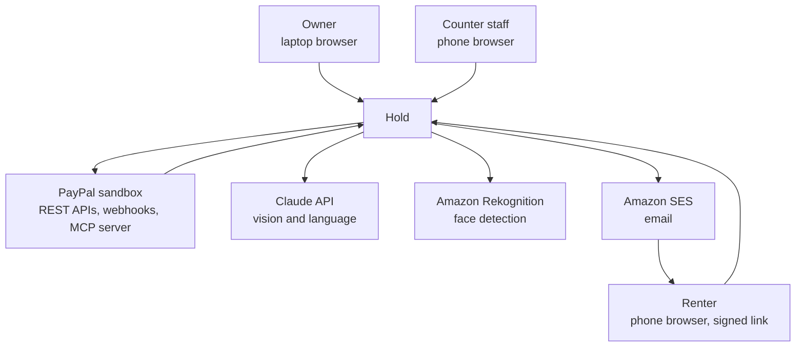

**People**

- **The owner** sets up items, prices and policies, approves larger claims and reviews the business.
- **Counter staff** hand items over, take them back and approve ordinary claims.
- **The renter** pays, accepts the hold, confirms condition, and accepts or contests a claim.

**Outside systems**

- **PayPal** reserves, captures and releases every dollar and reports every event.
- **Claude** compares photographs and writes language.
- **Rekognition** finds faces so they can be blurred.
- **SES** delivers links and messages.

---

## 4. Services and stores

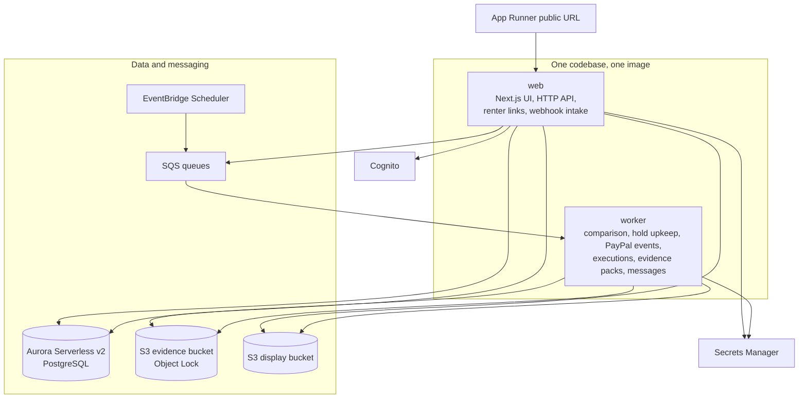

| Part | Responsibility | Never does |
|---|---|---|
| **web** | Serves the app and renter links. Exposes the HTTP API and the MCP server for assistants. Issues upload links. Receives PayPal webhooks. Runs the owner's assistant. | Compare photographs or call PayPal to capture inside a request |
| **worker** | Compares photo sessions. Keeps holds valid. Verifies and applies PayPal events. Executes approved actions. Builds evidence packs. Sends messages. Runs the operations agent and negotiations. | Serve user requests |
| **Aurora** | Shops, items, rentals, holds, claims, approvals, PayPal events, audit log | |
| **S3 evidence bucket** | Original photographs and evidence packs, locked against change | |
| **S3 display bucket** | Smaller, face-blurred copies for screens | |
| **SQS** | Hands work from web to worker, with retries | |
| **EventBridge Scheduler** | Starts timed work, most importantly hold upkeep | |
| **Cognito** | Signs in owners and staff | |
| **Secrets Manager** | Holds every credential | |

**Why a separate worker.** Comparing a photo session takes seconds and uses memory. The counter screens must stay instant while that happens, and a failed comparison must be retried without the user doing anything. Capturing money must also continue if the web tier is busy.

---

## 5. Code structure

One repository with shared packages, built into one Docker image.

```
hold/
  apps/
    web/              Next.js app, HTTP API, renter links, webhook intake
    worker/           queue consumers and scheduled jobs
  packages/
    domain/           rental, hold and claim state machines, claim arithmetic,
                      approval rules, upkeep planning, mandates, proposals,
                      detectors, trust ladder, negotiation referee. Pure code.
    db/               schema, migrations, repositories, row-level security
    paypal/           PayPal adapter, webhook verification, event mapping
    evidence/         capture sessions, fingerprints, chain, evidence packs
    vision/           quality checks, alignment, candidate regions
    compare/          the comparison pipeline and its second look
    agent/            owner's assistant, tool gateway with tiers, number guard
    mcp/              Hold's MCP server for assistants, agent tokens, quotes
    ops/              operations agent, PayPal MCP client
    negotiate/        the two advocates' runners
    trust/            Clean Record, credential signing and checking
    auth/             token verification, shop authorization, renter links
    notify/           email and in-app messages
    config/           typed configuration and secrets loading
  infra/              AWS CDK stacks
  eval/               photo evaluation set and its runner
  docs/
```

**The dependency rule.** `domain` depends on nothing. It has no database, no network and no AI. Every other package may depend on `domain`. Apps depend on packages and never on each other.

**Ports and adapters.** PayPal, Claude, Rekognition and email are each reached through an interface defined beside the code that needs it. Tests use fakes.

**`vision` runs in two places.** The quality checks are the same code on the phone and on the worker, so a photograph the phone accepts is one the worker can use.

---

## 6. Domain model

### 6.1 Concepts

| Concept | Meaning |
|---|---|
| **Shop** | A rental business, with one or more locations |
| **Item type** | A kind of thing rented, with its hold amount and photo plan |
| **Item** | One physical thing, with its own history |
| **Photo plan** | The views that must be photographed for an item type |
| **Price list** | The shop's published prices for damage, loss and lateness. Versioned. |
| **Wear policy** | What the shop counts as ordinary wear. Versioned. |
| **Rental** | One renter taking one or more items for a period |
| **Renter** | A person identified by their PayPal payment |
| **Hold** | Money reserved on the renter's PayPal account for one rental |
| **Authorization** | One PayPal authorization backing a hold. A hold may have several over time. |
| **Capture session** | One guided set of photographs: at handover, at return, at unboxing |
| **Photo** | One locked photograph of one view |
| **Mark** | A known imperfection on an item, with the date it was first seen |
| **Comparison** | The result of comparing a return session with its handover session |
| **Finding** | One difference: where, what kind, how confident |
| **Claim** | The shop's itemized request to charge the hold |
| **Approval** | One person's recorded decision, with what they changed |
| **Execution** | One attempt to carry out an approved action through PayPal |
| **Evidence pack** | The complete record of a rental's condition and money, as one document |
| **Mandate** | A person's written permission for an agent to act within limits |
| **Proposal** | An action an agent suggests, waiting for a person to decide |
| **Exception** | Something a detector found that needs attention |
| **Clean Record** | A renter's count of rentals returned in good condition |
| **Trust ladder** | A shop's published rule for lowering a hold. Versioned. |
| **Quote** | A priced offer of a rental, referred to by its ID |
| **Agent session** | An outside assistant's access to one rental |
| **Negotiation** | Two advocates' exchange of offers on a contested claim |
| **Incident** | Something a renter reported during a rental |

### 6.2 Entity relationships

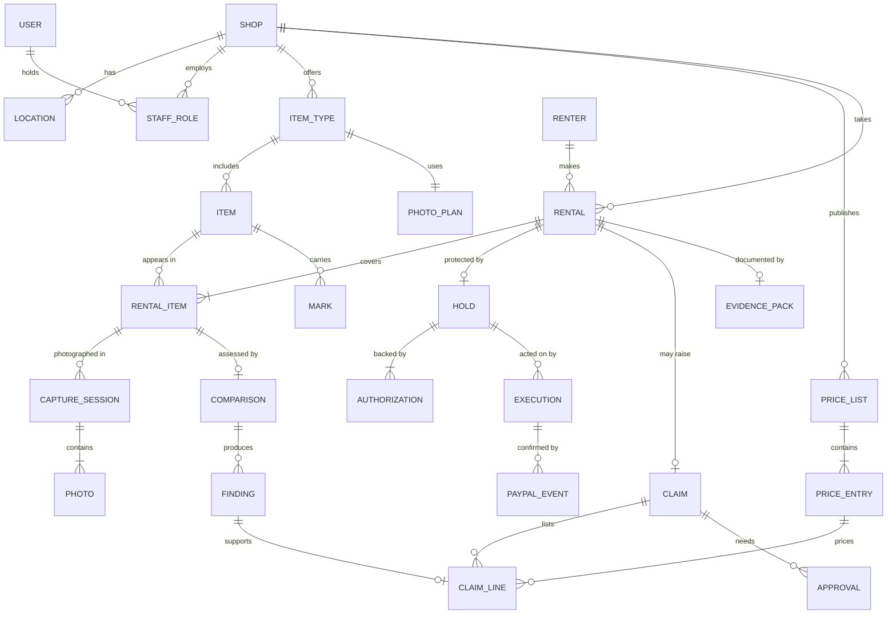

### 6.3 Tables

Every table except `users` and `renters` carries a `shop_id`.

| Table | Key contents |
|---|---|
| `users` | Cognito subject, contact details, language |
| `shops` | Name, timezone, currency, approval thresholds, reply period |
| `locations` | Address, opening hours |
| `staff_roles` | User, shop, role, approval limit |
| `paypal_accounts` | Shop, merchant ID, credential reference, webhook ID, mode |
| `item_types` | Name, value, hold amount, photo plan |
| `items` | Type, label or serial, status, chain head fingerprint |
| `photo_plans` | Ordered views with labels, outlines and whether each is required |
| `price_lists` | Version, effective date, published text |
| `price_entries` | Code, description, amount, category |
| `wear_policies` | Version, rules |
| `renters` | PayPal payer ID, email, name, language |
| `rentals` | Renter, period, fee, agreed price list and wear policy versions, state |
| `rental_items` | Rental, item, accessories out, accessories back |
| `holds` | Rental, reserved amount, placement strategy, state, current authorization |
| `authorizations` | Hold, PayPal authorization ID, amount, created, assured until, valid until, state |
| `capture_sessions` | Rental item, kind, actor, started, completed, manifest fingerprint |
| `photos` | Session, view, evidence key, display key, fingerprint, received time, quality scores |
| `marks` | Item, view, region, description, first seen session, status |
| `comparisons` | Handover session, return session, alignment scores, state, model and version used |
| `findings` | Comparison, view, region, class, confidence, description, matched mark, suggested price entry |
| `claims` | Rental, total, state, presented at, reply due |
| `claim_lines` | Claim, finding, price entry, amount, source |
| `claim_replies` | Claim, renter decision, comment, added photos |
| `approvals` | Subject, staff member, decision, changes made, method |
| `executions` | Action, idempotency key, PayPal resource IDs, state, attempts |
| `paypal_events` | PayPal event ID, type, raw body, headers, verification state, processing state |
| `money_events` | Rental, kind, amount, PayPal reference, time. Append-only. |
| `invoices` | Rental, PayPal invoice ID, amount, state |
| `shipments` | Rental, direction, carrier, tracking number, status |
| `disputes` | Rental, PayPal dispute ID, reason, state, evidence sent |
| `evidence_packs` | Rental, version, evidence key, manifest fingerprint |
| `renter_links` | Rental, token fingerprint, scope, expiry, last used |
| `outbox` | Pending messages written in the same transaction as state changes |
| `audit_log` | Who did what, when, from where |

**What the migrations hold so far.** Every table above except `locations`, `shipments` and `disputes`, which arrive with the features that use them. The schema is in `packages/db/src/schema`, the migrations in `packages/db/migrations`.

**Tables added by the extensions.** `mandates`, `proposals`, `exceptions`, `ops_runs`, `eval_runs`, `finding_outcomes`, `rental_outcomes`, `trust_ladders`, `trust_rungs`, `renter_consents`, `quotes`, `agent_sessions`, `negotiations`, `negotiation_moves` and `incidents`. Their contents are listed in `extensions.md` section 4.6.

---

## 7. The hold core

This is the part of Hold that must never be wrong. It lives in `packages/domain` and is plain, deterministic code.

### 7.1 Three linked state machines

A rental, its hold and its claim each move through explicit states. A change that is not listed cannot happen.

**Rental**

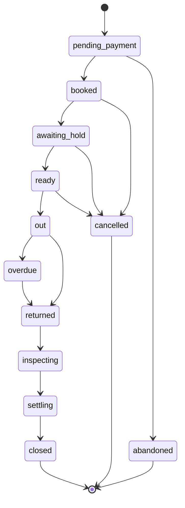

- **pending_payment:** a booking exists and its fee is not yet paid. It keeps its item for fifteen minutes.
- **abandoned:** the fee was never paid and the item was freed.

**Hold**

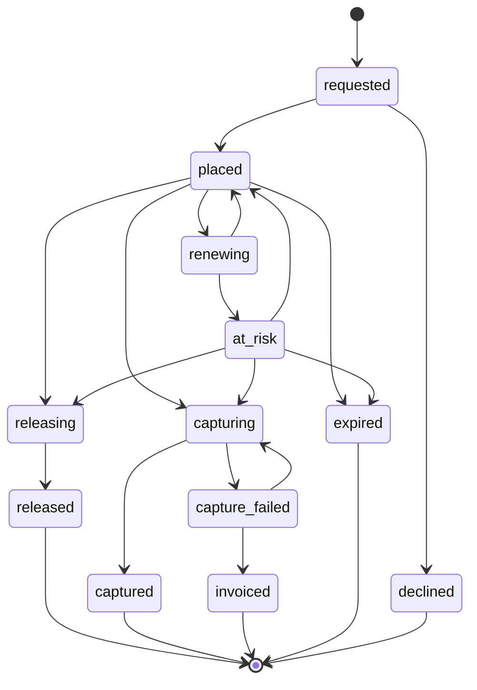

- **placed:** PayPal confirms the money is reserved.
- **at_risk:** the hold exists but its assured period has passed and a renewal did not succeed. The owner is told.
- **captured:** the approved amount was taken. Any remainder is released in the same step.
- **invoiced:** capture was not possible, so the claim was sent as an invoice.
- **expired:** the hold reached the end of its life without being used or replaced.

**Claim**

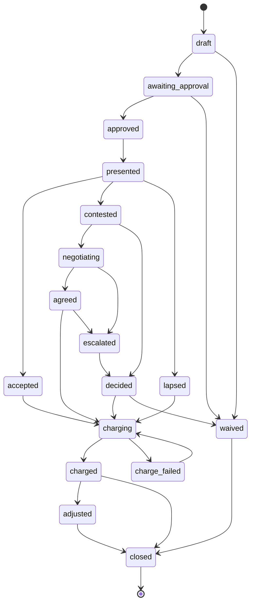

- **lapsed:** the renter's reply period ended without a reply.
- **adjusted:** part of a charge was refunded after review.
- **negotiating:** both sides gave an advocate limits, and the advocates are exchanging offers.
- **agreed:** the advocates agreed. Each person confirms, unless their mandate waives it.
- **escalated:** the advocates did not agree, or a person declined the result. The owner decides. A claim never returns to `contested`.

**How they connect.** A rental cannot be handed over unless its hold is placed. A hold cannot be captured unless a claim reached charging. A rental cannot close while its hold is in any state but released, captured, invoiced or expired.

### 7.2 Claim arithmetic

- **Each line is priced from the price list version the renter agreed to at booking.** A later price change never affects an earlier rental.
- **The line amount is read from the database.** The model may suggest which entry applies. It cannot supply an amount.
- **The claim total is the sum of its lines.**
- **The charge is the smaller of the claim total and the reserved amount.**
- **Anything above the reserved amount** becomes a separate invoice with the same evidence.
- **Amounts are integer cents** with a currency code.

Hold deliberately does not use PayPal's allowance to capture slightly more than was authorized. The renter agreed to a stated hold, and Hold never takes more than that from it.

### 7.3 Approval rules

Before any action on a hold, the approval rules decide who must confirm it.

| Action | Who may confirm |
|---|---|
| Release a hold after a clean return | Any staff member |
| Approve a claim up to the shop's staff limit | Any staff member with that limit |
| Approve a claim above the staff limit | The owner or a manager |
| Reduce or waive a claim | The owner, a manager, or the staff member who raised it |
| Decide a contested claim | The owner or a manager, and not the person who raised it where the shop has more than one |
| Refund part of a charge | The owner or a manager |

**Rules that always hold**

- A claim cannot be approved unless every line has a finding with photographs, or was added by a named person with a written reason.
- A claim cannot be charged before the renter has been shown it, unless the hold is about to lapse. Section 7.5 covers that case.
- Every approval records what the person changed, such as a removed line or a reduced amount.

**Approval in advance**

A person may also approve earlier, by granting a mandate. A mandate has a fixed kind, typed limits and an end date, and can be revoked. Plain code checks each action against it, and the approval record names it.

| Mandate | Granted by | Allows |
|---|---|---|
| Standing rule | The owner | The operations agent to release a hold after a clean comparison that nobody confirmed |
| Settlement, shop side | The owner | The shop's advocate to agree a contested claim, down to a stated share |
| Settlement, renter side | The renter | The renter's advocate to agree a contested claim, up to a stated total |
| Hold by assistant | A renter with a saved method | The renter's own assistant to accept a hold, up to a stated amount. Optional. |

No mandate allows a charge that a claim does not already justify. The rules above still apply to every claim.

### 7.4 Hold upkeep

A PayPal hold has two clocks.

- **Assured period:** three days from placement. Capture is best assured inside it.
- **Validity:** 29 days from placement. After that the hold is gone.

A hold can be renewed once, after the assured period and before validity ends. The renewal gives a new authorization identifier and a new three-day assured period. It does not extend the 29 days.

**Hold renews only at the moment it charges.** The sandbox said on 14 October 2026 that a hold may be renewed only once. A renewal made earlier is a guess about when a charge will come. If the return is late, or the renter takes the reply period, the charge falls outside the renewal's three days and the one renewal is already spent. So when a charge is due after the assured period, Hold renews and captures on the new identifier straight away, inside its fresh assured period. Every charge within the 29 days is then assured, whatever the return date and however long the reply period. A clean return, the common case, is never renewed at all. Decision 4 in section 21 records the alternatives.

The plan is computed by plain code in `packages/domain/src/upkeep.ts` from the authorization's clocks. Each timed step is a schedule in EventBridge. None of them renews.

| When | What Hold does |
|---|---|
| **The hold is placed** | Records both clocks from PayPal's reply and creates the schedules below |
| **A charge is due,** inside the assured period | Captures on the current identifier |
| **A charge is due,** after the assured period, on a hold not yet renewed | Renews, reads the new authorization back, then captures on it at once |
| **A charge is due,** and the renewal is already spent | Captures on the current identifier, without assurance |
| **A renewal fails** | Marks the hold at risk, tells the owner, and still tries the capture on the original identifier |
| **A capture is refused** | Sends the claim as an invoice with the evidence pack and releases the hold (section 8.4) |
| **Three days before validity ends,** and the rental is still open | Starts a replacement: a new hold through a saved payment method if one exists, otherwise a link asking the renter to approve a new hold. The replacement has its own clocks and its own renewal. |
| **A replacement is confirmed** | Releases the old hold |
| **A day before validity ends,** with an approved claim still waiting for the renter's reply | Charges it then, as section 7.5 says |
| **Validity ends with no replacement** | Marks the hold expired and tells the owner at once |
| **The rental ends** | Removes any schedules still pending |

**What Hold gives up.** A renewal also re-checks the renter's funds, so renewing early would warn sooner that the money is gone. Hold accepts the later warning: the failure is handled at the charge in the same way, with a capture attempt and then an invoice, and the one renewal is never wasted on a rental that comes back clean. While a claim is being prepared, the claim screen reads the authorization from PayPal to show that the hold still stands, which spends nothing.

**Hold tracks expiry itself.** PayPal's event list has no event for a hold expiring, so Hold does not wait to be told. It acts on its own clock and confirms by reading the authorization from PayPal.

### 7.5 The reply period and the hold's life

A shop may give the renter time to reply to a claim. That period cannot outlast the hold.

- If the reply period ends inside the hold's validity, Hold waits.
- If the hold would lapse first, Hold captures the approved amount before it lapses and tells the renter that the claim is still open. If the claim is then reduced or waived, the difference is refunded.

This rule is shown to the renter at booking.

### 7.6 Execution, the outbox and idempotency

Acting on a hold involves a database and an outside API, which cannot share a transaction. Hold uses the outbox pattern.

1. In one database transaction, Hold records the approval, creates an execution with a fresh idempotency key, and writes an outbox row.
2. The worker reads the outbox and sends the message to the executions queue.
3. The worker calls PayPal with the idempotency key.
4. The worker records PayPal's reply and marks the execution submitted.
5. The execution is confirmed only when the matching PayPal event is verified, or the resource is read back from PayPal.

**Idempotency at each layer**

- **To PayPal:** the `PayPal-Request-Id` header carries the execution's key. A retry cannot capture twice.
- **From PayPal:** each event's ID is unique in `paypal_events`. A redelivered event is ignored.
- **In the money log:** each row has a unique PayPal reference. Applying the same event twice writes nothing new.
- **In the queues:** work is ordered per rental, so two workers never act on the same hold at once.

**Invariants the code enforces**

- The amount captured from a hold never exceeds its reserved amount.
- The amount captured never exceeds the approved claim.
- Captured plus released never exceeds reserved.
- A hold reaches exactly one final state.

---

## 8. PayPal integration

### 8.1 The shop's PayPal account

Each shop is paid into its own PayPal business account. Hold does not hold funds at any point.

**In the hackathon,** each demo shop maps to a sandbox business account. Its API credentials are stored in Secrets Manager and referenced from `paypal_accounts`.

**In production,** Hold would act for shops through PayPal's partner model, with each shop's consent and without holding its credentials. The code reaches the account through a credential provider interface, so that change is confined to one adapter.

### 8.2 Placing the hold: three strategies

PayPal sets two constraints that shape this.

- An order that authorizes first cannot contain more than one purchase unit. The fee and the deposit cannot be two parts of one such order.
- A hold lasts 29 days. A hold placed when a tourist books three weeks ahead would be nearly spent by the time they arrive.

So the hold is always its own authorization, and when it is placed depends on the rental. All three strategies sit behind one interface and produce the same hold object.

| Strategy | When it is used | How it works | Approvals by the renter |
|---|---|---|---|
| **At the counter** | Advance bookings, and the safe default | The fee is paid at booking with an ordinary order. At pickup, staff show a QR code and the renter approves the hold on their own phone. | One at booking, one at pickup |
| **Combined** | Walk-in and same-day rentals | One authorize-first order for the fee plus the deposit. The fee is captured at once, marked as not the final capture. The rest stays reserved as the hold. | One |
| **Saved method** | Returning renters, where the shop is approved for it | The renter saves their PayPal wallet with the shop once. Hold places the hold shortly before pickup with no action from the renter, and can replace it for long rentals. | None after the first |

**Which is built first.** "At the counter" uses only behavior PayPal documents plainly, so it is the baseline. "Combined" gives the best walk-in experience. The sandbox confirmed on 14 October 2026 that the remainder stays held after a partial capture and can then be captured or released. Renewal after a partial capture is still to be confirmed after day 4. "Saved method" is optional.

### 8.3 Which PayPal capability does what

| Hold need | PayPal capability | Call | Confirmed by |
|---|---|---|---|
| Rental fee | Orders v2, capture | Create order, capture order | `PAYMENT.CAPTURE.COMPLETED` |
| Place the hold | Orders v2, authorize | Create order with intent to authorize, authorize order | `PAYMENT.AUTHORIZATION.CREATED` |
| Renew the hold | Payments v2 | Reauthorize the authorization | Read-back of the new authorization |
| Release the hold | Payments v2 | Void the authorization | `PAYMENT.AUTHORIZATION.VOIDED` |
| Charge damage | Payments v2 | Capture the authorization for the claim amount, as the final capture | `PAYMENT.CAPTURE.COMPLETED` |
| Check a hold | Payments v2 | Show authorization details | |
| Reduce a charge | Payments v2 | Refund the capture | `PAYMENT.CAPTURE.REFUNDED` |
| Damage beyond the hold | Invoicing v2 | Create and send invoice | `INVOICING.INVOICE.PAID` |
| Returning renter | Payment Method Tokens v3 | Setup token, payment token, order with the saved method | `VAULT.PAYMENT-TOKEN.CREATED` |
| Shipped rental | Shipment tracking | Add and read tracking | Tracking status |
| Dispute | Disputes v1 | Read dispute, provide evidence | `CUSTOMER.DISPUTE.*` |
| The record of truth | Webhooks, Transaction Search | | |
| Owner identity | Log in with PayPal | OAuth exchange | |
| Owner's assistant | Agent Toolkit, sandbox MCP server | Read tools | |

### 8.4 The life of one hold in PayPal calls

**Placing, at the counter**

1. The worker creates an order in the shop's account with intent to authorize, for the hold amount, described as a refundable hold.
2. The renter approves it in PayPal from the QR code or link.
3. On approval, the server authorizes the order.
4. PayPal returns an authorization with its identifier and expiry time.
5. Hold records both clocks and marks the hold placed when the event is verified.

**Releasing after a clean return**

1. A staff member confirms the clean return.
2. The worker voids the authorization.
3. `PAYMENT.AUTHORIZATION.VOIDED` confirms it.
4. The renter is told that nothing was charged.

**Charging damage**

1. The claim reaches charging.
2. If the assured period has passed and the hold has not been renewed, the worker renews it and reads the new authorization back. This is the only place Hold renews (section 7.4).
3. The worker captures the claim amount as the final capture, at once, on the current identifier.
4. `PAYMENT.CAPTURE.COMPLETED` confirms it.
5. The worker reads the authorization back to confirm the remainder was released.
6. Renter and shop receive the same record.

**If the renewal or the capture fails**

1. A refused renewal marks the hold at risk. The worker still captures on the original identifier, without assurance.
2. A refused capture is not retried with a second renewal, which PayPal does not allow. The claim is sent as an invoice with the evidence pack, and the hold is released.
3. The owner is told in plain words what happened.

### 8.5 The webhook pipeline

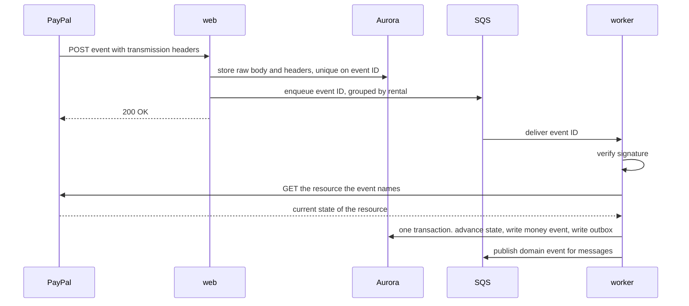

**Rules**

- **Store first.** The raw body is saved before anything else, so no event is lost and the signature is checked against the exact bytes received.
- **Answer quickly.** PayPal retries a delivery that does not return success, up to 25 times over three days.
- **Verify before applying.** An event that fails verification is kept for inspection and never applied.
- **Read the resource back.** Hold does not trust the event body for amounts or status.
- **Tolerate disorder.** State machines only move forward, so a late or repeated event changes nothing.

**Simulator events.** PayPal's webhook simulator sends events that PayPal's own verification call rejects. Hold accepts them only in the test environment, behind an explicit setting, and marks them as simulated.

### 8.6 Reconciliation

Every night Hold compares its records with PayPal.

- **Every open hold** is read from PayPal. Its status and expiry must match Hold's record.
- **Every capture and refund** in the shop's transaction history must have a money event in Hold.
- **A difference** raises an alert. Missing events are applied through the normal path. Anything else is shown to the owner and is never corrected silently.

### 8.7 Disputes

A renter may open a dispute with PayPal despite the reply period.

1. `CUSTOMER.DISPUTE.CREATED` arrives and Hold links the dispute to the rental by the capture it names.
2. The owner is told, with the evidence pack already built.
3. The owner reviews and confirms.
4. Hold uploads the evidence pack to PayPal as the shop's response.
5. Later events update the dispute's state. If the shop loses, the refund appears as a money event like any other.

Hold never responds to a dispute without the owner's confirmation.

### 8.8 The PayPal adapter

`packages/paypal` is the only code that talks to PayPal.

- **One method per business action,** such as `placeHold`, `renewHold`, `releaseHold` and `captureFromHold`, each requiring an idempotency key.
- **The port** is `PayPalHolds` in `packages/paypal/src/port.ts`: `createHoldOrder`, `readHoldOrder`, `placeHold`, `readAuthorization`, `renewHold`, `releaseHold` and `captureFromHold`. Every write takes an idempotency key. After placing, renewing or releasing, the adapter reads the authorization back from PayPal instead of trusting the reply.
- **A fake PayPal** (`createFakePayPal`) implements the same port in memory with a clock the caller controls. It is what renewal and expiry are tested against, and what the integration tests use.
- **Typed results and typed errors,** so callers can tell a decline from an expired hold from an outage.
- **Token handling.** Access tokens are fetched per shop account, cached until shortly before expiry and never logged.
- **Debug IDs.** PayPal returns a debug ID with each response. Hold logs it with every call.
- **Retry policy.** Network and server errors are retried with backoff and the same idempotency key. Client errors are not retried.

**How the Agent Toolkit is used.** The toolkit has no tool to authorize, renew, release or partly capture a hold, so the adapter calls the REST API for those. The toolkit is used for invoices, refunds, shipment tracking and reading disputes and transactions, and it gives the owner's assistant its PayPal read tools.

---

## 9. Evidence architecture

Hold's claim to fairness rests on its evidence. This section describes how a photograph becomes something both sides can rely on.

### 9.1 Capture sessions

A capture session is one guided set of photographs of one item.

| Kind | Taken by | When |
|---|---|---|
| Handover | Staff | When the item leaves |
| Return | Staff | When the item comes back |
| Packing | Staff | Before a shipped item is sealed |
| Unboxing | Renter | When a shipped item arrives |
| Send-back | Renter | Before a shipped item is returned |

**How a session runs**

1. The app loads the photo plan for the item type.
2. For each view, the camera shows a framing outline. In a return session it also shows the handover photograph faintly, to match the angle.
3. The phone checks sharpness, brightness and framing at once, and asks for a retake if needed.
4. The photograph uploads straight to the evidence bucket through a short-lived signed link, with its fingerprint attached so S3 rejects a corrupted upload.
5. When every required view is present, the session is sealed.

### 9.2 What makes a photograph evidence

| Property | How Hold provides it |
|---|---|
| **It cannot be changed** | The evidence bucket uses S3 Object Lock. An object cannot be overwritten or deleted until its retention period ends. |
| **It can be proved identical** | A SHA-256 fingerprint is recorded in the database when the upload completes. |
| **Its time is trustworthy** | The recorded time is when the server received it, not the phone's clock. |
| **Its place in history is fixed** | Each sealed session writes a manifest listing its photographs and fingerprints, plus the fingerprint of the item's previous manifest. This forms a chain per item. Removing or replacing an earlier session would break it. |
| **It shows the right item** | The comparison checks identifying features and flags a mismatch. |
| **It is not a reused image** | A perceptual fingerprint is compared with earlier sessions for the same item. |

### 9.3 Two copies of every photograph

- **The original** stays locked in the evidence bucket and is never shown directly.
- **The display copy** is smaller, has faces blurred, and lives in the display bucket. It is what people see on screen.

Faces are found by Amazon Rekognition and blurred before the display copy is saved. If a dispute requires it, the owner can release the original.

### 9.4 The item passport

Each item carries a list of marks.

- A mark has a view, a region, a description and the session where it was first seen.
- At handover, staff confirm the known marks and can add new ones. The renter sees the list and can add a photograph of anything missed.
- During comparison, a difference that matches a known mark is labelled as already present and cannot be claimed.
- When damage is charged, it becomes a mark, so the next renter is not charged for it.
- When the item is repaired, the mark is closed.

This is what guarantees that nobody pays for an earlier renter's damage.

### 9.5 The evidence pack

One document per rental, built by the worker.

1. The rental's details and the versions of the price list and wear policy the renter agreed to.
2. The handover session and the condition report the renter confirmed.
3. The return session.
4. The comparison: each finding with both photographs and the region outlined.
5. The claim, each line with its price list entry.
6. The approvals, including anything a person changed.
7. The renter's reply, if any.
8. The PayPal record: hold placed, amount captured, amount released.
9. A manifest of every photograph's fingerprint.

The pack is stored locked, shown to the renter, and is what Hold uploads if a dispute is opened. A new version is written if anything changes. Earlier versions remain.

---

## 10. AI architecture

### 10.1 The principle

The AI is good at looking and at language. It has no authority over money. It produces findings and words. People produce decisions.

```mermaid
flowchart LR
    pair["Handover and return photos"]
    q["Quality check<br/>plain code"]
    align["Align and find regions<br/>plain code"]
    look1["First look<br/>Claude, full views and crops"]
    look2["Second look<br/>Claude, crops only, fresh context"]
    marks["Match known marks<br/>plain code"]
    price["Price from the list<br/>plain code"]
    person["Person approves"]
    claim["Claim"]

    pair --> q
    q --> align
    align --> look1
    look1 --> look2
    look2 --> marks
    marks --> price
    price --> person
    person --> claim
```

### 10.2 The comparison pipeline

Run by the worker for each item when a return session is sealed.

**Step 1. Quality.** Plain code scores each photograph for sharpness, brightness and framing. This already happened on the phone. It runs again so the record does not depend on the phone.

**Step 2. Normalize.** Orientation, size and exposure are corrected so the two photographs of a view are comparable.

**Step 3. Align.** The return photograph is lined up with the handover photograph. An alignment score is recorded. A poor score means the angles differ too much to compare reliably.

**Step 4. Candidate regions.** Plain code marks areas that changed between the aligned pair. These are hints. Most will be shadows, reflections or dirt.

**Step 5. First look.** Claude receives both full photographs of the view, close crops of each candidate region from both, the item type, the known marks and the wear policy. It returns structured findings:

| Field | Content |
|---|---|
| View | Which view of the item |
| Region | Where in the photograph |
| Class | No change, ordinary wear, damage, missing part, or cannot tell |
| Confidence | A stated level |
| Description | A short plain sentence |
| Suggested price entry | A code from the shop's list, or none |

The model is also asked to report anything the candidate regions missed.

**Step 6. Second look.** Each finding classed as damage or missing is checked again by a separate call with a fresh context. That call sees only the two close crops and a neutral question. It does not see the first call's reasoning. If the two disagree, the finding becomes "cannot tell".

**Step 7. Known marks.** Plain code compares each finding's region with the item's marks. A match is relabelled as already present and removed from consideration. Marks reported during this rental through the incident desk are checked too. A match there is labelled as reported during the rental and linked to any line the renter already agreed.

**Step 8. Price.** Plain code looks up the suggested entry in the price list version the renter agreed to. If the code does not exist in that list, the finding is left for a person to price.

**Step 9. Outcome.** The comparison ends in one of three results.

| Result | Condition | What happens |
|---|---|---|
| **Clean** | No damage or missing findings, nothing uncertain | Staff confirm and the hold is released |
| **Findings** | One or more confirmed findings | A draft claim is prepared for a person |
| **Needs a person** | Anything uncertain, a poor alignment, a possible item mismatch | Staff are asked to look at the item itself |

### 10.3 When the system defers

Hold is designed to say "I cannot tell" readily. It defers to a person when:

- a photograph's quality score is below the threshold
- the alignment score is poor
- lighting differs strongly between the two sessions
- the two looks disagree
- confidence is below the shop's threshold
- the item's identifying features do not match

A wrong damage finding on a clean return is treated as the worst error the system can make. The thresholds are tuned to avoid it, at the cost of asking people to look more often.

### 10.4 Language

| Task | Input | Safeguard |
|---|---|---|
| **Turn the shop's rules into a price list and wear policy** | The owner's plain description | The owner reviews and publishes the result. Nothing takes effect unreviewed. |
| **Write the claim message** | The approved claim | The number guard checks every amount and item against the claim. |
| **Translate for the renter** | The message and the renter's language | The number guard runs on the translation too. |
| **Summarize a contested claim** | The claim, the renter's reply and photographs | The summary must present both sides. It makes no recommendation. |
| **Draft rental terms** | The shop's settings | The owner reviews and publishes. |

**The number guard.** Before any message about money is sent, plain code extracts every amount and item name from it and compares them with the claim record. If anything differs or is missing, the message is discarded and a fixed template is used. A renter can never read an amount that the claim does not contain.

### 10.5 The owner's assistant

The owner can ask questions and give instructions in plain language.

- **Model:** Claude Opus 5.5 on Amazon Bedrock (`anthropic.claude-opus-5-5`), through the Bedrock SDK's Mantle client and the Anthropic SDK's tool runner.
- **Tool choice is automatic,** with strict tool schemas.
- **Every tool call passes through a gateway** that checks the owner's identity, shop and role.

| Tool | Kind |
|---|---|
| `list_holds`, `get_hold` | Read |
| `list_rentals`, `get_rental` | Read |
| `list_claims`, `get_claim` | Read |
| `damage_report`, `item_history` | Read |
| `search_paypal_transactions`, `get_paypal_insights` | Read, through the PayPal toolkit |
| `get_shipment_status` | Read, through the PayPal toolkit |
| `propose_release` | Proposal, confirmed by the owner on screen |
| `propose_extension` | Proposal, confirmed by the owner on screen |
| `draft_message_to_renter` | Draft, sent only after the owner confirms |

**An asymmetry by design.** The assistant can propose releasing a hold, which returns money to a renter. It has no tool to propose a charge. A charge can only begin from a claim built from photographs and approved on the claim screen.

**Proposals are records.** A proposal names the records it concerns and never an amount. It is checked again against the current state when the owner approves it. The operations agent writes the same proposals each night and prepares the owner's morning queue.

**Tools have tiers.** Read, draft, propose, notify, or act under a mandate. No tier permits a charge. See `extensions.md` sections 4 and 6.

### 10.6 Defense against manipulation

| Threat | Defense |
|---|---|
| A renter's comment contains instructions aimed at the model | Renter text is passed as data. The summary step has no tools. |
| A renter uploads an edited photograph | Renter photographs are labelled as renter-supplied and are never used as the comparison baseline. |
| Staff substitute an old photograph | Uploads come from the live camera session. Reused images are flagged by perceptual fingerprint. |
| The model invents a price | Prices are read from the database. The number guard checks every message. |
| The model overstates damage | The second look, the confidence threshold and a person's approval. |
| The owner's assistant is asked to charge someone | No such tool exists. |
| Text in a PayPal memo or dispute note steers the operations agent | It can only write proposals of allowed kinds, for exceptions that plain code found, and a person approves each one. |
| A renter's outside assistant sends instructions or bad data | Everything it sends is stored as data. No tool it can call takes an amount or moves money. |
| An advocate is talked into a bad agreement | The referee is plain code. No move outside a side's mandate is accepted. |
| An advocate reveals its side's limit | Limits are never placed in the other side's context. Amounts in argument text must match the offer. |
| An assistant blocks a shop's items with unpaid bookings | Unpaid bookings expire in fifteen minutes and are capped per caller. |

### 10.7 Model configuration

- Model Claude Opus 5.5 on Amazon Bedrock, `anthropic.claude-opus-5-5`, with a client-side refusal fallback to `anthropic.claude-opus-4-8`.
- Effort is set explicitly on every call: high for both looks, medium for summaries, low for short messages.
- Structured output for all findings.
- The stop reason is checked on every response. A refusal is handled as a normal outcome, and server-side fallbacks are enabled.
- The model and prompt version used are stored with each comparison, so a result can be explained later.

### 10.8 Measuring the comparison

`eval/` holds pairs of photographs with known outcomes: no change, ordinary wear, and damage of several kinds, in good and poor light, on each supported item type.

| Measure | Why |
|---|---|
| Share of real damage found | Shows the shop is protected |
| Share of clean returns wrongly flagged | The error that harms renters. Kept as low as possible. |
| Share sent to a person | Shows the cost of caution |
| Agreement between the two looks | Shows whether the second look adds value |
| Whether stated confidence matches reality | Shows the thresholds can be trusted |

The set runs before every release and whenever a prompt or threshold changes.

**The results are published.** The set has a tuning half and a gate half. Only the gate half is published, each number with its count, in the owner's view, on a public page and in the README. The build fails if the gate half gets worse. Every closed claim also records what a person decided about each finding. See `extensions.md` section 5.

---

## 11. Key flows

### 11.1 Booking and placing the hold at the counter

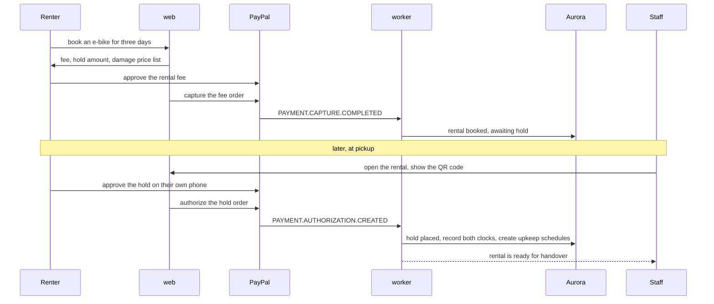

### 11.2 Guided handover

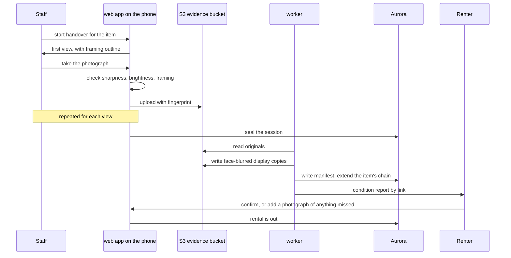

### 11.3 A clean return

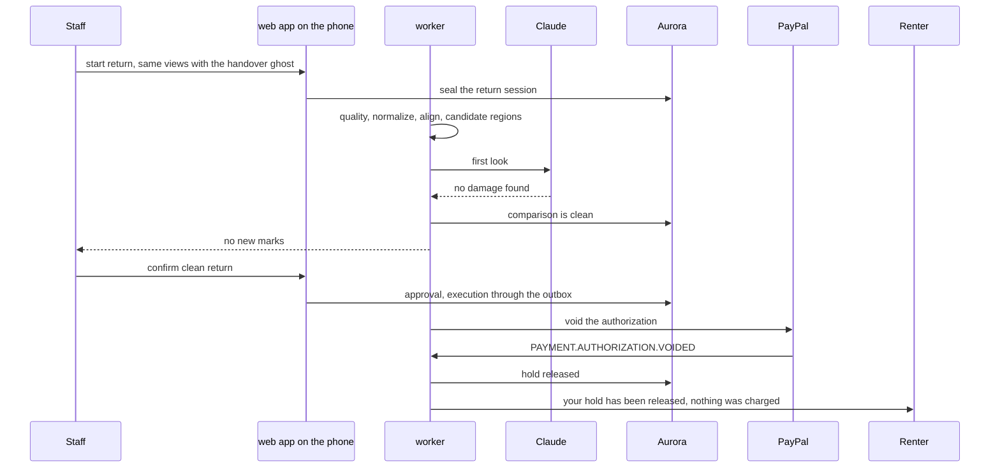

### 11.4 A return with damage

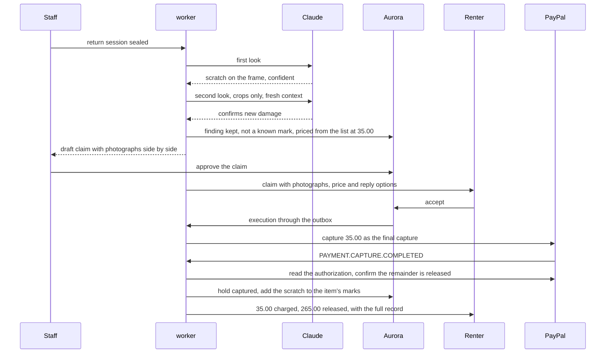

### 11.5 A contested claim

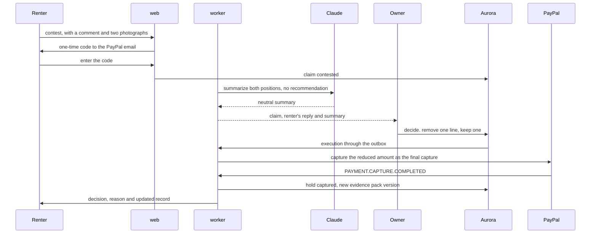

### 11.6 Charging a hold after day three

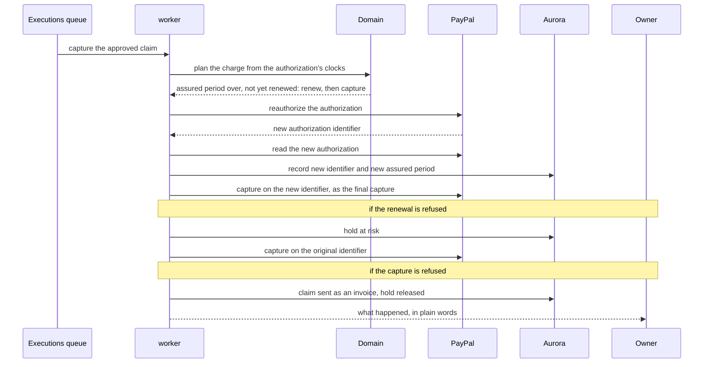

A long rental is kept protected by the replacement in section 7.4, not by renewal.

### 11.7 A dispute

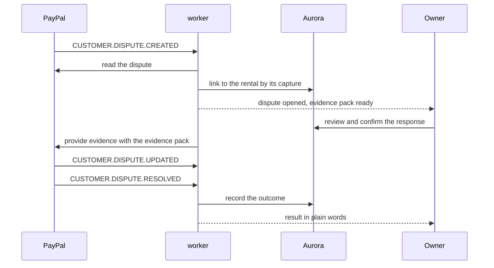

### 11.8 Flows added by the extensions

| Flow | Where |
|---|---|
| The operations agent's nightly run | `extensions.md` section 6.3 |
| A booking made by a renter's assistant | `extensions.md` section 8.4 |
| A negotiation between two advocates | `extensions.md` section 9.8 |
| Damage agreed during a rental | `extensions.md` section 10.4 |

---

## 12. Identity and access

### 12.1 Owners and staff

- **Amazon Cognito** holds one user pool for owners and staff.
- **Passwordless sign-in** by emailed code or passkey, on Hold's own `/sign-in` and `/sign-up` pages, which call Cognito. Decision 25 says why.
- **Who signs up.** Only a shop's owner. Staff are invited by the owner and sign in with that address. Renters have no account.
- **How sign-up and sign-in run.** Both pages check their input in the browser and on the server with one function (`apps/web/src/features/auth/auth-input.ts`), then call Cognito through the `Identity` port in `packages/auth`. The steps are in `apps/web/src/features/auth/sign-in-flow.ts`.
  - **Sign-up** creates a Cognito account with no password and emails a six-digit code to confirm the address. The confirmation signs the person in with no second code. Then one transaction creates the person, the shop and their `owner` role, and writes the audit line (`registerOwner` in `packages/db`). The person also joins the `owner` group in Cognito.
  - **Sign-in** emails an eight-digit code (Cognito's `USER_AUTH` flow with `EMAIL_OTP`).
  - **An address that already has an account** is sent a sign-in code by the sign-up page, and the new shop is added to that account. One person may own several shops.
  - **The same answer for every address.** An address with no account gets the same "check your email" step, and a code typed for it is simply wrong. The forms cannot be used to find out who has an account.
  - **Between the two steps,** the address, Cognito's session for the attempt and the shop to create travel in a cookie sealed with AES-256-GCM. The browser cannot read or change it. Cognito keeps an attempt open for ten minutes and ends it after three wrong codes.
  - **The session** is the Cognito access token and refresh token, each in an HTTP-only cookie. Every request checks the access token on the server with `aws-jwt-verify`. When it lapses, the proxy uses the refresh token for a new one. Signing out revokes the refresh token at Cognito.
  - **Rate limits of Hold's own,** on top of Cognito's: five code emails per address and forty sign-in requests per network address in fifteen minutes, counted in `rate_limits` by fingerprint, so no address is stored. The network address is the last entry of `x-forwarded-for`, the one App Runner's load balancer adds. A request with none, or from loopback, comes from a developer's machine and is limited by address only.
- **The test environment.** With `HOLD_ENVIRONMENT=test`, the web app uses an in-memory identity service that sends a fixed code, and a PGlite database. Only the end-to-end tests set it. Every other environment refuses to start without Cognito and Aurora settings.
- **A passkey as the second factor** for owners and managers, and for staff whose approval limit is above the shop's threshold (`needsStrongSignIn` in `packages/domain`). Cognito cannot follow an emailed code with an authenticator app: a person who turns one on can only sign in with a password from then on. A passkey with user verification is the device and the person's fingerprint, face or PIN together, so it is multi-factor on its own. The user pool requires user verification and its relying party is the web app's domain (`passkeyRelyingPartyId` in `infra/cdk.json`, `localhost` until the app is deployed).
  - A person's first passkey is registered from a session an emailed code proved, on the shop's security page: there is nothing stronger yet. Every later one needs a session a passkey proved, so someone who reached the person's inbox cannot add a passkey of their own. A passkey can then be used to sign in.
  - **Sign-in answers every address the same way.** For an emailed code, any refusal by the identity service still leads to the code step, for an attempt that fails as a wrong code would. For a passkey, the options sent to the browser leave out the account's list of credentials, and any refusal gets options of the same shape for an attempt that fails as an unrecognized passkey would. Only "too many attempts" is said plainly. Confirming with a passkey, which may say "you have none", is open only to the person signed in, and always uses their own address.
  - **How a session was proven** is kept beside it in a sealed cookie, bound to the person the access token names and to the session's refresh token, so a record from one account's session counts for nothing on another's. Every change to prices, staff or PayPal checks it on the server: a person who needs a passkey and signed in with an emailed code is asked to confirm with their passkey first, and returns to the page they were on.
- **Staff are invited, never sign up.** An owner or a manager invites by email, with a role and, for counter staff, an approval limit. Owners invite managers, counter staff and read-only members; managers invite counter staff and read-only members (`mayInvite`). The email carries a link with a random token, of which only the SHA-256 fingerprint is stored. The link works once, for seven days. Following it sends a code to the invited address, never to one the visitor types; once the code is typed, the role is created and the invitation is marked accepted, in one transaction.
- **Every change to a shop** goes through `shopAction` in `apps/web/src/server/shop-access.ts`, which authenticates, resolves the shop and the caller's role, checks the passkey where needed, validates the form against a strict schema, opens the transaction with the caller's identity and writes the audit line. A refusal rolls the transaction back. A test fails on any export of `features/shop/actions.ts` not built by it.
- **Tokens** are verified by every service on every request.

### 12.2 Authorization

Three layers, each independent of the others.

| Layer | Question | Where enforced |
|---|---|---|
| **Account type** | May this person use the shop side of Hold at all? | Cognito group, checked at the edge |
| **Role in a shop** | What may this person do in this shop, and up to what amount? | Service, on every request, from `staff_roles` |
| **Row-level security** | Can this query see this row? | Aurora, on every query |

**How row-level security works.** At the start of each request the service opens a transaction with `inShop` from `packages/db`. It sets the role, the shop and, for a signed-in person, the user's ID, each for that transaction only. Every table has a policy that allows a row only inside that shop, and only if the named person has a role there. A renter link or a worker job names no person and is bound to its shop by the code that resolved it. A query that forgets its filter, or runs outside `inShop`, returns nothing.

- `users` and `renters` carry no shop. A person sees themselves and their colleagues in the current shop. A shop sees only the renters who rented from it. Renters are created only through `hold_renter_for_payer`, from the identity PayPal returned.
- No service role may delete a row. The money log, approvals and the audit trail also refuse updates. Both rules are grants, so they hold even for a query that passes every policy.

**Service access.** The worker uses a separate database role, `hold_worker`, and each job names the single shop it is working on.

### 12.3 Renters

Renters have no account. They act through links.

| Property | How |
|---|---|
| **Bound to one rental** | The link's token names one rental and nothing else |
| **Signed** | The token is signed by Hold. A changed token is rejected. |
| **Expiring** | Each link has an end date tied to the rental's life |
| **Scoped** | View, confirm condition, extend, accept, contest. Each link carries only the scopes it needs. |
| **Revocable** | Only the token's fingerprint is stored. Removing it ends the link. |
| **Stepped up for money decisions** | Accepting or contesting a claim requires a one-time code sent to the email PayPal provided |

**Who the renter is.** The renter's identity is the PayPal payer who approved the order. Their payer ID, name and email come from PayPal and are not typed in.

### 12.4 Connecting the shop's PayPal account

**In the hackathon build,** the owner pastes the client ID and secret of their shop's PayPal sandbox app on the shop's PayPal page. Hold checks them by asking PayPal for a token, then keeps them in Secrets Manager under `hold/paypal/shops/{shop}/sandbox`, and stores only that name in `paypal_accounts`. They are never shown again. Only the owner can connect, and only after confirming with a passkey.

**In production,** the owner would connect through Log in with PayPal and PayPal's partner model, and Hold would keep no credentials. The `CredentialStore` interface in `packages/paypal` is the one place that change touches.

### 12.5 Assistants

A renter's own AI assistant acts through an agent token: signed, bound to one rental, scoped, expiring, and revocable by the renter. It is issued only after PayPal confirms the fee was paid, and only to the caller that made the booking. Before that, an assistant has no identity and can only read public information, quote and book. No scope moves money. See `extensions.md` section 8.5.

---

## 13. Interfaces

### 13.1 HTTP API for owners and staff

Served by `web`. All routes require a Cognito token.

| Group | Purpose |
|---|---|
| `/api/shops` | Shop settings, locations, staff and limits |
| `/api/items` | Item types, items, photo plans, item passports |
| `/api/prices` | Price lists and wear policies, draft and publish |
| `/api/rentals` | Create, read, extend, cancel |
| `/api/holds` | Read state, request a hold, show the approval QR code |
| `/api/sessions` | Start, add photographs, seal |
| `/api/uploads` | Short-lived upload links |
| `/api/comparisons` | Read results and findings |
| `/api/claims` | Read, edit, approve, waive, decide |
| `/api/disputes` | Read, confirm the response |
| `/api/reports` | Holds ledger, damage and recovery, staff consistency |
| `/api/assistant` | Conversation with the owner's assistant, streamed |
| `/api/paypal/connect` | Connect the shop's PayPal account |
| `/api/proposals` | The morning queue: read, approve, reject, postpone |
| `/api/mandates` | Standing rules and settlement limits |
| `/api/ladder` | The trust ladder: draft, simulate, publish |
| `/api/incidents` | Incidents reported by renters |
| `/api/accuracy` | The scorecard |

### 13.2 Renter routes

Served by `web`. Each requires a valid signed link.

| Route | Purpose |
|---|---|
| `/r/{token}` | The rental: status, hold, price list |
| `/r/{token}/pay` | Pay the fee or approve the hold |
| `/r/{token}/condition` | Review and confirm the handover report |
| `/r/{token}/session` | Guided photographs for shipped rentals |
| `/r/{token}/claim` | See a claim, accept or contest it |
| `/r/{token}/record` | The evidence pack |
| `/r/{token}/incident` | Report something that happened during the rental |
| `/r/{token}/negotiation` | Set an advocate's limit, read the transcript, confirm the result |
| `/r/{token}/trust` | The Clean Record, consent and the credential |
| `/r/{token}/assistant` | What a connected assistant did, and a button to disconnect it |

### 13.3 Inbound webhooks

| Route | From | Protection |
|---|---|---|
| `/webhooks/paypal/{accountId}` | PayPal | Signature verification |

### 13.4 The MCP server for assistants

Served by `web` at `/mcp` over streamable HTTP. It lets a traveller's own AI assistant find a shop, read its damage prices, get a quote, book, and follow the rental. The person approves every payment in PayPal.

| Caller | Identified by | May |
|---|---|---|
| Any assistant | Nothing. Rate limited. | Read public information, quote, book |
| The assistant of the renter who paid | An agent token bound to one rental | Follow the hold, read the condition report and any claim, ask for an extension, prepare a reply |

No tool takes an amount, and none can capture a hold. Accepting or contesting a claim needs the person's confirmation or a mandate. The tools, the identity rules and the defenses are in `extensions.md` section 8.

### 13.5 Public pages

| Route | Purpose |
|---|---|
| `/` | The home page: the handover and return comparison, the shop's screen beside the renter's, and a summary of each page below |
| `/how-it-works` | One rental in four moments, each beside the record it leaves: the hold, the condition report, the comparison to try and the two ways a rental settles. Then what happens when the renter disagrees, and the questions asked at the counter |
| `/for-shops` | What changes for the owner, the counter staff and the business, the owner's day at a glance, what the shop sets up once, the item passport, the safeguards, and the kinds of shop Hold is built for |
| `/for-renters` | A deposit and a hold as two account statements, the claim as the renter sees it, the published price list, what the renter can count on, and the questions asked before approving |
| `/ai` | The seven steps from photograph to decision and who carries out each, what the AI does and never does, the four answers a comparison can give, how accuracy is measured, and the tiers an agent's tools may use |
| `/paypal` | The life of one hold as the four PayPal calls behind it, which capability meets each rental need, how long a hold lasts beside a card hold, and how a payment's status is confirmed |
| `/sign-in` | Sign-in for owners and staff: a work email, then a code by email. It tells staff they are invited and renters that they need no account |
| `/sign-up` | Sign-up for a shop's owner: name, shop name and work email, and the three steps that follow |
| `/demo` | The demo shop's entry page. Until the demo is deployed it says so and describes the three sample rentals, the three people to sign in as, and what is real and what is simulated |
| `/accuracy` | The comparison's measured accuracy, with counts |
| `/verify` | Checks a Clean Record credential |
| `/.well-known/jwks.json` | The public key that credentials are signed with |

The first nine routes are the public site. They take no sign-in, read no shop data and call no service. `/sign-in` and `/sign-up` post to a server function that checks the input and, until Cognito is connected, does nothing else (section 12.1).

- **Languages.** English is served at the bare path. Spanish, French and German are served under `/es`, `/fr` and `/de`, for example `/de/for-shops`. The `[locale]` route segment is the root of the app, and `src/proxy.ts` sends each request to its language. A switch to English goes through `/en/...`, which redirects to the bare path.
- **One list of routes.** `apps/web/src/lib/routes.ts` names every public route. The header, the footer, the phone menu and the tests read that list. A test fails if a route has no page.
- **No in-page links.** Header and footer links open pages. The only `#` link is the skip link for keyboard users.
- **A page opens at its top.** The root layout sets `data-scroll-behavior="smooth"` on `<html>`. Without it, Next.js 16 leaves smooth scrolling on while it changes page, and a page reached from far down another one opens at the old position and glides upward.
- **Example figures.** The amounts shown (300 reserved, 35 taken, 265 released, the 120 fee and the three damage prices) are fixed data from `project-description.md` section 5, held as integer cents in `features/marketing/example-rental.ts`. The owner's day on `/for-shops` is fixed data in the same file. No screen computes an amount.
- **Illustrations say so.** The phone screens, the owner's day, the item passport, the price list and the example findings are pictures of the product, not the product. Each carries a caption that says it is an example.
- **Illustrative photographs.** The frame photograph is a stock photograph with the marks drawn on. The page says so beside it and in the footer. `apps/web/public/images/CREDITS.md` lists each source and edit.

---

## 14. Infrastructure on AWS

### 14.1 Layout

Hold runs in the AWS account 707938860881, us-east-1, which it shares with Wick and CareCircle. It uses none of their resources. Every name starts with `hold`, every resource carries `project=hold`, and Hold has its own database cluster, buckets, user pool, queues, roles and image repository. Two things are shared because the account has only one of each: the CDK bootstrap stack, and the default VPC that Hold's database cluster sits in. The cluster has no public address and lets nothing connect to it over the network.

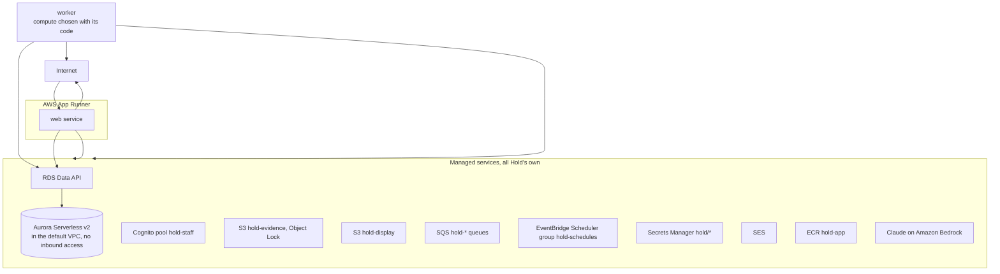

The CDK code is in `infra/`, as four stacks:

| Stack | Holds | Protection |
|---|---|---|
| `HoldData` | The Aurora cluster, its two logins, the evidence and display buckets | Termination protection. Every resource is retained if the stack is deleted |
| `HoldIdentity` | The Cognito pool `hold-staff` for owners and staff, its groups and its web client. Codes go out through the SES identity `rogerjeasybavibidila@gmail.com`, which is verified outside the stack | Termination protection, deletion protection on the pool |
| `HoldWork` | The spine's queues and their dead-letter queues and alarms, the schedule group, the role the scheduler uses | |
| `HoldRegistry` | The image repository | Retained |

The App Runner service and the worker's compute are added once there is an image to run.

### 14.2 Containers

- **One Docker image** built from a multi-stage Dockerfile. The web app runs from it on App Runner.
- **The image is built for the processor architecture it runs on.** The image library ships different binaries for each architecture, so a mismatch fails at start.
- **Amazon ECR** stores the images in `hold-app`. A tag names one build and cannot be moved.
- **Docker Compose** runs web, worker and PostgreSQL together for local development.
- **No secrets in the image.** They are read from Secrets Manager at start.

### 14.3 Network

- **No network path to the database.** The cluster sits in the default VPC with no public address, and its security group has no inbound rules. Hold reaches it only through the RDS Data API, over HTTPS and authorized by IAM.
- **No VPC for the services.** App Runner calls PayPal, Bedrock and the AWS APIs directly over HTTPS, so there is no NAT gateway and no VPC connector.

### 14.4 Compute

| Service | Runs on | Notes |
|---|---|---|
| web | App Runner | Health-checked, scales on requests. Deployed by pushing a new image tag |
| worker | To be chosen with its code | App Runner throttles CPU between requests, so it cannot poll queues. Lambda functions fed by SQS are the likely choice |

### 14.5 Data

- **Aurora Serverless v2,** PostgreSQL 17, one writer, with the RDS Data API switched on. The minimum capacity is zero while building, so the cluster pauses when idle, and is raised above zero for judging.
- **The database** is `hold_db`. Aurora reserves `hold`. While the cluster is paused, the first call fails with `DatabaseResumingException` until it resumes, so the adapter retries that error.
- **Two logins.** `hold_admin` runs migrations. `hold_app` is what the services use. It does not own the tables, so row-level security applies to it.
- **Backups** kept for seven days, with point-in-time recovery.
- **Encryption** at rest with the AWS-managed KMS key.
- **Migrations** run as a one-off step before each deployment.

### 14.6 Storage

| Bucket | Contents | Protection |
|---|---|---|
| **Evidence**, `hold-evidence-707938860881` | Original photographs, manifests, evidence packs | Object Lock in governance mode with 180 days' retention by default, versioning, KMS encryption, no public access, TLS only. Object Lock is switched on when the bucket is created. |
| **Display**, `hold-display-707938860881` | Smaller, face-blurred copies | KMS encryption, no public access, TLS only, served through short-lived signed links |

### 14.7 Queues and schedules

| Queue | Carries | Ordering |
|---|---|---|
| `paypal-events` | Stored event IDs to verify and apply | Per rental |
| `executions` | Approved actions on holds | Per rental |
| `comparisons` | Sealed return sessions to compare | None needed |
| `media` | Display copies and face blurring | None needed |
| `evidence` | Evidence packs to build | Per rental |
| `messages` | Emails and in-app messages | None needed |
| `ops-agent` | Operations agent runs | Per shop |
| `negotiations` | The advocates' turns on a contested claim | Per rental |

Every queue has a dead-letter queue and an alarm on it.

**Schedules:** hold replacement before validity ends, the charge of an unanswered claim before the hold lapses, hold expiry, return-due reminders, overdue alerts, reply-period end, the nightly reconciliation, the operations agent's run after it, and the expiry of unpaid bookings. Schedules for a hold are created when it is placed and removed when it ends.

### 14.8 Configuration

- Non-secret configuration is typed and validated at startup, in `packages/config`. A service with invalid configuration does not start, and the error names the settings that are wrong, never their values. The web app's settings are listed in `apps/web/.env.example`.
- Secrets come from Secrets Manager at startup and are never written to logs or images. The key that seals the sign-in cookie is `hold/web/cookie-key`, made by the HoldIdentity stack: the web app reads it by its ARN (`HOLD_COOKIE_KEY_SECRET_ARN`) and uses its SHA-256 as the key. Deployed, the app refuses a key given any other way.

---

## 15. Security

### 15.1 Threats and controls

| Threat | Control |
|---|---|
| **A shop overcharges a renter** | Charges only from findings with photographs. Prices only from the list the renter agreed to. Never more than the hold. A person's approval on record. The renter sees everything and can reply. |
| **Staff invent damage** | Every line needs a finding or a written reason. Claims above the limit need a second person. Approvals record what was changed. |
| **Evidence is altered afterwards** | Object Lock, fingerprints and the chain per item. |
| **A renter denies damage they caused** | The handover report they confirmed, and the dated photographs. |
| **A renter is blamed for old damage** | The item passport and the known-marks check. |
| **Someone guesses a renter's link** | Long signed tokens, expiry, scopes, and a one-time code for money decisions. |
| **A staff account is taken over** | Passwordless sign-in, a passkey before any change to prices, staff or PayPal, approval limits. Tested in `shop-access.test.ts`. |
| **An invitation is guessed, reused or forwarded** | A 32-byte random token, stored only as a fingerprint, valid once for seven days. The code goes to the invited address, and the role is given only if the proven address matches. Tested in `shop-setup.test.ts` and `sign-in-flow.test.ts`. |
| **Codes are requested to pester someone or run up cost** | Five code emails per address and forty requests per network in fifteen minutes, on top of Cognito's own limits. Tested in `sign-in-flow.test.ts`. |
| **A shop's PayPal credentials leak** | Kept only in Secrets Manager, checked with PayPal before being kept, never shown again, never logged. |
| **Someone finds out who has an account** | Every address gets the same "check your email" step, and a code for an address with no account is simply wrong. Passkey sign-in gives every address options of the same shape, with no list of credentials. Tested in `sign-in-flow.test.ts` and `fake-identity.test.ts`. |
| **A passkey-proven record is carried to another account's session** | The record names the person and the session it belongs to, and is checked against the verified access token. Tested in `shop-access.test.ts`. |
| **Someone who reached an owner's inbox adds their own passkey** | Only the first passkey can be added from an emailed-code session. Every later one needs a session a passkey proved, checked on both halves of the registration. Tested in `passkey-registration.test.ts`. |
| **A sign-in attempt is altered or guessed** | The attempt travels in a cookie sealed with AES-256-GCM, so a changed one is refused. It lasts ten minutes and ends after three wrong codes. Tested in `sealed.test.ts`. |
| **A forged webhook** | Signature verification and reading the resource back from PayPal. |
| **A replayed request** | Idempotency keys at every layer. |
| **One shop reads another's data** | Shop checks in the service and row-level security in the database. |
| **A credential leaks** | Secrets only in Secrets Manager. Each service has its own minimal IAM role. |
| **A hold lapses unnoticed** | Hold upkeep, the at-risk state, alarms and reconciliation. |

### 15.2 Data protection

- **In transit:** TLS everywhere.
- **At rest:** KMS encryption in Aurora and both buckets.
- **Minimal data:** photographs of items, the renter's PayPal identity and contact email. No payment details are stored. PayPal holds those.
- **Faces:** blurred in every copy people see.
- **Logs:** no tokens, no credentials, no photograph contents. Personal details are masked.
- **Model calls:** photographs of items and the minimum text needed. No renter contact details.
- **Retention:** photographs are kept for the shop's stated period and the period a dispute could arise, then removed. Object Lock retention is set to match.

---

## 16. Reliability and failure handling

| Failure | What Hold does |
|---|---|
| **The hold is declined** | The rental stays awaiting hold. The renter is told plainly and can try another funding source. The item is not handed over. |
| **A PayPal call times out** | Marks the execution unknown, reads the resource from PayPal by its identifier, waits for the event. Never assumes. |
| **A capture fails** | Falls back to an invoice with the evidence pack, releases the hold and tells the owner. There is no second renewal to retry with. |
| **A renewal fails** | Marks the hold at risk and tells the owner. The capture is still attempted on the original identifier. |
| **A hold expires** | Marks it expired, tells the owner at once, and offers an invoice path for any later claim. |
| **A webhook is missed** | Nightly reconciliation finds and applies it. |
| **A webhook arrives twice or out of order** | Duplicate IDs are ignored. State machines only move forward. |
| **An upload fails on weak wifi** | The phone retries. A session cannot be sealed until every required photograph is confirmed stored. |
| **Claude is unavailable** | The return session is still sealed and stored. Staff are told the comparison is delayed and can inspect by eye. The hold stays in place. |
| **The comparison cannot decide** | The result is "needs a person". Nothing is charged on an uncertain finding. |
| **Rekognition is unavailable** | Display copies are held back until faces can be blurred. Originals are unaffected. |
| **A worker crashes mid-job** | The message returns to the queue. Idempotency makes the retry safe. |
| **A message keeps failing** | It moves to the dead-letter queue and raises an alarm. |
| **A deployment goes wrong** | Rolling deployment with health checks rolls back automatically. |

**The governing rule:** when Hold is unsure whether money moved, or unsure whether damage occurred, it stops, finds out and tells a person. It never charges on a guess.

---

## 17. Observability and audit

### 17.1 Logs, metrics and alarms

- **Structured logs** from both services, each line tagged with the shop, the rental, the hold, the execution and PayPal's debug ID.
- **A correlation ID** follows one piece of work from the first request through every queue.

| Metric | Why |
|---|---|
| Holds by state | The health of the whole system at a glance |
| Holds at risk or expired | Should be near zero |
| Time from return to release | The renter's experience |
| Time to complete a comparison | The counter's experience |
| Comparison outcomes: clean, findings, needs a person | Shows how often the system defers |
| Disagreements between the two looks | Shows comparison stability |
| Claims accepted, contested, reduced | Shows whether evidence convinces |
| Captures by outcome | Shows charges are succeeding |
| Number guard rejections | Shows how often the model strays |
| Reconciliation differences | Should be zero |
| Dead-letter queue depth | Should be zero |
| Model cost per comparison | Keeps running costs known |

**Alarms** on any hold that expires, any hold at risk for more than an hour, any execution unknown for more than a few minutes, any reconciliation difference and any dead-lettered message.

### 17.2 The audit trail

For any charge, Hold can show:

1. The rental and the price list version the renter agreed to.
2. The handover photographs and the report the renter confirmed.
3. The return photographs.
4. Each finding, with both looks and their confidence.
5. Who approved the claim and what they changed.
6. What the renter was shown and how they replied.
7. The request sent to PayPal and its identifier.
8. The PayPal event that confirmed it.
9. The fingerprints proving the photographs are unchanged.

---

## 18. Performance and scale

**For the hackathon,** load is a few demo shops and occasional judge visits.

**Targets to measure against**

| Step | Target |
|---|---|
| Photo quality check on the phone | Feels instant |
| A full handover session | Under one minute |
| Comparison of one item | Within the time staff take to greet the renter |
| Release after a clean return | Seconds after staff confirm |

These are targets, not measured results.

**Where it would be stressed first, and the answer**

| Pressure | Answer |
|---|---|
| A busy morning of returns | Comparisons are queued and workers scale on queue depth |
| Large photographs on slow wifi | Direct upload to S3 with retry. Display copies generated later. |
| Model cost per comparison | Candidate regions limit what is sent as close crops. The second look runs only on damage findings. |
| Many shops | Every table is scoped by shop. Queues are ordered per rental, not per shop. |
| Photograph storage growth | Lifecycle rules move older evidence to cheaper storage and remove it at the end of retention |

---

## 19. Testing

| Level | What is tested | How |
|---|---|---|
| **Domain** | State machines, claim arithmetic, approval rules, upkeep planning | Unit tests and property-based tests. No database, no network. |
| **Adapters** | PayPal mapping, webhook verification, event handling | Tests against recorded PayPal responses |
| **Integration** | A full flow through the database and queues | A real PostgreSQL (PGlite, in the test process) and a fake PayPal |
| **Sandbox** | Real calls: authorize, capture, void, refund | Run on demand and before release |
| **Negative** | Declines, failed captures, voided holds | PayPal's mock-response header, which covers orders, captures and voids |
| **Renewal** | Reauthorization and expiry | A fake PayPal with a controllable clock, because the sandbox cannot simulate these |
| **End to end** | Handover, return, claim, reply | Playwright, with a recorded image as the camera |
| **Comparison** | Accuracy of findings | The evaluation set in section 10.8 |
| **Evidence** | Lock, fingerprints, chain | Tests that try to alter stored evidence and must fail |
| **Security** | Isolation between shops, renter link scope | Tests that try to cross those boundaries and must fail |
| **Agents** | That no tool, proposal kind or mandate leads to a charge a claim does not justify | Tests that list every one and must find none |
| **Detectors** | Each exception is found once, and only when its condition is true | Seeded states and property tests |
| **Referee** | No settlement outside either side's limits, and every negotiation ends | Property tests over any sequence of moves |
| **Ladder** | A hold is never raised, and never rises with more clean returns | Property tests |
| **Manipulation** | Text from renters, assistants and PayPal memos cannot steer an agent into an action | Seeded hostile text |

**Properties the domain tests assert for any input**

- A hold reaches exactly one final state.
- The amount captured never exceeds the reserved amount or the approved claim.
- Applying the same event twice changes nothing.
- No sequence of events can move a record backwards.
- A charge at any moment within the 29 days, on a hold not yet renewed, is assured: it captures inside the assured period or renews first.
- An unanswered claim is always charged before the hold lapses.

---

## 20. Environments, deployment and demo mode

### 20.1 Environments

| Environment | Purpose | PayPal |
|---|---|---|
| **Local** | Development with Docker Compose. A tunnel for webhooks. | Sandbox |
| **Test** | Automated tests in continuous integration | Fake, plus the simulator |
| **Demo** | The hosted environment judges use | Sandbox |

### 20.2 Deployment

1. Every pull request and every push to main runs **CI** (`.github/workflows/ci.yml`): lint, type-check and the unit tests (`pnpm check`), the end-to-end suite against the in-process fakes, and a build of the container image. CI needs no AWS access and no secret.
2. Once CI passes on main, **Deploy** (`.github/workflows/deploy.yml`) runs. It can also be started by hand.
3. Database migrations run through the Data API as `hold_admin` (`pnpm --filter @hold/db migrate:aurora`).
4. The image is built and pushed to ECR, tagged with the commit. Tags are immutable.
5. The CDK shows its diff, then deploys every stack.
6. Once the App Runner service exists, it rolls forward to the new image, with health checks and automatic rollback.

GitHub signs in to AWS through OpenID Connect as `hold-github-deploy`, made by the HoldDelivery stack. Only a workflow on the main branch of `rogerjeasy/hold` can take it, named by GitHub's immutable subject (owner and repository ids as well as names), so a renamed or recreated repository does not match. The account is shared, so nothing the pipeline holds reaches beyond Hold:
- It never takes the account's CDK bootstrap roles, which could deploy any stack. Hold's stacks are synthesized with the caller's own credentials and keep their templates under `hold/` in the bootstrap bucket, the only prefix it may list.
- It may change only the four resource stacks (`HoldData`, `HoldIdentity`, `HoldWork`, `HoldRegistry`), through change sets that CloudFormation carries out as `hold-cloudformation-exec`.
- That CloudFormation role manages Hold's resources and reads none of their contents: no objects, messages, user accounts or credentials, except the database logins' secrets, which attaching the cluster needs. Security groups and user pools are reached by the `project=hold` tag, which may be set only while one is created and never changed after.
- Every role it makes or changes must carry `hold-permissions-boundary`, which it can neither change nor remove. The boundary caps any Hold role at Hold's own resources, so no template can make a role that reaches further.
- HoldDelivery itself, with both roles and the boundary, is deployed only by an administrator, so a commit on main cannot widen what the pipeline may do.
- Beyond deploying, the pipeline may push to `hold-app` and run statements on `hold-database` with the two database secrets. No AWS key is stored in GitHub. The ARNs it needs are repository variables, which hold no secret.

**The image** (`Dockerfile`) is the web app's standalone build, run by `apps/web/serve.ts` instead of the server.js Next.js generates. That server names a host, and then treats each language rewrite as a request to another site, which loops. `serve.ts` starts it the way `next start` does.

### 20.3 Demo mode

Judges have no bike to photograph and cannot wait four days for a hold to age.

- **A seeded shop** with items, a price list, a wear policy, an owner, a staff member and a sandbox renter.
- **Sample photo sets** built in: a clean return, a return with a scratch, and a return that leads to a contested claim. One tap loads a set in place of the camera. The rest of the flow, including every PayPal call, is real.
- **The real camera path** also works, on any object a judge has to hand.
- **Renewal and expiry.** PayPal allows renewal only from the fourth day, so it cannot be shown on a hold placed during the demo. The demo shows the upkeep plan for each hold and marks any simulated renewal as simulated.
- **Honest labelling.** Anything simulated is marked as simulated on screen and in the record.
- **Reset.** One command returns the shop to its starting state.
- **For the extensions.** The seeded renter has a history of clean returns, so the trust ladder can be seen. A seeded contested claim can be settled by two advocates. The morning queue is seeded with one case for each detector. A hosted assistant uses the same MCP server as any outside assistant, so a judge needs no MCP client.

---

## 21. Decision record

| # | Decision | Alternatives considered | Reason |
|---|---|---|---|
| 1 | The hold is its own authorization, separate from the fee | One order with two purchase units | PayPal does not allow an authorize-first order with more than one purchase unit. A separate hold also has a clean, fully documented life. |
| 2 | Three placement strategies behind one interface | One fixed way to place a hold | Advance bookings, walk-ins and returning renters have different needs, and a hold lasts only 29 days. |
| 3 | Place the hold close to pickup | Place it at booking | A hold placed weeks ahead would be nearly spent on arrival. |
| 4 | Renew only at the moment of charging, and capture on the new identifier at once | Renewing every three days; renewing shortly before the expected return; renewing as soon as damage is found | PayPal allows one renewal. Each alternative spends it on a guess, and a late return or the reply period then pushes the charge outside its three days. Renewing at the charge makes every charge within the 29 days assured, and clean returns never renew. Decided 14 October 2026. |
| 5 | Never capture above the held amount | Use PayPal's allowance to capture slightly more | The renter agreed to a stated amount. Anything more goes by invoice. |
| 6 | Webhooks plus read-back as the source of truth | Trusting API responses | A response can be lost. The event and the resource cannot both lie. |
| 7 | Hold tracks expiry itself | Waiting for PayPal to report it | PayPal's event list has no expiry event. |
| 8 | An append-only money log, not a double-entry ledger | A full ledger | Hold never holds a balance. It records what PayPal did. A ledger would add complexity without adding truth. |
| 9 | Classical image steps before the model | The model alone | Alignment and difference-finding are precise. The model judges what the differences mean. |
| 10 | A second, independent look on every damage finding | One model call | A wrong damage finding is the worst error. An independent check is the cheapest strong defense. |
| 11 | Prices read from the database | Prices proposed by the model | A renter must never be charged an invented amount. |
| 12 | Locked storage, fingerprints and a chain per item | Ordinary storage | Evidence that could have been altered convinces nobody. |
| 13 | Two copies of each photograph | One copy | The original must stay untouched. The copy people see must protect bystanders. |
| 14 | No renter accounts | Sign-up for renters | A visitor renting for an afternoon will not create an account. |
| 15 | The assistant can propose a release but not a charge | Full control by conversation | Returning money is low risk. Taking it must begin from evidence. |
| 16 | Per-shop roles in the database, not in Cognito | Cognito groups for everything | One person can work in several shops with different limits. |
| 17 | A mandate is an approval given in advance, with typed limits checked by plain code | Approval at the moment only. Or agents trusted to stay in bounds. | People cannot be present for every step. An agent's own word that it is allowed is worth nothing. |
| 18 | Detectors in plain code find what needs attention. The agent explains and proposes. | Let the agent look for problems | A lapsing hold must never be missed because a model overlooked it. The queue is complete even with no model. |
| 19 | PayPal's MCP server is reached from Hold's own client, behind the gateway | The model provider's connector. The toolkit's framework adapters. | Every call is checked and logged in one place, and the shop's PayPal token stays inside Hold. |
| 20 | The comparison's accuracy is published from a half of the set that tuning never sees | Internal testing only. One set for both. | A number tuned on its own test proves little. A published number can be held to account. |
| 21 | Trust only ever lowers a hold | A score that raises or lowers it | Nobody is penalised for who they are. A new account gains nothing. No model judges a person. |
| 22 | A renter's assistant is identified by the PayPal payment, with a token passed as a tool argument | A sign-in for the MCP server | Renters have no account. Any MCP client can use it with no setup. |
| 23 | Two advocates exchange itemized offers under a referee in plain code | Private bids split down the middle. One model acting as mediator. | A split gives a number with no reasons. Hold's product is a claim where each line traces to a photograph. |
| 24 | Damage agreed during a rental is charged at the return, in the one final capture | Take part of the hold at once | It uses only PayPal behavior the spine already depends on, and a named person still sees the item first. |
| 25 | Hold's own sign-in and sign-up pages, calling Cognito | Cognito's managed pages | The pages keep the site's design, its four languages and its header. They can also tell staff and renters, who do not sign up, where they belong. Cognito still holds the users and issues the tokens. |
| 26 | Hold's own resources in an AWS account shared with Wick and CareCircle | Reusing their database, user pool or table, with Hold's data kept apart inside them | Nothing Hold stores can be read through, or lost with, another project. Names, tags and stacks make Hold's part of the account plain. |
| 27 | The web app on App Runner | ECS Fargate behind a load balancer | No load balancer, NAT gateway or VPC to run and pay for through judging. The trade is that App Runner cannot run the worker. |
| 28 | The RDS Data API between the services and Aurora | A VPC connector with a NAT gateway or instance | The database accepts no network connections, and App Runner keeps direct internet access for PayPal. Each statement takes some tens of milliseconds longer. |
| 29 | Hold's own Aurora cluster | A `hold` database inside CareCircle's cluster | CareCircle's own Terraform could change or remove that cluster before judging ends. |
| 30 | Columns with a fixed list of values are text with a check constraint | PostgreSQL enums | The RDS Data API sends every string parameter as text, and PostgreSQL will not compare an enum with text. Every insert and every filter on an enum column would need a cast. The values still come from the domain's lists. Found against Aurora on 14 October 2026. |
| 31 | A passkey with user verification as the second factor | An authenticator app, as first planned | Cognito allows an authenticator app only after a password. A person who turned one on could no longer sign in with an emailed code. Found in Cognito's documentation on 14 October 2026. |
| 32 | Rate limits counted in Aurora, by fingerprint | Counting in memory; a separate store | App Runner may run more than one instance, so a count in memory would not hold. Aurora is already there. |

---

## 22. Risks, assumptions and open questions

### 22.1 Assumptions the design depends on

- A sandbox business account can authorize, capture part, release and renew.
- After a final capture for part of a hold, the remainder is released.
- The comparison can tell real damage from wear, dirt and lighting often enough to be useful, with people handling the rest.

The first two are confirmed by short trials on day one. The third is confirmed only by the evaluation set. The second was confirmed in the sandbox on 14 October 2026 (`tech-stack.md` section 16, item 1).

### 22.2 Open questions

| Question | Why it matters | Affects the hackathon |
|---|---|---|
| **Does the "combined" strategy work?** | Partly answered: the sandbox confirmed on 14 October 2026 that the remainder survives a partial capture and can be captured or released. Renewal after a partial capture is tried after day 4. | Yes. If renewal fails, combined holds are limited to short rentals. |
| **What runs the worker?** | App Runner throttles CPU between requests, so it cannot poll queues or run scheduled work. Lambda functions fed by SQS are the likely answer, and suit the worker's short jobs. Comparisons that run for minutes fit Lambda's 15-minute limit. | Yes, before the first queue consumer is built |
| **Is SES out of its sandbox?** | In the sandbox, SES sends only to verified addresses, so a judge would never receive a sign-in code. Production access is requested from AWS and can take a day. | Yes, before judging |
| **How accurate is the comparison in a real shop?** | Outdoor light, wet or dirty items and hurried photographs will all test it. | Yes. It decides how much is automatic and how much goes to a person. |
| **How does Hold act on a real shop's PayPal account?** | Holding a shop's API credentials is not acceptable in production. PayPal's partner model is the likely answer. | No |
| **Will shops be approved for saved payment methods?** | The "saved method" strategy needs it in production. | No, it is optional |
| **How are rentals longer than 29 days protected?** | They need a replacement hold, which needs the renter or a saved method. | No, but the design covers it |
| **What do consumer protection rules require** for holds, damage charges and the right to reply, in each country? | Decides reply periods and wording. | No |
| **How long may photographs be kept?** | Sets Object Lock retention. | No |
| **Is Pay Later offered on these orders?** | It may not be available when an order authorizes first. | No, it is optional |

### 22.3 Risks

| Risk | Likelihood | Effect | Mitigation |
|---|---|---|---|
| The comparison misses small damage | Medium | Shops lose trust | Guided angles, the handover ghost, candidate regions, and staff can always add a line with a reason |
| The comparison flags clean returns | Medium | Renters lose trust. The worst outcome. | The second look, cautious thresholds, deferral to a person, and human approval on every charge |
| A hold lapses during a rental | Low | The shop is unprotected | Upkeep schedules, the at-risk state, alarms, reconciliation and the invoice fallback |
| Phone cameras behave differently across devices | Medium | Poor photographs | Quality checks on the phone, early testing on iPhone and Android |
| A sandbox behavior differs from the design | Medium | A flow must change | Day-one trials and the baseline strategy that uses only plainly documented behavior |
| The demo environment fails during judging | Low | Judges cannot test | Alarms, automatic rollback, a reset script and a recorded walkthrough |
| The extensions crowd out the spine | High | No working product | The gates and the stop line in `extensions.md` section 12 |

The extensions' own risks and open questions are in `extensions.md` section 14.

### 22.4 The essential spine

If time is short, these parts alone make a complete product: placing a hold at the counter, guided handover, guided return, the comparison with its second look, the claim screen with approval, capture and release, and the evidence pack. Everything else can follow.

**After the spine,** the extensions are built in the order set out in `extensions.md` section 12: the accuracy scorecard, the operations agent, the Clean Record, renting through an assistant, the advocates, and the incident desk. None starts before the spine runs end to end.

---

## 23. How certain each part is

**Checked against PayPal's documentation during this work**

- A hold is valid for 29 days, with a three-day period in which capture is best assured.
- A hold can be renewed after the three-day period and within the 29 days. The renewal gives a new identifier and a new three-day period. The sandbox says only once, which corrects the earlier reading that it could be repeated.
- A capture can be for less than the held amount, and can be marked as final or not final.
- A fully captured hold cannot be voided.
- An authorize-first order cannot have more than one purchase unit.
- The endpoints for showing, capturing, renewing and voiding a hold, and for refunding a capture.
- The dispute endpoints, including providing evidence, and the two sandbox-only test endpoints.
- The webhook event names used here, and that the list contains no hold-expiry event.
- Webhook verification and PayPal's retry behavior.
- PayPal's mock-response header for sandbox error testing covers orders, captures and voids, and does not list renewal.
- Saving a PayPal wallet for later charges, and its approval requirement.
- The Agent Toolkit's tool list.

**Confirmed in the sandbox**

- That a final capture for part of a hold releases the remainder, and that the hold then refuses further captures and voids. 14 October 2026.
- That a hold can be captured as final or voided after a non-final partial capture. 14 October 2026.

**Written from general knowledge and to be confirmed**

- That a hold can be renewed after part of it has been captured. If it cannot, a walk-in hold charged after day 3 captures without assurance, as section 7.4 already allows.
- That a capture after the assured period succeeds on a hold that was never renewed. The fallback in section 7.4 depends on it. Trial 3, hold G.
- That a sandbox account allows more than one capture on a hold without special setup.
- The accepted formats and size limits for dispute evidence.
- AWS specifics: S3 Object Lock and upload checksums, Rekognition face detection, Aurora's pause behavior and Cognito's sign-in options.
- That OpenCV.js runs fast enough on a phone and gives usable alignment on the worker.

**Not yet tested**

- Apart from the PayPal adapter in `packages/paypal` and the sandbox trials, nothing in this document has been built or run. The comparison's accuracy is unknown until the evaluation set exists. The timing figures are targets.
