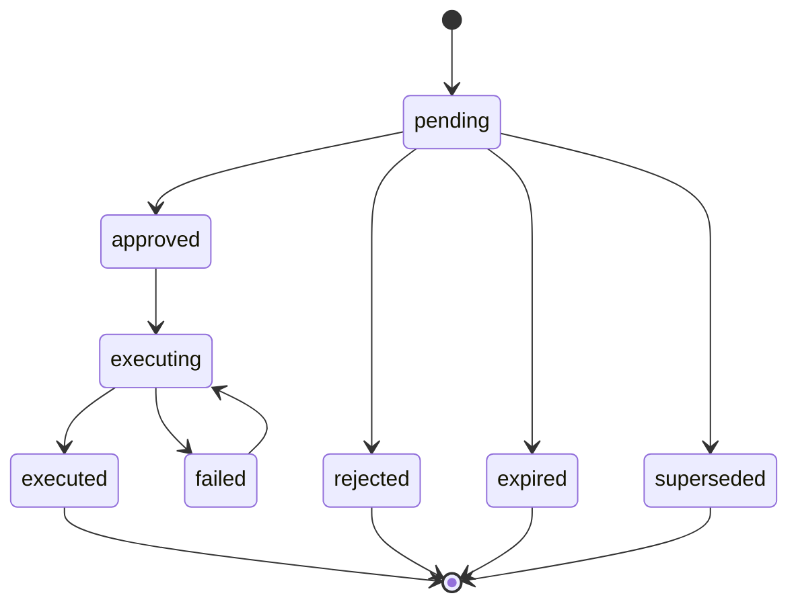
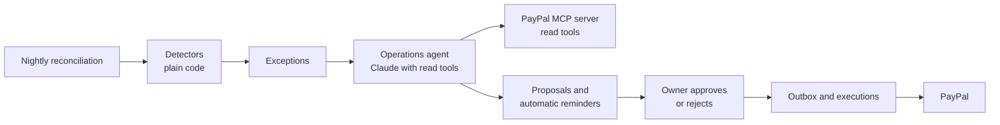
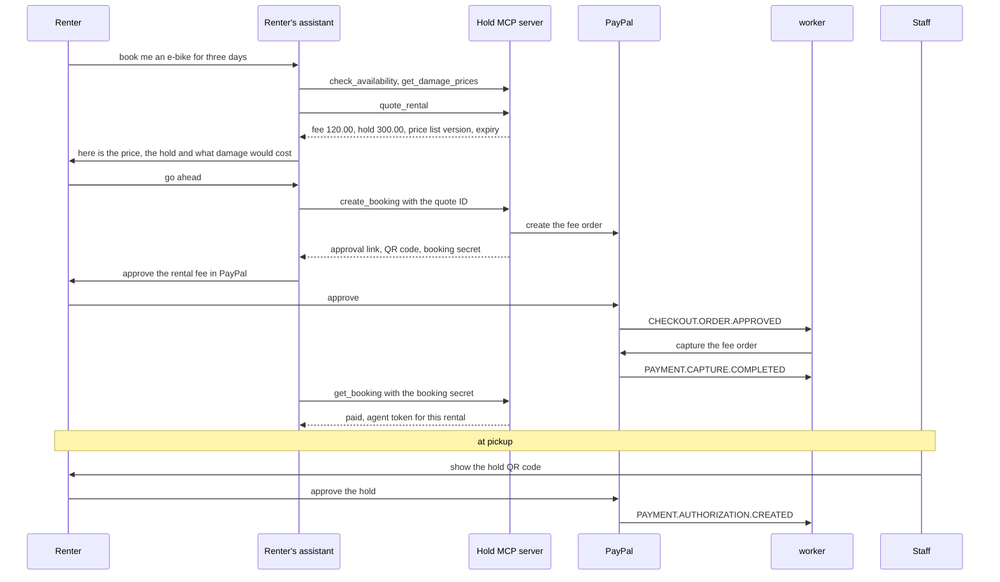
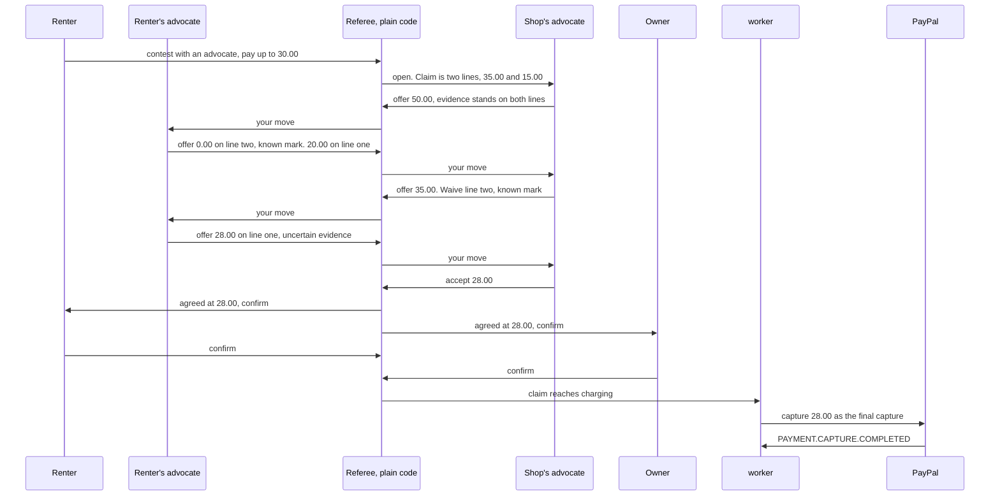
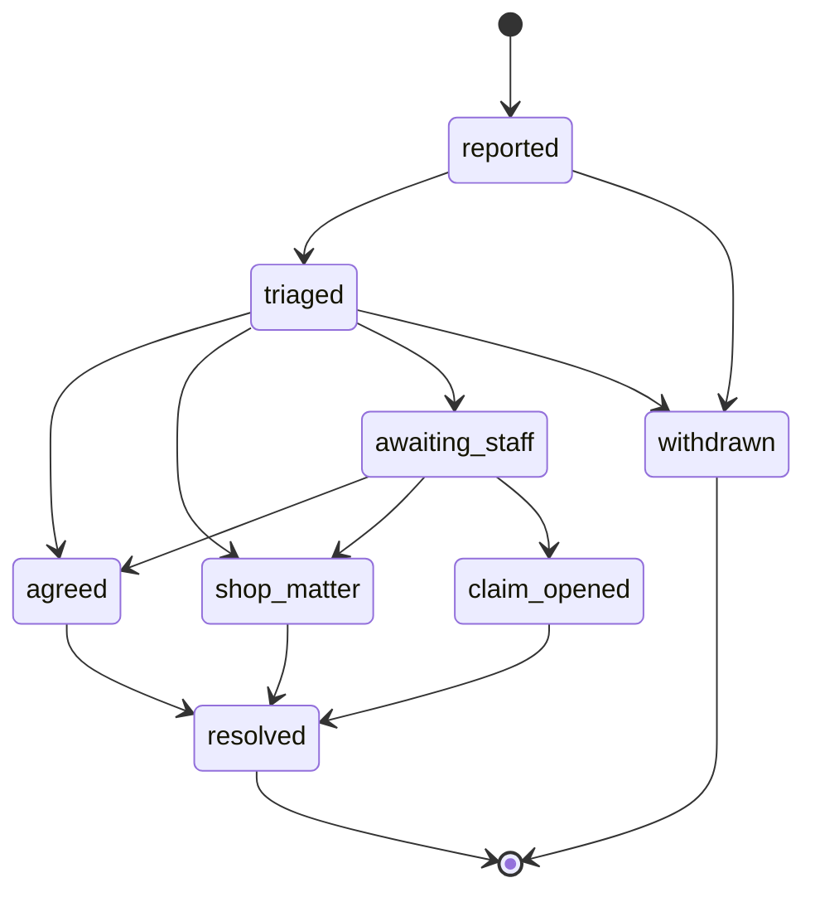
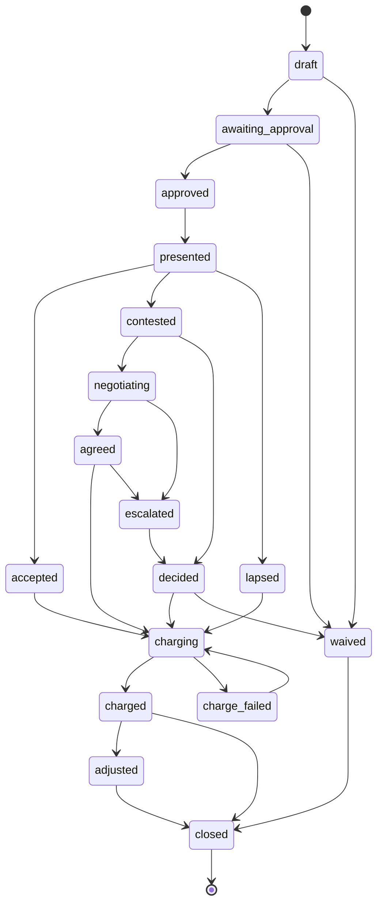

# Hold: extensions

Six additions built on top of the spine, in build order. PayPal AI Hackathon 2026. Draft 1, 13 October 2026.

Read `project-description.md` for what Hold is, `architecture.md` for how it is built and `tech-stack.md` for the tools. This document specifies what is added once the spine works: what each addition does, what it changes in the design, which PayPal calls it makes, how its agent is contained, and how to tell that it is finished.

**None of these changes what Hold is.** Hold remains a deposit and damage system for small rental shops, built on a PayPal hold and a shared evidence pack. Each addition makes one of Hold's existing promises stronger, or carries the same rental into one more moment.

**Contents**

1. Summary
2. Why these six
3. Rules every extension obeys
4. Shared foundations
5. Extension 0: the accuracy scorecard
6. Extension 1: the operations agent and the morning queue
7. Extension 2: the Clean Record and the trust ladder
8. Extension 3: renting through your own assistant
9. Extension 4: an advocate for each side
10. Extension 5: the incident desk
11. Where each change lands in the existing design
12. Build order, gates and cut line
13. The video
14. Risks and open questions
15. How certain each part is

---

## 1. Summary

| # | Extension | In one sentence | The existing promise it strengthens |
|---|---|---|---|
| 0 | **The accuracy scorecard** | The comparison's measured accuracy is published with its sample sizes, and a release that makes it worse does not ship. | "Honest about the AI's limits" |
| 1 | **The operations agent** | Every night an agent checks each hold, claim, invoice and dispute against PayPal and gives the owner a short queue of decisions to approve. | "A hold never lapses unnoticed" |
| 2 | **The Clean Record** | A renter's clean returns lower their next hold, at any Hold shop, by a ladder the shop publishes. | "A clean record the shop can reward" |
| 3 | **Renting through your own assistant** | A traveller's AI assistant finds, quotes, books and manages a rental through an MCP server, while the person approves the money in PayPal. | The roadmap's "bookable by AI assistants" |
| 4 | **An advocate for each side** | In a contested claim, each side may give an agent written limits, and the two agents settle from the same evidence, inside those limits. | "A real right to reply" |
| 5 | **The incident desk** | A renter reports damage, a fault or a theft during the rental, with photographs, and can agree a small matter before the return. | "The conversation is about a photograph" |

**Three ideas carry all six.**

1. **Detect with code, explain with the model.** Which holds are about to lapse, which hold a renter is entitled to, whether an offer is inside its limits: plain code answers these. The model investigates, argues, drafts and explains.
2. **A mandate is an approval given in advance.** Hold's rule is that a person decides. A person may decide at the moment, or earlier, by writing limits an agent must stay inside. Both are recorded the same way.
3. **One gateway for every agent.** The owner's assistant, the operations agent, a renter's outside assistant and the two advocates all reach Hold through the same checked, logged, tiered tool gateway. No agent has a private door.

---

## 2. Why these six

### 2.1 What the judges score

From the official rules, checked on 13 October 2026.

- Five criteria, equally weighted: Technological Implementation, Design, Potential Impact, Innovation, Presentation.
- Ties are broken in that order, so Technological Implementation decides a close result.
- A project can win one Grand Prize and one Sponsor Prize, or one Honorable Mention and one Sponsor Prize. Honorable Mentions do not add up.

Hold is built for the Grand Prize. Each extension is chosen because it lifts at least two of the five criteria, and because it would also make Hold a strong candidate for one Honorable Mention if the Grand Prize goes elsewhere.

| Extension | Tech | Design | Impact | Innovation | Presentation | Honorable Mention it also supports |
|---|---|---|---|---|---|---|
| 0 Scorecard | Strong | Some | Strong | Some | Strong | Best Use of PayPal + AI |
| 1 Operations agent | Strong | Strong | Some | Some | Some | Best Use of PayPal + AI |
| 2 Clean Record | Some | Strong | Strong | Strong | Strong | Most Impactful |
| 3 Own assistant | Strong | Some | Some | Strong | Strong | Best Use of Agentic Commerce |
| 4 Advocates | Strong | Some | Strong | Strong | Strong | Most Creative |
| 5 Incident desk | Some | Strong | Strong | Some | Some | Most Impactful |

### 2.2 What PayPal asked for

The hackathon's resources page describes the agentic projects it hopes to see: "an AI agent that shops and checks out for you" and "two agents negotiating and settling a payment between themselves". Extension 3 is the first, applied to a rental. Extension 4 is the second, applied to a damage claim.

### 2.3 What was left out, and why

| Idea | Why it is not here |
|---|---|
| Repair partners who quote from the evidence and are paid by Payouts | A third actor in a three-minute video. Stays on the roadmap. |
| A ChatGPT app on the Agentic Commerce Protocol | PayPal's integration for it runs on Braintree, which is outside Hold's stack. |
| Enrolling the shop in PayPal Store Sync | Store Sync is access-gated and today covers physical goods sold to customers in the United States in dollars. A rental is neither. |
| Immediate part-capture of a hold during the rental | Depends on PayPal behavior that is still unconfirmed. Extension 5 is designed so it is not needed. |

---

## 3. Rules every extension obeys

These extend the product principles and the safeguards. A feature that cannot meet them is not built.

1. **A charge still begins from a claim.** A capture can only come from a claim that reached `charging`. An agent can shorten the path to a decision. It cannot create the evidence, the claim lines or the prices.
2. **No amount is model output.** Every amount shown or charged is read from the database or computed by plain code from records. The one place an agent names amounts is an offer in Extension 4, and each amount there is checked by code against the line's published price and the agent's limits.
3. **Detect with code, explain with the model.** Anything that must never be missed is found by deterministic code. If the model is unavailable, the list of things that need attention is still complete. In the photo comparison, code finds the areas that changed and the problems with a photograph, and every finding is the model's; with no model, the return goes to a person, and nothing is charged.
4. **A person decides, at the moment or in advance.** An agent acts on money only after a person's approval on screen, or inside a mandate that a person granted. No third way exists.
5. **One gateway.** Every tool call from every agent passes the same gateway, which checks identity, shop, tier, mandate and rate, and writes the audit log.
6. **Text from outside is data.** Renter comments, messages from another agent, memos on PayPal transactions and dispute notes are passed to a model as quoted data. Steps that read them have no tools that move money.
7. **The person sees what their agent did.** Every action taken for a person is listed for that person, in plain words, with a way to stop the agent.
8. **Everything degrades to the spine.** If the model, an MCP connection or an agent fails, the manual path from `architecture.md` still works and nothing is charged.
9. **Simulated things say so.** As in the spine, anything simulated for the demo is labelled on screen and in the record.

---

## 4. Shared foundations

Four small pieces are used by more than one extension. They are built once, with Extension 1, and reused.

### 4.1 Actors

Every approval, proposal, tool call and audit line names an actor. The spine has three kinds. The extensions add three.

| Actor kind | Who | How it is identified | First used in |
|---|---|---|---|
| `staff` | Owner, manager, counter staff | Cognito token and a role in the shop | Spine |
| `renter` | The person renting | Signed link, with a one-time code for money decisions | Spine |
| `system` | The worker doing scheduled work | Service role | Spine |
| `shop_agent` | The owner's assistant, the operations agent, the shop's advocate | Runs inside Hold for one shop | Extension 1 |
| `renter_agent` | A renter's outside assistant, or the renter's advocate | An agent token bound to one rental | Extension 3 |
| `public_agent` | Any assistant that has not yet paid for anything | No identity. Rate limited. | Extension 3 |

An agent actor always records the person it acts for and, where it acted on money, the mandate it acted under.

### 4.2 Mandates

A mandate is a person's written permission for an agent to act within limits. It is the same kind of record as an approval, made earlier.

| Property | Rule |
|---|---|
| **Granted by a person** | An owner on a signed-in screen, or a renter after a one-time code |
| **Bounded** | Each kind has a fixed, typed set of limits. Free text is never a limit. |
| **Expiring** | Every mandate has an end date |
| **Revocable** | The person can end it at any time. Revocation takes effect at the agent's next action. |
| **Private** | A mandate's limits are shown only to the person who granted it and to code. They are never shown to the other side or placed in the other side's agent context. |
| **Checked by plain code** | `withinMandate(action, mandate, now)` in `packages/domain` decides. The model is never asked whether it is allowed. |
| **Recorded** | Each action taken under a mandate stores the mandate's ID. The approval record's method is `mandate`. |

| Mandate kind | Granted by | Lets which agent do what | Limits | Used in |
|---|---|---|---|---|
| `ops_standing_rule` | Owner | The operations agent carry out one kind of proposal without asking | Proposal kind, conditions, daily count | Extension 1 |
| `agent_hold` | Renter with a saved PayPal method | The renter's own assistant accept a hold | Maximum amount, shops, end date | Extension 3, optional |
| `settlement_shop` | Owner | The shop's advocate agree a contested claim | Lowest share of the claim, rounds, largest claim, whether a final tap is needed | Extension 4 |
| `settlement_renter` | Renter | The renter's advocate agree a contested claim | Highest total, whether a final tap is needed | Extension 4 |

No mandate kind permits a charge that a claim does not already justify, and none can be added without a change to `packages/domain` and its tests.

### 4.3 Proposals

The spine's assistant can already propose a release or an extension for the owner to confirm. The extensions make the proposal a first-class record.



- **A proposal names records, not amounts.** Its payload holds IDs. The amount shown to the owner and the amount sent to PayPal are both read from the database at that moment.
- **A proposal carries its preconditions.** It stores a fingerprint of the state it was written against, such as the hold's state and current authorization ID. At approval the state is read again. If it changed, the proposal becomes `superseded` and nothing is executed.
- **One live proposal per subject and kind.** A unique key on shop, kind, subject and precondition fingerprint makes a repeated agent run write nothing new.
- **Approval uses the existing path.** An approved proposal writes an approval record and an execution through the outbox, with an idempotency key, exactly as a click on the hold screen does.

| Proposal kind | What approval does | Executed through |
|---|---|---|
| `release_hold` | Voids the authorization | Direct REST |
| `request_replacement_hold` | Sends the renter a link to approve a new hold, or uses their saved method | Direct REST |
| `send_invoice` | Creates and sends an invoice for a decided balance | Not offered in this build: approval is refused, and the spine invoices a balance itself once the charge is settled |
| `refund_part` | Refunds part of a capture | Not offered in this build: no detector proposes it |
| `respond_to_dispute` | Gives PayPal the drafted note as evidence, with the rental's latest published evidence pack as a PDF | Direct REST, `provide-evidence` |
| `send_message` | Sends a drafted message to a renter | SES |
| `move_booking` | Moves a booking that has not started to another free item of the same type, for the same period. Planned with the rental calendar in section 12.5; not built. | Hold's rentals path. No PayPal call. |
| `note` | Nothing. It informs the owner. | |

There is no proposal kind for a capture. A test enumerates the kinds and fails if any maps to one.

### 4.4 Tool tiers and the gateway

Each tool is declared with a tier. The gateway refuses a call whose actor is not entitled to that tier.

| Tier | Meaning | Example |
|---|---|---|
| `read` | Returns records the actor may see | `get_hold`, PayPal's `list_transaction` |
| `draft` | Produces text for a person to send or discard | `draft_message_to_renter` |
| `propose` | Writes a proposal, or a request, that a person must approve before anything happens | `propose_release`; `request_extension`, whose PayPal order for more days the person approves in PayPal |
| `notify` | Sends a fixed-template message without approval, rate capped | A return-due reminder |
| `act_under_mandate` | Acts on money inside a live mandate | `submit_offer` |

There is no tier above these. For each call the gateway checks, in order: the actor and the person it acts for, the shop, the tier, the mandate where the tier requires one, the rate limit, and the shape of the arguments. It then writes one audit line with the actor, tool, subject, outcome and duration.

### 4.5 New packages

```
packages/
  domain/      adds: mandates, proposals, detectors, ladder, negotiation referee,
               incident rules. Still pure code.
  mcp/         Hold's MCP server: tool definitions, agent tokens, quotes
  ops/         the operations agent run and the PayPal MCP client
  negotiate/   the two advocates' runners. The referee is in domain.
  trust/       the Clean Record: outcome records, credential signing and checking
```

The dependency rule is unchanged. `domain` depends on nothing. The new packages depend on `domain` and never on each other.

### 4.6 New tables

All carry `shop_id` and row-level security, except where noted.

| Table | Key contents | Extension |
|---|---|---|
| `mandates` | Kind, grantor, agent, limits, valid from and until, revoked at, how it was granted | 1, 3, 4 |
| `proposals` | Kind, subject, payload of IDs, reason, references, precondition fingerprint, state, proposer, decider, decision reason | 1 |
| `exceptions` | Kind, subject, detected at, resolved at, fingerprint | 1 |
| `ops_runs` | Trigger, started, completed, state, budget used, model and prompt version, counts | 1 |
| `eval_runs` | Data set version, pipeline version, measures, results key. No `shop_id`. | 0 |
| `finding_outcomes` | Finding, final verdict, who decided, when | 0 |
| `rental_outcomes` | Renter key, item category, closed at, outcome class, hold amount released | 2 |
| `trust_ladders`, `trust_rungs` | Version, published at. Clean returns needed, window, share of the hold, largest item value, whether a saved method is needed | 2 |
| `renter_consents` | Renter key, what was consented to, when, withdrawn at. No `shop_id`. | 2 |
| `quotes` | Period, each item type with its count, day rate and hold, fee, hold amount, price list and wear policy, expiry, the booking made from it | 3 |
| `agent_sessions` | Rental, booking secret fingerprint, token fingerprint, scopes, client label, token issued and end, last used, revoked at, the reply it drafted | 3 |
| `negotiations` | Claim, both mandate IDs, state, round, deadline, transcript head fingerprint | 4 |
| `negotiation_moves` | Negotiation, side, move, line amounts, grounds, evidence references, previous move fingerprint | 4 |
| `incidents` | Rental item, kind, state, description, triage result, model and prompt version | 5 |
| `insights_dashboards` | The shop's insights dashboard as AG Studio last left it, the report version it was built on, who saved it and when. One per shop. | 12.5 |

---

## 5. Extension 0: the accuracy scorecard

### 5.1 What it is

The spine already plans an evaluation set for the comparison. This extension turns its results into a product feature. The numbers are published, each with its sample size, in the owner's view, on a public page and in the README. A release that makes them worse does not ship.

### 5.2 Why it is first

- The comparison is the main technical risk in `architecture.md`. Everything else in this document rests on it.
- A claim that an AI is accurate, with no numbers, convinces no judge and no renter. Numbers with sample sizes do.
- It is the cheapest extension. The evaluation set has to exist anyway.

### 5.3 The evaluation set

One case is one pair: a handover photograph and a return photograph of the same view. The sizes below are targets for the first version, for the e-bike item type.

| Group | Pairs | What it tests |
|---|---|---|
| Clean, easy | 30 | Same light, same angle |
| Clean, hard | 30 | Wet, dirty, shadows, reflections, a different time of day, a slightly different angle |
| Ordinary wear | 20 | Marks the wear policy says are not damage |
| Damage | 40 | Scratch, dent, crack, bent part, missing accessory. Small and large. Good and poor light. |
| A known mark is present | 15 | A mark already in the item passport must not be charged |
| Wrong item or reused photograph | 10 | The identity and reuse checks |

- **Each damage pair has its region labelled,** so a finding in the wrong place does not count as found.
- **Labels live in a manifest beside the images** in `eval/`, with the photographs. The photographs are freely licensed photographs of real e-bikes from Wikimedia Commons, under CC BY-SA 4.0. They show no people, and are credited in `eval/raw/SOURCES.md` and on `/reliability`.
- **Two halves.** A tuning half is used when adjusting prompts and thresholds. A gate half is never looked at while tuning and is the only half that is published. This keeps the published numbers honest.

### 5.4 The measures

| Measure | Definition |
|---|---|
| **Damage found** | Labelled damage for which the pipeline produced a damage or missing finding that overlaps the labelled region, divided by all labelled damage |
| **Damage passed as clean** | Labelled damage whose pair ended in the result "Clean", divided by all labelled damage. This is the miss nobody would look at again. A pair sent to a person is not counted, since a person decides it. Added 29 October 2026; earlier runs say "Not recorded in this run". |
| **Clean returns wrongly flagged** | Clean pairs that ended in the result "Findings", divided by all clean pairs. This is the error that harms renters. |
| **Sent to a person** | Pairs that ended in "Needs a person", divided by all pairs. Reported separately. Deferring is not counted as an error or as a success. |
| **Known marks respected** | Pairs with a known mark where no claim line was drafted for it, divided by all such pairs |
| **Agreement between the two looks** | Damage findings the second look confirmed, divided by all damage findings from the first look |
| **Confidence holds up** | For each confidence level, the share of findings at that level that were correct |
| **Cost and time** | Model cost and elapsed time for one comparison, median and slowest tenth |

**Every number is shown with its count.** A share is printed as "57 of 60", never as a bare percentage. Where a count is zero, the page says what that can and cannot support. Sixty clean pairs with none wrongly flagged supports "below about 6 percent", not "never".

### 5.5 Where the numbers appear

- **The owner's view.** A page titled "How reliable is the comparison", with the measures, their counts, the date of the run and the pipeline version.
- **Each finding.** Beside its confidence level: how often findings at that level were correct in testing.
- **A public page and the README.** The same table, so a renter or a judge can read it without signing in.
- **Case by case, on the public page.** Below the table, every pair of the accepted run: what it should have ended in, what the comparison did, the change it claimed and how sure it was, what the second look said, how well the photographs lined up, and whether that was right. Choosing a pair shows its two photographs, with where the damage truly is outlined beside what was found. Then how confidence held up, level by level, counted from those same pairs; a table of what each pair should have ended in against what it did; and every run of the gate half against the lines its gate drew.
- **What publishing the pairs costs.** Whoever tunes the comparison can now see which gate pairs it gets wrong. The gate half stays honest only while nobody tunes towards it, so after any change made in answer to what the page shows, the gate half is refreshed with new pairs before the next accepted run.
- **The evidence pack.** The pipeline version and the run it was last measured in.

### 5.6 The release gate

The pipeline in GitHub Actions runs the gate half whenever a prompt, a threshold, the model ID or the comparison code changes.

- The run is stored in `eval_runs` with the model ID, prompt version and thresholds.
- The build fails if clean returns wrongly flagged rises above its limit, or if damage found falls by more than its tolerance against the last accepted run.
- **The limits are set after the first run, not before.** The gate's job is to stop the comparison getting worse without anyone noticing.
- **With no accepted run, the gate has nothing to compare against** (`no_baseline`, since 4 November 2026). It stops nothing, so the first run can become the baseline, and it is never reported as a pass: the report says "no accepted run to compare against", the run is recorded with the reason `no_baseline`, and in GitHub Actions the step adds a warning to the run. Before then it was a pass with the reason `first_run`.
- **Set 1 November 2026** in `eval/gate-limits.json`: at most 5 percent of clean returns wrongly flagged, which keeps the scorecard's "below about 6 percent" true, and damage found falling by no more than 10 points. Before then the file was missing, and every gate run after the first accepted run (29 October) stopped with an error.

### 5.7 The field record

Testing is not the same as a shop. Every real decision is also a label.

- When a claim closes, each of its findings gets a row in `finding_outcomes`: upheld, removed by staff, removed after the renter contested, or reduced.
- The owner's view shows the share of findings a person removed, by month.
- A sharp rise raises an alarm, because it means the comparison and the shop's staff have started to disagree.

### 5.8 What it changes

| Area | Change |
|---|---|
| Data | `eval_runs`, `finding_outcomes` |
| Code | `eval/` gains the manifest format, the runner's report and the gate. `apps/web` gains the scorecard page. |
| PayPal | None |
| AI | None new. This measures the AI already in the spine. |

### 5.9 Done when

- **X0.1** The gate half has at least the pair counts in 5.3, each with a label and, for damage, a region.
- **X0.2** One command runs the set and writes an `eval_runs` row and a report that lists every measure in 5.4 with its counts.
- **X0.3** The scorecard page, the README table and the run's report show the same numbers.
- **X0.4** A deliberately weakened prompt makes the pipeline fail the gate in continuous integration.
- **X0.5** Closing a claim writes one `finding_outcomes` row for each of its findings.
- **X0.6** No number appears anywhere without its count.

**Open scorecard, 28 October 2026.** Built: the runner keeps every pair with its run, and `/reliability` shows them case by case on AG Grid with the calibration, the outcome table and run against run (`features/open-scorecard`, `scorecard-cases.ts` in `packages/domain`). It is checked end to end against a made-up fixture run in the test environment only; the deployed page shows it once a real run over the evaluation set is accepted, which still waits for X0.1.

**Open scorecard on AG Grid Enterprise, 29 October 2026.** The pairs are grouped by kind with each group's record, each pair opens in place into its photographs (master-detail), each column with words filters by its values (set filter), and the pairs shown download for a spreadsheet, every cell in words as the grid shows it (Excel export). On a phone the pairs stay a list with the chosen pair below it.

**Status, 26 October 2026.** X0.2, X0.5 and X0.6 pass in tests (`eval/src/evaluate.test.ts`, `packages/db/src/scorecard-repository.test.ts`, `packages/domain/src/evaluation.test.ts`, the scorecard screens' tests). X0.3 holds by construction, every surface rendering one run's measures through `sharePercent`, and is checked when the first run is accepted. X0.1 waits for the photographs of the hybrid set (`architecture.md` section 10.8). **28 October 2026:** still waiting. The set needs real photographs, which only the team can take: one bike (A) photographed view by view on separate occasions, sessions 1 to 3 at least, and one other bike (B) once, named like `A-s1-frame-left.jpg` and `B-s1-frame-left.jpg`, at least four views so each half has two. `pnpm --filter @hold/eval augment --raw <folder>` then builds both halves, with synthetic pairs filling each group and labelled as synthetic. Meanwhile, on the demonstration's own sample pair, the second look was unsure of a featureless tube twice in five runs; with a wider crop (`SECOND_LOOK_MARGIN`, prompt version `inspection-2`) it confirmed the chip 8 of 8 times and still sent the contested sample to a person 3 of 3. That is a check on one pair, not a measurement, and no figure is published from it. X0.4 needs the `hold-github-eval` role and the `hold/database/eval` secret deployed, the repository variables `AWS_EVAL_ROLE_ARN` and `HOLD_DATABASE_EVAL_SECRET_ARN` set, and one deliberately weakened run.

**29 October 2026.** X0.1 is met. The team had no bike to photograph, so the set starts from freely licensed photographs on Wikimedia Commons (`eval/raw/SOURCES.md`). Bike A is an Urwahn Platzhirsch e-bike, and bike B a Riese und Müller New Charger. Each photograph is cut into six views placed relative to the wheel hubs.

A first run used real re-shots of bike A from two other places, and sent all 144 such pairs to a person without calling the model. Such shots never line up with the handover at the 92 percent the comparison requires. In a shop the return is framed at the same counter with the handover overlay, so the returns are now generated from the handover photograph instead. Each is a small camera move of up to 1.5 percent per corner, with mild light changes, and is marked synthetic. Only the wrong-item and reused-photograph pairs count as real.

A mask beside each raw photograph marks the yellow frame, so drawn damage and known marks land on the bike, never on the wall behind it. Each half holds 30 clean easy, 30 clean hard, 21 wear, 42 damage, 15 known-mark and 12 identity pairs.

The same first run found a real gap in the reuse check. A handover photograph resized and saved again moved its fingerprint by one to four bits, so the check, which wanted an exact match, missed all six. Claude then judged them clean. `photoReused` now treats fingerprints within four bits as the same picture (`REUSED_WITHIN_BITS`). The cost is that a very steady new photograph of the same view can also land within four bits and go to a person: about one in seven of the generated re-shots do.

That first run was accepted by mistake, and it is the accepted run until the next accepted run replaces it.

A full gate run on the rebuilt set found no damage: Claude described the drawn chips as "a gray polygonal patch… may be a digitally applied mask… or a sticker", and would not call flat drawn shapes damage. Damage is now drawn from the photograph's own pixels (`eval/src/damage.ts`). Bare metal keeps the light on the tube, a scratch lightens and a crack darkens the paint it cuts, chips show a primer ring, and nothing spills off the item's mask. The five kinds are now scratch, dent, crack, chip and scuff. A missing part cannot be drawn believably, so the set has no missing-part pairs.

On a sample from the tuning half, the first look now calls scratches, scuffs and cracks new damage. The second look agrees with the class but, for small marks, at a confidence of 0.6 to 0.65, below the level a charge needs. Such pairs go to a person. Large clear damage is confirmed. Drawn chips are still sometimes read as a sticker.

A gate run on that set still found no damage. The first look named 9 large chips and scuffs as new damage at 0.78 to 0.95, each in the right place, and the second look confirmed none, because it was held to the first look's 0.9. The second look now confirms at 0.6 (`INSPECTION_LIMITS.secondLookMinConfidence`, decided 29 October), and each run records it in `thresholds`.

That change answered what the gate half showed, so the gate half was refreshed with new pairs (`augment --seed 2`) before the next accepted run, as section 5.5 requires.

**3 November 2026.** The run accepted by mistake is withdrawn. Migration 0042 adds `withdrawn_at` and `withdrawn_reason` to `eval_runs` and withdraws every accepted gate run whose pairs reached the model less than half the time (`model_not_asked`). The run stays on record. The public and owner scorecards show no run, say which run was withdrawn and why, and say that the gate half was rebuilt after a threshold was set from a gate run; the next run is not measured against the withdrawn one. No run is accepted yet, so Hold claims no accuracy.

**X0.4, 4 November 2026: shown on the gate rule, not on a live run.** A unit test measures the same pairs twice, once as an accepted run saw them and once as a weakened prompt would answer, missing small marks and calling shadows damage, and `checkGate` fails the weaker run with both reasons, `clean_wrongly_flagged_above_limit` and `damage_found_fell` (`packages/domain/src/evaluation.test.ts`); `eval/src/evaluate.test.ts` shows the runner refuses to accept such a run. No weakened prompt has been run through the real model in continuous integration: the gate half has no accepted run to fail against, and the workflow depends on repository variables that cannot be checked from the repository. Until a person accepts a run, every gate run in CI reports `no_baseline`.
### 5.10 In the video

Four seconds on the scorecard while the damage comparison runs, with the real numbers on screen.

### 5.11 Size

About one day beyond the evaluation set that the spine already needs. Never cut.

---

## 6. Extension 1: the operations agent and the morning queue

### 6.1 What it is

An agent that works while the shop is closed. After the nightly reconciliation it looks at every hold, claim, invoice and dispute, checks each against PayPal, and prepares a short queue. Each entry says what should happen, why in one line, and what PayPal reference proves it. The owner approves or rejects each one in a single screen. Approved entries are executed through the same path as a click.

### 6.2 Why it matters

- **For the owner.** Tomás does not read a ledger. He reads six lines over coffee.
- **For robustness.** The spine already reconciles and raises alarms. Alarms tell a person something is wrong. This tells them what to do and does it when they agree.
- **For the judges.** It uses PayPal's own remote MCP server as working plumbing, across transactions, insights, invoices, disputes and tracking, with the hold lifecycle behind approval.

### 6.3 How it works



**Step 1. Detectors find the exceptions.** Plain code in `packages/domain`, run over the shop's records, decides what needs attention. This is the complete list. The model cannot shorten it.

| Detector | Condition | What may be proposed |
|---|---|---|
| Clean return not confirmed | The comparison is clean, the hold is still placed, and no staff member confirmed within the shop's set time | `release_hold` |
| Hold near the end of its life | The rental is open and validity ends within three days with no replacement started | `request_replacement_hold` |
| Hold at risk | The hold has been `at_risk` for more than an hour, so its renewal was refused and the capture has not completed | `send_invoice`, `send_message` |
| Return overdue | The rental is past its end time | Reminder, automatic |
| Claim reply due soon | A claim is `presented` and its reply period ends within a day | Reminder, automatic |
| Balance above the hold | A decided claim exceeds the reserved amount and no invoice exists | `send_invoice` |
| Capture failed | The hold is `capture_failed` after its retry | `send_invoice`, then `release_hold` |
| Invoice unpaid | An invoice has been sent and unpaid for the shop's set time | Invoice reminder, automatic |
| Dispute open | A dispute is open with no response and a due date | `respond_to_dispute` |
| Incident waiting | An incident from Extension 5 has waited for staff longer than the shop's set time | `note` |
| Decision promised | A contested claim the shop promised to decide within a day (architecture.md section 6.16) | `send_message`, `note` |
| Promise missed | A contested claim not decided by the date the shop promised; only the owner may decide it | `note` |
| Reconciliation difference | The nightly comparison with PayPal found a difference it could not apply. A walk-in hold, placed with the fee and the fee captured from it at once, reads `PARTIALLY_CAPTURED` for its whole life and is no difference | `note` |

Section 12.5 adds one more detector, a booking blocked by an overdue or damaged item, with the rental calendar.

**Step 2. The agent investigates each exception.** It has read tools only: Hold's records and PayPal's remote MCP server. For each exception it confirms the facts against PayPal, chooses among the proposal kinds that detector allows, writes the one-line reason with its references, and drafts any message or dispute note.

**Step 3. The agent may add observations.** It can raise things no detector looks for, such as an item damaged in three rentals running. An observation can only become a `note`. It is labelled as raised by the agent.

**Step 4. The queue is ordered.** By deadline first, then by money at stake. The morning brief opens with one sentence: how many decisions, and how many expire today.

**Step 5. The owner decides.** Each entry shows what will happen in plain words, the amount read from the database, and the PayPal reference. The owner approves, rejects with a reason, or postpones. Several `release_hold` entries can be approved together. Nothing else can.

**Step 6. Execution.** An approved proposal is re-checked against its preconditions, then written to the outbox as an execution with an idempotency key.

### 6.4 Tiers

| Tier | What | Examples |
|---|---|---|
| **Automatic** | Fixed-template messages that move no money. At most one of each kind per renter per day. The shop can switch each kind off. | Return-due, reply-due and invoice reminders |
| **Needs approval** | Anything that moves, returns or requests money, or speaks for the shop to PayPal | Release, replacement hold, invoice, part refund, dispute response |
| **Never** | A charge | No proposal kind exists |

**Standing rules.** An owner may let one kind of approval-tier proposal run without asking, under stated conditions. This is an `ops_standing_rule` mandate. The only kind offered in the hackathon build is releasing a hold when the comparison was clean and nobody confirmed it within the set time. It is off by default.

### 6.5 Learning from a rejection

When the owner rejects a proposal with a reason, the agent drafts a rule from it, such as "do not propose invoices under 10 euros". The owner sees the drafted rule and confirms or discards it. Confirmed rules are a visible list in the shop's settings. The agent's memory is that list and nothing else.

### 6.6 PayPal calls

| Need | Capability | Reached through |
|---|---|---|
| Confirm transactions, orders and refunds | `list_transaction`, `get_order`, `get_refund` | PayPal remote MCP server, read tools |
| Headline numbers for the brief | `get_merchant_insights` | PayPal remote MCP server |
| Read disputes, invoices and tracking | `list_disputes`, `get_dispute`, `list_invoices`, `get_invoice`, `get_shipment_tracking` | PayPal remote MCP server |
| Release a hold | Payments v2, void | Direct REST, after approval |
| Replacement hold | Orders v2, authorize | Direct REST, after approval |
| Invoice a balance | Invoicing v2, create and send | Direct REST, by the spine once a charge is settled |
| Remind about an invoice | Hold's own email reminder | Automatic tier; PayPal's `send_invoice_reminder` is not used |
| Refund a charge | Payments v2, refund | Direct REST, from a decided claim, for the whole capture; refunding part of a charge is planned. Not from the queue in this build |
| Answer a dispute | Disputes v1, provide evidence | Direct REST, after approval |

**How the MCP server is connected.** The worker runs an MCP client and connects to `https://mcp.sandbox.paypal.com/sse` over server-sent events with the shop's own access token (the `/http` path answers 404; `tech-stack.md` trial 10). It lists the server's tools, keeps only those on Hold's read allowlist, and offers them to the model through Hold's gateway. Two reasons:

- Every PayPal tool call is checked and logged by the same gateway as every other tool.
- The shop's PayPal token stays inside Hold. It is not handed to the model provider to make the connection.

PayPal's write tools, such as `create_invoice`, `create_refund` and `accept_dispute_claim`, are never offered to the model. Hold calls the equivalent functions itself after approval.

**Tool names are resolved at run time.** PayPal's reference page and the toolkit's README spell some names differently, for example `list_transaction` and `list_transactions`. The allowlist is matched against what the server actually lists, and the worker refuses to start a run if a required tool is missing.

### 6.7 What the AI does and does not do

| Does | Does not |
|---|---|
| Confirms each exception against PayPal | Decide which exceptions exist |
| Chooses among the proposals a detector allows | Invent a proposal kind |
| Writes the one-line reason and its references | Supply an amount |
| Drafts messages and dispute notes | Send or submit them |
| Drafts a rule from a rejection | Make the rule active |
| Raises observations as notes | Turn an observation into an action |

**The reach of a run that has been manipulated.** Memos on PayPal transactions, dispute notes and renter comments are text from outside. If one of them steered the agent completely, the worst it could do is write a proposal of an allowed kind for a real exception, which a person must still approve, or send one rate-capped template reminder. It has no other tool.

**Run limits.** Each run has a ceiling on tool calls, tokens and elapsed time. If a ceiling is reached, the remaining exceptions go to the queue with a fixed reason that says they were not investigated.

**What a run spends the model on.** Only what is new. An exception whose proposal still waits for the owner is not asked about again, and PayPal's MCP server is not opened when nothing is left to investigate. A sample rental's records are left out of the detectors' snapshot and of the nightly read-back, since its renter and PayPal references were made up (`shopSnapshot` and `holdsToReconcile` in `packages/db`). Until 3 November 2026 they were not: every demo shop's sample claims tripped the claim detectors, and the nightly run of 1 November asked Claude about them in shop after shop, about 600,000 tokens over some 130 calls, two thirds of the account's day, by the account's Bedrock metrics (`run-operations.test.ts` now runs the samples through thirty nights and asks nothing).

**Dispute notes pass the number guard.** A drafted dispute response is checked like any message about money. Every amount in it must match the claim record.

### 6.8 Failure handling

| Failure | What happens |
|---|---|
| Claude is unavailable | The queue is built from the detectors alone, each entry with a fixed reason |
| PayPal's MCP server is unavailable | The agent uses Hold's own records, and each entry says PayPal could not be checked |
| The state changed before approval | The proposal becomes `superseded`. The owner is told why. |
| An execution fails | The spine's handling applies: retry, then the fallback for that action, then tell the owner |
| The run is repeated | The unique key on proposals means nothing is written twice |

### 6.9 What it changes

| Area | Change |
|---|---|
| Data | `exceptions`, `proposals`, `ops_runs`, `mandates` |
| Code | `packages/ops`. Detectors, proposals and mandates in `packages/domain`. The gateway gains tiers. |
| Queues | `ops-agent`, ordered per shop |
| Schedules | One run per shop after reconciliation. Extra runs when a dispute opens, a hold becomes at risk or a capture fails. Since 28 October 2026 a verified `CUSTOMER.DISPUTE.CREATED` or `CUSTOMER.DISPUTE.UPDATED` event, once PayPal's own list of disputes waiting on the shop shows the dispute, queues a run with the trigger `dispute_opened`, so the answer reaches the owner the same day (`paypal-events.ts` in `packages/settle`); an event naming no open dispute asks for nothing. |
| Screens | The morning queue, a list grouped by kind. The rules list in shop settings. |
| Assistant | Planned, not built: the owner's assistant would use the same proposals, with `propose_release` and `propose_extension` writing proposal records (`architecture.md` section 10.5). |

### 6.10 Tests

- **Detectors.** For each detector, a seeded state that must raise it and a near-miss that must not. Property tests: one exception for each true condition, none otherwise.
- **Proposals.** Approval of each kind against a fake PayPal. Approval of a stale proposal must be refused.
- **Containment.** A seeded renter comment and a seeded transaction memo that instruct the agent to release every hold. The run must produce no proposal outside the detectors' list.
- **Agent quality.** A set of seeded shop states with the proposals a careful owner would expect. Measured: the share of exceptions given the expected proposal kind, and the share of reasons whose references resolve.

### 6.11 Done when

- **X1.1** In a seeded shop with one case of each detector, a run records exactly one exception per case and one proposal or automatic reminder for each.
- **X1.2** Running again writes no new exception or proposal.
- **X1.3** A test lists every proposal kind and fails if any leads to a capture.
- **X1.4** Approving a `release_hold` proposal voids the authorization in the sandbox, the verified `PAYMENT.AUTHORIZATION.VOIDED` event marks the hold released, and the renter is told.
- **X1.5** Approving a proposal whose hold has already been released is refused as superseded.
- **X1.6** With the Claude key removed, the queue still lists every exception.
- **X1.7** Every PayPal MCP tool call appears in the audit log with its shop, run and tool name. Since 4 November 2026 the line also names the person the agent acted for: the shop's owner, read from the shop's staff when the run begins (`operationsPrincipal`). A shop with no owner gets no PayPal read at all, since the gateway refuses an agent that acts for nobody, and its queue is still written from the detectors (`run-operations.test.ts`).
- **X1.8** The containment test in 6.10 passes.
- **X1.9** A rejection with a reason produces a drafted rule. Once confirmed, the next run does not make that proposal.
- **X1.10** Amounts on the queue screen equal the database values for the records they name: the hold for a release or a replacement hold, what the claim still leaves uncaptured for an invoice or a refund, and what was captured for an answer to a dispute, since that is the money disputed.

**Progress, 27 October 2026, the owner's screens.** X1.5, X1.9 and X1.10 are met in tests against the test environment's simulated PayPal. X1.5: `operations-flow.test.ts` approves a replacement whose hold was released meanwhile; it is refused and kept as superseded, and shown under "Decided in the last day". X1.9: `operations-flow.test.ts` rejects with a reason, confirms the drafted rule, and the next run makes no proposal for a second hold near its end, until the rule is discarded; `queue.spec.ts` does the same through the page with two disputed payments. X1.10: the queue page's entries carry the hold's reserved amount as the database holds it (`operations-flow.test.ts`), and the screen shows it through the shared money formatter (`queue-screen.test.tsx`, `queue.spec.ts`).

### 6.12 In the video

Fifteen seconds. Tomás opens the morning queue, reads six lines, approves five and rejects one with a reason.

### 6.13 Size

About three days. Its foundations, which are proposals, tiers and mandates, are reused by Extensions 3 and 4.

### 6.14 Investigating a demo's samples

A demo shop's morning queue opens with two sample entries, a hold near its end (Marco Rossi) and a dispute waiting for an answer (Daniel Ortiz), seeded as no model looked at them, since the nightly run never reads samples (section 6.7). Left so, a judge sees the agent's words nowhere. Until 3 November 2026 their chips read "Not investigated" and "PayPal could not be checked", which a stranger takes for a broken integration; they now read "Sample entry: no model has looked at it yet".

**When the owner or a manager asks.** The queue page offers **Investigate the samples** while a sample entry waits that no model has looked at. It opens an ops run marked as the samples' own (`counts.samples`), and hands it to the `ops-agent` queue through the outbox with `samplesRunId` (`startSampleInvestigation` in `packages/db`; `investigateSamples` in `features/operations/actions.ts`). The worker's handler for that queue takes it to `investigateSamples` in `packages/ops`, which runs the same investigation as a nightly run, through the same gateway, audit lines and ceilings, over each waiting sample entry. No PayPal account is read and no reminder is sent.

**PayPal's facts are simulated, and said to be.** A sample's PayPal references were made up and never existed at PayPal. The investigator is offered PayPal's read tools, and each answers with the sample's own records and the words "Simulated for a demonstration sample: PayPal has no record of it" (`samplePayPalReader`). Each call passes the gateway and gets its audit line, as any PayPal read does.

**What is written.** An answer of the entry's own kind is written over the sample entry: Claude's reason, references and any draft (the draft through the same number guard), the model and the prompt version, the run, and the marks `investigated: yes`, `paypalChecked: simulated`. The entry keeps `simulated: yes`, so approving it records the decision and carries nothing out (`decideProposal`). A refusal, an outage or a steered kind leaves the entry as it was. The worker may not rewrite a proposal's words, so it does this through `hold_record_sample_investigation` (migration `0046`), which rewrites only a waiting sample entry in the transaction's own shop and returns false for any other.

**On screen.** The entry reads "Investigated by Claude Opus 4.5 · PayPal facts simulated for a sample", the model named from the record. Above the queue, the state of the last run comes from the server, so a reload keeps it: running since a time, with the page looking again; how many entries which model investigated and when; that Claude did not answer, so the entries stay as they were; or that a run did not finish within ten minutes, which can be started again.

**Its cost.** Two investigations of a few short turns, stopped at 40,000 tokens (`SAMPLE_INVESTIGATION_TOKENS`) rather than a nightly run's 400,000. Each run still spends the account's daily Claude allowance, so it is allowed once a day per demo, twice per network and ten times across every demo (`SAMPLE_INVESTIGATIONS_PER_*` in `packages/domain` demo-limits.ts), refused beyond that with a message that says why.

**Seen without signing in.** One such investigation, recorded live from Bedrock by `packages/ops/scripts/record-sample-investigation.ts` (`AWS_PROFILE=… pnpm --filter @hold/ops record:sample`, at most 40,000 tokens) on a fresh demo over an in-memory database, is committed as `apps/web/src/features/operations/recorded-investigation.json` and shown on the public `/ai` page: for each entry what code found, what Claude proposed and why, its references and draft, the PayPal read tools it called, the model, prompt version, tool calls and tokens. It is checked against a schema before it is shown: a proposal kind and a detector kind that exist, and tool names that only get or list. The recording of 3 November 2026: Claude Opus 4.5, 4 read calls, 13,950 tokens, both entries answered.

**Tests.** `sample-investigation-repository.test.ts` (one run at a time, a stalled run, the function refusing a real entry, a decided one and another shop's), `sample-investigation.test.ts` in `packages/ops` (Claude asked about both entries with simulated PayPal answers and audit lines, the shop's PayPal never read, a refusal or a steered kind writing nothing), `sample-investigation-flow.test.ts` (roles, the outbox message, the page's status, the three caps) and `queue-screen.test.tsx` (the chips and every status line).

---

## 7. Extension 2: the Clean Record and the trust ladder

### 7.1 What it is

Every rental that ends well adds to the renter's Clean Record. A shop publishes a trust ladder: so many clean returns earn so much off the hold. At the next booking, at that shop or at any other Hold shop, the renter's hold is lower, and the page says why. The record belongs to the renter, carries no personal details, and can be checked by anyone they show it to.

### 7.2 Why it matters

- **For the renter.** A hold is not a charge, but it still ties up money. A student or a traveller with a small balance may not have 300 euros to reserve. The ladder turns careful behavior into access.
- **For the shop.** Lower holds for proven renters mean fewer bookings lost at the word "hold", with protection kept where the risk is.
- **For PayPal.** The record is keyed to a PayPal payer, so a renter's reputation travels with their PayPal wallet from shop to shop.

### 7.3 The rule that makes it safe

**Trust only ever lowers a hold.** A poor history, or no history, means the shop's ordinary hold applies. Three things follow.

- Nobody is ever charged more, or held for more, because of who they are or what they did before.
- Opening a new PayPal account to escape a bad record gains nothing. The new account starts at the ordinary hold.
- Hold needs no score, no model and no judgment about a person. It counts clean returns.

### 7.4 The record

When a rental closes, Hold writes one `rental_outcomes` row.

| Outcome | Meaning | Effect on the ladder |
|---|---|---|
| `clean` | The hold was released in full with no claim | Counts as a clean return |
| `settled` | A claim was accepted or decided, and paid | Neutral. Accidents happen, and the renter paid. |
| `unpaid` | A decided claim, or an invoice for one, is past due | No reduction until it is paid |
| `open` | The rental has a claim or dispute still in progress | Not counted yet |

**Opening a PayPal dispute never counts against a renter.** The right to dispute is PayPal's protection for buyers. Only an amount that was finally decided and left unpaid affects the record.

**The renter key.** The record is keyed by a keyed hash of the renter's PayPal payer ID, made with a secret only Hold has. The payer ID itself is not stored in the record or shown to any shop.

**What only counts.** To stop a record being built cheaply, a rental counts only if its fee was captured through PayPal and it met the shop's minimum fee and length.

### 7.5 The ladder

A shop publishes its ladder the way it publishes its price list: versioned, visible to renters before they book, and applied to everyone the same way.

| Example rung | Clean returns in the last 24 months | Share of the ordinary hold | Largest item value covered |
|---|---|---|---|
| 0 | Fewer than 3 | All of it | Any |
| 1 | 3 | Three quarters | Up to 2,000 euros |
| 2 | 5 | Half | Up to 2,000 euros |
| 3 | 10, with a saved PayPal method | None | Up to 1,000 euros |

- **Plain code decides.** `holdFor(itemType, ladder, record)` in `packages/domain` returns the amount, the rung and the sentence shown to the renter.
- **The value cover stops a known trick.** A renter cannot build a record on helmets and then take an expensive e-bike with no hold.
- **The top rung needs a saved method.** With no hold at all, a later claim is collected through the renter's saved PayPal method, after the same claim, reply and approval steps as any other. This rung depends on saved payment methods, which are optional in the spine. Without them the lowest share a ladder can offer is above zero.
- **The rental remembers.** Each rental stores the ladder version and rung applied, as it stores the price list version.
- **Which history counts.** A shop chooses between its own history only, or its own plus the Hold network. A renter's history at other shops is used only with their consent.

**The sentence the renter reads.** "Your hold is 150 euros, not 300, because you have returned 5 rentals in good condition in the last 24 months."

### 7.6 Consent and control

- **Asked once, in a sentence.** At the first booking: "Use my record of clean returns to lower future holds at Hold shops." It is off until the renter turns it on.
- **A shop never sees where else a renter rented.** It sees the rung reached and the counts behind it.
- **The renter can see and delete the record** from any rental link. Deleting it returns them to the ordinary hold.
- **No personal details in the record.** No name, no email, no payer ID, no shop names, no amounts.

### 7.7 The credential

Inside Hold, a shop reads the record directly. The credential is how the record leaves Hold.

- **Format.** A compact signed token. Its contents are the renter key, the counts for each outcome, the window, the number of different shops, an issue date and a short expiry.
- **Signature.** Made with an asymmetric key in AWS KMS. The public key is published at a well-known address, so anyone can check a credential without asking Hold.
- **Use.** The renter's link shows the record with a QR code. A verify page checks the signature and expiry and shows the counts.
- **Fresh on demand.** A credential is short-lived and reissued whenever the renter opens it, so a withdrawn consent or an unpaid claim is reflected quickly.

### 7.8 Helping the owner set the ladder

- **A simulation in plain code.** Replays a candidate ladder over the shop's past rentals and reports how much hold would have been lowered, and how many past claims would have exceeded the lowered hold.
- **The assistant drafts.** From the shop's own damage and recovery figures and PayPal's `get_merchant_insights`, the owner's assistant suggests a ladder and explains the simulation in words.
- **The owner publishes.** As with the price list, nothing takes effect unreviewed. The assistant sets no amount.
- **Built so far.** The simulation and publishing are built (`/shop/trust`, `architecture.md` section 6.8). The assistant's draft waits for Extension 1's owner's assistant and PayPal MCP.

### 7.9 The figure the renter sees

"Deposits never taken from you: 1,240 euros across 6 rentals." It is the sum of holds released without a capture, read from the money log.

### 7.10 PayPal calls

| Need | Capability | Reached through |
|---|---|---|
| Know who the renter is | The payer on the captured fee order | Orders v2, read-back |
| Place the lowered hold | Orders v2, authorize, for the ladder's amount | Direct REST |
| The top rung | Payment Method Tokens v3, and an order with the saved method if a claim is approved | Direct REST. Optional. |
| Figures for the ladder draft | `get_merchant_insights` | PayPal remote MCP server |

**When the renter is known.** The ladder needs the payer before the hold amount is fixed. With the "at the counter" strategy the fee is paid first, so the payer is known by pickup. With the "combined" strategy a new walk-in is unknown until they approve, so the ordinary hold applies and the rental still counts toward their record.

### 7.11 What it changes

| Area | Change |
|---|---|
| Data | `rental_outcomes`, `trust_ladders`, `trust_rungs`, `renter_consents`. `holds` gains the ordinary amount, the ladder version and the rung. |
| Code | `packages/trust`. The ladder and its invariants in `packages/domain`. |
| State machines | None. The outcome row is written in the transaction that closes the rental. |
| Screens | The ladder editor and simulation for the owner. The Clean Record and the reason for the hold amount for the renter. A trust ledger as a list. |

### 7.12 Tests

- **Properties of the ladder.** For any record and any ladder: the amount is never above the ordinary hold, never below zero, and never rises as clean returns rise.
- **Isolation.** A shop that uses only its own history must not be affected by another shop's rows. A renter without consent must be treated as having no history elsewhere.
- **The credential.** A changed credential, an expired one and one signed by another key must all fail.
- **The simulation.** Its totals must equal a direct recomputation.

### 7.13 Done when

- **X2.1** A renter with five clean returns at shop A, with consent given, books at shop B. The authorization PayPal reports is for the ladder's amount, the page shows the reason, and the rental stores the ladder version and rung.
- **X2.2** The same renter without consent is offered shop B's ordinary hold.
- **X2.3** The property tests in 7.12 pass.
- **X2.4** A credential verifies with the published key. A changed one fails.
- **X2.5** A test confirms the credential contains no name, email, payer ID, shop identifier or amount.
- **X2.6** Deleting the record returns the next booking to the ordinary hold.
- **X2.7** Opening a dispute leaves the record unchanged. An unpaid decided claim removes the reduction, and paying it restores it.
- **X2.8** The "never taken from you" figure equals the sum of released holds in the money log.

**Progress.** Built in `packages/domain`, `packages/trust`, `packages/db` (migration `0021`), `apps/web` and `infra`; `architecture.md` section 6.8.

| Check | State | Tested by |
|---|---|---|
| X2.1 | Passes against the simulated PayPal: two shops, consent through a code, the authorization PayPal reports is the ladder's amount, the reason shows, the rental keeps version and rung. Two real sandbox shops not yet run. | `trust-flow.test.ts`, `record.test.ts`, `hold-screen.test.tsx` |
| X2.2 | Passes | `trust-flow.test.ts`, `record.test.ts` |
| X2.3 | Passes | `trust-ladder.test.ts`, `clean-record.test.ts`, `ladder-simulation.test.ts`, `trust-repository.test.ts` |
| X2.4 | Passes with the in-process key and a stand-in for KMS; the KMS key itself is not yet made | `credential.test.ts`, `kms-signer.test.ts`, `signed-check.test.tsx`, `trust.spec.ts` |
| X2.5 | Passes | `credential.test.ts` |
| X2.6 | Passes | `trust-flow.test.ts`, `record.test.ts` |
| X2.7 | Passes | `clean-record.test.ts` (in `packages/settle`), `record.test.ts` |
| X2.8 | Passes | `never-taken.test.ts`, `record.test.ts` |

### 7.14 In the video

Ten seconds. Priya books again. The hold reads 150 euros, with the sentence explaining why.

### 7.15 Size

About two days.

---

## 8. Extension 3: renting through your own assistant

### 8.1 What it is

Hold exposes an MCP server. A traveller's own AI assistant can find a shop, read its damage prices, get a quote, make a booking and hand the person a PayPal link to approve. Once the fee is paid, the assistant receives a token for that one rental and can follow the hold, read the condition report, ask for an extension, and read and prepare a reply to a claim. The person approves every movement of money in PayPal's own pages.

### 8.2 Why it matters

- **For the renter.** Priya plans her trip with an assistant. Renting a bike becomes one more thing it arranges, and the assistant can read the price list and the evidence for her.
- **For the shop.** A new way to be found and booked, with no extra work.
- **For the judges.** It is the hackathon's own example, an agent that shops and checks out for you, with the payment held where PayPal says it belongs: with the buyer.

### 8.3 The tools

**Open to any assistant.** No identity. Rate limited.

| Tool | Returns |
|---|---|
| `find_shops` | Shops by place and kind of item |
| `get_shop` | Hours, location, languages, how holds work at this shop |
| `check_availability` | Item types free for a period, each with its fee and ordinary hold |
| `get_damage_prices` | The published price list, the wear policy and the hold terms |
| `quote_rental` | A quote: fee, hold amount, the versions of the price list and wear policy, and an expiry |
| `create_booking` | A booking awaiting payment, a PayPal approval link, a QR code and a booking secret |
| `get_booking` | Whether the fee is paid. Once it is, the agent token for the rental. |

**Open to the assistant of the renter who paid.** Each call carries the agent token.

| Tool | Returns or does | Needs the person |
|---|---|---|
| `get_rental` | Status, pickup details, return time | No |
| `get_hold` | The hold's state, amount and the dates it is kept valid | No |
| `get_hold_approval_link` | The PayPal link or QR code to approve the hold at pickup | The person approves in PayPal |
| `get_condition_report` | The handover photographs and the list of known marks | No |
| `request_extension` | The price of extra days and a PayPal link to pay for them | The person approves in PayPal |
| `get_claim` | The claim lines, the photographs, the prices and the reply date | No |
| `draft_claim_reply` | Saves a reply for the person to review | No |
| `submit_claim_reply` | Accepts or contests a claim | Yes, or a mandate |
| `report_incident` | Opens an incident. See Extension 5. | No |
| `get_negotiation`, `get_claim_lines`, `get_line_photos`, `get_price_list`, `get_known_marks` | Read a contested claim as the renter's advocate in Extension 4: the negotiation for the renter's side, each line's finding, links to its photographs, the agreed price list and wear policy, the known marks | The renter chose this assistant as their advocate, with their code |
| `submit_offer` | Offer, accept or pass as the renter's advocate, through the referee | The same choice; an agreement waits for the person's code |
| `get_record` | The evidence pack | No |

**No tool takes an amount.** A quote is priced by Hold and referred to by its ID. A booking is made from a quote. An assistant cannot propose a fee or a hold. The one exception is the advocate's offer in Extension 4: `submit_offer` names each claim line's amount in cents, and the referee holds it to the line's published price, the claim the shop approved and the renter's own limit, so it can only lower a charge a person already approved.

**When the person is needed.** A tool that needs the person returns `human_confirmation_required` with a link. The person confirms there, with the one-time code the spine already uses.

### 8.4 One booking



### 8.5 Identity

A renter has no account, so the usual sign-in for MCP servers does not fit. Hold uses the identity it already trusts: the PayPal payment.

| Stage | Who the assistant is to Hold | What it can do |
|---|---|---|
| Before payment | Nobody. A `public_agent`. | Read public information, quote, book. Rate limited. |
| After payment | The assistant of the PayPal payer who paid | Whatever its agent token's scopes allow, on that one rental |

- **The booking secret.** Returned once, when the booking is made. Only its fingerprint is stored. The agent token is given only to a caller that presents it, and only after the verified `PAYMENT.CAPTURE.COMPLETED` event.
- **The agent token.** Signed, bound to one rental, scoped, expiring and revocable, like a renter link. It is passed as a tool argument, so that any MCP client can use it without special setup.
- **The assistant's name.** Taken from what the client declares when it connects. It is shown to the renter and marked as not verified.
- **The renter is told.** The renter's own link shows "An assistant is connected to this rental", a list of everything it did, and a button to disconnect it.

### 8.6 Defenses

| Threat | Defense |
|---|---|
| An assistant books every bike and pays for none | An unpaid booking holds its item for fifteen minutes. A cap on unpaid bookings per caller and per shop. |
| An assistant reads someone else's rental | The agent token names one rental. A token for one rental is refused on another. |
| An assistant accepts a claim the person never saw | Accepting or contesting needs the person's confirmation or a mandate |
| Text from the shop steers the renter's assistant | Shop-written text is returned in labelled fields as the merchant's words. Hold's tool results contain no instructions. |
| Text from the assistant steers Hold | Everything an assistant sends is stored as data. No Hold model acts on it with tools. |
| A stolen agent token | Short life, narrow scopes, revocation by the renter, and no scope that moves money |

### 8.7 A mandate to accept the hold, optional

A returning renter with a saved PayPal method can let their assistant accept holds for them: up to a stated amount, at named shops, until a stated date. This is the `agent_hold` mandate. Under it, the hold is placed from the saved method with no approval step, and the renter is told at once.

It depends on saved payment methods, which are optional in the spine and need PayPal's approval for a real merchant. It is built only if the sandbox trial in `tech-stack.md` succeeds.

### 8.8 PayPal calls

| Need | Capability | Confirmed by |
|---|---|---|
| The fee | Orders v2, create with intent to capture, and the approval link PayPal returns | |
| Capture when the person approves with no Hold page open | Orders v2, capture, started by the approval event | `CHECKOUT.ORDER.APPROVED`, then `PAYMENT.CAPTURE.COMPLETED` |
| The hold at pickup | Orders v2, authorize, as in the spine | `PAYMENT.AUTHORIZATION.CREATED` |
| An extension | Orders v2, capture, for the extra fee | `PAYMENT.CAPTURE.COMPLETED` |
| A mandated hold | An order with the saved method. Optional. | `PAYMENT.AUTHORIZATION.CREATED` |

When the person approves from a link their assistant gave them, no Hold page may be open. PayPal's redirect to Hold's return page captures the fee. The approval event is the backstop if the redirect is lost.

### 8.9 The same contract as PayPal's Cart API, optional and last

PayPal publishes a Cart API for agentic commerce with four operations: create a cart, read it, replace it, and complete checkout. Hold's quote and booking map onto them, with the PayPal order ID as the payment token. Exposing those four routes would let Hold be tested with PayPal's own Postman collection.

This is listed so the mapping is known. It is built only if everything else in this document is finished. It would not make a Hold shop part of Store Sync, which today covers physical goods sold to customers in the United States in dollars.

### 8.10 What it changes

| Area | Change |
|---|---|
| Data | `quotes`, `agent_sessions` |
| Code | `packages/mcp`, served by `web` at `/mcp` over streamable HTTP |
| State machines | Rental gains `pending_payment` before `booked`, and `abandoned`. This also covers a web booking that is never paid. |
| Schedules | Expiry of unpaid bookings |
| Screens | "An assistant is connected" on the renter's link. A page where a judge can talk to a hosted assistant that uses the same MCP tools. |
| Interfaces | Replaces the planned interface in `architecture.md` section 13.4 |

**The hosted assistant is a client, not a shortcut.** It connects to the same MCP server with the same tools as any outside assistant. It exists so a judge can see the flow without setting up an MCP client.

**Asking about one's own booking (4 November 2026).** A judge who booked at their demo shop's counter and then asks the hosted assistant "what about my booking?" used to be asked for a rental ID. When this browser's demo shop has a booking of its own, not a sample, that no assistant follows yet, the page offers **Ask about my latest booking**. The tap binds a new booking secret to that booking, exactly as `create_booking` binds one (`followOwnBooking` in `packages/db` and `packages/mcp`), and the turn begins with Hold's page calling `get_booking` with it through the same MCP client before the model's first reply (`lookup` in `runHostedTurn`, counted as one of the turn's eight calls). The model reads the result as quoted data, as it reads any tool result: the status and the time to pay by, and, once the fee is paid, the agent token `get_booking` issues, with which it reads the rental through `get_rental` and the gateway. No amount is put in the prompt. A rental has one assistant at most and its secrets are issued once (migration 0026), so the offer is made once per booking: asked again, the page says an assistant already follows it, and neither Hold's tools nor the model are asked. A turn the model could not answer keeps the lookup, so the secret is not lost. The renter's link shows the hosted assistant connected once its token is issued, and can disconnect it.

**While an answer is on its way.** The person's message shows at once, with how many seconds the assistant has been working and why it takes a while (an answer usually takes 10 to 20 seconds: Claude and Hold's tools in turn). Streaming was considered and not built: the page's one way in is `publicAction`, which returns one checked result, and a streaming route would have been a second way in with its own limits. The page cannot see which tool is being called until the answer returns, so it does not pretend to; the transcript then lists each tool used.

### 8.11 Tests

- **Contract.** Every tool's input and output shape, checked against its schema.
- **Boundaries.** A token for one rental used on another must fail. A booking secret used before payment must return no token.
- **Money.** A test lists every tool and fails if any leads to a capture of a hold, or accepts an amount as input other than the advocate's offer lines.
- **Limits.** The unpaid booking cap and the rate limits.
- **Two clients.** The flow is run with the hosted assistant and with one outside MCP client.
- **Hostile words, an obedient model.** The shop's price list and wear policy, and the person's message, tell the hosted assistant to capture a hold, quote a lower fee and reveal the shop's settlement limits; a stand-in model obeys every word. Through the real MCP server, no tool it is offered is named for moving money, each call the injection asks for is refused (`unknown_tool`, `invalid_arguments` or `not_authorized`), nothing reaches the money log, an execution, the outbox or a quote, the injected words come back only inside `merchant_words`, and the shop's limits appear in no request (`packages/mcp/src/hosted/adversarial.test.ts`). It proves what Hold's server allows, not how Claude itself answers; no live hosted turn is recorded.

### 8.12 Done when

- **X3.1** An MCP client given only the server's address can list the tools, get a quote, make a booking and receive a PayPal approval link.
- **X3.2** After approval in the sandbox, `get_booking` reports paid and returns an agent token, and the rental appears in the staff view.
- **X3.3** The fee and hold in a quote equal the database values, and no tool accepts an amount.
- **X3.4** An unpaid booking expires after fifteen minutes and its item is available again.
- **X3.5** An agent token for one rental is refused on another.
- **X3.6** `submit_claim_reply` without a mandate returns `human_confirmation_required` and changes nothing.
- **X3.7** After the renter disconnects the assistant, its next call is refused.
- **X3.8** The renter's link lists every action the assistant took.
- **X3.9** The fee is captured when the redirect is blocked, through the approval event alone.

**Progress.** Built in `packages/domain` (`assistant.ts`, the rental binding in `agent-gateway.ts`), `packages/db` (migration `0026`, `assistant-repository.ts`), `packages/mcp` (the server, its gateway path, the secrets and the hosted assistant) and `apps/web` (`/mcp`, `/assistant`, `/r/{token}/assistant`, and the staff list); `architecture.md` sections 6.11 and 13.4. Every check below runs against the test environment's simulated PayPal, and the hosted assistant against its scripted stand-in.

| Check | State | Tested by |
|---|---|---|
| X3.1 | On the deployed app on 27 October 2026, `create_booking` failed: the expiry of unpaid assistant bookings bound its date as untyped text, which Aurora's Data API refuses and the in-memory PostgreSQL accepts. Fixed with a typed comparison and a Data API test (`assistant-data-api.test.ts`); a tool call that fails inside the server now reaches the model as a failed result instead of ending the turn. Passes with the MCP SDK's own client over streamable HTTP, in the package and through the app's `/mcp` route, and with the hosted assistant end to end. Trial 13, on 3 November 2026: the MCP SDK's own client, run from outside AWS against the deployed address, listed the 22 tools and `find_shops` answered in about three seconds. MCP Inspector and Claude Code against it are for the video. | `server.test.ts`, `route.test.ts`, `assistant.spec.ts` |
| X3.2 | Passes against the simulated PayPal: the person approves and returns, `get_booking` reports paid and returns the token, and the rental shows in the staff list as booked by the renter's assistant. The live sandbox not yet run. | `route.test.ts`, `assistant.spec.ts`, `rentals-screen.test.tsx` |
| X3.3 | Passes | `server.test.ts`, `route.test.ts`, `catalogue.test.ts`, `assistant-repository.test.ts` |
| X3.4 | Passes: after fifteen minutes with no capture begun, the rental is `abandoned` and its item is free | `assistant.test.ts`, `assistant-repository.test.ts` |
| X3.5 | Passes | `agent-gateway.test.ts`, `server.test.ts` |
| X3.6 | Passes | `server.test.ts`, `route.test.ts` |
| X3.7 | Passes | `server.test.ts`, `route.test.ts`, `assistant.spec.ts` |
| X3.8 | Passes | `route.test.ts`, `assistant-screen.test.tsx`, `assistant.spec.ts` |
| X3.9 | Passes against the simulated PayPal, for a booking an assistant made, from `CHECKOUT.ORDER.APPROVED` alone. The live sandbox with the redirect blocked not yet run. | `route.test.ts`, `paypal-webhook.test.ts` |

Also built: the contract test of every tool's input and output schema, the test that lists every tool and fails on an amount input or a capture, the unpaid-booking caps and rate limits, and the hosted assistant's ceilings, refusal and outage handling (`catalogue.test.ts`, `server.test.ts`, `runner.test.ts`, `bedrock-model.test.ts`, `hosted-flow.test.ts`). Not offered yet, and listed with the reason in `NOT_OFFERED`: `report_incident` (an incident needs photographs taken through the renter's link). `request_extension` is offered since 29 October 2026, under the agent scope `extend` (architecture.md section 6.14). The renter's advocate's tools of Extension 4 are built: see section 9.11 and X4.9. The cut-line items, the mandated hold of 8.7 and the Cart API contract of 8.9, are not built; the `agent_hold` mandate kind remains the seam for the first. The hosted assistant ran live against Claude Opus 4.6 on Bedrock on 2 November 2026, on the deployed app: asked to book an e-bike for three days, it asked for the dates, called `get_shop`, `check_availability` and `get_damage_prices`, offered a City bike when no e-bike was free, called `quote_rental` and then `create_booking`, and returned a real PayPal sandbox approval link. Each turn took about 30 seconds.

### 8.13 In the video

Twenty seconds near the start. Priya asks her assistant for an e-bike. It reads out the fee, the hold and the price of a scratch, and shows a PayPal QR code.

### 8.14 Size

About three days. Cut first: the Cart API contract. Cut second: the mandated hold.

---

## 9. Extension 4: an advocate for each side

### 9.1 What it is

When a renter contests a claim, they can ask an advocate to argue it for them, and tell it the most they are willing to pay. The shop has an advocate too, with limits the owner set in advance. The two advocates exchange itemized offers. Each concession must point at the evidence: this line overlaps a known mark, that one was uncertain. A referee written in plain code checks every move. If the advocates agree, each person confirms with one tap and PayPal captures the agreed amount. If they do not, the owner decides, as in the spine.

### 9.2 Why it matters

- **For the renter.** Priya is on holiday, has never contested a damage claim, and may not share a language with the shop. Her advocate reads the same photographs and the same price list the shop has, and knows which lines are weak.
- **For the shop.** A contested claim usually waits for the owner. Most end in a reduction the owner would have agreed to anyway. This settles them in a minute.
- **For Hold's promise.** "A person decides" stays true. Each person decides their limits before the advocates speak, and by default each confirms the result.

### 9.3 Why advocates and not a single number

A simpler design exists: each side names a figure privately, and if they overlap, split the difference. It was rejected. It produces a number with no reasons. Hold's product is an itemized claim in which every line can be traced to a photograph. The advocates' work is to decide which lines stand, and to say why.

### 9.4 The mandates

**The shop's,** set once by the owner in shop settings. Kind `settlement_shop`.

| Limit | Meaning | Default |
|---|---|---|
| Lowest share | The smallest part of the claim's total the advocate may agree to | Set by the owner |
| Largest claim | Claims above this go straight to the owner | The staff approval limit |
| Rounds | The most offers each side may make | 6 |
| Evidence required | Whether each reduction must cite the evidence | Yes |
| Final tap | Whether the owner or a manager confirms the result | Yes |

**The renter's,** set on the claim screen after a one-time code. Kind `settlement_renter`.

| Limit | Meaning | Default |
|---|---|---|
| Highest total | The most the advocate may agree to pay | Set by the renter |
| Final tap | Whether the renter confirms the result | Yes |
| End | When the mandate stops | The end of the claim's reply period |

The renter sets it in a sentence: "My advocate may agree to pay up to 30 euros. Ask me before agreeing."

**Each side's limits are private.** The renter's advocate never sees the shop's lowest share. The shop's advocate never sees the renter's highest total. The two run as separate model calls with separate contexts.

### 9.5 What can be negotiated

Only the amounts on the claim's existing lines.

- A line's amount can stay at its published price, be lowered, or be waived.
- No line can be added. No line can go above its published price.
- An offer is a full list of line amounts. Its total is their sum.

### 9.6 Grounds

Every lowered or waived line must name a ground and point to records in this rental's evidence. Code checks what it can. The rest is recorded for the people who read the transcript.

| Ground | Meaning | What code checks |
|---|---|---|
| `known_mark` | The damage was already on the item | A mark on that view, first seen before this rental, lies within the referee's distance of the finding's region |
| `ordinary_wear` | The wear policy covers it | The clause cited exists in the wear policy version the renter agreed to |
| `uncertain_evidence` | The photographs do not settle it | The finding's confidence is below the highest level, or its alignment or lighting score is poor |
| `renter_photo` | A photograph from the renter bears on it | The photograph cited belongs to this claim |
| `evidence_stands` | Used by the shop's advocate to keep a line | Both looks confirmed the finding |
| `goodwill` | A reduction with no evidence behind it | Refused unless the shop's mandate allows it |

The comparison already removes clear matches with known marks before a claim exists. The `known_mark` ground is for near misses, and for lines a person added by hand.

This is what makes the result follow the evidence. A line both looks confirmed, with no known mark near it, gives the shop's advocate no ground to concede. A line the second look doubted gives the renter's advocate a strong one.

### 9.7 The referee

The referee is plain code in `packages/domain`. It is not a model. It accepts or refuses each move.

1. Moves alternate. The shop's advocate opens with the claim as presented.
2. A move is an offer, an acceptance of the other side's last offer, or a pass.
3. Each line amount is between zero and the line's published price.
4. The shop's offers never rise in total. The renter's offers never fall. This guarantees an end.
5. Every offer is inside its own side's mandate.
6. Every lowered line cites a ground whose checks pass.
7. Each side has a limited number of offers and a time limit for each.
8. A refused move is returned to its own advocate with the reason. The other side learns nothing. After two refusals in a row, that side passes.
9. A pass, the round limit, the time limit or a mandate that has ended or been revoked sends the claim to the owner.
10. Agreement is an acceptance of the last offer on the table.

**One negotiation per claim.** A claim that fails to settle goes to the owner and cannot be negotiated again. Nobody can probe the other side's limit by trying several times.

**The transcript.** Each move stores the fingerprint of the move before it, so the sequence cannot be reordered or trimmed. The transcript shows the offers and their grounds. It never shows either side's limits. It is added to the evidence pack.

### 9.8 One negotiation



### 9.9 Settling

- **Agreement** moves the claim to `agreed`.
- **Confirmation.** Each side whose mandate asks for a final tap confirms. On the shop's side that is the owner or a manager, as for any decision on a contested claim. If both mandates waive the tap, the claim moves on at once.
- **Charging.** The claim moves to `charging` and the spine takes over: renew the hold if its assured period has passed and it has not been renewed, capture the agreed total as the final capture at once, confirm the remainder was released.
- **The approval record** names both mandates and the fingerprint of the last move. Its method is `mandate`.
- **No agreement,** or a person declines the result: the claim moves to `escalated`. The owner decides with the transcript and the neutral summary from the spine.
- **The hold's life still rules.** A negotiation's deadline is the earlier of the reply period's end and the hold's validity, less a margin. The rule in `architecture.md` section 7.5 is unchanged.

### 9.10 When only one side has an advocate

| Who has one | What happens |
|---|---|
| Both | The negotiation above |
| The renter only | The advocate writes the renter's reply: which lines it contests, on which grounds, with which evidence. The owner decides as in the spine. |
| The shop only | Nothing changes. The renter replies as in the spine. |
| Neither | The spine |

### 9.11 Who runs the renter's advocate

In the hackathon build Hold runs both advocates, and Hold's customer is the shop. That is a real tension, and the design answers it openly.

- **The rules are code, and public.** The referee is in the open repository, with its tests.
- **The renter's advocate can be replaced.** Through Extension 3, a renter's own assistant can take the renter's side. When an assistant is connected to the rental, the claim screen asks who argues the contest: Hold's advocate, or that assistant, named as it named itself and marked not verified. Choosing it takes the same one-time code and highest total. The renter's mandate then names that one assistant's session, for this rental's one claim, ending no later than its token; that mandate is the assistant's negotiation scope, which no agent token carries. Over MCP it gets the same read-only evidence as Hold's advocate (`get_negotiation`, `get_claim_lines`, `get_line_photos`, `get_price_list`, `get_known_marks`) and one move tool, `submit_offer`, through the one gateway and the same referee, held to the renter's written limit; it never sees the shop's limits. Hold's own advocate then never moves for the renter. Stopping the advocate, or disconnecting the assistant, ends the grant and sends the claim to the owner. Nothing it can call captures, refunds or moves money, and an agreement still needs the renter's code.
- **Its instructions are published.** The prompt for the renter's advocate is in the repository.
- **The renter's own limit binds it.** No result can exceed what the renter wrote.
- **By default the renter confirms.** The advocate's agreement is a recommendation until then.

### 9.12 PayPal calls

| Need | Capability | Confirmed by |
|---|---|---|
| Keep capture assured | Payments v2, reauthorize, if the assured period has passed | Read-back |
| Take the agreed amount | Payments v2, capture as the final capture | `PAYMENT.CAPTURE.COMPLETED` |
| Confirm the rest was released | Payments v2, show authorization | |
| A claim captured early under section 7.5, then agreed lower | Payments v2, refund the difference | `PAYMENT.CAPTURE.REFUNDED` |

### 9.13 What the AI does and does not do

| Does | Does not |
|---|---|
| Reads the photographs, findings, marks and policies | See the other side's limits |
| Chooses which lines to press or concede, and on what ground | Decide whether a move is allowed |
| Writes a short argument for each move | Add a line or raise a price |
| Accepts an offer inside its mandate | Capture anything. The claim does, after confirmation. |

**No words cross.** As first designed, an advocate wrote a short argument for each move, kept only if every amount in it was a line amount of the move. A security review showed a limit could still cross in words, other scripts' digits, Roman numerals or a share. As built, a move carries no text: only its line amounts, grounds and the ids of the records they cite, and Hold words them from fixed templates on every screen and in the evidence pack. A move with a free-text field is refused by the gateway. An advocate cannot write its limit into the transcript.

**Text from the other side is data.** An advocate investigates before it moves. Hold's advocate reads through six read-only tools (the negotiation for its side, each line's finding, a line's handover and return photographs as images, the agreed price list and wear policy, the known marks, the condition report), over a few turns, then makes exactly one move: offer, accept or pass. Every record comes back as quoted data: the renter's comments, the shop's descriptions, the finding descriptions and the other side's moves. No read tool changes anything or takes an amount, and the moves cannot exceed the advocate's mandate. Each move has ceilings on model calls, reads, tokens and time; reaching one, a refusal or an outage is a pass.

### 9.14 What it changes

| Area | Change |
|---|---|
| Data | `negotiations`, `negotiation_moves`. `mandates` gains the two settlement kinds. |
| Code | `packages/negotiate` for the advocates. The referee in `packages/domain`. |
| State machines | Claim gains `negotiating`, `agreed` and `escalated`. See section 11. |
| Queues | `negotiations`, ordered per rental |
| Evidence pack | A new section: the transcript |
| Screens | A third choice on the renter's claim screen. The owner's settlement limits. A transcript both sides can read. |

### 9.15 Tests

- **Properties of the referee.** For any two mandates and any sequence of moves, including hostile ones:
  - a settled total is never above the renter's highest total
  - a settled total is never below the shop's lowest share of the claim
  - no line is above its published price
  - the amount captured is never above the reserved amount
  - the negotiation ends within its round limit
  - no settlement exists unless both mandates were live at the moment of agreement
- **Privacy.** A test searches every message sent to one advocate for the other side's limits and must find none.
- **Hostile input.** An outside assistant sending malformed offers. A renter comment that instructs the shop's advocate to accept. An argument text that states a limit.
- **The recorded live run, replayed.** The run the site shows (`apps/web/src/features/negotiation/recorded-run.json`, Claude on Bedrock, 3 November 2026) is set up again on the same demonstration claim, and two stand-ins answer each turn with the move Claude made then. The runner and the referee accept the same moves, line for line, reach the same agreement, and plain code finds it inside both mandates (`packages/negotiate/src/recorded-run.test.ts`). It replays the moves, not Claude's reasoning: it shows the referee's side of the recording.
- **Quality.** A set of claims with known evidence strength. Measured: how often the waived lines are the weak ones, the share that settle, and the number of rounds.

### 9.16 Done when

- **X4.1** In the seeded contested claim, two advocates reach agreement, both people confirm, PayPal captures the agreed total in the sandbox and the remainder is released.
- **X4.2** The property tests in 9.15 pass.
- **X4.3** With limits that do not overlap, the claim reaches `escalated` within the round limit, and the owner's screen shows the transcript.
- **X4.4** The privacy test in 9.15 passes.
- **X4.5** A lowered line with a ground whose check fails is refused, and the other side receives nothing.
- **X4.6** Revoking a mandate during a negotiation sends the claim to the owner with nothing captured.
- **X4.7** A claim that was escalated cannot enter `negotiating` again.
- **X4.8** The evidence pack for a settled claim contains the transcript, and its chain of fingerprints verifies.
- **X4.9** An outside assistant with a mandate can take the renter's side through the MCP server and is held to the same rules.

**Progress.** Built in `packages/domain` (the referee, grounds and settlement mandates), `packages/db` (migration `0027`), `packages/negotiate`, `packages/evidence`, `apps/worker`, `apps/web` and `infra`; `architecture.md` section 6.10.

| Check | State | Tested by |
|---|---|---|
| X4.1 | Passes in the test environment with the simulated advocates and the simulated PayPal: the renter hands over the contest with a code, the advocates agree, both people confirm, the agreed total is captured as the final capture and the rest released. Not yet run against the PayPal sandbox. Since 3 November 2026 a demo shop starts with the owner's limits for the shop's advocate and with a sample claim that waits for its reply (Elena Duarte: a photographed scratch and a cleaning line). The owner or a manager hands it to the advocates with one button and no passkey (`argueSampleClaim`); the made-up renter's contest and limit are fixed in code (`SAMPLE_CONTEST`), and when deployed both advocates are Claude on Bedrock, through the same gateway and referee as a real contest. Only a sample may be argued this way, and an agreement on a sample can never be confirmed into a capture (`simulated_rental`). **First live run, 3 November 2026,** on the deployed app with Claude Opus 4.6 on Bedrock: the shop's advocate opened with the claim as presented (€50.00), the renter's advocate kept the €15.00 cleaning line and offered €10.00 for the €35.00 scratch on the ground that the photographs do not settle it, and the shop's advocate accepted €25.00, its limit, in three moves and about a minute. The fingerprint chain verified. The claim page says how many live runs are left today and, at none, which share of the day is spent, read by the server for every view (`sampleAdvocatesAllowance`, `architecture.md` section 20.3); below the button it shows a recorded live run, labelled as one and as not the demo's own claim, with its model, prompt version, calls and tokens (`recorded-run.json`, written by `packages/negotiate/scripts/record-sample-run.ts` from a fresh demo on an in-memory database with both advocates on Bedrock, and checked against a schema before it is shown; until a run is recorded, nothing is shown). The seeded contested claim belongs to a sample rental whose PayPal references are simulated, so it cannot reach a sandbox capture either. For a real one, a judge returns a sandbox rental with the contested-claim sample photograph, claims the scratch and contests it from the renter's link (`architecture.md` section 20.3). | `negotiation-flow.test.ts`, `sample-advocates-flow.test.ts`, `recorded-run.test.ts`, `claim-screen.test.tsx`, `demo-advocates.test.ts`, `negotiation.spec.ts`, `negotiation-repository.test.ts`, `runner.test.ts` |
| X4.2 | Passes | `referee.property.test.ts` |
| X4.3 | Passes | `runner.test.ts`, `negotiation-flow.test.ts`, `claim-screen.test.tsx` |
| X4.4 | Passes: every request sent to each advocate's model, its tool results included, is searched for the other side's limits; the briefs are tested over any limits; the evidence holds none; and every advocate tool over MCP is searched for the shop's | `runner.test.ts`, `negotiation-brief.test.ts`, `negotiation-evidence.test.ts`, `advocate.test.ts`, `negotiation-repository.test.ts` |
| X4.5 | Passes | `referee.test.ts`, `negotiation-repository.test.ts` |
| X4.6 | Passes for the renter stopping the advocate and the owner ending the shop's limits | `negotiation-repository.test.ts`, `referee.test.ts` |
| X4.7 | Passes | `state-machines.test.ts`, `negotiation-repository.test.ts` |
| X4.8 | Passes | `negotiation-repository.test.ts`, `evidence-renderer.test.ts`, `negotiation-fingerprint.test.ts` |
| X4.9 | Passes in the test environment, with an outside MCP client (the end-to-end test speaks JSON-RPC to the app's `/mcp`) against the simulated shop advocate and the simulated PayPal: the assistant books, the renter chooses it on the claim screen with their code, it reads the negotiation and the evidence, an offer above the renter's limit is refused, its offer is accepted by the shop's advocate, and both people confirm. A forged, expired, other-rental or ungranted token, a stopped advocate and a disconnected assistant are refused on every advocate tool. Not yet run with a real outside assistant against the deployed address. | `advocate.test.ts`, `negotiation-repository.test.ts`, `negotiation-flow.test.ts`, `runner.test.ts`, `negotiation.spec.ts` |

**Decisions made while building.**

- Goodwill is open to the shop's advocate alone, and only when the owner turned off "every reduction cites evidence". The renter's advocate is refused it whatever the shop chose, so it never learns the shop's choice by trying.
- `evidence_stands` holds only where both looks confirmed the finding, nothing about it is in doubt and no earlier mark lies near; it keeps a line, never lowers one.
- The round limit comes from the shop's mandate and is the same for both sides. It is procedural and visible to both advocates as offers left; the money limits never are.
- An offer equal to or past the other side's last one is refused: the side accepts instead. This with the monotone totals and the round limit guarantees an end.
- A claim larger than the shop's largest claim, or opened with no time left before the deadline, gets no shop advocate: the renter's advocate writes the reply and the owner decides.
- An agreement on nothing to pay goes to the owner to waive, since the claim machine has no move from `agreed` to `waived`.
- Revoking either mandate, or a decline, ends the negotiation at once, even after agreement; nothing is captured.
- The agreed total becomes the claim's total, which may only fall once approved. Lines keep their published amounts; the agreed lines are in the approval and the transcript.
- One queue message runs a negotiation as far as Hold's advocates can take it in one worker call, rather than one message per turn: simpler, and a retry resumes from the stored transcript. When the renter's side is their own assistant, the run stops at its turn, and each move it makes through the MCP server queues the shop's turn again.
- An advocate's move is a bounded tool loop (`packages/negotiate/src/advocate-turn.ts`): five model calls, ten reads, 150,000 tokens and three minutes a move, inside the run's 60 calls, 600,000 tokens (80,000 on a demo's sample claim, `SAMPLE_ADVOCATE_RUN_TOKENS`) and eight minutes. Reads past their ceiling are answered with a refusal rather than run. A turn that calls two moves is a pass. Prompt version `advocate-2`; each move stores its model and prompt version, and an assistant's moves store none, since Hold ran no model for them.
- The renter's own assistant's negotiation scope is not on its agent token, which never changes once issued (a database trigger guards it): it is the renter's live settlement mandate whose agent is `assistant:{session id}`, on the rental the token is bound to. No migration was needed.
- Over MCP, `get_line_photos` returns short-lived links, as `get_claim` does; Hold's advocate receives the display copies as images. The negotiation role may read the display bucket only.
- An outside assistant has the same ten minutes a move as Hold's advocates. A sweep every five minutes (`negotiation-sweep-lambda.ts`, shops with a PayPal sandbox account) sends a negotiation nobody moved in time to the owner.

### 9.17 In the video

Thirty seconds. The scratch claim is contested. Four moves appear on screen, each with its ground. Both phones show "Agreed: 28 euros." Then: 28 captured, 272 released.

### 9.18 Size

About three days. Cut first: the outside assistant taking the renter's side. Cut second: waiving the final tap.

---

## 10. Extension 5: the incident desk

### 10.1 What it is

During a rental, the renter's link has one more button: "Something happened". The renter describes it and takes photographs. Hold sorts the report into one of four kinds and offers the right next step. Small damage can be agreed on the spot at the published price and is charged once, at the return. A mechanical fault is the shop's matter. A theft or loss gets clear steps and a person. Every report is dated, locked and added to the item's history.

### 10.2 Why it matters

- **For the renter.** The worst moment of a rental is not knowing what a mishap will cost. Hold answers that in a minute, from the price list they already agreed to.
- **For the shop.** Staff learn about a problem while the renter can still be reached, and a reported scratch is not an argument at the counter.
- **For the product.** The spine covers booking, handover and return. This covers the days in between.

### 10.3 The four kinds

| Kind | Example | What the renter is offered | Who decides |
|---|---|---|---|
| **Small damage** | A scratch that matches a price list entry | Agree it now at the published price, or leave it for the return | The renter agrees. Staff confirm at return. |
| **Mechanical fault** | A battery that will not charge | Logged for the shop, which makes it its matter once staff confirm it. Staff are told at once. | Staff: swap, collect or compensate |
| **Theft or loss** | The bike is gone | Fixed steps: where, when, the lock and keys, a police report number later. Staff are told at once. | The owner, through the ordinary claim |
| **Anything unsafe or unclear** | A cracked frame. Someone was hurt. | A fixed message: stop using the item, the shop will contact you. Emergency numbers where relevant. | A person |

**Hold never tells a renter an item is safe to keep using.** Sorting a report as small damage only decides which price list entry applies. Anything that could bear on safety goes to a person with a fixed message.

### 10.4 Agreeing small damage before the return

1. The renter photographs the damage. The camera shows the handover photograph of that view faintly, as in a return session.
2. Hold suggests a price list entry. A staff member confirms which published price applies, and Hold shows it. (Decided after the security review: a price chosen by the model alone never becomes binding.)
3. The renter agrees, with the one-time code used for any money decision.
4. The agreed line is stored on the incident. Nothing is charged.
5. At the return, the comparison recognises the mark as reported during the rental and links it to the agreed line.
6. A staff member confirms the line after seeing the item. They may lower or remove it. They cannot raise it.
7. The line is charged with any others in the one final capture, and the rest of the hold is released.

- **A named person still approves every charge.** The renter's agreement does not replace the staff member's confirmation.
- **Damage found at return that was not reported** goes through the ordinary claim.
- **Damage that has grown since the report** is sent to a person. The agreed line covers what was photographed.
- **An honesty reduction, if the shop offers one.** A shop may publish a reduction for damage the renter reports themselves, as part of its price list. It is the same for everyone and is off unless the shop sets it.

**Why nothing is charged before the return.** Taking part of a hold during a rental, and keeping the rest, depends on PayPal behavior that has not been confirmed. One final capture at the return uses only behavior the spine already relies on.

### 10.5 The incident's life



### 10.6 Evidence

- **An incident's photographs are a capture session** of kind `incident`: locked, fingerprinted, timed by the server and added to the item's chain.
- **They are renter-supplied.** As in the spine, they are labelled so and are never the baseline for a comparison. The handover report the renter confirmed remains the baseline.
- **The mark.** An incident adds a mark to the item with the status "reported during this rental". At the return, step 7 of the comparison checks findings against these marks as well as older ones.
- **Reporting something does not make it old.** A mark first seen during a rental belongs to that rental.

### 10.7 PayPal calls

| Need | Capability | Reached through |
|---|---|---|
| The agreed line, at return | Payments v2, capture as the final capture, with the other lines | Direct REST |
| Keep the charge for a theft or loss assured | Payments v2, reauthorize, at the moment of charging, if the assured period has passed | Direct REST |
| Compensation for a fault | Payments v2, refund part of the fee | A `refund_part` proposal in the morning queue |
| Loss above the hold | Invoicing v2 | A `send_invoice` proposal in the morning queue |

Nothing is called when the report is made.

### 10.8 What the AI does and does not do

| Does | Does not |
|---|---|
| Sorts the report into one of the four kinds, with a confidence | Say an item is safe |
| Matches small damage to a price list entry | Set the price. Plain code reads it. |
| Writes the confirmation in the renter's language, through the number guard | Charge anything |
| Sends anything doubtful to a person | Decide a theft, a loss or a fault |

The sorting step has no tools. The renter's description is passed as quoted data.

### 10.9 What it changes

| Area | Change |
|---|---|
| Data | `incidents`. Capture sessions gain the kind `incident`. Marks gain the status "reported during this rental" and a link to the incident. Claim lines gain the source `agreed_in_rental`. |
| Code | Incident rules in `packages/domain`. Comparison step 7 reads incident marks. |
| Routes | `/r/{token}/incident` |
| Operations agent | A detector for incidents waiting too long |
| Screens | "Something happened" on the renter's link. An incidents list for staff. |

### 10.10 Done when

- **X5.1** A renter reports a scratch with a photograph, is shown the published price, agrees with a one-time code, and no PayPal call is made.
- **X5.2** At the return, the comparison labels that mark as reported during the rental and links it to the agreed line.
- **X5.3** A staff member can lower or remove the agreed line and cannot raise it.
- **X5.4** The final capture equals the confirmed lines, and the remainder is released.
- **X5.5** A report sorted as unsafe shows only the fixed message and alerts staff.
- **X5.6** A report of a fault adds a mark that no claim line can be drafted from.
- **X5.7** The incident's photographs are locked and extend the item's chain.
- **X5.8** With Claude unavailable, the report is still stored and staff are alerted.

**Progress, 27 October 2026.** Built on its own branch; `architecture.md` section 6.8 describes it.

| Check | State | Proven by |
|---|---|---|
| X5.1 | Met | `incident-repository.test.ts` (agreement stores the entry's amount, writes no execution or outbox work), `incidents.spec.ts` (report, staff confirm, one-time code, agreed). Live: the email code in the sandbox. |
| X5.2 | Met | `inspection.test.ts`, `pipeline.test.ts`, `incident-claim.test.ts` (reported marks read, finding linked to the report and its agreed line), `comparison-screen.test.tsx`. The end-to-end run uses the test environment's unavailable comparison model, so the label itself needs Bedrock to be seen live. |
| X5.3 | Met | `incident.test.ts` (`checkKeptLine`), `incident-claim.test.ts`, `claim-screen.test.tsx`, `incidents.spec.ts` (raising refused, lowered to 20). |
| X5.4 | Met | `incident-claim.test.ts` (capture execution of the kept lines only), `incidents.spec.ts` (settled: 20 captured, 280 released, against the simulated PayPal). Live: the sandbox capture. |
| X5.5 | Met | `incident-safety.test.ts`, `incident.test.ts`, `incident-outcome.test.ts`, `incidents.spec.ts` (fixed message only, no price, staff list). |
| X5.6 | Met | A fault's mark is covered, so a finding over it is `reported` and never billable; no fault report can be agreed, so no `agreed_in_rental` line comes from it (`incident-claim.test.ts`, `incident-repository.test.ts`). |
| X5.7 | Met | `incident-repository.test.ts` (sealed into the chain, chain head moves, session closed once sent). |
| X5.8 | Met | `incident-repository.test.ts` and `incident-triage.test.ts` (unavailable, refused, invalid and timed out all store and go to a person), the sent-but-unsorted report still listed, alert email in `incident-email.test.ts`. Live: Bedrock itself. |

Deferred: the operations agent's detector and the `refund_part` and `send_invoice` proposals (Extension 1, which reads `incidentsWaitingForStaff`); withdrawing a report (in the state machine, with no screen yet); the honesty reduction (off by default, so nothing changes until a shop can set it).

### 10.11 In the video

Shown only if built. Eight seconds: the scratch is reported from the roadside, and at the return it is already agreed.

### 10.12 Size

About two days. First to be cut.

---

## 11. Where each change lands in the existing design

`architecture.md` has been updated to match. This table is the index.

| Section of `architecture.md` | Change | From |
|---|---|---|
| 1. Summary | Three more decisions: mandates, detectors, one gateway | All |
| 4. Services and stores | `web` serves the MCP server. `worker` runs the operations agent and negotiations. | 1, 3, 4 |
| 5. Code structure | `mcp`, `ops`, `negotiate`, `trust` | 1 to 4 |
| 6. Domain model | New concepts and the tables in 4.6 | All |
| 7.1 State machines | Rental: `pending_payment`, `abandoned`. Claim: `negotiating`, `agreed`, `escalated`. | 3, 4 |
| 7.3 Approval rules | Approval in advance by mandate | 1, 3, 4 |
| 10.2 Comparison pipeline | Step 7 also reads marks reported during the rental | 5 |
| 10.5 The owner's assistant | Proposals become records. Tools gain tiers. | 1 |
| 10.6 Defense against manipulation | Agents from outside, advocates, the operations agent | 1, 3, 4 |
| 10.8 Measuring the comparison | Published scorecard, release gate, field record | 0 |
| 11.8 Flows added by the extensions | Pointers to the four new flows | 1, 3, 4, 5 |
| 12.5 Assistants | The agent token and when it is issued | 3 |
| 13 Interfaces | The MCP server replaces the planned interface. New renter routes. | 3, 5 |
| 14.7 Queues and schedules | `ops-agent`, `negotiations`. Booking expiry and the nightly run. | 1, 3, 4 |
| 19 Testing | The tests in each extension | All |
| 20.3 Demo mode | Seeded history, the hosted assistant, a seeded contested claim | 2, 3, 4 |
| 21 Decision record | Decisions 17 to 24 | All |
| 7.3 Approval rules, 13.1 and 13.6 Interfaces | Moving a booking. The calendar and insights pages. | Section 12.5 |
| 22 Risks | The risks in section 14 below | All |

**The claim state machine after the extensions.**



No new state moves a claim backwards. A failed negotiation goes forward to `escalated`, never back to `contested`.

---

## 12. Build order, gates and cut line

### 12.1 The order

| Step | What | Depends on |
|---|---|---|
| A | The day-one trials in `tech-stack.md` section 16, and the first photographs | Nothing |
| B | The spine in `architecture.md` section 22.4, end to end in the sandbox | A |
| 0 | The accuracy scorecard | The comparison |
| 1 | The operations agent, with the shared foundations in section 4 | B |
| 2 | The Clean Record | B |
| 3 | Renting through your own assistant | B, and the gateway from 1 |
| 4 | An advocate for each side | B, and mandates from 1. Step 3 for the outside assistant only. |
| 5 | The incident desk | B |
| 6 | The sponsor surfaces in section 12.5: the rental calendar, then the insights dashboard | B. The calendar's agent needs 1. |

Extensions 2 and 5 share nothing with 1, 3 and 4 beyond the spine. A second person can build them alongside.

### 12.2 Gates

- **Nothing in this document starts until the spine runs end to end** on the "at the counter" strategy: fee, hold, handover, return, comparison, claim, capture, release.
- **Nothing ships if the scorecard's gate fails.**
- **An extension is finished when every line of its "Done when" passes** and the spine's end-to-end tests still pass.
- **The next extension does not start while the one before it is unfinished.** A half-built extension is worth less than none.

### 12.3 A calendar, as a proposal

The deadline is Thursday 12 November 2026 at 12:00 pm Pacific Time. This assumes one person building with AI coding tools.

| Dates | Work |
|---|---|
| 13 to 16 October | Step A. Trials, photographs, a first run of a bare comparison. |
| 17 to 28 October | Step B. The spine. |
| 29 October | Extension 0 |
| 30 October to 1 November | Extension 1 |
| 2 to 3 November | Extension 2 |
| 4 to 6 November | Extension 3 |
| 7 to 9 November | Extension 4 |
| 10 November | Freeze. Deploy, seed, reset script, README, the judges' quick start. |
| 11 November | Video and submission form. Submit. |
| 12 November, morning | Spare |

Extension 5 fits only if earlier steps finish early or a second person builds it. The sponsor surfaces in 12.5 have no dates yet. They start only after the extensions before them are finished, and the stop line in 12.4 applies to them too.

### 12.4 The cut line

If time runs short, cut in this order, and cut whole things.

1. The sponsor surfaces in 12.5: the insights dashboard, then the calendar's agent, then the calendar.
2. Extension 5.
3. In Extension 3: the Cart API contract, then the mandated hold.
4. In Extension 4: the outside assistant as the renter's advocate, then waiving the final tap.
5. In Extension 2: the top rung with no hold.
6. Extension 4 as a whole, leaving the renter's advocate that only drafts a reply.

Never cut: the spine, the scorecard, the morning queue.

**The stop line is the end of 9 November.** Anything not finished then is removed from the build, the README and the video. Nothing is shown half-working.

### 12.5 After the six: the sponsor surfaces

Screens built for the sponsor prizes in `tech-stack.md` section 15. They follow every rule in section 3 and change no money rule. They come after the six extensions and are the first thing cut.

**The rental calendar, on Bryntum Scheduler**

Page `/shop/calendar`. Items down the side, grouped by item type, and time across the top. Each rental is a bar on each of its items.

- **PayPal state flags each bar.** Plain code maps the rental's, hold's and claim's states to a flag: fee unpaid, with the time left before the booking lapses, then confirmed, hold placed, hold ending, hold at risk, capture failed, claim open, dispute open, overdue. A flag changes only when the state machine moves, which for PayPal means a verified event or a read back from PayPal. A booking turns from fee unpaid to confirmed only once PayPal confirms the fee. Each flag has an icon and a text label, never color alone.
- **Collisions move bookings.** A booking is blocked when the item it needs will not be back in time: the rental before it on that item is overdue, or the item came back damaged and is out of service. The operations agent in section 6 gains one detector.

| Detector | Condition | What may be proposed |
|---|---|---|
| Booking blocked | A booking that has not started needs an item that is overdue or out of service for any part of its period | `move_booking` when plain code finds a free item of the same type for the whole period, otherwise `send_message` and `note` |

- **What the agent does.** It investigates as for any exception, chooses among the free items plain code lists, and writes the one-line reason. A proposed move shows on the calendar as an outline at its new place, and in the morning queue. A person approves it on either screen.
- **Why a move never touches money.** `move_booking` keeps the period and the item type, so the fee and the hold amount stay as they are. A change of period goes through the existing `propose_extension`. A booking that is out, or a move to another item type, is refused by the server.
- **Moving by hand.** Staff may drag a booking that has not started to another item of the same type. The same server rule applies. The drag sends a request through `/api/rentals`; the calendar is not the check.
- **Small screens.** The scheduler scrolls inside its own container. Below `md` the page becomes a list of the day's bookings by item.

**The decision board, on AG Grid**

Page `/shop/decisions`, right after Today in the menu. Every record that waits on a person, in one grid, so an owner clears the morning from one screen instead of four.

- **What it holds.** Claims awaiting approval, contested claims, claims the advocates escalated, the operations agent's pending proposals (section 6), renters' reports waiting for staff (section 10), holds near their end and late returns. One row each. A hold the agent already proposes to release or replace shows once, as that proposal.
- **The order.** What falls due first comes first: a missed return, a proposal's deadline, the end of a hold's validity, which is also the date a claim must be decided by. Rows with no date follow, oldest first. With every group shown, the rows are grouped by kind (claims, the agent's, incidents, holds and returns), the group holding the most urgent decision first, each heading saying how many decisions it holds and the total of their amounts as the grid adds them up. The amount and due columns sort within each group, with missing values last either way, and the groups keep their order.
- **Who decides, for the viewer.** Each row says it from where the viewer stands, through the domain's `mayConfirm`: counter staff decide a claim within their approval limit and see a larger one waiting for an owner or manager; the owner who raised a contested claim sees that another owner or manager decides it, unless the shop has nobody else; the agent's proposals are an owner's or manager's; a read-only member decides nothing. "Only mine" narrows the board to the viewer's own.
- **The evidence in place.** A decision opens under its own row, by its button, a click on the row or Enter, and closes the same way; several can be open at once: for a claim, its lines and where each came from, the handover and return photographs with the mark outlined on the return, and how the hold would split; for a proposal, its reason, PayPal references, marks and draft, with approve, postpone and reject; for a report, the renter's words quoted as data and any safety note.
- **Keyboard first.** Arrow keys move between decisions. Enter opens one and puts the focus on its heading, and closes it again. Space chooses a release. A right-click menu opens the decision, its claim page or its rental, and offers nothing that moves money.
- **Releases together.** Only the agent's `release_hold` proposals the viewer may approve can be chosen, and the chosen ones are approved in one tap through the morning queue's own `approveProposals`, which checks the kinds and the passkey again on the server.
- **What it never does.** No row charges anyone. A claim is approved or decided on its own page, with its passkey and limits. Every amount comes from the records.
- **On AG Grid Enterprise.** Row grouping with aggregation, master-detail and the context menu are Enterprise modules, registered by this grid alone; the licence key is read at runtime (`tech-stack.md` section 15). The grid is themed from Hold's own tokens, follows the light and dark themes, and draws each cell as a React component that reads what it needs from context, so a change never redraws a row or loses the keyboard's place. Below `md` the board is a list of cards holding the same rows, filtered by the same function.

**Done when**

- **D1** Every waiting claim, proposal, report, hold near its end and late return of a seeded shop appears once, and a second shop's records never do.
- **D2** The rows come in the order they fall due, and each says who decides it for the viewer as `mayConfirm` does.
- **D3** Only releases the viewer may approve can be chosen, and they are approved together through `approveProposals`.
- **D4** Arrow keys move between decisions, Enter opens one in place with the focus on its heading, and the evidence of a claim shows its photographs and the split of the hold.
- **D5** The board fits every width in `AGENTS.md` section 9 with no sideways scroll, becomes a list of cards below `md`, and passes the accessibility checks in both themes.

**Status, 28 October 2026.** Built: `features/decisions` in the web app and `decisionRecords` in `packages/db`. D1 to D5 pass in tests (`decision-records.test.ts`, `board.test.ts`, `decisions-screen.test.tsx`, `e2e/decisions.spec.ts`). The operations agent reads no sample rental, so a shop's samples bring two sample proposals of their own (`addSampleRentals`): a replacement hold for the hold near its end and an answer to a sample PayPal dispute, each with its detector's fixed reason and marked `simulated: 'yes'`. Approving one records the decision and carries nothing out (`decideProposal`), so no PayPal call is made with a sample's references. A demo raises its sample claims as the counter staff member, so the owner may decide the contested one.

**29 October 2026.** Items renters dropped off with nobody at the counter are rows of their own (`dropped_off`, under holds and returns), with the same photographs and the two choices as the morning queue (`architecture.md` section 6.13). A contested or escalated claim opens on the neutral summary of where the two sides differ (section 6.15).

**29 October 2026.** Repairs still to do are rows of their own (`repair`, under holds and returns), for any staff member, with what was claimed for the damage and a link to the item's passport, where it is photographed and closed (architecture.md section 9.6).

**Status, 29 October 2026.** Moved to AG Grid Enterprise: grouped by kind, each decision opening in place, the right-click menu. D1 to D5 pass again in the same tests; the side panel is gone, and the component tests draw the opened decision through a stand-in grid.

**The price list editor, on AG Grid**

Page `/shop/prices`. The first thing a real shop asks is how its existing list gets in, and the rule that prices are published before a rental needs a face.

- **A draft of version N plus one.** The version in force opens as a draft: an editable grid, a price a row, in the order renters read, dragged into order by a handle, a kind chosen from a searchable list, and a price added above or below another or removed from a right-click menu. Below `md`, a card per price.
- **Like a spreadsheet.** Cells are chosen by dragging or with Shift and the arrows, and copied out with each kind by its name. Cells pasted at a description are read as prices, as a pasted list is, writing over the rows from there and adding the rest; cells pasted at an amount or a kind fill that column down, an amount cleaned when it can be read and a kind written only where one is named (`pasteAt`). A paste is one change, however many cells it holds. The draft downloads for a spreadsheet.
- **Pasted from a spreadsheet.** A list copied from a spreadsheet, a document or an email is read row by row: a header line left out, the amount found in any column and cleaned of signs, codes and thousands separators, the kind read from its name in English or the shop's language. A price it cannot read stays as written, marked, for the shop to fix.
- **Every cell checked.** By publishing's own rules (`checkPriceRows` beside `checkPriceList` in `packages/domain`): a description missing, too long or repeated, an amount that is not money in the shop's currency or is zero. The problem shows under the cell in words. Publishing waits until none is left, and the server checks again.
- **Undo.** Every change, a paste of forty rows as much as one cell, is a step that can be taken back and taken back again, by button or Ctrl or ⌘ with Z. The draft stays in the browser until it is published or discarded.
- **What a renter reads.** The draft as the renter's own pages draw it, in the language chosen, beside the grid on a wide screen.
- **Versions and what changed.** Every published version with how many open rentals were agreed to it, and what changed between any two of them or against the draft, entry by entry by code. A renter is held to the version they agreed to, never a later one.
- **On AG Grid Enterprise.** Cell selection, the clipboard, the rich select editor, the context menu and the Excel export are Enterprise modules, registered by this grid alone. The grid hands every paste to the draft rather than writing cells itself, so what is pasted is read by Hold's own rules and taken back in one step; the history covers the wear policy too, so it stays Hold's own, a plain function with its own tests.

**Done when**

- **P1** A list pasted from a spreadsheet becomes rows of the draft, its header left out, each cell checked by the rules publishing applies.
- **P2** Every change can be undone and redone, and publishing waits until no cell has a problem.
- **P3** Publishing makes version N plus one, the versions list shows it in force, and the open rentals agreed to each version are counted.
- **P4** The diff names what was added, removed and changed between two versions or against the draft.
- **P5** The preview shows the draft in the renter's language, and the page fits every width and passes the accessibility checks in both themes.

**Status, 29 October 2026.** Built: `features/prices` in the web app, `price-draft.ts` in `packages/domain`, `priceListVersions` in `packages/db`. P1 to P5 pass in tests (`price-draft.test.ts`, `paste.test.ts`, `history.test.ts`, `editor-model.test.ts`, `prices-screen.test.tsx`, `price-versions.test.ts`, `e2e/prices.spec.ts`). Moved to AG Grid Enterprise the same day: cells chosen, copied and pasted like a spreadsheet (`pasteAt`, `insertRow` in `editor-model.ts`), a kind from a searchable list, the right-click menu and the download, checked in `editor-model.test.ts` and `e2e/prices.spec.ts`.

**The money ledger, on AG Grid**

Page `/shop/money`, "Money" in the menu after the calendar. The owner and the accountant ask how much is held, what came in and what went back, without opening PayPal. The money log already holds the answer; this page reads it back line by line and shows that Hold's money rules held.

- **What it holds.** Every line of the money log (`money_events`), each with the rental it belongs to. Above the grid, three figures: held on renters' accounts now, to the shop, and back to renters.
- **Grouped by rental or by month.** A rental's lines together, its heading giving the renter, the period, what went to the shop and back to the renter as the grid adds them up, what is held now, and what its checks found; or a month's, with the month's totals. Lines keep the order money moved in: a hold before its capture, a capture before the release of what was left.
- **What each line did.** Read by the domain's `lineFlows`: a fee, a capture or a paid invoice went to the shop; a release or a refund went back to the renter; a hold was placed or renewed; an invoice was sent. A replacement voids the authorization before it after the new one is placed, so only the release that settled the hold is money back, and the others are called what they were: a release as a new hold took its place.
- **Checked per rental.** By the domain's `rentalMoney`, against the hold as it stands, the claim's total once a person approved it, and the operations agent's findings: more captured than the hold; more captured than the approved claim, or a capture with no approved claim; captured and released together above the hold; more refunded than taken; and PayPal's record of the hold differing from Hold's, an unresolved `reconciliation_difference`. Each says so in words with a sign; a rental with none says it agrees with its hold, its claim and PayPal.
- **Where the money is now.** Filters by rental: held now, taken by the shop, back with the renter, invoiced and unpaid, and needs a look, each with its count. A rental is always shown whole.
- **What confirms a line.** A line opens in place into when PayPal says it happened and when Hold wrote it after reading it back, its PayPal reference, the PayPal event about the same resource once its signature was verified (its type, identifier and time, never its body), the execution that asked PayPal for it with its idempotency key and attempts, and the rental's audit trail.
- **For the accountant.** The lines shown download for a spreadsheet, every cell in words as the grid shows it, with each line's month and renter.
- **Who reads it.** Every staff member, inside the shop alone. Nothing on it moves money, and no amount on it comes from anywhere but the money log and the records it is checked against.
- **On AG Grid Enterprise.** Row grouping with aggregation, master-detail and the Excel export, registered by this grid alone. Below `md`, a card per rental with its figures, its checks and its lines.

**Done when**

- **M1** Every line of the shop's money log appears once with its rental, in the order money moved, and a second shop's lines never do.
- **M2** Grouped by rental or by month, the grid's totals equal the sums of the lines, and a rental's held-now amount is its hold while PayPal holds it.
- **M3** Each check is found by `rentalMoney` in tests, a replaced hold is never taken for money back, and any settlement within its hold and claim is never flagged.
- **M4** A line opens into its read-back, any verified PayPal event about the same resource, its execution and the rental's audit trail; the lines download for a spreadsheet.
- **M5** The page fits every width in `AGENTS.md` section 9, becomes a card per rental below `md`, and passes the accessibility checks in both themes.

**Status, 29 October 2026.** Built: `money-ledger.ts` in `packages/domain`, `moneyLedgerRecords` in `packages/db`, `features/money` in the web app. M1 to M5 pass in tests (`money-ledger.test.ts`, `money-ledger-records.test.ts`, `ledger-rows.test.ts`, `e2e/money.spec.ts`). No migration: a line's PayPal event and execution are found by the resource its reference names. The sparkline of held money per month is not built; it would need AG Charts.

**The fleet passport, on AG Grid**

On `/shop/items`, from `md`. An owner deciding which bike to repair, retire or insure needs each item's record set side by side with the rest of its type.

- **Each type above its items.** AG Grid's tree data: a type's row gives how many of its items are shown and its items' totals, which the grid adds up; below it, each item. The items page's filters by standing apply. Each type's panel below the grid keeps its terms, kit and photo plan, a link to change the type, and the form to add items. A phone keeps each type's list of items in its panel.
- **What each item's rentals say.** Read by the domain's `itemWear` from the rentals that went out: how many, the days out this year on the shop's clock (`shopYear`, a part day counted whole), the damage the comparison found at each of the last twelve returns as a line of bars, and what was recovered of the damage priced. The damage priced is the claim lines priced from the item's findings on a claim a person decided, or every line of such a claim when the item went out alone; what was recovered is the item's share of what PayPal collected on the claim, never more than its lines (`recoveredCents`). Open marks are counted from the item's record.
- **Wearing fastest.** The domain's `wearingFastest`: within each type, the items with the most damage found per rental, when that is more than nothing and more than another item of the type shows. Retired items are not compared. It shows beside the item's name, in words with a sign.
- **Row actions, each through the page that already does it.** Enter on an item opens its passport. The right-click menu opens the passport, its status panel to send it to repair or retire it, and, for an owner or manager and a type that is not a sample, the type's hold, where it is changed with a passkey. A type's row opens the type. Nothing in the grid changes a record itself.
- **What repairs cost.** Since 29 October 2026 (architecture.md section 9.6): each item's repair cost, what its damage recovered less that (`repairMargin`, none before a repair was done) and its repairs to do, totalled by type.
- **For the shop's records.** The fleet downloads for a spreadsheet, the damage priced and recovered in columns of their own.
- **On AG Grid Enterprise.** Tree data, aggregation, sparklines with AG Charts, the context menu and the Excel export, registered by this grid alone; every column is drawn, so one scrolled out of sight is still read by a screen reader.

**Done when**

- **F1** Each type shows above its items with its items' totals, and the filters by standing apply as on the rest of the page.
- **F2** An item's rentals, days out, damage line, damage priced and recovered, and open marks are those `itemWear` reads from its records, and another shop's records never show.
- **F3** `wearingFastest` names the item with the most damage per rental in its type, and never one in a type with no damage, a lone item, or items never rented.
- **F4** The menu reaches an item's passport, its status and, for those who may and a type that is not a sample, its type's hold; the fleet downloads for a spreadsheet.
- **F5** The page fits every width in `AGENTS.md` section 9 and passes the accessibility checks in both themes.

**Status, 29 October 2026.** Built: `fleet.ts` and `shopYear` in `packages/domain`, `fleetRecords` in `packages/db`, the fleet grid in `features/items`. F1 to F5 pass in tests (`fleet.test.ts`, `shop-calendar.test.ts`, `fleet-records.test.ts`, `fleet-rows.test.ts`, `e2e/fleet.spec.ts`, `e2e/items.spec.ts`). The accessibility check found the type facts' definition list holding a term one level too deep; fixed. A passport report for resale or insurance is not built. The insights dashboard on AG Studio waits for an AG Studio Pro with AI licence key.

**The insights dashboard, on AG Studio**

Page `/shop/insights`, for the owner and managers; others read that only the owner or a manager opens it.

- **Its data.** The money ledger's lines and rentals and the fleet's items (`insightsTables`), read inside the shop and shaped on the server, with labels in the viewer's language and no renter named: a rental is its identifier. AG Studio's data engine works out every figure in the browser from those rows; amounts reach it in the shop's currency and dates as UTC milliseconds (`insightsRows`). The money table is bound to a calendar over the shop's years, and five measures are defined: held now, to the shop, back to renters, damage priced and recovered.
- **What a shop first sees.** Where its money is now, what went to it and back to renters month by month, damage priced and recovered by item type, and every item's record (`insightsState`), in Hold's tokens in both themes, the first series in Hold's accent.
- **The insights agent.** AG Studio's own agents (lead, planning, data, page and widget) in edit mode, with three prompt starters. Studio runs the agent loop in the browser and carries out its tools there, on the dashboard alone; each model turn goes to `askInsights` on Hold's server (owners and managers, a turn schema with a ceiling of 400,000 characters, a rate limit of 120 turns a quarter hour per shop, and a budget of 3,000,000 tokens a day per shop, `withinInsightsBudget`), which adds Hold's instructions, asks Claude on Bedrock (Opus 4.6 until 3 November 2026, Opus 4.5 since, the agents' model in `claude-models.ts`) with a ceiling of 4,096 tokens a turn, no thinking and no strict tools, and gates every call the model asks for (`gateInsightsCalls`): only Studio's dashboard tools that the turn offered pass, each read or draft. Every number it states must come from a tool result. Its audit line names the model, the prompt version, the tokens, any call dropped and, when Bedrock turned the turn away, why (status, kind and message, cut to 240 characters). Opus 4.6 takes no prefill, so a turn Studio ends on the agent's own words gets a short line from Hold asking it to carry on (`insightsRequest`). Hold's instructions also say that a new widget is placed with an id of its own and leaves every widget already there as it is. If the model is down, the dashboard and every widget still work. In the test environment a script answers and says it is simulated.
- **Its data, for holds.** Each live hold's rung of the trust ladder, the hold placed and the ordinary hold it lowered (`holds`), and where it stands on PayPal's 29 days: its day, the days PayPal assures it, its standing (assured, valid, ending) and when it stops being valid (`lives`, from the domain's `holdDay` and `holdStanding`). Each rental also carries what was reserved, captured and released.
- **Hold's own widgets.** Two Studio custom widgets drawn by Hold's code (`hold-widgets.ts`, shapes in `widget-shapes.ts`): each live hold on its 29-day line, assured, valid and ending, with today marked and its standing in words; and the settlement waterfall, reserved stepping down by captured and released to what is still held, saying whether captured plus released stayed within what was reserved. Both read their rows through Studio's widget API, so the page's filters apply, and write every value as text. A column chart beside them shows the hold placed and the ordinary hold by trust rung. All three are on the first dashboard and in Studio's widget menu under Hold.
- **The shop's own dashboard.** As the owner or a manager leaves it, it is saved a moment after the last change (`saveInsightsDashboard`: owners and managers, a schema on the state, a limit of 240 saves a quarter hour per shop, an audit line) to `insights_dashboards`, one per shop, and opens so on the next visit, for every owner and manager of the shop. A dashboard saved on an earlier report version opens as the first one, since it may name fields that are gone. "Back to the first dashboard" puts it back and saves that.
- **Loading.** AG Studio's own browser build is served from `/vendor/ag-studio`, copied from the package before each build by `apps/web/scripts/vendor-ag-studio.ts`; the app imports only its types (`studio-assets.test.ts`), as for Bryntum.
- **Licence.** AG Studio Pro with AI, read at runtime from `HOLD_AG_STUDIO_LICENCE_KEY` (`tech-stack.md` section 15).
- **On a phone and a tablet.** Studio's canvas needs 720 pixels, so below `md` the page shows the figures it opens with. The insights agent's panel lies over the canvas, so below `xl` it starts folded, even on a dashboard left with it open (`withAgentPanel`); a canvas wider than its room scrolls inside Studio. Studio's own controls are given 44 pixels by its theme and by `globals.css`.

**Status, 28 October 2026.** The calendar is built, read only: `/shop/calendar` on Bryntum Scheduler's trial package, each item a row and each rental a bar with its standing in words (held on PayPal, waiting for the renter in PayPal, late, being settled, done), opening where the earliest rental still out began, with a line marking now; a bar opens its rental; below `md` a list by item (`apps/web/src/features/calendar`, `shopCalendar` in `packages/db`). The browser loads Bryntum's own build from `/vendor/bryntum`, copied from the package before each build by `apps/web/scripts/vendor-bryntum.ts`, and the app imports only its types: bundling its 4.6 MB module ran the build runners out of memory on 28 October 2026 (`bryntum-assets.test.ts` keeps it out). S1 passes in tests and in the width checks; S2 holds because the calendar reads only states the spine records after verified events. Not built: the finer flags of S3, moving bookings and `move_booking` (S4 to S6).

**Status, 29 October 2026.** The insights dashboard is built: `features/insights` in the web app, the insights agent's turn and its Bedrock port in `packages/agent`, its gate in `packages/domain`. S8 holds in part: the opening figures equal the money ledger's (`e2e/insights.spec.ts`), every table is read inside the shop alone, and counter staff are refused (`features/insights/actions.test.ts`); read-only staff are refused by the same role check, without a test of their own. The saved dashboard is read and written inside the shop alone (`insights-dashboard-repository.test.ts`), and only owners and managers save it (`actions.test.ts`); a removed widget stays removed after a reload and comes back with the first dashboard (`e2e/insights.spec.ts`). S9 holds in part: no write tool and no PayPal tool can pass the gate (`insights-gateway.test.ts`); checked live on 29 October 2026 against Aurora and Bedrock, from a local production build on a fresh demo shop: asked which item type cost the most in damage and to add a pie chart, the agent answered Gravel bike at €45 and Hybrid bike at €35, which equal the fleet's damage priced in the database (claims a person decided; a Hybrid claim still awaiting approval is rightly left out), every call passed the gate and none was dropped, and the dashboard it changed was saved to `insights_dashboards`, kept after a reload and put back by "Back to the first dashboard". The live runs found two faults, both fixed with tests: Bedrock refused a turn ending on the agent's words (no prefill on Opus 4.6), which ended Studio's page agent and led the lead agent to turn the existing bar chart into the pie; and, before that, the page agent replaced the bar chart when asked to add a chart.

**Done when**

- **S1** A seeded shop's calendar shows every rental on its items, at every width in `AGENTS.md` section 9, with no sideways page scroll.
- **S2** A booking shows as confirmed only after the verified fee event. A forged or unverified event changes nothing on the calendar.
- **S3** A hold at risk, a failed capture and an open dispute each show their flag with a text label.
- **S4** An overdue rental that collides with the next booking on its item produces exactly one `move_booking` proposal naming a free item of the same type. Approving it moves the booking and changes no amount. With no free item, the proposals are `send_message` and `note`.
- **S5** Approving a move whose target item has since been booked is refused as superseded.
- **S6** Moving a booking that is out, or to another item type, is refused by the server, by drag and by proposal.
- **S7** The test in X1.3 still finds no proposal kind that leads to a capture.
- **S8** Every figure on the dashboard equals a query over the shop's records. A second shop's manager, counter staff and read-only staff are refused.
- **S9** A widget built by the insights agent shows the same numbers as the database. The agent's tool list contains no write tool and no PayPal tool.

**Licences.** Both are 45-day trials. See `tech-stack.md` section 15 for when to start them.

**In the video.** If built, the calendar joins the morning-queue beat: a flagged booking and its proposed move. The dashboard closes the owner's part.

**Size.** About a day and a half for the calendar with its detector, and two days for the dashboard and its agent.

---

## 13. The video

One story, as in `project-description.md`: one bike, one scratch, one photograph that settles it. Each extension is a short beat inside that story. This is a proposal for the three minutes.

| Time | Beat | Shows |
|---|---|---|
| 0:00 to 0:15 | The word "deposit", and a customer hesitating | The problem |
| 0:15 to 0:35 | Priya asks her assistant for an e-bike. It reads out the fee, the hold and the price of a scratch, and shows a PayPal QR code. | Extension 3 |
| 0:35 to 0:55 | Jonas places the hold and takes six photographs | The spine |
| 0:55 to 1:10 | A clean return. "Nothing was charged." | The spine |
| 1:10 to 1:20 | Priya books again. The hold is 150 euros, with the reason. | Extension 2 |
| 1:20 to 1:45 | A return with a scratch. The mark outlined, matched to the price list. The scorecard beside it. | The spine, Extension 0 |
| 1:45 to 2:15 | Priya contests through her advocate. Four moves, each with its ground. Agreed at 28 euros. 28 captured, 272 released. | Extension 4 |
| 2:15 to 2:30 | Tomás's morning queue. Five approved, one rejected. | Extension 1 |
| 2:30 to 2:45 | The item passport and the evidence pack | The spine |
| 2:45 to 3:00 | Who it is for, and the close | |

---

## 14. Risks and open questions

### 14.1 Risks

| Risk | Likelihood | Effect | Mitigation |
|---|---|---|---|
| The extensions crowd out the spine | High | No working product | The gates in 12.2 and the stop line in 12.4 |
| Negotiation looks like the AI deciding a charge | Medium | It weakens Hold's central promise | Final tap by default, limits set by people, the referee in plain code, the framing as the renter's advocate |
| Hold runs both advocates | Certain | A fair question about whose side Hold is on | The answers in 9.11, stated openly |
| The scorecard's numbers are poor | Medium | A weak figure in public | Publish them anyway with the deferral rate. A system that defers honestly is the product. Raise thresholds so wrong flags stay rare. |
| An outside assistant misuses the MCP server | Medium | Blocked inventory, noise | Expiring bookings, caps, rate limits, no scope that moves money |
| A record is built up between a renter and a friendly shop | Low | A hold lower than deserved | PayPal-captured fees only, minimum fee and length, value cover, own-history setting |
| The operations agent is steered by text in a PayPal memo | Low | An unwanted proposal | It can only propose allowed kinds for real exceptions, and a person approves |
| PayPal's remote MCP server behaves differently in the sandbox | Medium | The agent has fewer read tools | Hold's own records and direct REST reads cover the same facts |
| Too many beats in three minutes | Medium | A confusing video | One story. A beat that does not fit is cut from the video even if it is built. |

### 14.2 Open questions

| Question | Why it matters | Blocks the hackathon build |
|---|---|---|
| Is a renter's PayPal payer ID the same at two different sandbox business accounts? | The Clean Record is keyed on it across shops | Extension 2 across shops. If not, the key falls back to the email PayPal provides. |
| Does the sandbox MCP server accept a shop's access token from a server with no browser? | The operations agent runs unattended | Extension 1's PayPal reads through MCP. Direct REST is the fallback. |
| Which tool names does the sandbox MCP server list? | PayPal's pages spell some differently | No. Names are resolved at run time. |
| Can a hold be placed from a saved PayPal method with nobody present, in the sandbox? | The top rung and the mandated hold | Only those two optional parts |
| Does the `CHECKOUT.ORDER.APPROVED` event arrive reliably in the sandbox? | It is the backstop for capturing a fee approved from an assistant's link | No. The redirect is the main path. |
| What must a renter be told before delegating to an advocate, in each country? | Consent wording | No |
| How should records from shops with little history be weighted? | Stops a new or friendly shop inflating a record | No |
| Should the renter's advocate be run by a party other than Hold? | Independence | No. Section 9.11 covers the hackathon build. |

---

## 15. How certain each part is

**Checked against the source on 13 October 2026**

- The hackathon's deadline, judging period, five criteria and their order for breaking ties, and the limit of one Grand Prize or one Honorable Mention plus one Sponsor Prize. From the official rules.
- The two agentic examples quoted in section 2.2. From the hackathon's resources page.
- PayPal's agent tools reference lists tools for the catalog, disputes, invoices, payments, reporting, shipment tracking and subscriptions. It lists none to authorize, void, reauthorize, save a payment method, pay out or submit dispute evidence.
- The tool names used in section 6.6 appear in that reference or in the toolkit's README, which spell some of them differently.
- The remote MCP server's sandbox address, its two transports and that it accepts an access token as a bearer token.
- The toolkit's listed adapters: Vercel AI SDK, OpenAI Agents SDK, LangChain, Amazon Bedrock and MCP for TypeScript. The pages checked list none for the Anthropic SDK.
- PayPal's Cart API has four operations: create, read, replace and complete checkout.
- Store Sync covers physical goods sold to customers in the United States in dollars, and access is by request.
- Agent Ready is for Braintree merchants and names two protocols.
- PayPal's own description of its WebMCP work says the buyer remains in charge of approving the payment.

**Checked against the source on 15 October 2026**

- What each sponsor prize asks for, the prize amounts and the 45-day trials of AG Studio and Bryntum, quoted in `tech-stack.md` section 15. From the hackathon's sponsor pages and rules.

**Written from general knowledge and to be confirmed**

- That a PayPal payer ID is the same across merchants.
- That an order can be authorized from a saved PayPal method with nobody present.
- The `CHECKOUT.ORDER.APPROVED` event name and its timing.
- That AWS KMS asymmetric keys suit signing the credential, and the choice of signing algorithm.
- That MCP clients in common use can connect to a remote server with no sign-in step.
- That AG Studio's agents accept Claude on Bedrock as a swapped-in harness, and what an expired AG Studio or Bryntum trial does to the page.

**Estimates and proposals**

- Every size in days, the calendar in 12.3 and the video timings in section 13.
- The pair counts in 5.3 and the example ladder in 7.5.

**Not yet built**

- Each extension's own status line says what is built, what has run live and what is still open. This list held, on 14 October 2026, that nothing was built yet; all six extensions have since been built and deployed.
